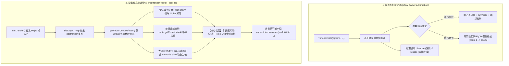
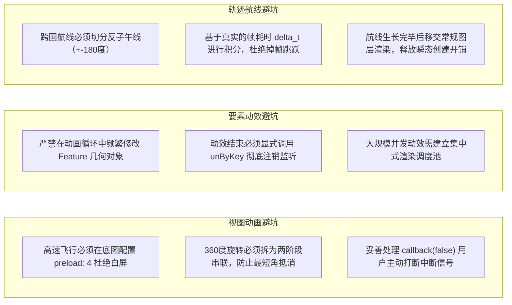

# OpenLayers 空间动效渲染与动态轨迹动画实战架构指南 (Spatial Animation & Dynamic Trajectory Architecture)

> 本指南基于 OpenLayers 官方 **animation** 核心专题群的代表性示例，深度解构 WebGIS 动态视效渲染管线。系统剖析 `view.animate()` 视图镜头动画引擎与两阶段飞行动画（FlyTo）视差模型、依托 `postrender` 渲染钩子与 `VectorContext` 瞬态画布实现的高性能雷达脉冲扩散、点要素沿折线（Polyline）轨迹时间积分平滑巡航，以及基于大圆航线（Great Circle）与跨国际日期变更线（$\pm 180^\circ$）切分的全球航空流向动效架构。

---

## 一、空间动效渲染管线全景架构 (Architectural Overview)

在现代 WebGIS 中，空间动效分为**相机视口级动画**与**图层要素级动效**两大分支。OpenLayers 依托底层的帧循环（Frame Loop）机制，提供了零数据污染的高性能动效管线：



---

## 二、视图级动画引擎 (`View.animate`) 深度解构

在电子地图中，机械突兀的中心瞬移会破坏用户的空间方位感。`view.animate()` 提供了流畅的镜头运镜能力。

### 1. 并行复合与串行链式组合
- **并行复合**：当单一对象中配置多个属性时，平移、缩放与旋转在同一时间窗口内同步并行插值。
- **串行链式**：将多个配置对象作为连续参数传入，OpenLayers 内部会自动排队按序执行：
  ```javascript
  // 串行执行两段动画
  view.animate(stage1Options, stage2Options);
  ```

### 2. 电影级起降飞行（FlyTo）视差原理
[`examples/animation.html`](file:///d:/Users/Downloads/openlayers/examples/animation.html) 中的 `flyTo` 巧妙利用视差深度模拟无人机航拍起降：
```javascript
function flyTo(location, done) {
  const duration = 2000;
  const zoom = view.getZoom();
  let parts = 2;
  let called = false;
  function callback(complete) {
    --parts;
    if (called) return;
    if (parts === 0 || !complete) {
      called = true;
      done(complete);
    }
  }
  // 1. 视口中心线性平移至目标城市（耗时 2000ms）
  view.animate({ center: location, duration: duration }, callback);
  // 2. 垂直高度两阶段缩放：前 1000ms 拉高巡航（zoom - 1），后 1000ms 俯冲着陆（zoom）
  view.animate(
    { zoom: zoom - 1, duration: duration / 2 },
    { zoom: zoom, duration: duration / 2 },
    callback
  );
}
```

### 3. 旋转最短弧度规避法则
OpenLayers 的旋转动画默认遵循**沿最短角弧度插值**。若目标角度设置为 `view.getRotation() + 2 * Math.PI`，系统计算起止角度差为 0，导致动画根本不发生旋转。
要完成完整的 360° 全景环绕旋转，**必须拆解为两个 $\pi$ 弧度的串行阶段**：
```javascript
const rotation = view.getRotation();
view.animate(
  { rotation: rotation + Math.PI, anchor: rome, easing: easeIn },
  { rotation: rotation + 2 * Math.PI, anchor: rome, easing: easeOut }
);
```

---

## 三、高性能要素动效范式 (`postrender` 与 VectorContext)

在传统 GIS 开发中，若通过每秒 60 次修改 `feature.getGeometry().setCoordinates()` 来驱动动画，每次修改都会导致矢量源（`VectorSource`）内部的 R-Tree 空间索引树推倒重建并触发图层全量重绘，导致 CPU 占用飙升并出现严重掉帧。

### 1. `postrender` 与 `VectorContext` 瞬态绘制
OpenLayers 提供了专为高帧率动效设计的通道：
1. 监听底层切片图层的 `postrender` 渲染完成事件：`tileLayer.on('postrender', animate)`；
2. 获取当前帧画布代理：`const vectorContext = getVectorContext(event)`；
3. 直接调用 `vectorContext.drawGeometry(transientGeom)` 绘制临时发光图形；
4. 调用 `map.render()` 自驱动请求下一帧（`requestAnimationFrame`）。

### 2. 雷达波纹扩散动效（Flash Wave）
在 [`examples/feature-animation.html`](file:///d:/Users/Downloads/openlayers/examples/feature-animation.html) 中，每次添加点位时启动动态光晕：
```javascript
function flash(feature) {
  const start = Date.now();
  const flashGeom = feature.getGeometry().clone();
  const listenerKey = tileLayer.on('postrender', animate);

  function animate(event) {
    const elapsed = event.frameState.time - start;
    if (elapsed >= duration) {
      unByKey(listenerKey); // 达到 3 秒生命周期后彻底注销，防止内存泄漏
      return;
    }
    const vectorContext = getVectorContext(event);
    const elapsedRatio = elapsed / duration;
    // 半径缓动扩展：5px -> 30px
    const radius = easeOut(elapsedRatio) * 25 + 5;
    // 不透明度递减：1.0 -> 0.0
    const opacity = easeOut(1 - elapsedRatio);

    vectorContext.setStyle(new Style({
      image: new CircleStyle({
        radius: radius,
        stroke: new Stroke({
          color: `rgba(255, 0, 0, ${opacity})`,
          width: 0.25 + opacity,
        }),
      }),
    }));
    vectorContext.drawGeometry(flashGeom);
    map.render();
  }
}
```

---

## 四、折线轨迹沿线运动与车辆巡航架构 (`Marker Animation`)

智慧物流、车联网监控与历史轨迹回放的核心是驱动车辆沿折线平滑行进。

[`examples/feature-move-animation.html`](file:///d:/Users/Downloads/openlayers/examples/feature-move-animation.html) 给出了工业级参考架构：

### 1. 折线高精度百分比插值 (`route.getCoordinateAt`)
`LineString.prototype.getCoordinateAt(fraction)` 接受一个 $0.0 \sim 1.0$ 的归一化比例值，内部自动对折线各分段进行累加并精准返回对应物理位置坐标，开发者无需手动计算复杂的折线各拐角向量。

### 2. 时间增量积分与往复模运算
为保证在不同硬件设备和不同刷新率屏幕（60Hz、120Hz、144Hz）上车辆行驶的物理速度恒定，位移计算必须基于每帧的**真实时间差（$\Delta t$）**进行积分：
$$\text{distance} = \left(\text{distance} + \frac{\text{speed} \times \Delta t}{10^6}\right) \bmod 2$$
- 当 $\text{distance} \in [0, 1]$ 时，车辆处于正向巡航；
- 当 $\text{distance} \in (1, 2)$ 时，车辆处于逆向折返，实际路径比例为 $2 - \text{distance}$。

### 3. “临时隐藏 + 帧代理”黄金性能模式
- 启动巡航时：`geoMarker.setGeometry(null)`，将要素实体从数据源中剥离；
- 巡航期间：每帧利用 `vectorContext.drawGeometry(position)` 绘制即时点位；
- 停止巡航时：`geoMarker.setGeometry(position)` 恢复要素数据实体。
这一技巧将动画期间的 CPU 运算量削减了 90% 以上！

---

## 五、大圆航线生成与全球航班飞行轨迹 (`Flight Animation`)

在展现跨国航空物流、全球航线网络等大屏可视化中，普通的平面直线无法反映真实的地球最短航线。

[`examples/flight-animation.html`](file:///d:/Users/Downloads/openlayers/examples/flight-animation.html) 展现了全球级航空流光动效：

### 1. 球面大圆劣弧（Great Circle）与反子午线切分
地球为旋转椭球体，两点间最短飞行路径是大圆弧线。在墨卡托投影中大圆弧线展现为拱形曲面。借助 `arc.js`：
```javascript
const arcGenerator = new arc.GreatCircle(
  { x: from[1], y: from[0] },
  { x: to[1], y: to[0] }
);
const arcLine = arcGenerator.Arc(100, { offset: 10 });
```
若航线横跨 $\pm 180^\circ$ 国际日期变更线（反子午线），`arc.js` 会自动切分为两段独立的几何折线，彻底杜绝横穿整幅世界地图的“贯穿拉线”Bug。

### 2. 动态切片与航迹生长 (`coords.slice`)
依据当前帧流逝时间计算已飞行的顶点数：
$$\text{maxIndex} = \min(\text{elapsedTime} \times \text{pointsPerMs}, \text{coords.length})$$
通过 `new LineString(coords.slice(0, maxIndex))` 截取子折线并上屏，呈现航迹从起点逐步向前推进生长的流光动态效果。

### 3. 多世界平铺无缝平移补偿（World Wrapping Offset）
当用户横向无级漫游地球时，视口中心所在的水平偏移为：
$$\text{offset} = \left\lfloor \frac{\text{center}_x}{\text{worldWidth}} \right\rfloor$$
通过在主世界与相邻副本世界中连续调用 `currentLine.translate(worldWidth, 0)` 绘制两遍，确保环球拖拽漫游时航线无论滑动到哪里都绝不断裂。

---

## 六、空间动效核心示例矩阵 (Examples Matrix)

| 示例文件与链接 | 技术切入点 | 核心 API / 关键配置 | 典型业务落地场景 |
| :--- | :--- | :--- | :--- |
| [`examples/animation.html`](file:///d:/Users/Downloads/openlayers/examples/animation.html) | 视图镜头多维动画 | `view.animate()`, `flyTo` 两阶段起降, 锚点旋转 | 智慧城市全景漫游、重大事件镜头聚焦特写、自动巡检演示 |
| [`examples/feature-animation.html`](file:///d:/Users/Downloads/openlayers/examples/feature-animation.html) | 矢量要素发光光晕 | `tileLayer.on('postrender')`, `getVectorContext(event)` | 突发火警定位、紧急事件高亮报警、新数据接入动态脉冲 |
| [`examples/feature-move-animation.html`](file:///d:/Users/Downloads/openlayers/examples/feature-move-animation.html) | 折线沿线连续巡航 | `Polyline.readGeometry`, `route.getCoordinateAt()`, 时间积分 | 车联网实时跟踪、外卖骑手轨迹回放、无人机巡线监控 |
| [`examples/flight-animation.html`](file:///d:/Users/Downloads/openlayers/examples/flight-animation.html) | 球面大圆航迹流线 | `arc.GreatCircle`, 跨 180° 切分, 多世界平铺补偿 | 国际客运航班大屏、跨国物流流向图、全球网络拓扑连线 |
| [`examples/animated-gif.html`](file:///d:/Users/Downloads/openlayers/examples/animated-gif.html) | 动图栅格帧播放 | `ol/style/Icon`, GIF 帧解码同步 | 天气雷达拼图、动态风暴眼演进、卡通动图地标 |

---

## 七、生产级工程避坑指南 (Production Pitfalls Checklist)



1. **底图瓦片预加载（Preload）与防白屏**：
   在高速长距离执行 `flyTo` 或全景旋转时，若未在底图图层配置 `preload`，由于高分辨率切片下载需要数十毫秒至数百毫秒，视口边缘极易呈现大片空白。配置 `preload: 4` 能命令底层预缓存多级低清金字塔切片作为平滑衬底，大幅提升视觉品质。
2. **海量点位并发动画的性能塌陷**：
   在监控上千个报警点时，切勿为每个点要素单独注册 `tileLayer.on('postrender')`，这会导致每帧执行上千次函数调用。正确做法是维护一个单一全局的 `ActiveAnimationPool`，注册唯一一个 `postrender` 监听函数，在一次循环中完成所有活动要素的批量绘制。
3. **跨越国际日期变更线（$\pm 180^\circ$）的航线拉扯**：
   从北京（东经）飞往旧金山（西经）的航班必然穿越反子午线。如果直接将起点与终点连接为一条折线，墨卡托投影会沿顺时针方向横穿整个欧亚大陆与大西洋绘制一条贯穿全球的长直线。必须使用 `arc.js` 进行经度断点切分，分为东西两半球各自独立的折线段分别渲染。
