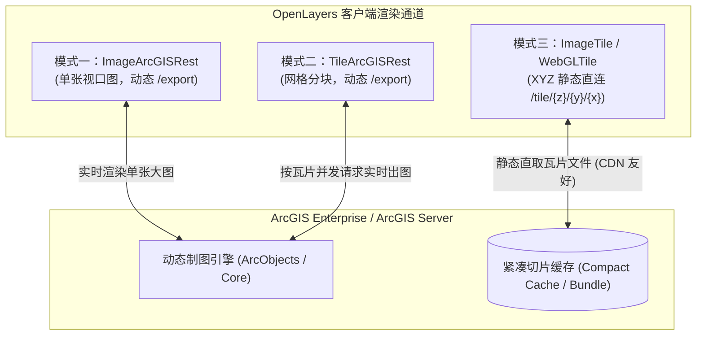
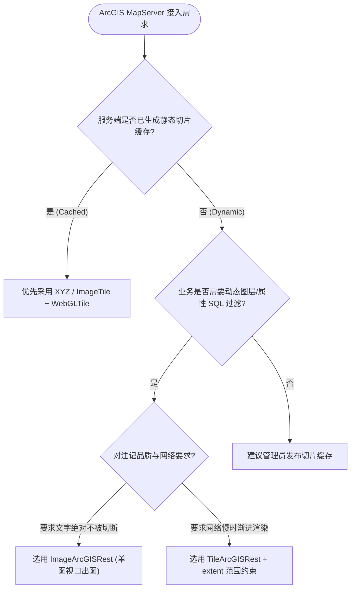

# Esri ArcGIS REST 地图服务集成与切片加速实战架构指南

> 在企业级 GIS、数字孪生、智慧城市以及自然资源信息化平台中，**Esri ArcGIS Enterprise / ArcGIS Server** 是应用最为广泛的工业级空间地理服务器之一。ArcGIS 对外提供了丰富的 REST 风格服务接口（包括 `MapServer`、`ImageServer`、`FeatureServer`）。
>
> OpenLayers 原生深度适配了 Esri ArcGIS REST 协议规范，并针对不同的网络延迟、服务器算力与交互场景提供了三种截然不同的接入范式：**视口动态单图出图（`ImageArcGISRest`）**、**动态分块瓦片导出（`TileArcGISRest`）**以及**预切片高速直连（`XYZ / WebGLTile`）**。本文基于 3 个核心官方示例，系统解构三种集成方案的底层实现原理、性能特征与生产工程选型实践。

---

## 1. 架构总览：ArcGIS REST 服务与 OpenLayers 的三大接入范式

### 1.1 三种接入模式的架构拓扑对比



### 1.2 方案选型综合特征对照表

| 维度 / 模式 | 单张动态图 (`ImageArcGISRest`) | 瓦片化动态图 (`TileArcGISRest`) | 紧凑切片直连 (`XYZ / ImageTile`) |
| :--- | :--- | :--- | :--- |
| **对应图层** | `ol/layer/Image` | `ol/layer/Tile` | `ol/layer/WebGLTile` / `ol/layer/Tile` |
| **底层请求接口** | `/MapServer/export?bbox=...&size=...` | `/MapServer/export?bbox=...` (瓦片网格) | `/MapServer/tile/{z}/{y}/{x}` |
| **服务端处理** | 每次平移/缩放实时空间查询与渲染 | 针对每个瓦片实时空间查询与渲染 | 零动态计算，静态文件分发 |
| **客户端展现** | 整屏单张图像无缝呈现 | 渐进式方块拼接加载 | GPU 毫秒级极速渲染（60 FPS） |
| **注记文本表现** | 完美连续、无拼接截断 | 瓦片接缝处可能截断或重复 | 依赖预切片时的固定注记排版 |
| **动态参数过滤** | 原生支持 `LAYERS`, `LAYERDEFS`, `TIME` | 原生支持 `LAYERS`, `LAYERDEFS`, `TIME` | **不支持**（切片为静态烘焙产物） |
| **服务器负载** | 中等（随用户缩放平移单次请求） | 较高（单次平移触发十几个 export 请求） | 极低（CDN 轻松承载数万人并发） |

---

## 2. 动态地图服务出图（`ImageArcGISRest`）

在 `arcgis-image.html` 中，通过单张图片图层承载动态 MapServer：

```javascript
import ImageLayer from 'ol/layer/Image';
import ImageArcGISRest from 'ol/source/ImageArcGISRest';

const imageryLayer = new ImageLayer({
  source: new ImageArcGISRest({
    ratio: 1, // 视口宽高比匹配系数
    params: {
      LAYERS: 'show:0,1,2',              // 仅显示特定子图层
      LAYERDEFS: '{"0": "STATE_NAME = \'California\'"}', // 动态 SQL 属性过滤
      FORMAT: 'png32',
      TRANSPARENT: true,
    },
    url: 'https://sampleserver6.arcgisonline.com/ArcGIS/rest/services/USA/MapServer',
  }),
});
```

### 2.1 动态出图请求机制解析
每次地图视口变化完成（`moveend`）时，OpenLayers 会自动计算当前屏幕像素的物理外接矩形，向服务端派发如下标准的 HTTP GET 请求：

$$\text{Request URL} = \text{url} + \text{/export?} \text{bbox}=\text{minx,miny,maxx,maxy} \& \text{size}=\text{w,h} \& \text{f}=\text{image} \& \text{dpi}=96$$

### 2.2 `ratio` 参数的平滑度权衡
- `ratio: 1`：请求图片尺寸严格等于 `<div id="map">` 像素尺寸，网络载荷最小，但稍微拖拽平移就会露出白边；
- `ratio: 1.5`：请求外扩 1.5 倍尺寸的图片，地图周围缓存有半屏图像，在轻微拖拽时无缝漫游，体验更优。

---

## 3. 瓦片化动态请求（`TileArcGISRest`）与范围约束

在 `arcgis-tiled.html` 中，针对没有预生成切片但希望获得“并发渐进加载”的动态服务，采用了 `TileArcGISRest`：

```javascript
import TileLayer from 'ol/layer/Tile';
import TileArcGISRest from 'ol/source/TileArcGISRest';

const tiledArcGIS = new TileLayer({
  // 关键：严格约束请求的空间包围盒，杜绝全球范围无效出图
  extent: [-13884991, 2870341, -7455066, 6338219],
  source: new TileArcGISRest({
    url: 'https://sampleserver6.arcgisonline.com/ArcGIS/rest/services/USA/MapServer',
  }),
});
```

### 3.1 空间包围盒范围约束（`extent`）的工程必要性
动态 MapServer 在全球尺度下若未加 `extent` 约束，用户在非洲或南极洲漫游时，OpenLayers 依然会向服务器请求成百上千个空白瓦片的 `/export`。
设置 `extent` 后，OpenLayers 渲染引擎会自动剔除范围外的切片请求，避免由于无意义的空请求将 ArcGIS Server 的 SOC（Server Object Container）进程池占满。

---

## 4. 预切片紧凑缓存直连（`XYZ / ImageTile`）与 WebGL 加速

在 `xyz-esri.html` 中，展示了加载已切片缓存的最佳实践：

```javascript
import Map from 'ol/Map';
import View from 'ol/View';
import WebGLTileLayer from 'ol/layer/WebGLTile';
import ImageTileSource from 'ol/source/ImageTile';
import {useGeographic} from 'ol/proj';

useGeographic();

const map = new Map({
  target: 'map',
  layers: [
    new WebGLTileLayer({
      source: new ImageTileSource({
        // 标准 ArcGIS REST 切片模板 /tile/{z}/{y}/{x}
        url: 'https://server.arcgisonline.com/ArcGIS/rest/services/World_Topo_Map/MapServer/tile/{z}/{y}/{x}',
      }),
    }),
  ],
  view: new View({
    center: [-121.1, 47.5],
    zoom: 7,
  }),
});
```

### 4.1 GPU 硬件加速管线
`WebGLTileLayer` 直接将每个从 CDN 拉取的 256×256 瓦片转换为 GPU 纹理显存，在缩放平移时通过顶点着色器（Vertex Shader）与片元着色器执行无极仿射过渡变换，帧率稳定在 60 FPS，彻底消除传统 DOM/Canvas 瓦片更新时的白色闪烁。

---

## 5. 生产避坑指南与常见故障排查

### 5.1 自定义切片方案（TileGrid）原点不一致导致的 404 与错位
- **现象**：加载私有部署的 ArcGIS MapServer 切片时，控制台频繁抛出大量瓦片 404，或者地图地物严重错位分裂。
- **根因**：Esri 公开底图（如 Topo、Imagery）默认采用标准 Web 墨卡托原点 `[-20037508.34, 20037508.34]`。但许多国内单位或特定投影的自建切片，原点可能是自定义坐标（例如以地方城市中心为原点）。
- **解法**：在加载前通过浏览器访问 `https://<server>/MapServer?f=pjson`，查看其 `tileInfo` 对象：
  ```javascript
  import TileGrid from 'ol/tilegrid/TileGrid';

  const tileGrid = new TileGrid({
    origin: [tileInfo.origin.x, tileInfo.origin.y],
    resolutions: tileInfo.lods.map(lod => lod.resolution),
    tileSize: [tileInfo.rows, tileInfo.cols],
  });

  const source = new ImageTileSource({
    url: '.../MapServer/tile/{z}/{y}/{x}',
    tileGrid: tileGrid,
  });
  ```

### 5.2 Token 动态鉴权安全拦截
- **现象**：专网 ArcGIS 资源返回 HTTP 498（Invalid Token）或 499（Token Required）。
- **解法**：在 URL 末尾附加 `?token={token}`，或者利用 `tileLoadFunction` 注入请求头：
  ```javascript
  source.setTileLoadFunction((imageTile, src) => {
    fetch(src, {
      headers: {Authorization: `Bearer ${getArcGISToken()}`},
    })
      .then(res => res.blob())
      .then(blob => {
        imageTile.getImage().src = URL.createObjectURL(blob);
      });
  });
  ```

---

## 6. 决策指南：三维选型决策树


