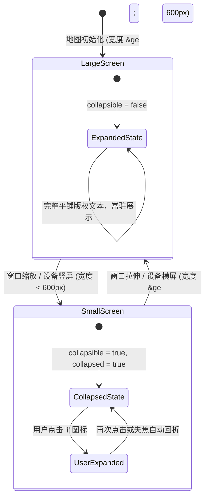
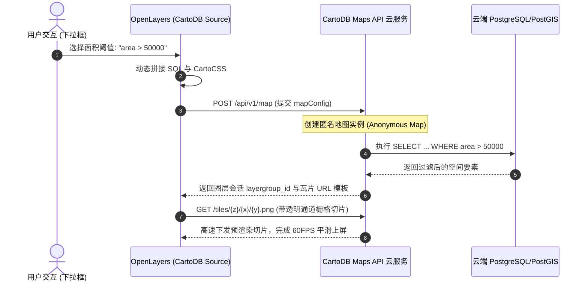

# OpenLayers 版权署名合规控制与云端空间数据服务实战架构指南

> 在企业级 WebGIS 与地理空间中台落地中，数据安全合规与空间大数据的高性能渲染是两个极其关键的核心议题：
> 1. **法律合规与移动端有限视口的平衡（Attribution Collapsing）**：无论是开源数据（OpenStreetMap）还是商业供应商（Mapbox、Google、ESRI），协议均强制要求标注版权。如何在桌面端充分展示完整法律信息，而在小屏移动端优雅收拢为极简图标，避免遮挡业务视口？
> 2. **平台主权与常驻版权解耦（Static Attribution）**：如何将企业自身的平台版权、免责声明或 ICP 备案号注入地图，使其独立于业务图层的加载、隐藏与切换，实现永不消失的合规常驻？
> 3. **云原生空间数据库动态切片（Cloud CartoDB & Maps API）**：面对数百万级海量空间多边形，直接向前端拉取 GeoJSON 会导致浏览器崩溃。如何借助云端 PostGIS 引擎完成动态 SQL 空间过滤与 CartoCSS 服务端渲染，并在前端以毫秒级热更新切片？
>
> 本文基于 3 个核心官方示例（`attributions.html`、`static-attribution.html`、`cartodb.html`），深度剖析版权控件的响应式状态机、静态合规声明以及云端动态切片服务的核心架构。

---

## 1. 架构总览：版权归属体系与云端渲染管线

OpenLayers 设计了高度解耦的版权收集渲染机制与空间数据驱动源：

```mermaid
graph TD
    subgraph DataSources["空间数据源图层 (Sources)"]
        OSMSource["OSM Source<br/>(动态提供 &copy; OpenStreetMap)"]
        CartoSource["CartoDB Source<br/>(云端 Maps API 切片 + 版权)"]
        BusinessSource["业务要素图层<br/>(动态可见性 visible)"]
    end

    subgraph AttributionEngine["版权归属合规引擎 (ol/control/Attribution)"]
        DynamicCollector["动态图层版权收集器<br/>(仅收集当前可见图层的版权)"]
        StaticConfig["静态常驻版权<br/>(attributions 选项，独立于图层)"]
        ResponsiveState["响应式状态机<br/>(setCollapsible / setCollapsed)"]
    end

    subgraph CloudEngine["云原生空间数据库服务 (CARTO / PostGIS)"]
        Config["mapConfig (CartoCSS + SQL 查询)"]
        CloudPostGIS["云端 PostGIS 空间过滤与栅格化切片"]
        Token["匿名地图会话协商 (Instantiation Token)"]
    end

    OSMSource -->|可见时贡献版权| DynamicCollector
    CartoSource -->|动态切片流| DynamicCollector
    DynamicCollector --> ResponsiveState
    StaticConfig --> ResponsiveState
    ResponsiveState -->|视口宽度 < 600px 折叠为 'i'| MapView["地图视口 UI (右下角)"]

    Config -->|setConfig(mapConfig)| CartoSource
    CartoSource <-->|HTTP POST 协商 Token| CloudEngine
    CloudPostGIS -->|生成 WebP/PNG 瓦片流| CartoSource
```

### 1.1 三大核心技术模式对比

| 模式 / 维度 | 响应式自适应折叠 | 静态常驻版权声明 | 云端空间数据切片 |
| :--- | :--- | :--- | :--- |
| **典型示例** | `attributions.html` | `static-attribution.html` | `cartodb.html` |
| **核心 API** | `attribution.setCollapsible()`, `change:size` | `new Attribution({ attributions })` | `new CartoDB()`, `setConfig()` |
| **生命周期依赖** | 依赖地图 DOM 容器像素尺寸 | 绑定控件自身，完全与图层显隐解耦 | 依赖云端 Maps API 实例协商生命周期 |
| **渲染形态** | 桌面端文本展开 / 移动端 "i" 图标 | 常驻在原生控件内，与图层版权合并 | 透明 PNG/WebP 栅格切片覆盖层 |
| **核心业务价值** | 满足商用底图法律合规同时优化移动端体验 | 统一平台 ICP 备案与法律资质，零冗余 DOM | 海量多边形服务端渲染，毫秒级 SQL 过滤 |

---

## 2. 响应式版权折叠状态机（`attributions.html`）

### 2.1 移动端断点与动态折叠原理

商业地图协议（如 OSM ODbL 协议）要求必须显式声明数据提供方。如果在移动设备上直接平铺文字，会遮挡比例尺与大量地图要素。
`ol/control/Attribution` 内置了折叠器状态机，通过对外暴露的 `setCollapsible` 和 `setCollapsed` 方法，开发者可以在任意时刻按需控制：



### 2.2 核心代码实现

为了防止与 OpenLayers 默认自带的 Attribution 控件发生冲突，必须先在 `defaultControls({ attribution: false })` 中显式关闭默认项，再注入自定义控件：

```javascript
// 1. 初始化自定义版权控件
const attribution = new Attribution({
  collapsible: false,
});

// 2. 禁用默认版权控件并接入自定义实例
const map = new Map({
  layers: [new TileLayer({ source: new OSM() })],
  controls: defaultControls({ attribution: false }).extend([attribution]),
  target: 'map',
  view: new View({ center: [0, 0], zoom: 2 }),
});

// 3. 响应式断点检测器
function checkSize() {
  const small = map.getSize()[0] < 600;
  attribution.setCollapsible(small);
  attribution.setCollapsed(small);
}

// 4. 监听视口尺寸变更
map.on('change:size', checkSize);
checkSize();
```

---

## 3. 静态常驻版权与图层解耦（`static-attribution.html`）

### 3.1 为什么需要与图层解耦的常驻版权？

默认情况下，`Attribution` 控件内的版权说明是**动态收集**的：
$$\text{RenderedAttributions} = \bigcup_{layer \in \text{VisibleLayers}} \text{layer.getSource().getAttributions()}$$
当用户在图层管理器中隐藏所有图层（例如执行底图切换或进入纯白白板标绘模式）时，动态收集到的版权为空，导致右下角的版权栏彻底消失。

如果系统需要展示**平台自身的运营主体信息、ICP 备案号或免责提示**，就必须将版权从图层中剥离。

### 3.2 静态 HTML 注入与验证

通过直接向 `Attribution` 构造函数传递 `attributions` 属性，声明一个全局静态条目：

```javascript
// 注入不受任何图层显隐影响的常驻版权
const attribution = new Attribution({
  collapsible: false,
  attributions: `<a href="https://openlayers.org">I'm a static attribution. I never disappear</a>`,
});

// 即使隐藏全部图层，静态版权依然牢固渲染在 DOM 中
document.getElementById('toggleLayerButton').addEventListener('click', () => {
  map.getLayers().forEach((l) => {
    l.setVisible(!l.getVisible());
  });
});
```

---

## 4. 云原生 CartoDB 空间数据源与动态 SQL 过滤（`cartodb.html`）

### 4.1 空间大数据切片渲染流水线

在处理大规模矢量数据（如全欧洲所有行政区划多边形）时，前端若加载完整的 GeoJSON，网络包体积往往数十兆，解析与 Canvas 绘制极易引起主线程崩溃。
CARTO（原 CartoDB）提供了服务端矢量动态栅格化方案：



### 4.2 配置热重载模式（`setConfig`）

当用户切换过滤条件时，无需销毁图层，直接调用 `setConfig()` 即可触发静默热更新：

```javascript
// CartoDB 声明式配置
const mapConfig = {
  layers: [
    {
      type: 'cartodb',
      options: {
        cartocss_version: '2.1.1',
        cartocss: '#layer { polygon-fill: #F00; }', // 红色填充
      },
    },
  ],
};

function setArea(n) {
  mapConfig.layers[0].options.sql =
    'select * from european_countries_e where area > ' + n;
}

const cartoDBSource = new CartoDB({
  account: 'documentation',
  config: mapConfig,
});

// 监听下拉菜单，更新 SQL 并热更切片
areaSelect.addEventListener('change', function () {
  setArea(this.value);
  cartoDBSource.setConfig(mapConfig); // 触发与云端重新协商切片
});
```

---

## 5. 生产实践踩坑与性能调优指南

### 5.1 XSS 跨站脚本防御与 HTML 转义

`Attribution` 控件原生支持渲染 HTML 字符串（包括超链接 `<a>`、商标图标 `` 等）。如果版权信息来源于不可信的第三方 WMS/WMTS GetCapabilities XML 描述，或者由后端管理系统动态配置下发，攻击者可能通过构造恶意的 `<script>` 或 `` 进行 XSS 攻击。
**防御准则**：
- 在向 `attributions` 属性传值前，必须经过 DOMPurify 或白名单过滤，只允许包含 `target="_blank"` 的安全锚点标签；
- 禁止向其中注入未经转义的动态查询参数。

### 5.2 默认控件重复注入的“幽灵双版权”问题

新手最容易犯的错误是在添加自定义 Attribution 控件时，忘记在 `defaultControls` 中关闭默认控件：
```javascript
// ❌ 错误做法：导致地图右下角同时挂载两个版权控件，样式重叠错乱
controls: defaultControls().extend([myAttribution])

// ✅ 正确做法：显式关闭默认项，由自定义实例接管
controls: defaultControls({ attribution: false }).extend([myAttribution])
```

### 5.3 匿名地图（Anonymous Maps）的 SQL 防注入与配额限制

在前端拼接 CartoDB SQL 查询时：
- **参数强类型校验**：必须通过 `Number(n)` 或 `parseInt(n, 10)` 进行数字转换，严禁直接拼接未经校验的用户输入字符串；
- **只读权限约束**：云端数据库租户空间必须设定严格的只读角色（`SELECT` 权限），禁用任何 `UPDATE`、`DELETE` 或 DDL 操作；
- **切片缓存控制**：利用 `TileLayer` 的 `transition: 200` 配置，确保在 `setConfig()` 热重载期间新旧切片平滑过渡，避免白屏闪烁。
