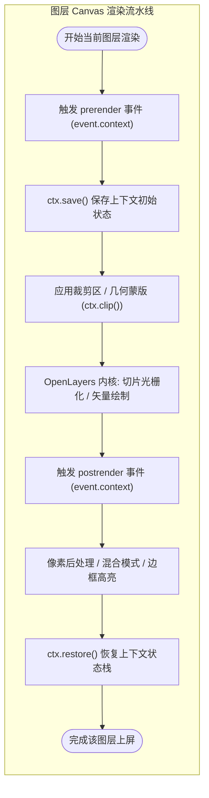
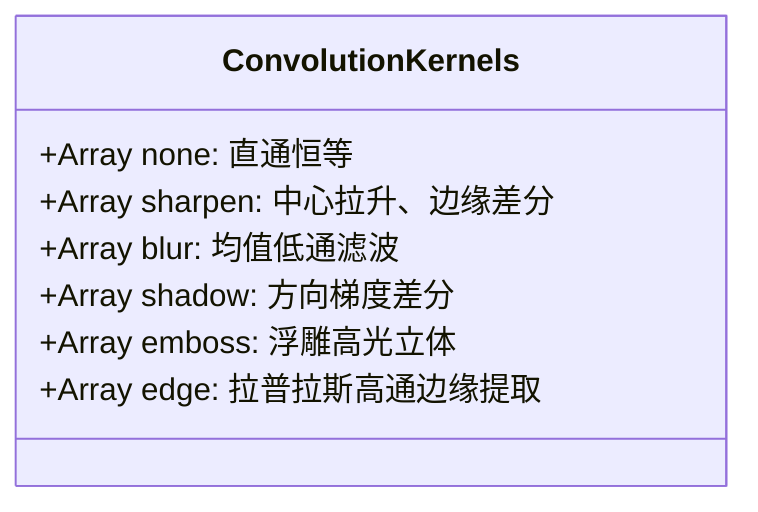
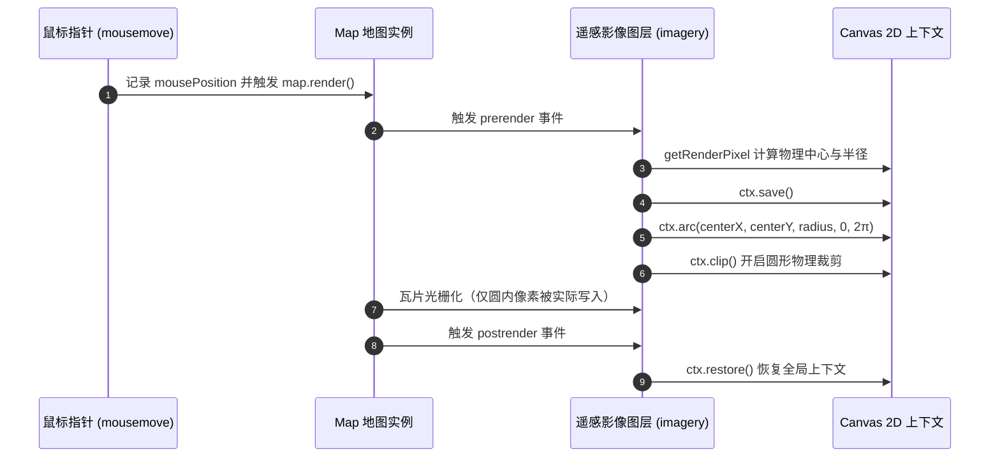
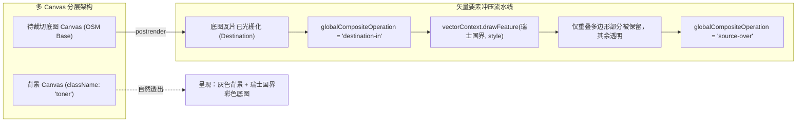

# OpenLayers Canvas 视口裁剪、透镜卷帘与像素滤镜实战架构指南

> 在空间数据可视化工程中，除了常规的矢量标注与切片贴图，开发者常常需要实现高阶的视觉交互效果——例如**双时相影像卷帘对比（Layer Swipe）**、**特定行政区划多边形蒙版裁切（Vector Mask Clipping）**、**局部圆形探照灯（Spyglass）**、**像素放大镜（Magnify）**以及**空间卷积图像滤镜（锐化/高斯模糊/浮雕/边缘检测）**。
>
> OpenLayers 拥有深厚而优雅的 Canvas 渲染拦截能力。通过在图层或地图的 `prerender` 与 `postrender` 生命周期钩子中接管底层的 HTML5 Canvas 2D 上下文，开发者无需侵入底层的渲染矩阵，即可在 GPU 像素上屏前后以极高帧率实施任意几何剪切、混合模式变换与像素重采样。本文基于 6 个核心官方示例，全面解构这一技术体系的底层架构与生产实践。

---

## 1. 架构总览：OpenLayers 渲染管线与 Canvas 拦截钩子

### 1.1 `prerender` 与 `postrender` 的执行拓扑

OpenLayers 的图层渲染并不是一个黑盒，而是为每个渲染通道提供了前置（`prerender`）与后置（`postrender`）拦截点：



### 1.2 核心事件参数解析

在事件回调函数中，`event` 包含了至关重要的绘图上下文与几何变换元数据：
- `event.context`：当前图层绑定的 `CanvasRenderingContext2D` 对象；
- `event.inversePixelTransform`：当前视口所应用的仿射逆变换矩阵 $[a, b, c, d, e, f]$，用于解构物理像素比与视口旋转角；
- `getRenderPixel(event, cssPixel)`：OpenLayers 提供的标准工具函数，负责将 DOM/CSS 逻辑像素换算为高分屏（Retina / HiDPI）上的 Canvas 物理像素。

---

## 2. 空间卷积核图像滤镜与 CPU 像素后处理

在 `image-filter.html` 示例中，遥感卫星影像在光栅化完成后，通过 `postrender` 拦截器接管像素缓冲区，应用 $3 \times 3$ 空间卷积核进行数字图像处理。

### 2.1 二维离散卷积数学模型

图像空间卷积通过一个加权矩阵（Kernel）滑过整张图像。对于输出图像中的每个像素 $(x, y)$，其各通道（R、G、B）由自身及周围邻近像素的加权和决定：

$$I_{\text{out}}(x, y) = \sum_{j=-1}^{1} \sum_{i=-1}^{1} I_{\text{in}}(x + i, y + j) \cdot K(i + 1, j + 1)$$



### 2.2 能量守恒与权重归一化算法

当卷积核权值之和 $\sum K > 0$ 时，必须将各元素除以总和以保持整体图像总亮度不变：

```javascript
function normalize(kernel) {
  const len = kernel.length;
  const normal = new Array(len);
  let sum = 0;
  for (let i = 0; i < len; ++i) {
    sum += kernel[i];
  }
  if (sum <= 0) {
    normal.normalized = false;
    sum = 1; // 边缘检测算子总和通常为 0，保留绝对梯度差
  } else {
    normal.normalized = true;
  }
  for (let i = 0; i < len; ++i) {
    normal[i] = kernel[i] / sum;
  }
  return normal;
}
```

---

## 3. 动态交互透镜：探照灯（Spyglass）与局部放大镜（Magnify）

透镜效果通过将用户的鼠标指针位置转换为局部关注区，实现不同图层间的无缝穿透或细节倍增。

### 3.1 图层探照灯：`prerender` 阶段的圆形裁切蒙版

在 `layer-spy.html` 中，底图为矢量路网（`roads`），上层为遥感影像（`imagery`）。遥感影像图层通过在渲染前设置圆形剪切区，仅在光标周围暴露卫星影像：



### 3.2 局部放大镜：`postrender` 阶段的 $2\times$ 极坐标超采样

在 `magnify.html` 中，通过在 `postrender` 中截取光标周围 $size \times size$ 的局部图像矩形，并利用极坐标欧氏距离判断是否在透镜圆内。圆内像素采用 $2\times$ 倍率反向映射采样，从而形成光学放大镜效果：

$$\Delta i = i - half, \quad \Delta j = j - half, \quad dist = \sqrt{\Delta i^2 + \Delta j^2}$$

$$sourceI = \begin{cases} \text{round}\left(half + \frac{\Delta i}{2}\right) & dist < half \\ i & dist \ge half \end{cases}$$

---

## 4. 几何蒙版裁切：贝塞尔心形与 GeoJSON 矢量边界冲压

### 4.1 逆像素变换矩阵与屏幕空间心形裁切

在 `layer-clipping.html` 中，为了让爱心蒙版端正居中地固定在屏幕正中央，即便地图发生平移或旋转也不会晃动，必须利用逆像素变换矩阵（`event.inversePixelTransform`）提取视口参数：

$$\text{canvasPixelRatio} = \sqrt{a^2 + b^2}, \quad \text{canvasRotation} = -\text{atan2}(b, a)$$

通过在 `prerender` 中逆向平移到中心、反向旋转视口角度，并执行贝塞尔路径裁切：

```javascript
osm.on('prerender', function (event) {
  const ctx = event.context;
  const matrix = event.inversePixelTransform;
  const canvasPixelRatio = Math.sqrt(matrix[0] * matrix[0] + matrix[1] * matrix[1]);
  const canvasRotation = -Math.atan2(matrix[1], matrix[0]);

  ctx.save();
  // 1. 移动至画布中心并抵消地图旋转
  ctx.translate(ctx.canvas.width / 2, ctx.canvas.height / 2);
  ctx.rotate(-canvasRotation);

  // 2. 缩放至心形局部坐标系并绘制贝塞尔曲线
  ctx.scale(3 * canvasPixelRatio, 3 * canvasPixelRatio);
  ctx.translate(-75, -80);
  ctx.beginPath();
  // ...绘制心形三次贝塞尔曲线...
  ctx.clip(); // 执行裁切

  // 3. 撤销局部变换并恢复原始上下文矩阵
  ctx.translate(75, 80);
  ctx.scale(1 / 3 / canvasPixelRatio, 1 / 3 / canvasPixelRatio);
  ctx.rotate(canvasRotation);
  ctx.translate(-ctx.canvas.width / 2, -ctx.canvas.height / 2);
});
```

### 4.2 多 Canvas 隔离与 `destination-in` 矢量冲压裁切

在 `layer-clipping-vector.html` 中，需求是将底图裁切为**瑞士国界**的复杂行政区划多边形：



> [!IMPORTANT]
> **多 Canvas 强制隔离法则**：OpenLayers 默认将同类型的瓦片图层合并在单一共享 Canvas 中。若未显式为背景图层配置 `className: 'toner'`，背景图层与待裁切底图将绘制在同一画布上，执行 `destination-in` 会连同背景图层一并裁切成空白！

---

## 5. 交互式图层卷帘（Layer Swipe）工程实践

在 `layer-swipe.html` 中，利用滑动输入条（Range Input）动态调节视口矩形裁切分界线：

```javascript
aerial.on('prerender', function (event) {
  const ctx = event.context;
  const mapSize = map.getSize();
  const width = mapSize[0] * (Number(swipe.value) / 100);

  // 关键：必须换算为高分屏物理像素坐标
  const tl = getRenderPixel(event, [width, 0]);
  const tr = getRenderPixel(event, [mapSize[0], 0]);
  const bl = getRenderPixel(event, [width, mapSize[1]]);
  const br = getRenderPixel(event, mapSize);

  ctx.save();
  ctx.beginPath();
  ctx.moveTo(tl[0], tl[1]);
  ctx.lineTo(bl[0], bl[1]);
  ctx.lineTo(br[0], br[1]);
  ctx.lineTo(tr[0], tr[1]);
  ctx.closePath();
  ctx.clip(); // 右半侧可见
});

aerial.on('postrender', function (event) {
  event.context.restore();
});
```

---

## 6. 生产环境避坑指南与工程规范

### 6.1 状态栈泄漏导致的全图黑屏或空白
- **问题**：在 `prerender` 中调用了 `ctx.save()`，但在 `postrender` 中未执行 `ctx.restore()`（或代码抛错导致中断）。
- **后果**：Canvas 内部的状态栈不断压栈，且局域 `clip()` 遮罩持续收缩，最终导致整张地图无法绘制任何内容。
- **最佳实践**：成对编写 `save()` 与 `restore()`，在可能抛出异常的复杂逻辑外使用 `try ... finally` 确保 `restore()` 百分之百执行。

### 6.2 跨域画布污染（CORS Taint）
- **问题**：在执行 `getImageData()` 时控制台报错 `SecurityError: The canvas has been tainted by cross-origin data`。
- **排查**：切片瓦片服务必须支持 CORS，且 HTTP 响应头必须包含 `Access-Control-Allow-Origin: *`。
- **规范**：使用标准瓦片提供商时，确认数据源构造选项支持跨域凭据。

### 6.3 高分屏（Retina / HiDPI）像素坐标错位
- **问题**：在 MacBook、高分显示器或移动端，探照灯透镜偏移或卷帘分界线不在鼠标指定位置。
- **根因**：直接使用了 CSS 逻辑像素进行 Canvas 路径绘制，未乘以 `window.devicePixelRatio`。
- **解决**：永远使用 `getRenderPixel(event, cssCoord)` 处理一切传递给 Canvas 上下文的坐标与半径。

### 6.4 视口边缘采样越界保护
- **问题**：当鼠标移至地图视口边缘时，放大镜提取区域越界抛出 `IndexSizeError`。
- **解决**：计算采样子矩形时必须使用 `Math.max(0, ...)` 与 `Math.min(canvas.width, ...)` 实施保护。

---

## 7. 核心 API 与技术方案选型对比表

| 特性 / 模式 | 核心技术方案 | 适用生命周期钩子 | 优势 | 适用业务场景 |
| :--- | :--- | :--- | :--- | :--- |
| **空间卷积滤镜** | `getImageData` + 卷积核加权 | `postrender` | 像素级可编程、效果丰富 | 影像边缘提取、清晰度增强、浮雕特效 |
| **探照灯（Spyglass）** | `ctx.arc()` + `ctx.clip()` | `prerender` / `postrender` | 纯几何裁切、开销极低、无缝透视 | 双时相影像地物对比、地下管网透视 |
| **局部放大镜（Magnify）** | 局部矩形截取 + 极坐标映射 | `postrender` | 无需加载额外切片即可局部放大 | 标本细节检查、密集点云与细小路网微观查看 |
| **几何蒙版裁切** | 贝塞尔路径 / SVG + 逆矩阵抵消 | `prerender` / `postrender` | 屏幕空间固定、不受地图旋转影响 | 趣味地图、艺术遮罩、圆形航海图 |
| **矢量要素冲压** | `destination-in` + `className` 隔离 | `postrender` | 严格匹配地理多边形（如国界/省界） | 行政区划白模剔除、特定范围专题图制作 |
| **双图层卷帘对比** | 矩形多边形 `ctx.clip()` | `prerender` / `postrender` | 极高帧率（60FPS）、零网络额外负载 | 灾前灾后卫星影像对比、规划图与现状图对比 |
