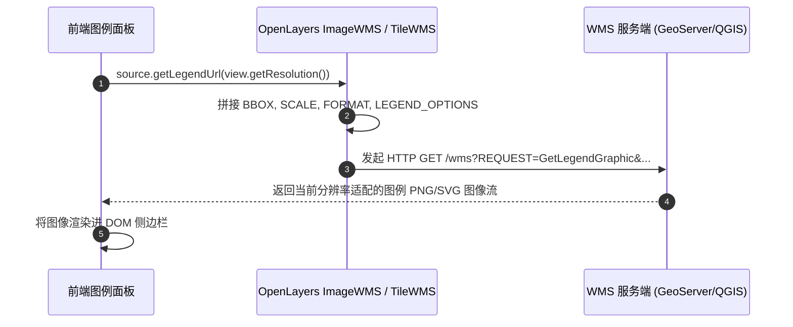

<nav aria-label="breadcrumb"><ol class="breadcrumb mb-4"><li class="breadcrumb-item"><a href="../">Home</a></li><li class="breadcrumb-item"><a href="./">Summary</a></li><li class="breadcrumb-item active" aria-current="page">制图控件、动态图例与提示指南</li></ol></nav>

# OpenLayers 地图制图辅助控件、动态图例与浮动提示实战指南

> 一幅标准的出版级或专业级工程地图，除了基础底图与空间要素外，不可或缺的是**制图辅助要素（Cartographic Elements）**：包括表明空间尺度的**比例尺（ScaleLine）**、解释符号含义的**动态图例（Legend Graphic）**、指示地理方位的**指北针**、以及提供人机交互反馈的**浮动提示（Tooltips & Titles）**。
>
> 在 WebGIS 开发中，开发者常遇到三大痛点：
> 1. Web 墨卡托投影在高纬度形变严重，导致默认比例尺计算出的物理距离严重失真；
> 2. 服务端发布的 OGC WMS 图层样式复杂，纯前端手工绘制图例极易与服务端出图脱节；
> 3. 地图上的按钮与悬浮要素缺乏无障碍（A11y）说明与顺滑的悬停提示。
>
> 本文基于 5 个核心官方示例，系统解构专业地图辅助制图体系、投影变形校准算法与图元提示的最佳实践。

---

## 1. 架构总览：5 个制图控件与图例提示核心官方示例矩阵

| 分类 | 示例标识 | 核心技术机制 | 解决的典型生产场景 |
| :--- | :--- | :--- | :--- |
| **WMS 动态图例获取** | [`wms-getlegendgraphic`](../en/latest/examples/wms-getlegendgraphic.html) | `source.getLegendUrl(resolution)` 动态请求服务端图例 | 地质调查、土地利用分类等复杂符号化图层的动态图例同步 |
| **通用比例尺控件** | [`scale-line`](../en/latest/examples/scale-line.html) | `ScaleLine` 控件 + `units: 'metric' / 'nautical' / 'imperial'` | 网页地图标配物理尺度条，支持公制（km/m）与海里切换 |
| **局部高精测绘比例尺** | [`scaleline-indiana-east`](../en/latest/examples/scaleline-indiana-east.html) | 结合本地高斯/UTM/州平面投影校正变形系数 | 地方高精测绘与市政规划中的厘米级比例尺精确度量 |
| **控件无障碍标题** | [`button-title`](../en/latest/examples/button-title.html) | 控件 DOM `title` 属性与屏幕阅读器 ARIA 标签 | 政府与公共事业系统合规的 Web 可访问性（WCAG/A11y）建设 |
| **鼠标悬停属性气泡** | [`tooltip-on-hover`](../en/latest/examples/tooltip-on-hover.html) | `pointermove` + `forEachFeatureAtPixel` + `Overlay` | 鼠标滑过地块/管线时毫秒级显示名称、流速等轻量提示条 |

---

## 2. OGC WMS 动态图例提取体系（`wms-getlegendgraphic`）

### 2.1 为什么手工维护前端图例不可持续？

在大型 GIS 系统中，服务端（如 GeoServer、MapServer、ArcGIS Server）配置了极其复杂的 SLD 或 MapCSS 样式规则（如不同比例尺区间显示不同颜色、不同地类符号）。

OGC WMS 提供了标准的 `GetLegendGraphic` 规范。OpenLayers 提供了开箱即用的解析方法：



### 2.2 生产级动态分辨率图例绑定代码范式

```javascript
import ImageWMS from 'ol/source/ImageWMS.js';

const wmsSource = new ImageWMS({
  url: 'https://ahocevar.com/geoserver/wms',
  params: { 'LAYERS': 'topp:states' },
  ratio: 1,
});

function updateLegend() {
  const resolution = map.getView().getResolution();
  // 根据当前视图分辨率动态拉取图例 URL
  const graphicUrl = wmsSource.getLegendUrl(resolution, {
    LEGEND_OPTIONS: 'forceRule:True;fontSize:12', // GeoServer 特性参数
  });

  const img = document.getElementById('legend-img');
  img.src = graphicUrl;
}

// 视图缩放分辨率变化时联动刷新图例
map.getView().on('change:resolution', updateLegend);
```

---

## 3. 比例尺控件与高精投影变形校准（`scale-line` / `scaleline-indiana-east`）

### 3.1 墨卡托投影变形对比例尺的冲击

Web 墨卡托（EPSG:3857）是等角切圆柱投影，在赤道处比例尺因子为 1，但随着纬度 $\varphi$ 升高，面积和长度被成倍拉伸：

$$\text{Scale Factor } k = \sec(\varphi) = \frac{1}{\cos(\varphi)}$$

- 在纬度 $60^\circ$ 处，东西向距离被放大了整整 $1 / \cos(60^\circ) = 2$ 倍！
- 若直接按平面坐标差计算距离，北欧或加拿大地区的比例尺将出现 $100\%$ 的致命误差。

OpenLayers 的 `ScaleLine` 内部会自动探测当前视口中心纬度，根据球面大圆测地线（Geodesic）自动校正比例尺物理长度。

### 3.2 局部测绘带（State Plane / UTM）高精比例尺

在地方市政测绘中，通常采用高斯-克吕格或州平面坐标系（如 Indiana East）。这些投影在特定狭长测绘带内变形率小于 $1/10000$：

```javascript
import ScaleLine from 'ol/control/ScaleLine.js';

const scaleLine = new ScaleLine({
  units: 'metric', // 公制单位 (m / km)
  bar: true, // 渲染为经典的黑白分段标尺栏 (Scale Bar)
  steps: 4, // 标尺刻度段数
  text: true, // 标尺上方显示数字注记
  minWidth: 140, // 控件最小宽度
});

map.addControl(scaleLine);
```

---

## 4. 鼠标悬停轻量提示与无障碍（`tooltip-on-hover` / `button-title`）

### 4.1 悬停提示（Tooltip）vs 点击弹窗（Popup）的架构区分

- **Popup（弹窗）**：通常包含富文本、表格、图表、操作按钮，需捕获鼠标点击并支持用户长久阅读；
- **Tooltip（气泡）**：鼠标滑动时即时跟随，纯只读轻量信息，移开即灭，追求毫秒级零延迟。

```javascript
import Overlay from 'ol/Overlay.js';

const tooltipElement = document.getElementById('tooltip');
const tooltipOverlay = new Overlay({
  element: tooltipElement,
  offset: [10, 0],
  positioning: 'bottom-left',
});
map.addOverlay(tooltipOverlay);

map.on('pointermove', function (evt) {
  if (evt.dragging) {
    tooltipElement.style.display = 'none';
    return;
  }

  const feature = map.forEachFeatureAtPixel(evt.pixel, (f) => f);
  if (feature) {
    tooltipOverlay.setPosition(evt.coordinate);
    tooltipElement.innerHTML = `<strong>${feature.get('name')}</strong>`;
    tooltipElement.style.display = 'block';
  } else {
    tooltipElement.style.display = 'none';
  }
});
```
