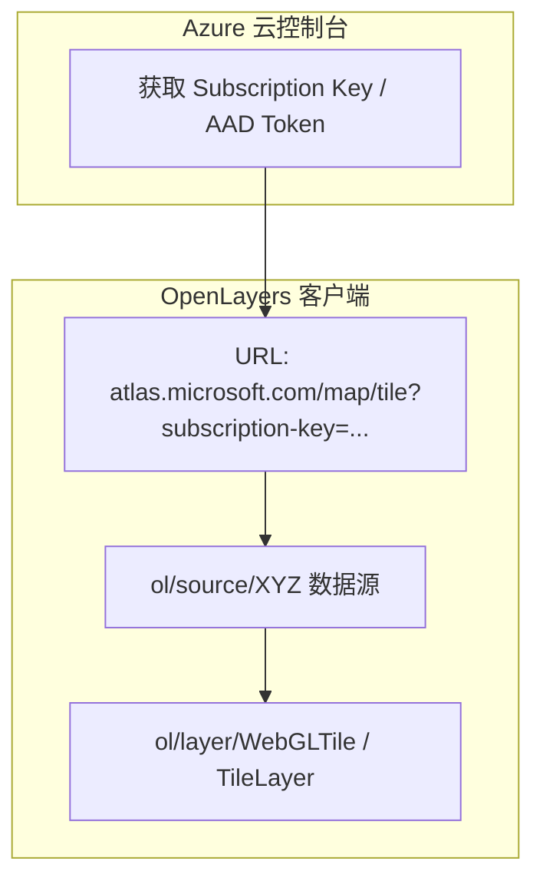

<nav aria-label="breadcrumb"><ol class="breadcrumb mb-4"><li class="breadcrumb-item"><a href="../">Home</a></li><li class="breadcrumb-item"><a href="./">Summary</a></li><li class="breadcrumb-item active" aria-current="page">第三方云服务集成指南</li></ol></nav>

# OpenLayers 商业与第三方多源云地图服务集成实战指南

> 在企业级混合云 GIS 架构中，底图数据往往不仅来自公开通用的 OpenStreetMap，还需要跨平台集成**商业云地图服务（如微软 Azure Maps / Bing Maps）**、**老牌开源空间服务器（MapServer、MapGuide）**以及**专业垂直行业底图（如 OpenSeaMap 国际航海标线图层）**。
>
> 不同的服务提供商在坐标系网格切分、Quadkey 四叉树索引、动态鉴权 Token 刷新以及 CGI 请求协议上存在显著差异。本文基于 4 个核心官方示例，系统解构商业与开源第三方地图服务的协议转换、请求定制与生产接入方案。

---

## 1. 架构总览：4 个第三方服务集成官方示例矩阵

| 分类                    | 示例标识                                                                        | 核心机制 / 关键 API                          | 解决的典型生产场景                                 |
| :---------------------- | :------------------------------------------------------------------------------ | :------------------------------------------- | :------------------------------------------------- |
| **微软商业云底图**      | [`azure-maps`](../en/latest/examples/azure-maps.html)                           | `ol/source/XYZ` + Azure Maps REST API 鉴权   | 企业级高分辨率全球卫星影像、合规路网底图快速集成   |
| **开源 CGI 地图服务**   | [`mapserver-cgi`](../en/latest/examples/mapserver-cgi.html)                     | `ol/source/ImageWMS` + MapServer CGI 传参    | 局域网自建高性能 C 语言 MapServer 单图即时渲染     |
| **Autodesk 空间服务器** | [`mapguide-untiled`](../en/latest/examples/mapguide-untiled.html)               | `ol/source/ImageMapGuide` + 动态会话管理     | 规划勘测行业 MapGuide 动态图层展示与视口同步       |
| **垂直航海多源叠加**    | [`localized-openstreetmap`](../en/latest/examples/localized-openstreetmap.html) | 多层 `ol/layer/Tile` 复合堆叠 + 局部语言重写 | 航运港口、专业水文航标（OpenSeaMap）与街道图层融合 |

---

## 2. 微软 Azure Maps 云底图接入范式

微软将其原有的 Bing Maps 服务全面升级并入了 **Azure Maps** 空间云生态。



### 2.1 Azure Maps 矢量/影像瓦片标准请求模板（`azure-maps`）

Azure Maps 采用标准的 Web 墨卡托 XYZ 切片网格。核心代码范式如下：

```javascript
import TileLayer from "ol/layer/Tile";
import XYZ from "ol/source/XYZ";

const subscriptionKey = "YOUR_AZURE_MAPS_KEY";

// 卫星影像图层
const satelliteLayer = new TileLayer({
  source: new XYZ({
    url: `https://atlas.microsoft.com/map/tile?api-version=2.0&tilesetId=microsoft.imagery&x={x}&y={y}&zoom={z}&subscription-key=${subscriptionKey}`,
    maxZoom: 19,
  }),
});

// 路网与行政区划标注图层
const roadsLayer = new TileLayer({
  source: new XYZ({
    url: `https://atlas.microsoft.com/map/tile?api-version=2.0&tilesetId=microsoft.base.labels.road&x={x}&y={y}&zoom={z}&subscription-key=${subscriptionKey}`,
    maxZoom: 19,
  }),
});
```

---

## 3. MapServer CGI 传统服务端动态渲染（`mapserver-cgi`）

MapServer 作为开源 GIS 领域的常青树，通过其高效的 C 语言核心支持原生 CGI 调用。

```javascript
import ImageLayer from "ol/layer/Image";
import ImageWMS from "ol/source/ImageWMS";

const mapserverLayer = new ImageLayer({
  source: new ImageWMS({
    // 指向服务器上的 mapserv 可执行 CGI 路径
    url: "https://demo.mapserver.org/cgi-bin/mapserv?",
    params: {
      map: "/mapserver/apps/tutorial/htdocs/example1.map", // 服务端 .map 配置文件物理路径
      LAYERS: "states", // 目标图层名
      MODE: "map", // CGI 原生地图模式
    },
    ratio: 1,
  }),
});
```

---

## 4. MapGuide 空间服务器动态单图接入（`mapguide-untiled`）

在政企测绘工程中，Autodesk MapGuide 提供了专用的交互接口：

```javascript
import ImageMapGuide from "ol/source/ImageMapGuide";
import ImageLayer from "ol/layer/Image";

const mapguideSource = new ImageMapGuide({
  url: "http://server.com/mapguide/mapagent/mapagent.fcgi",
  params: {
    MAPDEFINITION: "Library://Samples/Sheboygan/Maps/Sheboygan.MapDefinition",
    FORMAT: "PNG",
  },
  ratio: 1, // 单张整屏图像请求，避免接缝文本截断
});

const layer = new ImageLayer({ source: mapguideSource });
```

---

## 5. 垂直行业地图融合：航海标线图层叠加（`localized-openstreetmap`）

航运管理中，单一的地理底图无法满足安全通航要求，通常采用“基础街道/陆地底图 + 国际航海标线（OpenSeaMap）”复合图层堆叠结构：

```javascript
import TileLayer from "ol/layer/Tile";
import OSM from "ol/source/OSM";
import XYZ from "ol/source/XYZ";

// 1. 底层：基础地理地图
const baseMap = new TileLayer({
  source: new OSM(),
});

// 2. 顶层：OpenSeaMap 专业水文航标图层（透明 PNG 叠加）
const seaMap = new TileLayer({
  source: new XYZ({
    url: "https://tiles.openseamap.org/seamark/{z}/{x}/{y}.png",
    maxZoom: 18,
  }),
});
```

---

## 6. 生产工程避坑指南

1. **密钥暴露与反向代理**：商业云（如 Azure Maps、MapTiler）的 `subscription-key` 直接暴露在前端 URL 中极易被盗刷；生产环境应配置反向代理服务器（Nginx），在转发切片请求时隐式注入 Token；
2. **CGI 性能与超时防范**：MapServer CGI 在高并发请求下单图渲染耗时较长；应配置 `ratio: 1` 并在服务端结合 MapCache 开启缓存加速；
3. **HTTP 混杂内容（Mixed Content）**：部分老旧内部 MapServer/MapGuide 服务仍采用 HTTP 协议；若现代 Web 应用部署在 HTTPS 域名下，浏览器将直接拦截请求，必须前置反向代理配置 SSL 证书。

---

## 附录：4 个官方第三方云服务核心示例直达索引

1. [`azure-maps`](../en/latest/examples/azure-maps.html) &mdash; 微软 Azure Maps 商业底图与图层切换接入
2. [`mapserver-cgi`](../en/latest/examples/mapserver-cgi.html) &mdash; MapServer CGI 原生动态地图接口集成
3. [`mapguide-untiled`](../en/latest/examples/mapguide-untiled.html) &mdash; MapGuide 动态单图服务接入与视口同步
4. [`localized-openstreetmap`](../en/latest/examples/localized-openstreetmap.html) &mdash; OpenStreetMap 与 OpenSeaMap 国际航海标线多源复合集成
