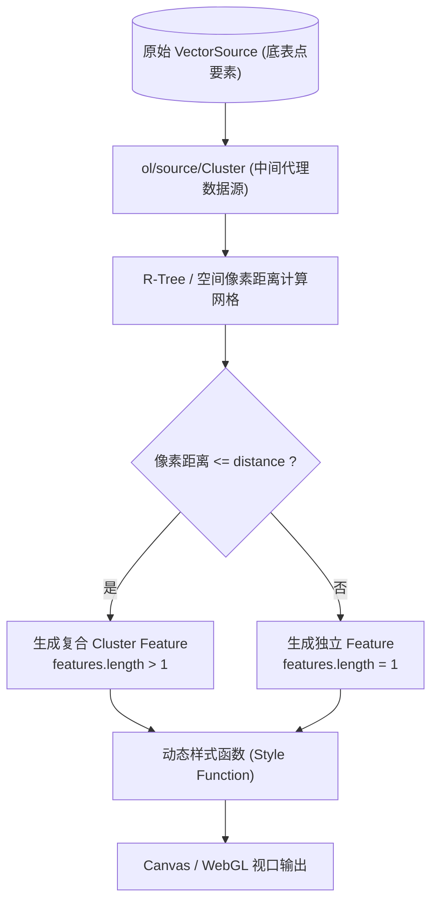
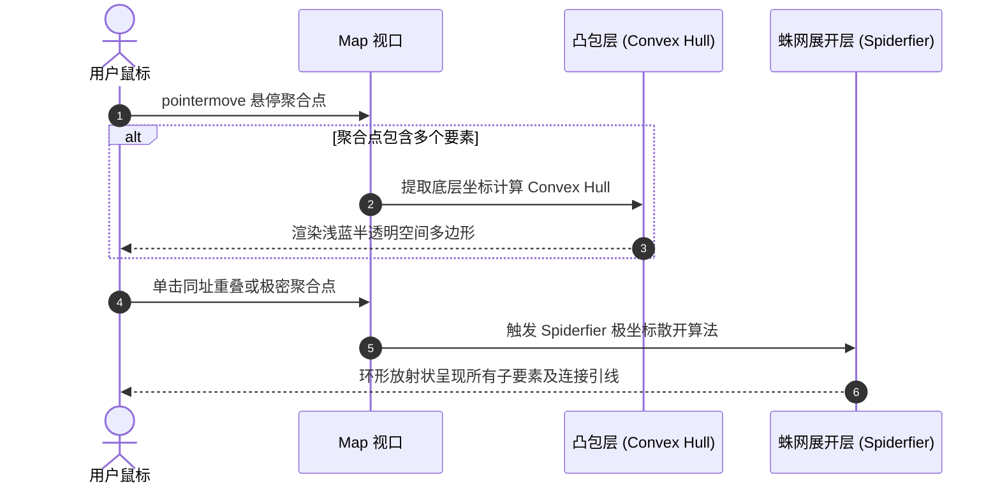

<nav aria-label="breadcrumb"><ol class="breadcrumb mb-4"><li class="breadcrumb-item"><a href="../">Home</a></li><li class="breadcrumb-item"><a href="./">Summary</a></li><li class="breadcrumb-item active" aria-current="page">要素聚合与点位聚类指南</li></ol></nav>

# OpenLayers 要素聚合与多尺度点位聚类全景实战指南
> 针对海量点位标记在屏幕密集重叠时的视觉冲突与渲染开销，系统解构 `ol/source/Cluster` 核心算法、多尺度参数调优、凸包包络计算（Convex Hull）与同址重叠蛛网展开（Spiderfier）技术。

---

## 1. 核心架构与聚类原理

在地理空间可视化中，当数据量达到数千至数十万级别时，屏幕像素空间的点位会发生严重重叠（Marker Collision），不仅使地图不可读，还会触发成千上万个 DOM 节点或 Canvas 绘图指令，导致视口帧率骤降。

OpenLayers 提供了基于像素距离的动态聚类数据源 `ol/source/Cluster`，它作为中间代理层包装原始 `VectorSource`，在视图缩放和分辨率（resolution）改变时按屏幕像素阈值动态生成聚类复合要素。



### 1.1 聚类数学模型与核心参数

聚类算法在当前屏幕分辨率 $r$（米/像素）下运行。对于空间中任意两个点要素 $P_1(x_1, y_1)$ 与 $P_2(x_2, y_2)$，其地理欧式距离为 $D_{\text{map}}$，投影到当前屏幕上的物理像素距离为 $D_{\text{screen}}$：

$$D_{\text{screen}} = \frac{\sqrt{(x_2 - x_1)^2 + (y_2 - y_1)^2}}{r}$$

- **`distance`（像素合并半径）**：当 $D_{\text{screen}} \le \text{distance}$ 时，两个要素将被归并在同一个聚类分组中。增大此值会使聚合点更少、更集中；减小此值则聚集粒度更细。
- **`minDistance`（最小聚类间距）**：OpenLayers 引入的防重叠保护阈值。定义任意两个聚类中心点之间的最小像素间距，防止两个已经生成的聚合气泡彼此压盖。

---

## 2. 官方示例矩阵解构

围绕聚类体系，官方示例展示了从基础参数调节、专题制图到微交互展开的三层能力：

| 示例标识 | 核心实现与涉及模块 | 解决的典型工程场景 |
| :--- | :--- | :--- |
| [`cluster`](../en/latest/examples/cluster.html) | `ol/source/Cluster`, `distance`, `minDistance` 动态联动 | 基础点要素聚类、滑块动态调整聚合距离与防叠间距 |
| [`earthquake-clusters`](../en/latest/examples/earthquake-clusters.html) | 根据包含要素数量动态计算气泡半径与颜色，鼠标悬停原地恢复震中星形 | 科学数据（地震、灾害）分级专题聚合，悬停细节探查 |
| [`clusters-dynamic`](../en/latest/examples/clusters-dynamic.html) | 三图层协同架构：凸多边形包络层 + 聚类层 + 蛛网展开层（Spiderfier） | 悬停预览聚合点物理空间范围、同坐标重叠点环形展开探查 |

---

## 3. 典型实战架构与核心实现

### 3.1 基础聚合源声明与动态样式函数

在 `cluster.html` 中，`Cluster` 接收一个底层的 `VectorSource`。渲染图层通过样式函数读取要素内的子要素集合 `feature.get('features')`：

```javascript
import Map from 'ol/Map';
import View from 'ol/View';
import Point from 'ol/geom/Point';
import Feature from 'ol/Feature';
import VectorSource from 'ol/source/Vector';
import Cluster from 'ol/source/Cluster';
import VectorLayer from 'ol/layer/Vector';
import {Style, Circle as CircleStyle, Fill, Stroke, Text} from 'ol/style';

// 1. 原始真实数据源
const count = 20000;
const features = new Array(count);
const e = 4500000;
for (let i = 0; i < count; ++i) {
  const coordinates = [2 * e * Math.random() - e, 2 * e * Math.random() - e];
  features[i] = new Feature(new Point(coordinates));
}
const source = new VectorSource({features});

// 2. 聚类代理源
const clusterSource = new Cluster({
  distance: 40,    // 40 像素合并半径
  minDistance: 20, // 20 像素最小间距
  source: source,
});

// 3. 样式缓存与动态渲染
const styleCache = {};
const clusters = new VectorLayer({
  source: clusterSource,
  style: function (feature) {
    const size = feature.get('features').length;
    let style = styleCache[size];
    if (!style) {
      style = new Style({
        image: new CircleStyle({
          radius: Math.min(10 + Math.log2(size) * 3, 25), // 随数量对数级放大半径
          fill: new Fill({
            color: size > 50 ? '#b02a37' : size > 10 ? '#fd7e14' : '#0d6efd',
          }),
          stroke: new Stroke({color: '#ffffff', width: 2}),
        }),
        text: new Text({
          text: size.toString(),
          fill: new Fill({color: '#ffffff'}),
          font: 'bold 12px sans-serif',
        }),
      });
      styleCache[size] = style;
    }
    return style;
  },
});
```

---

### 3.2 悬停凸包包络与同址重叠蛛网展开（Spiderfier）

在 `clusters-dynamic.html` 中，展示了解决“多个点完全重合在同一坐标”这一经典 GIS 痛点的完整方案：



#### 极坐标环形展开算法实现

当聚合点要素内的点在当前缩放下过于密集或坐标完全相同时，通过参数化圆周将点位向外投射：

$$x_i = x_0 + R \cdot \cos\left(\frac{2\pi \cdot i}{N}\right), \quad y_i = y_0 + R \cdot \sin\left(\frac{2\pi \cdot i}{N}\right)$$

```javascript
// Spiderfier 展开逻辑
function spiderfyCluster(clusterFeature, map) {
  const subFeatures = clusterFeature.get('features');
  const count = subFeatures.length;
  if (count <= 1) return;

  const centerCoord = clusterFeature.getGeometry().getCoordinates();
  const radius = 50; // 展开半径（像素）
  const resolution = map.getView().getResolution();
  const radiusMap = radius * resolution;

  const spiderFeatures = [];
  for (let i = 0; i < count; i++) {
    const angle = (2 * Math.PI * i) / count;
    const x = centerCoord[0] + radiusMap * Math.cos(angle);
    const y = centerCoord[1] + radiusMap * Math.sin(angle);
    const expandedPoint = new Feature({
      geometry: new Point([x, y]),
      originalFeature: subFeatures[i],
    });
    spiderFeatures.push(expandedPoint);
  }
  spiderSource.clear();
  spiderSource.addFeatures(spiderFeatures);
}
```

---

## 4. 生产避坑指南与性能治理

### 4.1 属性过滤操作对象误区
- **常见错误**：开发者常尝试调用 `clusterSource.getFeatures().filter(...)` 对聚合后的要素做业务过滤。
- **根本原因**：`clusterSource` 内部生成的复合要素是随缩放级别动态丢弃和重建的，其生命周期与视图帧绑定。
- **最佳实践**：**所有要素的增删改查、属性过滤必须全部作用于底层的真实 `VectorSource`**。底层源触发 `change` 事件后，`Cluster` 会自动捕获并重新计算聚类分组。

### 4.2 访问要素原始属性的指针层级
- **现象**：`feature.get('name')` 返回 `undefined`。
- **根因**：聚类图层回调中传入的 `feature` 是虚拟包装要素，其真实数据保存在 `features` 属性数组中。
- **防范规范**：
  ```javascript
  const leafFeatures = clusterFeature.get('features');
  if (leafFeatures.length === 1) {
    const rawName = leafFeatures[0].get('name');
  }
  ```

### 4.3 超大规模点位（> 50,000）样式缓存治理
- 在动态样式函数中，如果直接根据每个要素的唯一属性 `new Style(...)`，会导致内存中存在数万个样式对象，造成垃圾回收停顿。
- **治理法则**：建立基于要素数量或数值分级的 `styleCache` 对象（如按数量区间对数取整），确保渲染循环中 99% 的聚类气泡复用已分配的样式对象。
