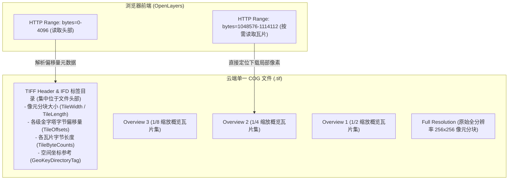
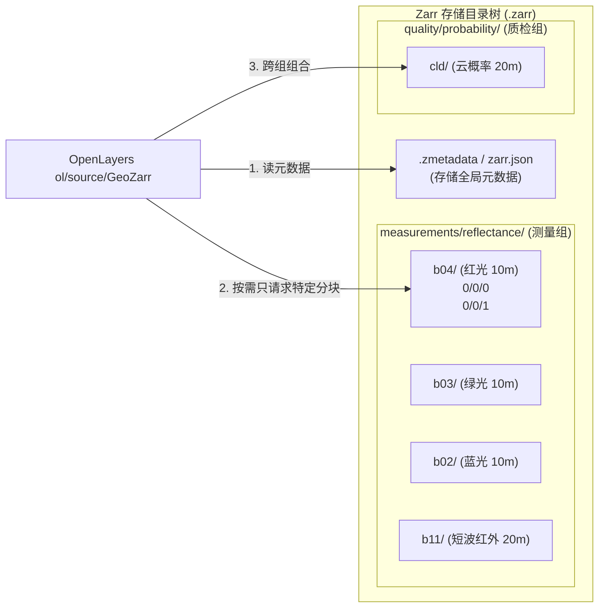
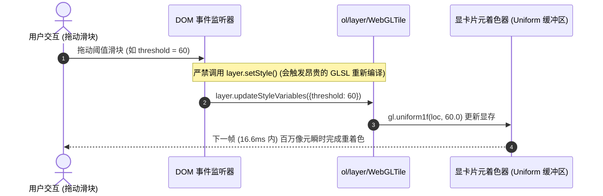
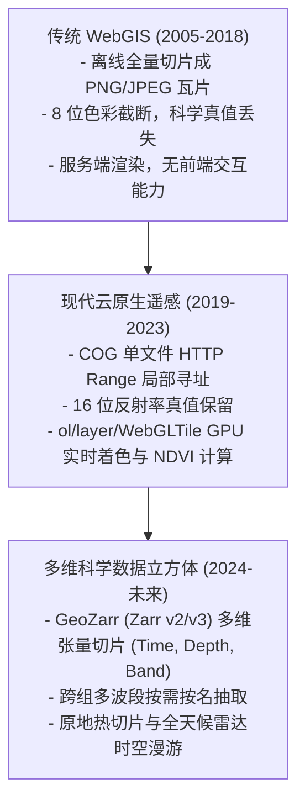

<nav aria-label="breadcrumb"><ol class="breadcrumb mb-4"><li class="breadcrumb-item"><a href="../">Home</a></li><li class="breadcrumb-item"><a href="./">Summary</a></li><li class="breadcrumb-item active" aria-current="page">云原生遥感与多维数据指南</li></ol></nav>

# OpenLayers 云原生遥感与多维科学数据全景实战指南
> 基于 25 个官方核心示例，深度解构云优化 GeoTIFF (COG)、GeoZarr 多维科学数据立方体、STAC 时空资产目录与 GPU 着色器波段代数

---

## 引言：云原生地理空间（Cloud-Native Geospatial）的范式转移

过去二十年间，WebGIS 呈现卫星遥感影像与多维栅格数据的传统技术路线始终遵循**“切片服务端预处理”**模式：
1. **预渲染与死板切片**：原始数十吉字节的 GeoTIFF 或 NetCDF 文件必须在服务端经由 MapServer、GeoServer 等地图引擎离线切片为数百万张 256×256 的 8 位 RGB PNG/JPEG 瓦片；
2. **科学真值彻底丢失**：一旦烘焙为 PNG，原始卫星传感器记录的 16 位/32 位物理辐射度、表观反射率、地表高程或风速气压真值全部被截断压缩为 0~255 的无量纲颜色，前端无法进行任何二次科学解译与动态阈值交互；
3. **运维与存储成本高昂**：全球多期影像与多波段组合产生海量切片文件碎片，云存储管理与分发链路极其繁琐。

随着 **云优化 GeoTIFF (Cloud Optimized GeoTIFF, COG)**、**GeoZarr / Zarr 多维数组规范** 以及 **STAC (SpatioTemporal Asset Catalog, 时空资产目录)** 国际标准的成熟，WebGIS 迎来了根本性的范式变革——**“客户端流式直读与 GPU 实时着色”**：
数据以原生精度常驻云端对象存储（如 AWS S3、Google Cloud Storage、Azure Blob），前端 OpenLayers 通过 **HTTP Range 请求（字节范围请求）** 按需仅拉取当前视口所需的瓦片字节，并在浏览器利用 **WebGL 硬件加速片元着色器** 实时完成波段代数计算（如 NDVI、NDWI、双极化雷达解算）、动态对比度拉伸与重投影！

本文基于官方示例库中的 **25 个核心技术示例**，全景剖析 OpenLayers 在云原生遥感影像与多维科学数据体系下的架构设计、数学模型与生产落地实践。

---

## 第一部分：全景视盘——25 个核心遥感与多维数据示例矩阵

| 技术分类 | 示例标识 | 核心类 / 关键 API | 解决的典型生产场景与技术精要 |
| :--- | :--- | :--- | :--- |
| **COG 核心加载与流式访问** | [`cog`](../en/latest/examples/cog.html) | `ol/source/GeoTIFF` + `WebGLTile` | 单文件云优化 GeoTIFF 基于 HTTP Range 局部按需流式加载 |
| | [`cog-blob`](../en/latest/examples/cog-blob.html) | `sources: [{blob: blob}]` | 浏览器本地文件离线直读：无需上传服务器直接从内存 Blob 解析渲染 |
| | [`cog-custom-client`](../en/latest/examples/cog-custom-client.html) | `sources: [{loader: fn}]` | 商业私有云存储鉴权：注入 Bearer Token 认证头与 AbortSignal 中止控制 |
| | [`cog-overviews`](../en/latest/examples/cog-overviews.html) | `overviews: ['...ovr.tif']` | 挂载外部 GDAL 金字塔概览文件，规避宏观尺度下 OOM 性能崩溃 |
| | [`cog-modeltransformation`](../en/latest/examples/cog-modeltransformation.html) | Tag 34264 仿射矩阵 + `TileDebug` | 倾斜轨道成像：解析 SAR 卫星非正交旋转矩阵并在 GPU 动态重投影 |
| | [`cog-projection`](../en/latest/examples/cog-projection.html) | `epsg.io` + `proj4` 在线注册 | 从 TIFF 头部动态查询稀有地方独立坐标系并完成跨系对齐 |
| | [`geotiff-reprojection`](../en/latest/examples/geotiff-reprojection.html) | 内置 UTM 引擎 | 零 Proj4 依赖完成高精度 UTM 卫星影像至 Web 墨卡托的硬件级重投影 |
| | [`multiple-cogs`](../en/latest/examples/multiple-cogs.html) | `sources: [...]` 跨分带拼接 | 跨 UTM 分带多幅高分辨率 COG 边缘无缝几何拼合与透明边缘遮罩 |
| **遥感波段代数与 GPU 实时着色** | [`cog-math`](../en/latest/examples/cog-math.html) | `['interpolate', ['/', ...]]` | 多源单波段 COG 融合，GPU 逐像素计算 NDVI 植被健康指数 |
| | [`cog-math-multisource`](../en/latest/examples/cog-math-multisource.html) | 异构分辨率 (10m + 60m) | 跨空间尺度自适应插值，同时计算 NDVI 植被指数与 NDWI 水体指数 |
| | [`cog-math-raster`](../en/latest/examples/cog-math-raster.html) | `ol/source/Raster` + Web Worker | CPU 多线程像素算子：在后台 Worker 中执行通用复杂遥感反演算法 |
| | [`cog-colors`](../en/latest/examples/cog-colors.html) | Chroma.js + `updateStyleVariables` | 在 Lab 感知均匀色彩空间中根据阈值滑块 60 FPS 无感刷新伪彩色带 |
| | [`cog-stretch`](../en/latest/examples/cog-stretch.html) | 16 位整数 + `normalize: false` | 卫星原始高动态反射率保留与真彩色/标准假彩色（NIR）通道动态重构 |
| | [`cog-style`](../en/latest/examples/cog-style.html) | AST 声明式着色器样式 | 基于数学表达式对 COG 多波段像元执行标准化与动态着色 |
| | [`geotiff-per-band-stats`](../en/latest/examples/geotiff-per-band-stats.html) | `min: [...]`, `max: [...]` 数组 | 无需编写着色器代码，直接为每个光谱通道配置独立的极值拉伸区间 |
| **金字塔目录、导出与 STAC 生态** | [`cog-pyramid`](../en/latest/examples/cog-pyramid.html) | `sourcesFromTileGrid` + STACTA | 大范围海量独立小 COG 构成的瓦片金字塔目录按需动态懒加载 |
| | [`stac-item`](../en/latest/examples/stac-item.html) | `ol-stac` 扩展库 | 自动化解析 STAC Item JSON，同步构建矢量外包足迹与 COG 图层组 |
| | [`export-map`](../en/latest/examples/export-map.html) | `geotiff.writeArrayBuffer` | 离屏 Canvas 重定向渲染，纯客户端生成带地理参考的 GeoTIFF 与 Worldfile |
| **GeoZarr 多维科学数据立方体** | [`geozarr`](../en/latest/examples/geozarr.html) | `ol/source/GeoZarr` (Sentinel-2) | 遵循 Multiscales 约定的云原生分块多维数组流式加载与伽马校正 |
| | [`geozarr-stretch`](../en/latest/examples/geozarr-stretch.html) | 物理反射率浮点数拉伸 | 短波红外 (SWIR) 与可见光多波段拉伸，自动解析坐标与视口参数 |
| | [`geozarr-datacube`](../en/latest/examples/geozarr-datacube.html) | N 维数据立方体 + `dimensions` 锁轴 | 科学张量切片：ERA5 气压、南极风速、冰川流速、碳通量与 CMIP6 气候模型 |
| | [`geozarr-dimensions`](../en/latest/examples/geozarr-dimensions.html) | `updateDimensions({time: idx})` | 时间轴滑块动态漫游：哨兵 1 号火山爆发雷达双极化时序原地热重载 |
| | [`geozarr-groups`](../en/latest/examples/geozarr-groups.html) | 跨 Zarr 树状群组提取波段 | 跨组融合反射率与云质量概率，在 GPU 实现动态容差去云遮罩 |
| | [`geozarr-sparse`](../en/latest/examples/geozarr-sparse.html) | 稀疏多尺度金字塔重采样 | 传感器异构分辨率适配：20m SWIR 波段在放大时自动跨层级升采样 |
| | [`geozarr-storytelling`](../en/latest/examples/geozarr-storytelling.html) | 升降轨群组探测 + CF 时间解码 | 综合地球观测故事线引擎：覆盖洪灾、火山造陆、油轮锚地与极地海冰 |

---

## 第二部分：数据底座——COG 与 GeoZarr 核心存储架构解析

### 1. 云优化 GeoTIFF (COG) 的内部物理结构

传统 TIFF 将整幅图像的像元连续平铺，而 COG 通过 GDAL 驱动将文件组织为**高度自描述且支持局部字节寻址**的格式：



* **HTTP Range 请求（字节范围协议）**：
  OpenLayers 底层通过 `geotiff.js`，首先向服务器发送 `Range: bytes=0-16383` 仅下载文件头部。解析出所有分块的偏移量表（`TileOffsets`）后，每当视口发生漫游或缩放，仅下载当前视野内所需的几十个切片块。
* **外部概览文件支持（`.ovr` / `.ovr.tif`）**：
  对于未内置金字塔的传统 TIFF，可通过 `overviews: ['path.ovr.tif']` 挂载外部金字塔文件（[`cog-overviews`](../en/latest/examples/cog-overviews.html)），彻底杜绝由于小比例尺全图加载导致浏览器内存溢出（OOM）。

---

### 2. GeoZarr 多维科学数据立方体架构

与专注于 2D/3D 平面影像的 COG 不同，**Zarr** 是一种面向海量 N 维张量（N-dimensional Arrays）的云原生分块压缩格式，广泛应用于气候科学、气象预报、地球物理与流体力学。



#### COG vs GeoZarr 核心技术特性选型矩阵

| 对比维度 | 云优化 GeoTIFF (`ol/source/GeoTIFF`) | 多维科学数组 (`ol/source/GeoZarr`) |
| :--- | :--- | :--- |
| **存储组织形态** | **单文件**（所有波段与金字塔打包在一个 `.tif` 内） | **目录分块/对象键值对**（每个波段为独立子路径，像元切片为独立对象） |
| **数据维度支持** | 原生支持 2D 空间与有限波段数（$X, Y, \text{Bands}$） | **任意 N 维张量**：支持 $(T, C, Z, Y, X)$（时间、高度层、集合成员等） |
| **波段按需加载** | 需从同一文件内根据字节偏移跳跃读取 | **按名称独立按需拉取**：如 `bands: ['b04', 'b02']`，未选中的波段零流量下载 |
| **多尺度组织规范** | TIFF 内部标准 IFD Sub-Directories | OME-NGFF / OGC TileMatrixSet / GeoZarr Multiscales 约定 |
| **典型适用场景** | 遥感正射卫星底图（Landsat, Sentinel-2 TCI）、无人机航拍、高分辨率 DEM | 全球气象预报（ERA5）、长时间序列监测、全球气候模式（CMIP6）、海洋三维洋流 |

---

## 第三部分：核心数学模型与遥感波段代数

在 OpenLayers WebGL 渲染管线中，所有的物理波段计算均被实时编译为显卡 GLSL 着色器程序执行。

### 1. 归一化植被指数 (NDVI, Normalized Difference Vegetation Index)

植被叶肉细胞对可见光红光（Red）具有强烈吸收，而对近红外（NIR）具有极强的高反射特性：

$$\text{NDVI} = \frac{\text{NIR} - \text{Red}}{\text{NIR} + \text{Red}}$$

* **取值范围**：$[-1.0, +1.0]$。
* **OpenLayers AST 表达式实现**（[`cog-math`](../en/latest/examples/cog-math.html)）：
```javascript
const ndvi = [
  '/',
  ['-', ['band', 2], ['band', 1]], // NIR 为 Band 2, Red 为 Band 1
  ['+', ['band', 2], ['band', 1]],
];
```

---

### 2. 归一化水体指数 (NDWI) 与三色复合显示

利用短波红外（SWIR）与红光通道反差提取水体（[`cog-math-multisource`](../en/latest/examples/cog-math-multisource.html)）：

$$\text{NDWI} = \frac{\text{SWIR} - \text{Red}}{\text{SWIR} + \text{Red}}$$

在三通道复合着色器中，同时赋予三种物理含义：
* **Red 通道**：$255 \times |\text{NDVI} - \text{NDWI}|$（突出陆面与水体的过渡带）；
* **Green 通道**：$255 \times \text{NDVI}$（健康植被显高亮绿色）；
* **Blue 通道**：$255 \times \text{NDWI}$（水体显高亮蓝色）。

---

### 3. 雷达（SAR）双极化特征与地表粗糙度解算

在哨兵 1 号合成孔径雷达（C-Band SAR）中，微波信号不受昼夜和云雾阻碍（[`geozarr-dimensions`](../en/latest/examples/geozarr-dimensions.html), [`geozarr-storytelling`](../en/latest/examples/geozarr-storytelling.html)）：

$$\text{Ratio} = \frac{\sigma^0_{\text{VV}}}{\sigma^0_{\text{VH}}}$$

* **VV（同向极化）**：反映地表镜面反射与面散射强度，映射至 Red 通道；
* **VH（交叉极化）**：反映冠层与破碎乱石的体散射强度，映射至 Green 通道；
* **VV / VH 比值**：对熔岩流表面粗糙度、海冰脊与船舶钢铁边缘极其敏感，映射至 Blue 通道。在平静海面上，移动船舶与新生熔岩呈现强烈的亮点。

---

### 4. 伽马校正（Gamma Correction）与线性对比度拉伸

卫星原始辐射反射率普遍偏低（通常集中在 $0.0 \sim 0.3$），直接线性显示会导致图像全黑或对比度极低。OpenLayers 引入了伽马非线性校正：

$$V_{\text{display}} = \left( \frac{V_{\text{raw}} - \text{min}}{\text{max} - \text{min}} \right)^{1 / \gamma} \times 255$$

在 [`geozarr`](../en/latest/examples/geozarr.html) 与 [`cog-stretch`](../en/latest/examples/cog-stretch.html) 中设置 `gamma: 1.5`，能够大幅提升暗部和中间调的视觉动态范围。

---

### 5. 模型仿射变换矩阵（ModelTransformation）

对于具有航天倾斜视角的雷达影像（如 Umbra SAR），像元网格与地图坐标轴存在明显的旋转与剪切角（[`cog-modeltransformation`](../en/latest/examples/cog-modeltransformation.html)）。GeoTIFF Tag 34264 定义了仿射变换矩阵：

$$\begin{bmatrix} X \\ Y \\ 1 \end{bmatrix} = \begin{bmatrix} a & b & c \\ d & e & f \\ 0 & 0 & 1 \end{bmatrix} \begin{bmatrix} \text{col} \\ \text{row} \\ 1 \end{bmatrix}$$

OpenLayers 在 GPU 贴图阶段直接进行反向仿射重投影，即使带有 30° 倾斜旋转的瓦片也能与 Web 墨卡托底图严密贴合！

---

## 第四部分：现代前端实现模式与核心 API 架构

### 1. 函数式 View 工厂：`getView(source, ...modifiers)`

传统开发中必须在 `source` 加载回调中手动计算中心点与层级。现代 OpenLayers 提供了链式、声明式的函数式 View 构造器：

```javascript
import {getView, withExtentCenter, withHigherResolutions, withLowerResolutions, withZoom} from 'ol/View.js';

const map = new Map({
  target: 'map',
  layers: [new TileLayer({source: cogSource})],
  view: getView(
    cogSource,
    withLowerResolutions(1),    // 允许缩小浏览大范围全景
    withHigherResolutions(2),   // 允许放大超过原始分辨率 2 级，看清像元细节
    withExtentCenter(),         // 自动以影像的几何外包矩形中心作为初始地图视口
    withZoom(2),                // 初始相对缩放偏移
  ),
});
```

---

### 2. 60 FPS 丝滑调参：`layer.updateStyleVariables()`

在动态遥感解译应用中，用户经常拖动阈值滑块（如云量阈值、对比度上下限、色相饱和度）：



* **铁律**：永远不要在滑块 `input` 事件中调用 `layer.setStyle()`；必须在样式中声明 `['var', 'varName']`，并在交互中仅调用 `updateStyleVariables()`，实现真正的显卡级零编译刷新。

---

### 3. 多维科学数组原地热切片：`source.updateDimensions()`

在处理时间序列与多维数据立方体时（[`geozarr-dimensions`](../en/latest/examples/geozarr-dimensions.html), [`geozarr-storytelling`](../en/latest/examples/geozarr-storytelling.html)）：

```javascript
// 1. 获取时间轴长度与单位
const {time} = await source.getDimensions();

// 2. 异步读取标量时间值并格式化
const date = await source.getValue('time', sliceIndex);

// 3. 原地重载切片 (保留当前地图中心与缩放，无需销毁重建图层)
source.updateDimensions({time: sliceIndex});
```

---

### 4. 离屏重定向地图导出 GeoTIFF 与 Worldfile

在 [`export-map`](../en/latest/examples/export-map.html) 示例中，展示了无需任何后端辅助、纯客户端生成地理参考 GeoTIFF 的工业级方案：

```javascript
// 1. 临时将渲染目标重定向至离屏画布
map.setTarget(offscreenCanvas);

map.once('rendercomplete', () => {
  const context = offscreenCanvas.getContext('2d');
  const imageData = context.getImageData(0, 0, width, height);

  // 2. 利用 geotiff 库组装 GeoTIFF 标签目录
  const tiffBuffer = writeGeotiff(imageData.data, {
    width, height,
    ModelPixelScale: [resolution, resolution, 0],
    ModelTiepoint: [0, 0, 0, extent[0], extent[3], 0],
    GTRasterTypeGeoKey: 1, // RasterPixelIsArea
    ProjectedCSTypeGeoKey: 3857,
  });

  // 3. 触发浏览器二进制下载
  downloadBlob(new Blob([tiffBuffer], {type: 'image/tiff'}));

  // 4. 恢复屏幕 DOM 挂载
  map.setTarget('map');
});
```

---

## 第五部分：生产环境工程化避坑与部署规范

### 1. 云端对象存储 CORS 与 HTTP Range 头部铁律

云原生遥感依赖按需拉取局部字节，对象存储（S3 / OSS / GCS / CDN）必须正确配置响应头：
* **`Access-Control-Allow-Origin: *`**：允许前端跨域访问；
* **`Accept-Ranges: bytes`**：必须显式声明支持字节范围请求（否则浏览器会自动退化为全量下载整张 TIFF）；
* **`Access-Control-Expose-Headers: Content-Range, Content-Length`**：允许客户端 JavaScript 读取返回的字节范围信息。

> [!WARNING]
> 若 CDN 开启了 Gzip 或 Brotli 压缩，可能会破坏 `Content-Range` 的字节对齐计算，导致解压瓦片失败。必须配置针对 `.tif` 与 `.zarr` 资源关闭二次压缩传输！

---

### 2. 缺失 Overviews 金字塔导致 OOM 的防御策略

若用户尝试加载未经 COG 标准化的普通 TIFF（单层分辨率，文件达数吉字节）：
* **直接加载的风险**：在全图比例尺下，前端需要发起数万个瓦片请求或下载整张大图，直接导致浏览器崩溃（Out of Memory）；
* **防御机制**：
  1. 通过 `source.getView().then(...)` 读取元数据，校验金字塔层级数；
  2. 若缺失金字塔，利用 `overviews` 属性指定外部生成的 `.ovr.tif` 文件；
  3. 或在 View 中配置 `minResolution`，限制用户不能过度缩小地图。

---

### 3. 数据源异构分辨率自适应融合

当融合 10m 与 60m 的波段时（如 Sentinel-2 B04 与 B09）：
* OpenLayers 的 WebGL 瓦片采样器会在后台将低分辨率分块自动按当前视口分辨率进行**双线性插值升采样**；
* 开发者无需在服务端手动对齐网格，直接在 `sources` 列表中混用异构分辨率数据即可。

---

## 总结与技术演变全景

从单一的切片底图（XYZ/TMS），到单文件流式加载的 **COG**，再到面向全地球系统科学的高维 **GeoZarr 数据立方体**，OpenLayers 构建了目前 Web 前端最完整、最高性能的云原生遥感可视化全栈体系：



掌握本文梳理的 25 个核心技术示例及其背后的底层架构，将为构建现代化云原生卫星遥感中台、智慧农业长势监测、海洋与气象实时数字孪生系统提供极其坚实的基础设施支撑。
