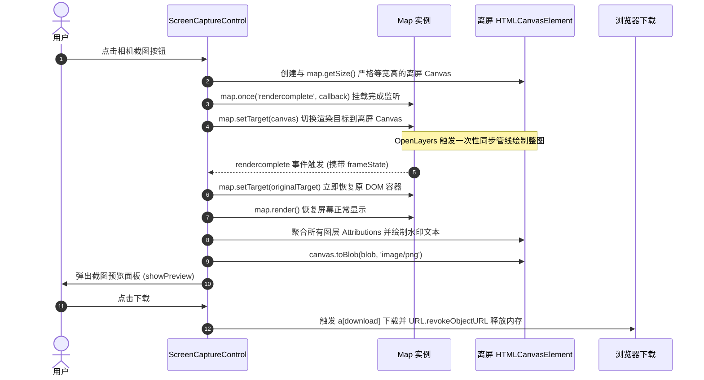
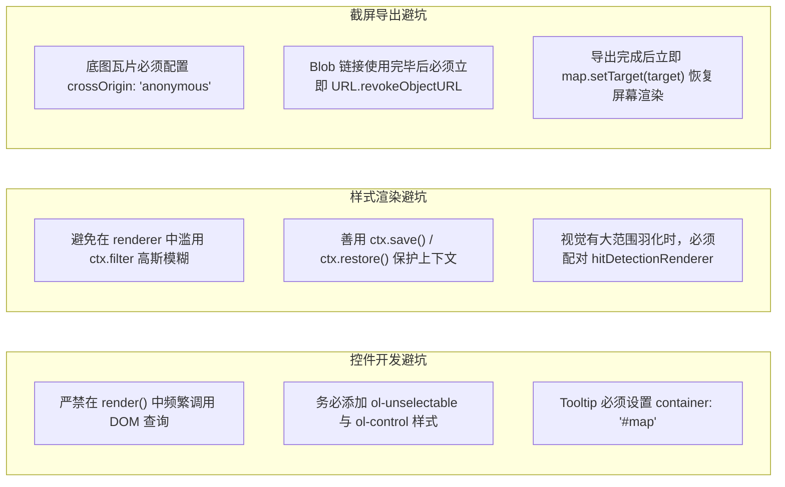

# OpenLayers 底层扩展与自定义开发全景实战架构指南 (Customization Architecture & Low-Level Extensibility)

> 本指南基于 OpenLayers 官方 **custom** 核心专题群的代表性示例，深度解构框架从 DOM 控件、用户交互手势、Canvas 样式渲染到离屏命中检测与视口截屏的全栈自定义扩展机制。系统剖析 `ol/control/Control` 继承模式与 60fps 渲染同步、`Style.renderer` 屏幕像素级 Canvas 2D 绘图接管、`Style.hitDetectionRenderer` 视觉与拾取解耦架构，以及 `map.setTarget(canvas)` 离屏重定向截屏导出的工程级最佳实践。

---

## 一、OpenLayers 自定义扩展全景架构 (Extensibility Architecture)

OpenLayers 采用高度解耦的面向对象与组件化分层设计，为开发者在各个生命周期节点提供了丰富的扩展插槽（Slots）与钩子函数（Hooks）。其扩展体系可划分为四大核心层级：

```mermaid
flowchart TD
    subgraph UIControlLayer["1. DOM 控件层扩展 (ol/control/Control)"]
        BaseControl["ol/control/Control 基类"] --> CustomControl["RotateNorthControl / ScreenCaptureControl"]
        CustomControl --> DOMElement["自定义 DOM 结构与 UI 样式 (SVG 图标、按钮)"]
        CustomControl --> RenderHook["render(mapEvent) 帧回调: 脏检查与 CSS 硬件加速"]
        DOMElement --> FullscreenFix["全屏模式容器挂载隔离 (container: '#map')"]
    end

    subgraph InteractionLayer["2. 交互手势层扩展 (ol/interaction/Pointer)"]
        BasePointer["ol/interaction/Pointer 基类"] --> CustomInteraction["拖拽、平移、吸附等复杂业务手势状态机"]
    end

    subgraph StyleRenderLayer["3. 样式渲染层扩展 (ol/style/Style.renderer)"]
        VectorPipe["矢量图层渲染管线 (VectorContext)"] --> StyleRenderer["Style.renderer(coordinates, state)"]
        StyleRenderer --> CanvasCtx["接管 CanvasRenderingContext2D (径向渐变、发光波束)"]
        StyleRenderer --> ScreenCoord["投影坐标 -> 屏幕物理像素坐标映射转换"]
    end

    subgraph HitDetectLayer["4. 拾取检测层扩展 (ol/style/Style.hitDetectionRenderer)"]
        PointerEvent["鼠标移动 / 点击 (map.forEachFeatureAtPixel)"] --> OffscreenCanvas["1x1 离屏 Hit-test 画布"]
        OffscreenCanvas --> HitRenderer["Style.hitDetectionRenderer"]
        HitRenderer --> AlphaTest["Alpha 通道像素探查: 剥离大范围半透明遮罩，精确定位轮廓"]
    end

    subgraph ExportPipeline["5. 视口重定向与导出 (map.setTarget)"]
        MapInstance["Map 实例"] --> TargetSwitch["map.setTarget(offscreenCanvas)"]
        TargetSwitch --> OnceRender["map.once('rendercomplete') 收集图层与版权 Promise"]
        OnceRender --> CompositeBlob["Canvas.toBlob -> PNG 导出与 URL.revokeObjectURL"]
    end
```



---

## 二、DOM 控件扩展机制 (`ol/control/Control`)

在 OpenLayers 中，控件（Control）是浮动在地图视口之上的 HTML DOM 组件。与绘制在 Canvas 画布内部的图层不同，控件享有浏览器原生事件、CSS 动画及高精度排版的全部能力。

### 1. 继承模式与构造函数规范
自定义控件需通过继承 `ol/control/Control` 实现，核心流程如下：

```javascript
import Control from 'ol/control/Control.js';

class RotateNorthControl extends Control {
  constructor(opt_options) {
    const options = opt_options || {};

    // 1. 构建控件 DOM 容器与按钮
    const button = document.createElement('button');
    button.type = 'button';
    button.title = 'Rotate to north / 复位至正北';
    button.innerHTML = '<svg ...>...</svg>';

    const element = document.createElement('div');
    // 规范：ol-unselectable 禁用文本选中，ol-control 提供定位与毛玻璃层叠样式
    element.className = 'rotate-north ol-unselectable ol-control';
    element.appendChild(button);

    // 2. 调用父类构造函数注入 DOM 节点
    super({
      element: element,
      target: options.target, // 支持挂载至地图视口外部的独立 DOM 容器
    });

    // 3. 缓存内部 DOM 引用并绑定事件
    this.arrow_ = button.querySelector('svg');
    this.rotation_ = undefined; // 脏检查缓存值
    button.addEventListener('click', this.handleRotateNorth.bind(this), false);
  }

  handleRotateNorth() {
    // 平滑动画重置视角至 0 弧度
    this.getMap().getView().animate({rotation: 0, duration: 250});
  }
}
```

### 2. `render(mapEvent)` 60fps 帧同步与脏检查守则
当用户平移、缩放或惯性旋转地图时，OpenLayers 会在每一渲染帧广播 `render(mapEvent)`。
- **性能红线**：该方法每秒可能执行 60 至 120 次，**严禁在此处执行 `querySelector`、大量 DOM 增删或触发同步排版（Layout Reflow）的操作**。
- **脏检查机制**：通过本地变量 `this.rotation_` 记录上一帧的值，仅在角度真实变动时更新 CSS Transform，极大降低 CPU/GPU 占用：

```javascript
render(mapEvent) {
  const frameState = mapEvent.frameState;
  if (!frameState) return;

  const rotation = frameState.viewState.rotation;
  if (rotation !== this.rotation_) {
    // 利用 GPU 硬件加速的 transform 属性进行实时旋转
    this.arrow_.style.transform = `rotate(${rotation}rad)`;
    // 角度为 0 时自动切换隐藏
    this.element.classList.toggle('ol-hidden', rotation === 0);
    this.rotation_ = rotation;
  }
}
```

---

## 三、Canvas 2D 绘图接管与样式定制 (`Style.renderer`)

默认的 `ol/style/Fill` 与 `Stroke` 仅能满足基础单色或虚线渲染。对于雷达光晕、动态脉冲、发光渐变等高级视觉特效，`ol/style/Style` 的 `renderer` 钩子函数允许开发者直接接管底层 Canvas 2D 上下文。

### 1. 坐标体系映射与物理像素解构
传入 `renderer(coordinates, state)` 的参数具有特殊规范：
- `coordinates`：并非原始的地理投影坐标，而是**已经被 OpenLayers 内部渲染管道投影并转换为当前视口的屏幕物理像素坐标**。
- 对于 `ol/geom/Circle`，`coordinates` 结构为 `[[centerX, centerY], [edgeX, edgeY]]`。
- 两点间的欧几里得距离即为该圆在当前屏幕上的真实像素半径：
  $$\text{radius} = \sqrt{(x_1 - x_0)^2 + (y_1 - y_0)^2}$$

### 2. 径向渐变光晕实战实现
以 [`examples/custom-circle-render.html`](file:///d:/Users/Downloads/openlayers/examples/custom-circle-render.html) 为例，在 Canvas 上构建发光渐变：

```javascript
new Style({
  renderer(coordinates, state) {
    const [[x, y], [x1, y1]] = coordinates;
    const ctx = state.context; // 当前图层的 CanvasRenderingContext2D
    const radius = Math.hypot(x1 - x, y1 - y);

    // 构建由中心透明到边缘半透明红晕的径向渐变
    const gradient = ctx.createRadialGradient(x, y, 0, x, y, radius * 1.4);
    gradient.addColorStop(0, 'rgba(255, 0, 0, 0)');
    gradient.addColorStop(0.6, 'rgba(255, 0, 0, 0.2)');
    gradient.addColorStop(1, 'rgba(255, 0, 0, 0.8)');

    ctx.beginPath();
    ctx.arc(x, y, radius, 0, 2 * Math.PI, true);
    ctx.fillStyle = gradient;
    ctx.fill();

    ctx.arc(x, y, radius, 0, 2 * Math.PI, true);
    ctx.strokeStyle = 'rgba(255, 0, 0, 1)';
    ctx.stroke();
  },
});
```

---

## 四、空间交互中的视觉与拾取解耦 (`Style.hitDetectionRenderer`)

在传统 GIS 开发中，开发者常遇到一个棘手难题：为了营造震撼的视觉效果，要素往往带有大范围的发光阴影、半透明扩散波或虚化外圈，这会导致**鼠标在距离要素主体很远时就被半透明区域触发拾取**，从而遮挡或抢占了下层其他要素的点击事件。

### 1. OpenLayers 离屏命中检测机制 (Hit-Detection Pipeline)
OpenLayers 执行 `map.forEachFeatureAtPixel(pixel, callback)` 时：
1. 不会读取包含底图和注记的主画布（防止底图像素颜色干扰要素归属）。
2. 在内存中创建一个微型离屏 Canvas（通常仅 1x1 像素）。
3. 针对鼠标像素点对应的候选要素，调用要素样式的绘制方法将其单独渲染到离屏画布中。
4. 调用 `ctx.getImageData(0, 0, 1, 1)` 检查 Alpha 通道值：若 $\text{Alpha} > 0$，则判定击中该要素。

### 2. 视觉与拾取分离实战
[`examples/custom-hit-detection-renderer.html`](file:///d:/Users/Downloads/openlayers/examples/custom-hit-detection-renderer.html) 演示了精妙的解耦方案：
- `renderer`：同时绘制大半径渐变光晕圆和中心文字。
- `hitDetectionRenderer`：**彻底略过渐变大圆，仅向离屏画布绘制文字轮廓**！

```javascript
circleFeature.setStyle(
  new Style({
    // 视觉渲染：渐变圆 + 文字
    renderer(coordinates, state) {
      drawRadialCircle(state.context, coordinates);
      renderLabelText(state.context, coordinates[0]);
    },
    // 命中检测：仅保留文字，彻底排除大圆！
    hitDetectionRenderer(coordinates, state) {
      renderLabelText(state.context, coordinates[0]);
    },
  })
);
```
用户鼠标在大圆内部划过时毫无反应；只有当光标精准悬停在中心文字像素上方时，拾取事件才被触发。

---

## 五、地图视口捕获与离屏重定向导出架构 (`ScreenCaptureControl`)

导出包含多图层叠加、动态注记与版权信息的全高清地图是许多业务系统的刚需。主流的 `html2canvas` 方案存在样式失真、跨域报错和性能低下等缺陷。

[`examples/screen-capture.html`](file:///d:/Users/Downloads/openlayers/examples/screen-capture.html) 展现了 OpenLayers 原生的高性能离屏截屏架构：



### 生产级截屏核心代码与内存防护
```javascript
handleCapture() {
  const map = this.getMap();
  const target = map.getTargetElement();
  const size = map.getSize();
  const canvas = document.createElement('canvas');
  canvas.width = size[0];
  canvas.height = size[1];

  map.once('rendercomplete', (event) => {
    // 1. 收集当前帧所有图层的版权归属 Promise
    const attributions = map
      .getAllLayers()
      .flatMap((layer) => layer.getAttributions(event.frameState));

    // 2. 立即将地图 Target 恢复为原始网页 DOM 容器并请求刷新
    map.setTarget(target);
    map.render();

    // 3. 异步解析图层版权文字并合成到离屏画布右下角
    Promise.all(attributions).then((resolved) => {
      drawAttributions(canvas, resolved);
      canvas.toBlob((blob) => this.showPreview_(blob, size), 'image/png');
    });
  });

  // 4. 重定向渲染目标至离屏 Canvas
  map.setTarget(canvas);
}
```

---

## 六、DOM 增强与全屏模式穿透 (`Button Tooltips`)

在定制地图原生按钮的提示组件（如 Bootstrap Tooltip、Tippy.js 或 Ant Design Tooltip）时，存在一个极具隐蔽性的浏览器全屏陷阱：

### 1. 全屏伪类 `:fullscreen` 与层叠遮挡陷阱
默认情况下，第三方 UI 组件库将气泡容器挂载在 `document.body` 尾部。当用户点击 OpenLayers 的 `FullScreen` 控件使地图容器进入全屏模式时：
- 浏览器的全屏呈现层（Top Layer / `:fullscreen`）将地图容器提升为独立顶层显示。
- 此时位于 `document.body` 顶层的 Tooltip DOM 节点完全被全屏层阻挡在后方，导致悬浮提示瞬间失效或消失。

### 2. 正确挂载策略：容器穿透
解决方案是显式声明 Tooltip 的挂载容器为地图宿主自身：
```javascript
document
  .querySelectorAll('.ol-zoom-in, .ol-zoom-out, .ol-rotate-reset')
  .forEach(function (el) {
    new bootstrap.Tooltip(el, {
      container: '#map', // 关键：强制挂载在地图容器内部，无惧全屏模式
    });
  });
```

---

## 七、自定义扩展核心示例矩阵 (Examples Matrix)

| 示例编号与名称 | 扩展切入点 | 核心 API / 关键技术 | 典型业务场景 |
| :--- | :--- | :--- | :--- |
| [`examples/button-title.html`](file:///d:/Users/Downloads/openlayers/examples/button-title.html) | DOM 控件外观增强 | `bootstrap.Tooltip({ container: '#map' })` | 全屏适配、多语言无障碍提示气泡 |
| [`examples/custom-controls.html`](file:///d:/Users/Downloads/openlayers/examples/custom-controls.html) | 控件基类子类化 | `class ... extends Control`, `render(mapEvent)` 60fps 脏检查 | 自定义动态指北针、图层联动控制器、时序播放轴 |
| [`examples/custom-circle-render.html`](file:///d:/Users/Downloads/openlayers/examples/custom-circle-render.html) | 矢量样式 Canvas 接管 | `Style.renderer(coordinates, state)`, `createRadialGradient` | 雷达波束、发光能量环、警示光晕动画 |
| [`examples/custom-hit-detection-renderer.html`](file:///d:/Users/Downloads/openlayers/examples/custom-hit-detection-renderer.html) | 拾取与命中解耦 | `Style.hitDetectionRenderer`, `forEachFeatureAtPixel` 离屏探查 | 消除大范围半透明遮罩误触，精细拾取中心微小文字 |
| [`examples/screen-capture.html`](file:///d:/Users/Downloads/openlayers/examples/screen-capture.html) | 视口重定向与导出 | `map.setTarget(canvas)`, `rendercomplete`, `URL.revokeObjectURL` | 纯前端无污染地图截图、图层版权水印自动合成 |
| [`examples/custom-interactions.html`](file:///d:/Users/Downloads/openlayers/examples/custom-interactions.html) | 用户手势交互拦截 | `class ... extends PointerInteraction`, `handleDownEvent` | 空间要素自定义手势拖拽、图形变形、吸附捕捉 |
| [`examples/style-renderer.html`](file:///d:/Users/Downloads/openlayers/examples/style-renderer.html) | 复杂多几何体渲染 | `Style.renderer`, 多段线沿线标注与符号绘制 | 气象风向标、测井曲线图、动态航线图表 |

---

## 八、生产级工程避坑与性能总结 (Production Pitfalls Checklist)



1. **避免在 `render(mapEvent)` 中引发重排（Reflow）**：
   `render` 回调是高频执行代码段。若在该函数内部直接读取 `offsetWidth`、`getComputedStyle` 等会导致浏览器强制同步重排，从而导致地图拖拽产生肉眼可见的掉帧卡顿。务必在构造函数中缓存尺寸并在必要时才读取。
2. **离屏拾取命中性能保障**：
   `hitDetectionRenderer` 旨在为拾取算法提供像素依据，千万不要在此函数中计算阴影、滤镜、文本抗锯齿或渐变等装饰性逻辑。使用纯色实心单色填充即可实现最轻量、最极速的拾取判定。
3. **CORS 跨域与 Canvas 污染**：
   在截屏与导出流程中，如果地图底图（如 OSM 或天地图等第三方瓦片）未正确返回 `Access-Control-Allow-Origin: *`，或者图层未声明 `crossOrigin: 'anonymous'`，Canvas 会被浏览器标记为 **Tainted（被污染）**，调用 `toBlob()` 时将抛出致命安全异常。在初始化数据源时必须严格验证 CORS 配置。
