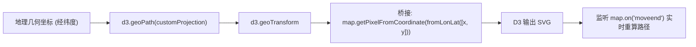

<nav aria-label="breadcrumb"><ol class="breadcrumb mb-4"><li class="breadcrumb-item"><a href="../">Home</a></li><li class="breadcrumb-item"><a href="./">Summary</a></li><li class="breadcrumb-item active" aria-current="page">外部库融合与异构数据指南</li></ol></nav>

# OpenLayers 外部图表库融合与异构数据解析实战指南

> 在现实的企业级数据可视化与 BI 分析场景中，空间数据源往往并非标准的 GeoJSON 或 WFS 服务，而是来自**业务数据库导出的纯文本 CSV 表格**，或是为了节省网络带宽而经过拓扑压缩的 **TopoJSON** 格式。
>
> 与此同时，单一依靠 GIS 引擎自带的基础点线面样式，往往难以满足诸如 **D3.js 的复杂数据驱动图表（如 Voronoi 多边形、力导向网络图）**或**复杂复合统计符号（如气象风向玫瑰图、分级震级环）**的制图表达需求。
>
> OpenLayers 具有极强的生态开放性与管道扩展能力。本文基于 4 个核心官方示例，系统解构 D3.js 投影适配桥接、前端流式 CSV 解析入库、TopoJSON 共享弧段解压与 Canvas 自定义复合统计符号的开发范式。

---

## 1. 架构总览：4 个外部库与异构数据核心官方示例矩阵

| 分类 | 示例标识 | 核心技术机制 | 解决的典型生产场景 |
| :--- | :--- | :--- | :--- |
| **D3.js 深度融合** | [`d3`](../en/latest/examples/d3.html) | `d3.geoTransform` 桥接 OpenLayers 像素坐标映射 | 利用 D3 的 SVG 路径生成器在瓦片底图上渲染高精度行政多边形 |
| **纯前端 CSV 解析** | [`csv`](../en/latest/examples/csv.html) | 原生 Fetch 文本流 + 正则/分词提取经纬度并动态构建要素 | 纯前端直接加载千万行级别气象台站、空气质量监测点 CSV 表格 |
| **TopoJSON 拓扑压缩** | [`topojson`](../en/latest/examples/topojson.html) | `ol/format/TopoJSON` 共享弧段（Shared Arcs）解算 | 大幅削减传输体积（较 GeoJSON 压缩 80%）的行政区划极速加载 |
| **自定义复合符号** | [`earthquake-custom-symbol`](../en/latest/examples/earthquake-custom-symbol.html) | `render` 回调接管原生 Canvas 绘制同心统计符号 | 绘制震级环、同心警报圈、风向标等富图表符号 |

---

## 2. D3.js 与 OpenLayers 投影管道无缝桥接（`d3`）

### 2.1 坐标转换桥接原理

D3.js 的核心路径生成器 `d3.geoPath()` 依赖一个投影函数（Projection Function），将地理坐标 $[\lambda, \varphi]$ 转换为屏幕像素 $[x, y]$。

OpenLayers 已经维护了高精度的坐标到像素映射系统 `map.getPixelFromCoordinate()`。因此，只需利用 `d3.geoTransform` 实现一个轻量适配器，即可让 D3 直接使用 OpenLayers 的相机矩阵：



### 2.2 生产级 D3.js 桥接代码范式

```javascript
import Map from 'ol/Map.js';
import { fromLonLat } from 'ol/proj.js';
import * as d3 from 'd3';

// 1. 构造自定义 D3 投影转换器
const transform = d3.geoTransform({
  point: function (x, y) {
    // 将 WGS84 经纬度投影至当前地图 Web 墨卡托像素
    const pixel = map.getPixelFromCoordinate(fromLonLat([x, y]));
    this.stream.point(pixel[0], pixel[1]);
  },
});

const path = d3.geoPath().projection(transform);

// 2. 将 SVG 容器挂载到地图主 DOM 内部
const svg = d3.select(map.getViewport()).append('svg')
  .style('position', 'absolute')
  .style('top', 0)
  .style('left', 0)
  .style('width', '100%')
  .style('height', '100%')
  .style('pointer-events', 'none');

// 3. 地图平移缩放结束时，触发 D3 重新计算路径
function renderD3() {
  svg.selectAll('path')
    .data(features.features)
    .join('path')
    .attr('d', path)
    .attr('fill', 'rgba(255, 0, 0, 0.4)')
    .attr('stroke', '#fff');
}

map.on('moveend', renderD3);
```

---

## 3. 纯前端 CSV 坐标解析与要素流水线（`csv`）

在轻量级应用中，后端往往直接抛出 CSV 文本文件（如 `station_id,name,lat,lon,pm25`）。

```javascript
import Feature from 'ol/Feature.js';
import Point from 'ol/geom/Point.js';
import { fromLonLat } from 'ol/proj.js';
import VectorSource from 'ol/source/Vector.js';

fetch('data/stations.csv')
  .then((res) => res.text())
  .then((csvText) => {
    const lines = csvText.split('\n');
    const features = [];

    // 跳过首行表头
    for (let i = 1; i < lines.length; i++) {
      const line = lines[i].trim();
      if (!line) continue;
      const parts = line.split(',');

      const lon = parseFloat(parts[2]);
      const lat = parseFloat(parts[1]);

      if (!isNaN(lon) && !isNaN(lat)) {
        const feature = new Feature({
          geometry: new Point(fromLonLat([lon, lat])),
          name: parts[0],
          value: parseFloat(parts[3]),
        });
        features.push(feature);
      }
    }

    // 批量装配进矢量数据源，触发单次渲染批处理
    vectorSource.addFeatures(features);
  });
```

---

## 4. TopoJSON 共享弧段与空间拓扑解压（`topojson`）

### 4.1 为什么 TopoJSON 优于 GeoJSON？

当展示全球 200 多个国家或中国 300 多个地级市的邻接多边形时，在 GeoJSON 中两省交界线会被重复记录两次，造成严重的空间数据冗余。

TopoJSON 引入**拓扑弧段字典（Arcs Dictionary）**机制：
- 任意一条共享边界仅存储一次；
- 多边形由弧段索引数组（如 `[12, -45, 89]`，负号表示逆向）组合而成；
- 数据体积平均压缩 **70% ~ 85%**。

OpenLayers 内置了透明解压格式解析器：

```javascript
import VectorSource from 'ol/source/Vector.js';
import TopoJSON from 'ol/format/TopoJSON.js';

const vectorSource = new VectorSource({
  url: 'data/world-110m.json',
  format: new TopoJSON({
    // 指定从 TopoJSON 的 objects 字典中提取指定图层
    layers: ['countries'],
  }),
});
```

---

## 5. Canvas 即时绘制复合统计符号（`earthquake-custom-symbol`）

当需要绘制复杂的图表化符号（例如：根据震级大小绘制同心半透明辐射圈，中心叠加数字文字）时，单一的 `ol/style/Circle` 无法满足。

OpenLayers 提供了 `ImageStyle` 的 `renderer` 钩子，直接接管底层 Canvas 2D 绘图上下文：

```javascript
import Style from 'ol/style/Style.js';
import ImageStyle from 'ol/style/Image.js';

const customSymbolStyle = new Style({
  renderer: function (pixelCoordinates, state) {
    const ctx = state.context;
    const [x, y] = pixelCoordinates;
    const magnitude = state.feature.get('magnitude');
    const radius = magnitude * 4;

    ctx.save();
    // 1. 绘制外圈半透明光晕
    ctx.beginPath();
    ctx.arc(x, y, radius, 0, 2 * Math.PI);
    ctx.fillStyle = 'rgba(255, 69, 0, 0.3)';
    ctx.fill();

    // 2. 绘制内圈实心圆心
    ctx.beginPath();
    ctx.arc(x, y, 3, 0, 2 * Math.PI);
    ctx.fillStyle = '#ff4500';
    ctx.fill();

    // 3. 绘制文字标注
    ctx.font = 'bold 11px sans-serif';
    ctx.fillStyle = '#000';
    ctx.textAlign = 'center';
    ctx.fillText(`M${magnitude}`, x, y - radius - 3);

    ctx.restore();
  },
});
```
