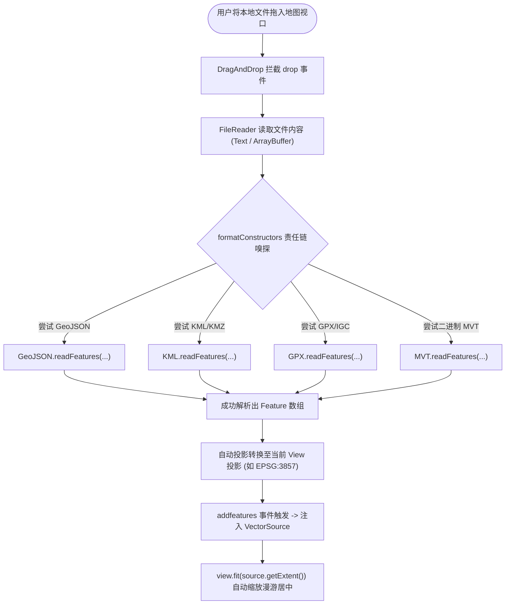

<nav aria-label="breadcrumb"><ol class="breadcrumb mb-4"><li class="breadcrumb-item"><a href="../">Home</a></li><li class="breadcrumb-item"><a href="./">Summary</a></li><li class="breadcrumb-item active" aria-current="page">空间文件拖拽解析指南</li></ol></nav>

# OpenLayers 本地空间文件拖拽导入与格式自动解析实战指南
> 针对将本地桌面端 GIS 文件快速拖入网页进行即时标绘与空间分析的业务诉求，系统解构 `ol/interaction/DragAndDrop` 架构、多格式无缝自动探测（GeoJSON, KML, GPX, IGC, TopoJSON）、纯前端 KMZ 压缩包内联解压以及二进制 MVT 矢量切片拖拽加载技术。

---

## 1. 核心架构与无缝格式探测链路

现代 Web 浏览器原生支持 HTML5 Drag & Drop API。OpenLayers 将文件读取、格式嗅探、要素反序列化与坐标投影转换封装为一体化的 `ol/interaction/DragAndDrop`：



---

## 2. 官方示例矩阵解构

| 示例标识 | 核心实现与涉及模块 | 典型生产应用场景 |
| :--- | :--- | :--- |
| [`drag-and-drop`](../en/latest/examples/drag-and-drop.html) | `ol/interaction/DragAndDrop` 配置 5 大标准矢量格式数组 + 视口自动定焦 | 零后端支持的快速数据探查工具、离线 GIS 标绘系统 |
| [`drag-and-drop-custom-kmz`](../en/latest/examples/drag-and-drop-custom-kmz.html) | 自定义 `JSZip` 处理器，解压 `.kmz` 提取 `doc.kml` 并动态将内嵌图片替换为 Blob URL | 军民标图、无人机航测航线与航模航迹数据快速校验 |
| [`drag-and-drop-custom-mvt`](../en/latest/examples/drag-and-drop-custom-mvt.html) | 自定义 ArrayBuffer 读取器 + `MVT` 格式加载独立 `.pbf` / `.mvt` 二进制切片 | 矢量切片服务调试、单切片数据结构与要素属性深度探查 |

---

## 3. 核心实现与典型范式

### 3.1 零后端纯前端多格式自动嗅探范式

在 `drag-and-drop.html` 中，展示了配置自动解析器的标准方式：

```javascript
import Map from 'ol/Map';
import View from 'ol/View';
import VectorSource from 'ol/source/Vector';
import VectorLayer from 'ol/layer/Vector';
import DragAndDrop from 'ol/interaction/DragAndDrop';
import GPX from 'ol/format/GPX';
import GeoJSON from 'ol/format/GeoJSON';
import IGC from 'ol/format/IGC';
import KML from 'ol/format/KML';
import TopoJSON from 'ol/format/TopoJSON';

const source = new VectorSource();
const layer = new VectorLayer({source: source});

const map = new Map({
  target: 'map',
  layers: [layer],
  view: new View({center: [0, 0], zoom: 2}),
});

// 配置拖拽交互组件
const dragAndDropInteraction = new DragAndDrop({
  // 按照优先级声明支持的解析器列表
  formatConstructors: [GPX, GeoJSON, IGC, KML, TopoJSON],
});

// 监听解析成功事件
dragAndDropInteraction.on('addfeatures', function (event) {
  // 1. 获取解析完成并已自动投影的要素
  const features = event.features;
  source.addFeatures(features);

  // 2. 视口平滑飞行定焦到新导入的数据包围盒
  map.getView().fit(source.getExtent(), {
    padding: [50, 50, 50, 50],
    duration: 1000,
  });
});

map.addInteraction(dragAndDropInteraction);
```

---

### 3.2 KMZ 压缩包前端解压与图片资源替换范式

在 `drag-and-drop-custom-kmz.html` 中，针对 KMZ 本质是 Zip 压缩包（内含 `doc.kml` 及各种 png/jpg 图标资源）的特点，展示了基于 `JSZip` 的无缝加载方案：

```javascript
import JSZip from 'jszip';
import KML from 'ol/format/KML';

class KMZFormat {
  getType() {
    return 'arraybuffer'; // 声明接收二进制流
  }
  readFeatures(buffer, options) {
    const zip = new JSZip();
    return zip.loadAsync(buffer).then(function (archive) {
      // 提取核心 doc.kml 文件内容
      const kmlFile = archive.file('doc.kml') || Object.values(archive.files).find(f => f.name.endsWith('.kml'));
      return kmlFile.async('text').then(function (kmlText) {
        // 将压缩包内的图片转换为内存 Blob URL 替换 KML 中的相对路径
        // ...
        return new KML().readFeatures(kmlText, options);
      });
    });
  }
}
```

---

## 4. 生产避坑指南与性能治理

### 4.1 自动投影转换（Target Projection）防错位
- 原始文件如果未配置投影，OpenLayers 默认假设数据源为 `EPSG:4326`（标准经纬度），并自动转换为当前 `map.getView().getProjection()`（通常为 `EPSG:3857`）。
- **警示**：如果用户拖入的是投影坐标（如西安80、北京54或本地高斯投影），直接拖入会导致要素飞到宇宙之外（坐标数值高达几千万）。在企业级平台中，建议在拖拽解析前弹窗提供“源坐标系选择确认”交互。

### 4.2 超大文件（> 30MB）导致主线程冻结卡死
- **根因**：浏览器的主线程如果解析超过 50,000 个复杂多边形或密集顶点的 GeoJSON，JSON 反序列化将耗时数秒，引发页面完全无响应（卡死）。
- **优化方案**：对于超大文件，推荐在独立的 Web Worker 线程中运行 `readFeatures`，完成几何解算后再通过 Transferable Objects 传递给主线程渲染。
