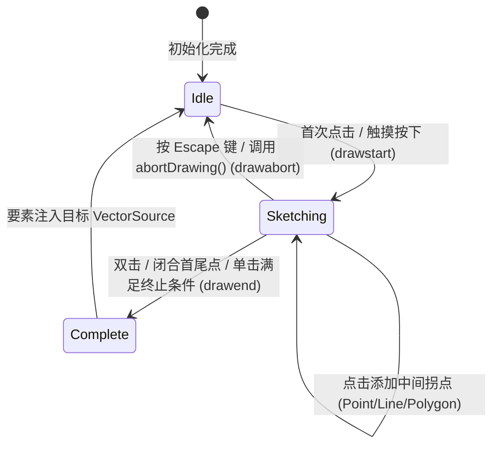
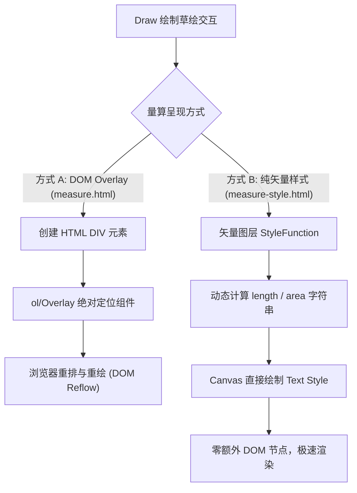

<nav aria-label="breadcrumb"><ol class="breadcrumb mb-4"><li class="breadcrumb-item"><a href="../">Home</a></li><li class="breadcrumb-item"><a href="./">Summary</a></li><li class="breadcrumb-item active" aria-current="page">Draw 绘制与几何数字化指南</li></ol></nav>

# OpenLayers 矢量绘制与图形数字化全景实战指南

> 基于 17 个核心绘制官方示例，全面解构几何采样本体、吸附捕捉网格、拓扑追踪描摹、动态量算与 WebGL 沿线着色渲染

---

## 引言：交互式矢量数字化的核心挑战

地图矢量绘制（Vector Digitization）是地理信息系统采集空间数据、标记业务实体与交互量算的核心入口。

在 OpenLayers 中，绘制不仅是捕捉鼠标点击并生成几何坐标，更涉及复杂的交互协同网络：

1. **几何形态多样性**：从常规点、线、面，到正多边形、星形等规则几何，再到在地球曲面上保持真实物理半径的大圆测地线（Geodesic Circle）；
2. **交互链路闭环**：绘制（Draw）、修改（Modify）、捕捉吸附（Snap）与拓扑边界自动追踪（Tracing）的无缝切换与事件传递；
3. **实时计算与量算呈现**：动态草绘过程中的距离与面积量算，以及基于 DOM Overlay 或矢量样式纯 Canvas 渲染的性能权衡；
4. **拓扑一致性与大图元维护**：共享边界的拓扑构建（如 Topolis 库集成）与自相交校验；
5. **硬件加速渲染**：利用 WebGL 矢量流水线实现高帧率动态沿线着色、虚线调节与时空轨迹（XYM 维度）过滤。

本文立足官方示例库中带 `draw` 标签的 **17 个核心示例**，建立完整的矢量绘制知识图谱与工程架构体系。

---

## 第一部分：全景视盘——17 个 Draw 核心示例矩阵

| 分类体系               | 示例标识                                                                          | 核心机制 / 关键 API                                         | 解决的典型生产场景                             |
| :--------------------- | :-------------------------------------------------------------------------------- | :---------------------------------------------------------- | :--------------------------------------------- |
| **基础绘制与规则图形** | [`draw-features`](../en/latest/examples/draw-features.html)                       | `ol/interaction/Draw` 基础配置（Point/Line/Polygon/Circle） | 基础图形采集与图层实时绑定                     |
|                        | [`draw-freehand`](../en/latest/examples/draw-freehand.html)                       | `freehand: true` 自由轨迹手绘模式                           | 涂鸦批注、电子围栏快速勾勒、触摸手写板录入     |
|                        | [`draw-shapes`](../en/latest/examples/draw-shapes.html)                           | `createRegularPolygon` / `createBox` 自定义几何函数         | 方位角矩形、正三角形、星形等多边形规则采集     |
|                        | [`draw-features-style`](../en/latest/examples/draw-features-style.html)           | `style` 配置独立草绘图层样式（Sketch Style）                | 区分正在绘制的半透明预览状态与入库实体的样式   |
| **绘制与修改协同**     | [`draw-and-modify-features`](../en/latest/examples/draw-and-modify-features.html) | `Draw` 与 `Modify` 共享同一 `VectorSource`                  | 绘制完成即刻转为顶点拖拽，全流程闭环编辑       |
|                        | [`draw-and-modify-geodesic`](../en/latest/examples/draw-and-modify-geodesic.html) | `GeometryCollection` + `Polygon#circular` 球面大圆          | 消除墨卡托投影高纬拉伸，绘制球面真实物理半径圆 |
|                        | [`modify-scale-and-rotate`](../en/latest/examples/modify-scale-and-rotate.html)   | `condition` 配合修饰键实现以几何质心旋转缩放                | 标绘符号整体平移旋转，免去单独重绘             |
| **捕捉、追踪与拓扑**   | [`snap`](../en/latest/examples/snap.html)                                         | `ol/interaction/Snap` 顶点与边线吸附                        | 消除空间接边缝隙，保证要素边界严密闭合         |
|                        | [`snap-custom-segmenter`](../en/latest/examples/snap-custom-segmenter.html)       | `segmenter` 自定义折线分割器                                | 沿折线中点、三分点或等分节点吸附定位           |
|                        | [`tracing`](../en/latest/examples/tracing.html)                                   | `trace: true` 自动拓扑寻路描摹                              | 沿复杂行政边界、河流岸线自动吸附并闭合多边形   |
|                        | [`draw-modify-trace-snap`](../en/latest/examples/draw-modify-trace-snap.html)     | `traceSource` 跨图层追踪与动态状态机切换                    | 复杂地块切分与边界共享数字化生产线             |
|                        | [`topolis`](../en/latest/examples/topolis.html)                                   | Topolis 拓扑数据结构集成（Node/Edge/Face）                  | 地籍地块共享边编辑、相交删边与自动构面         |
| **空间动态量算**       | [`measure`](../en/latest/examples/measure.html)                                   | `getLength()` / `getArea()` + Overlay DOM 标签              | 绘制过程中动态跟随光标显示实时距离与面积气泡   |
|                        | [`measure-style`](../en/latest/examples/measure-style.html)                       | 纯矢量样式函数（Style Function）输出动态标注                | 零 DOM 节点开销，百万级测量标记流畅平移缩放    |
| **线条样式与 WebGL**   | [`line-arrows`](../en/latest/examples/line-arrows.html)                           | `geometry.forEachSegment()` + 方位角图标旋转                | 航线、水流、单行道方向动态箭头装饰             |
|                        | [`webgl-draw-line`](../en/latest/examples/webgl-draw-line.html)                   | `WebGLVectorLayer` + 动态 Uniform 样式变量                  | GPU 级线条平滑线宽、虚线与纹理渲染             |
|                        | [`filter-webgl-line`](../en/latest/examples/filter-webgl-line.html)               | `['line-metric']` 表达式 + `XYM` 测量维度                   | 飞行滑翔航迹随时间戳动态演进与渐变着色         |

---

## 第二部分：架构全景——`ol/interaction/Draw` 运行模型与生命周期

`ol/interaction/Draw` 继承自 `PointerInteraction`，通过处理 `pointerdown`、`pointermove` 和 `pointerup` 事件驱动几何对象的创建。

### 1. 绘制生命周期与状态机



### 2. 内部草绘图层与样式隔离

当初始化 `new Draw({source, style})` 时：

- `Draw` 内部自动维护一个专用的 **Overlay 临时图层**，当前正在绘制尚未落库的几何对象保存在 `sketchFeature_` 中；
- 若显式配置了 `style`，该临时要素会应用自定义的草绘样式（例如半透明填充、高亮虚线描边等）；
- 只有触发 `drawend` 事件后，该几何要素才会被真正添加到传入的业务 `source` 中，并应用业务图层的正式样式。

### 3. `geometryFunction` 自定义几何回调

默认情况下，`Draw` 会依据 `type`（如 `Point`, `LineString`, `Polygon`, `Circle`）生成标准几何。如果需要绘制特殊几何形状，可通过 `geometryFunction` 拦截并重写几何生成过程：

```javascript
// 函数签名
function(coordinates, opt_geometry, projection) {
  // coordinates: 当前绘制已经记录的坐标数组（首点、中间点及当前光标预览点）
  // opt_geometry: 内部可复用的几何实例，避免频繁 GC
  // projection: 地图当前投影对象
  return geometry; // 返回最终几何对象
}
```

官方内置了两个开箱即用的快捷函数：

- `createBox()`：利用两点（左上角与右下角）绘制轴对齐矩形多边形；
- `createRegularPolygon(opt_sides, opt_angle)`：以首点为圆心、第二点为半径生成正 $N$ 边形或规则星形。

---

## 第三部分：协同编辑枢纽——Draw + Modify + Snap + Tracing 四位一体

### 1. 交互职责链与添加顺序律

在 OpenLayers 的事件分发管道中，交互（Interaction）按照**后添加先响应（逆序分发）**的规则执行。为了保证在数字化编辑时鼠标能够准确吸附到现有要素上，必须严格遵守以下注册顺序：

```javascript
// 1. 先添加 Modify 交互（处于底层，供拖拽编辑）
map.addInteraction(modifyInteraction);

// 2. 再添加 Draw 交互（供新要素数字化）
map.addInteraction(drawInteraction);

// 3. 最后添加 Snap 交互（最先捕获 pointermove，将光标坐标精准吸附到现有边界上）
map.addInteraction(snapInteraction);
```

### 2. Snap 捕捉吸附与自定义分割器（Custom Segmenter）

`ol/interaction/Snap` 监听鼠标位置，当距离现有要素小于设定的 `pixelTolerance`（默认 10 像素）时，自动将光标坐标修正为顶点或边线上的投影垂足。

在 [`snap-custom-segmenter`](../en/latest/examples/snap-custom-segmenter.html) 中，通过配置 `segmenter` 回调函数，可以将折线切分为更细密的虚拟段，实现“线段中点吸附”或“等分点吸附”：

```javascript
const snap = new Snap({
  source: source,
  segmenter: function (flatCoordinates, offset, end, stride) {
    // 获取当前线段起点与终点
    const start = flatCoordinates.slice(offset, offset + stride);
    const stop = flatCoordinates.slice(end - stride, end);
    // 计算线段中点
    const midpoint = [(start[0] + stop[0]) / 2, (start[1] + stop[1]) / 2];
    // 返回包含起点、中点、终点的展平坐标数组，供 Snap 注册捕捉候选
    return [...start, ...midpoint, ...stop];
  },
});
```

### 3. Tracing 拓扑追踪描摹机制

在水利红线、行政区划或地籍调查中，新画地块往往需要“紧贴”现有地块边界。传统人工逐点描摹极易留下缝隙或重叠自相交。

[`tracing`](../en/latest/examples/tracing.html) 与 [`draw-modify-trace-snap`](../en/latest/examples/draw-modify-trace-snap.html) 引入了拓扑寻路机制：

- 配置 `trace: true` 与 `traceSource: targetSource`；
- **起点锁定**：点击目标要素边界，自动捕捉为描摹起始点；
- **路径寻优**：移动光标时，引擎沿目标要素多边形环自动寻找两点间拓扑距离最短的连续折线段；
- **终点闭合**：再次点击边界上的点，自动将追踪段注入当前绘制的几何中，完成无缝贴边。

---

## 第四部分：数学与算法篇——测地线、规则几何与方向矢量

### 1. 测地线圆（Geodesic Circle）与投影变形矫正

常规 `ol/geom/Circle` 是二维笛卡尔平面圆，其半径以投影单位（如米）计算。在 Web 墨卡托投影（EPSG:3857）下，纬度 $y$ 处的局部长度变形比为：

$$k = \sec(\varphi) = \frac{1}{\cos(\varphi)}$$

在高纬度地区（如高纬度极区或欧洲北部），一个标称半径 1000 公里的平面投影圆，在地图上看似正圆，但实际地面物理覆盖范围已严重失真萎缩。

在 [`draw-and-modify-geodesic`](../en/latest/examples/draw-and-modify-geodesic.html) 中，核心采用 `ol/geom/Polygon#circular` 生成球面大圆：

```javascript
import { circular } from "../src/ol/geom/Polygon.js";
import { getDistance } from "../src/ol/sphere.js";

// 计算两点球面物理真实距离（哈弗辛公式 Haversine）
const centerLonLat = transform(center, projection, "EPSG:4326");
const edgeLonLat = transform(edgeCoord, projection, "EPSG:4326");
const radiusInMeters = getDistance(centerLonLat, edgeLonLat);

// 生成由 128 个顶点构成的球面大圆多边形，再重投影回视图坐标系
const geodesicPolygon = circular(centerLonLat, radiusInMeters, 128);
geodesicPolygon.transform("EPSG:4326", projection);
```

> [!NOTE]
> 在 Web 墨卡托视图下，真实的测地线圆会随着纬度升高而呈现上下扁平或类椭圆形，这正是保持地表真实距离一致的正确数学反映。

### 2. 规则图形极坐标展开

在 [`draw-shapes`](../en/latest/examples/draw-shapes.html) 中，自定义正多边形与星形基于极坐标参数方程：

$$x_i = x_0 + r \cdot \cos\left(\theta_0 + \frac{2\pi i}{N}\right), \quad y_i = y_0 + r \cdot \sin\left(\theta_0 + \frac{2\pi i}{N}\right)$$

### 3. 折线子段航向角与箭头指示

在 [`line-arrows`](../en/latest/examples/line-arrows.html) 中，沿线箭头的朝向通过相邻节点坐标差计算得出：

$$\theta = \operatorname{atan2}(y_{\text{end}} - y_{\text{start}},\, x_{\text{end}} - x_{\text{start}})$$

```javascript
geometry.forEachSegment(function (start, end) {
  const dx = end[0] - start[0];
  const dy = end[1] - start[1];
  const rotation = Math.atan2(dy, dx); // 计算线段弧度角
  styles.push(
    new Style({
      geometry: new Point(end),
      image: new Icon({
        src: "data/arrow.png",
        rotateWithView: true, // 随地图旋转保持相对方向
        rotation: -rotation,
      }),
    }),
  );
});
```

---

## 第五部分：空间量算与 WebGL 硬件加速

### 1. 动态量算架构选型：DOM Overlay vs 纯矢量样式



- **[`measure`](../en/latest/examples/measure.html)（DOM Overlay 方案）**：
  - 优势：支持任意 HTML/CSS 定制，可插入删除按钮或提示气泡；
  - 劣势：每段线或多边形均产生真实 DOM 节点，频繁缩放或成百上千个测量标记时产生性能瓶颈。
- **[`measure-style`](../en/latest/examples/measure-style.html)（纯矢量样式方案）**：
  - 优势：完全脱离 DOM，测量结果直接作为 Feature 的 `Text` 样式在 Canvas 上渲染，内存开销低，支持百万级平移缩放；
  - 劣势：样式表现受 Canvas 文本排版能力限制。

### 2. WebGL 矢量图层硬件加速

在 [`webgl-draw-line`](../en/latest/examples/webgl-draw-line.html) 与 [`filter-webgl-line`](../en/latest/examples/filter-webgl-line.html) 中，线条通过 GPU 着色器直接渲染：

- **`updateStyleVariables`**：动态修改线宽、虚线偏移或时间戳，直接更新 GPU Uniforms，耗时小于 1 毫秒，无须重刷顶点缓冲区；
- **`['line-metric']` 操作符**：读取几何坐标中的 M 维（如 GPS 时间戳、高程、里程桩号），在片元着色器中执行实时线性插值（`interpolate`）与阈值过滤（`filter: ['<=', ['line-metric'], ['var', 'timestamp']]`）。

---

## 第六部分：工程避坑与最佳实践指南

### 1. 移动端与自由手绘（Freehand）防抖防误触

在触屏或触控笔场景下，`freehand: true` 会以极高频率接收 `pointermove`。

- **问题**：生成密集过量顶点，导致 GeoJSON 体积暴增且后续拓扑运算卡顿；
- **对策**：在 `drawend` 事件中结合 Douglas-Peucker 算法（`geometry.simplify(tolerance)`）进行顶点抽取平滑。

### 2. 避免绘制自相交多边形（Polygon Self-Intersection）

OpenLayers 默认 `Polygon` 并不校验自相交。如需构建地籍或拓扑图元：

- 推荐使用 [`topolis`](../en/latest/examples/topolis.html) 维护平面拓扑图（Planar Graph），将相交线段自动打断为节点并计算独立拓扑面；
- 或在 `drawend` 中结合 Turf.js 的 `kinks()` 进行自相交校验并拦截非法要素。

### 3. 多世界循环（wrapX）下的几何跨度

如果地图视图开启了世界连续横向滚动，绘制多边形若跨越 180° 经线可能被切割成反向拉伸的大多边形：

- 在 `VectorSource` 中配置 `wrapX: false`；
- 或在 `Draw` 构造器中限制绘制在主世界范围之内。

---

## 附录：17 个 Draw 核心示例直达索引

1. [draw-features](../en/latest/examples/draw-features.html) — 基础点、线、面、圆绘制
2. [draw-freehand](../en/latest/examples/draw-freehand.html) — 自由手绘模式
3. [draw-shapes](../en/latest/examples/draw-shapes.html) — 正多边形与规则几何生成
4. [draw-features-style](../en/latest/examples/draw-features-style.html) — 自定义草绘样式隔离
5. [draw-and-modify-features](../en/latest/examples/draw-and-modify-features.html) — 绘制与修改协同编辑
6. [draw-and-modify-geodesic](../en/latest/examples/draw-and-modify-geodesic.html) — 测地线大圆高纬保真
7. [modify-scale-and-rotate](../en/latest/examples/modify-scale-and-rotate.html) — 交互式缩放与旋转
8. [snap](../en/latest/examples/snap.html) — 顶点与边界捕捉吸附
9. [snap-custom-segmenter](../en/latest/examples/snap-custom-segmenter.html) — 自定义分割器与中点吸附
10. [tracing](../en/latest/examples/tracing.html) — 边界自动拓扑寻路描摹
11. [draw-modify-trace-snap](../en/latest/examples/draw-modify-trace-snap.html) — 数字化生产综合交互
12. [topolis](../en/latest/examples/topolis.html) — Topolis 拓扑数据结构集成
13. [measure](../en/latest/examples/measure.html) — 动态量算（DOM Overlay 模式）
14. [measure-style](../en/latest/examples/measure-style.html) — 动态量算（矢量样式 Canvas 模式）
15. [line-arrows](../en/latest/examples/line-arrows.html) — 折线分段箭头方向指示
16. [webgl-draw-line](../en/latest/examples/webgl-draw-line.html) — WebGL 线条渲染与动态 Uniform
17. [filter-webgl-line](../en/latest/examples/filter-webgl-line.html) — WebGL 沿线度量过滤与时间渐变
