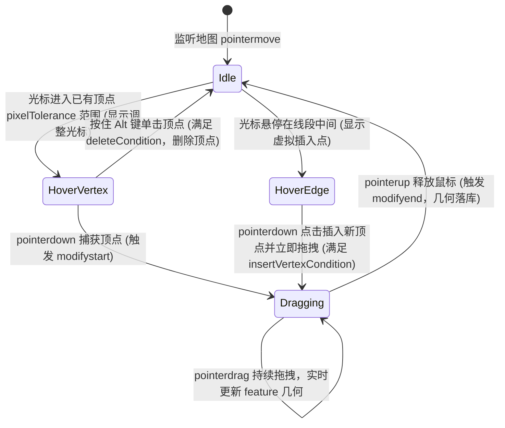
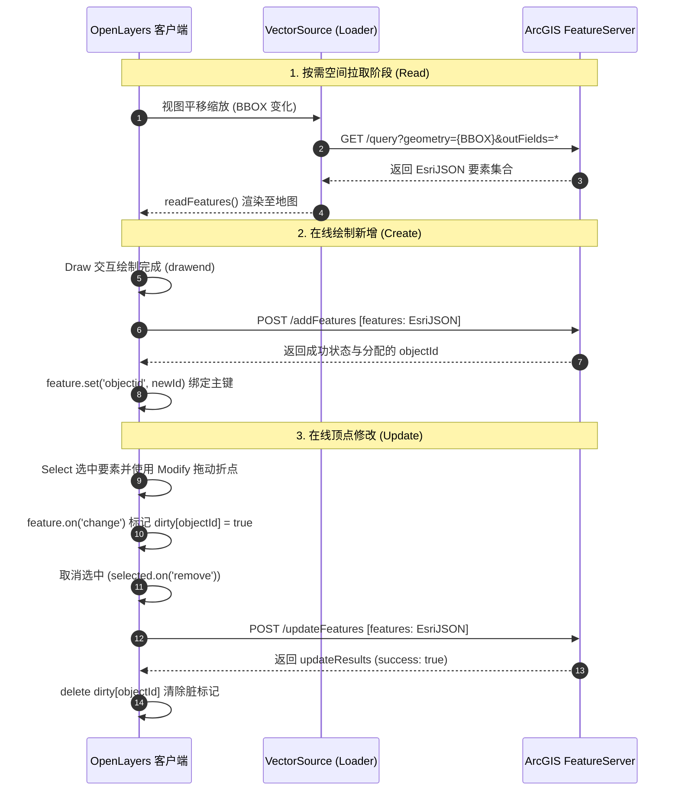

<nav aria-label="breadcrumb"><ol class="breadcrumb mb-4"><li class="breadcrumb-item"><a href="../">Home</a></li><li class="breadcrumb-item"><a href="./">Summary</a></li><li class="breadcrumb-item active" aria-current="page">Edit 要素编辑与拓扑修改指南</li></ol></nav>

# OpenLayers 空间要素编辑与数字化修改全景实战指南
> 基于 13 个核心编辑官方示例，深度解析要素顶点微调、几何形变变换、复杂多环拓扑控制与服务端 CUD 事务提交闭环

---

## 引言：从简单标绘到空间资产全生命周期维护

在地理信息系统（GIS）工程中，几何创建（Create）通常只是空间数据生命周期的第一步，而空间编辑（Edit: Update / Delete）才是业务资产日常运维的核心。

与单纯的点击绘制相比，空间要素编辑面临更严苛的技术要求：
1. **交互状态精确解耦**：如何控制只有选中的要素才激活顶点控制器，避免全图要素同时处于可编辑状态造成误触；
2. **顶点级精细控制**：折点平移、线段中点插值、按键删点（`deleteCondition`）以及针对特殊几何类型禁止插入新顶点（`insertVertexCondition`）；
3. **复合形变变换**：不依赖重新绘制，围绕几何质心执行等比缩放与自由旋转，保持几何形态比例；
4. **拓扑一致性保护**：多边形公共接边顶点的联动同步、内环洞（Holes）的处理，以及结合平面拓扑引擎（Topolis）保证空间拓扑有效性；
5. **前后端在线协同闭环**：结合空间查询范围分块加载数据，客户端执行脏检查（Dirty Tracking），并将增删改操作可靠同步至服务端（如 ArcGIS FeatureServer、OGC WFS-T 等）。

本文立足官方示例库中带 `edit` 标签的 **13 个核心示例**，全面解构 OpenLayers 的编辑交互体系、状态机控制与在线业务闭环。

---

## 第一部分：全景视盘——13 个 Edit 核心示例矩阵

| 分类体系 | 示例标识 | 核心机制 / 关键 API | 解决的典型生产场景 |
| :--- | :--- | :--- | :--- |
| **经典顶点修改与选择** | [`modify-features`](../en/latest/examples/modify-features.html) | `Select` + `Modify({features})` | 选中要素激活顶点编辑，Alt+点击删除折点，多选保持公共接边 |
| | [`modify-test`](../en/latest/examples/modify-test.html) | `insertVertexCondition` 条件函数 | 复杂几何测试（内环洞、多面、几何集合），限制禁止向多边形加点 |
| | [`modify-scale-and-rotate`](../en/latest/examples/modify-scale-and-rotate.html) | `condition` 配合修饰键进行仿射变换 | 基于不变质心执行要素缩放与旋转，免去单独重画标绘符号 |
| **绘制与修改闭环流水线** | [`draw-and-modify-features`](../en/latest/examples/draw-and-modify-features.html) | `Draw` + `Modify` + `Snap` 协同 | 标绘三位一体闭环：一边绘制新图形，一边微调已有要素 |
| | [`draw-and-modify-geodesic`](../en/latest/examples/draw-and-modify-geodesic.html) | `GeometryCollection` + `Polygon#circular` | 消除墨卡托投影高纬拉伸，球面测地线大圆圆心与半径同步编辑 |
| | [`draw-features`](../en/latest/examples/draw-features.html) | `removeLastPoint()` 动态撤销顶点 | 绘制线或面时光标逐点回退，支持 Shift 快捷键切换手绘模式 |
| | [`draw-freehand`](../en/latest/examples/draw-freehand.html) | `freehand: true` 自由轨迹手绘 | 屏幕连续拖拽涂鸦批注、电子围栏勾勒 |
| | [`draw-shapes`](../en/latest/examples/draw-shapes.html) | 自定义 `geometryFunction` 规则图形 | 两点框选生成正多边形、多角星形及轴对齐矩形 |
| **拓扑吸附与图元维护** | [`snap`](../en/latest/examples/snap.html) | `ol/interaction/Snap` 顶点与边线捕捉 | 消除要素接缝与微小重叠，保证编辑时顶点严密重合 |
| | [`topolis`](../en/latest/examples/topolis.html) | Topolis 拓扑数据结构（Node/Edge/Face） | 地籍地块共享边维护、绘制线段相交自动删边与合并邻接面 |
| **空间动态交互量算** | [`measure`](../en/latest/examples/measure.html) | `getLength` / `getArea` + DOM Overlay | 边绘制边跟随光标显示实时距离与面积浮动气泡 |
| | [`measure-style`](../en/latest/examples/measure-style.html) | 纯矢量样式函数（Style Function）输出标注 | 零 DOM 开销，海量测量要素在 Canvas 上流畅缩放平移 |
| **服务端在线空间编辑** | [`vector-esri-edit`](../en/latest/examples/vector-esri-edit.html) | ArcGIS REST `addFeatures` / `updateFeatures` | 瓦片化空间拉取、客户端脏检查，向服务端提交在线空间事务 |

---

## 第二部分：核心架构——`ol/interaction/Modify` 运行机制与状态机

`ol/interaction/Modify` 是 OpenLayers 要素编辑的中枢交互，专用于调整矢量要素的顶点坐标。

### 1. 顶点编辑生命周期与状态流转



### 2. 要素绑定模式对比：绑定 Source vs 绑定 Collection
`Modify` 支持两种初始化数据绑定的方式，决定了编辑器的交互安全级别：

| 绑定方式 | 初始化配置 | 运作特点 | 适用场景 |
| :--- | :--- | :--- | :--- |
| **全源绑定** | `new Modify({source: vectorSource})` | 地图上该图层内的**所有要素均处于可编辑状态**，鼠标悬停任意要素顶点都会出现手柄 | 纯单图层轻量标绘、简易草稿画布 |
| **动态集合绑定** | `new Modify({features: select.getFeatures()})` | 仅当要素被 `Select` 交互选中后才激活编辑控制器，未选中的要素保持静默 | **企业级 GIS 生产环境**，彻底杜绝全图要素误触 |

### 3. 条件控制钩子（Conditions）
- **`insertVertexCondition`**：控制何时允许在线段中间插入新顶点。在 [`modify-test`](../en/latest/examples/modify-test.html) 中，通过该条件函数可以禁止向多边形中插入新顶点（仅允许拖动已有顶点）：
  ```javascript
  const modify = new Modify({
    features: select.getFeatures(),
    insertVertexCondition: function () {
      // 若当前选中的要素包含多边形，则拦截加点动作
      return !select.getFeatures().getArray().every(function (feature) {
        return /Polygon/.test(feature.getGeometry().getType());
      });
    },
  });
  ```
- **`deleteCondition`**：控制何时删除顶点，默认为 `altKeyOnly`（按住 `Alt` 键单击已有顶点即将其移除）。

---

## 第三部分：高级几何形变与复杂拓扑控制

### 1. 基于不变质心的等比缩放与旋转（Scale & Rotate）
在 [`modify-scale-and-rotate`](../en/latest/examples/modify-scale-and-rotate.html) 中，无需重写复杂的编辑工具条，直接复用 `Modify` 交互即可实现几何要素的缩放与旋转变换。

其数学本质是先计算多边形包围盒几何中心（质心）：

$$C = \left(\frac{x_{\min} + x_{\max}}{2},\, \frac{y_{\min} + y_{\max}}{2}\right)$$

当按住特定快捷键（如 `Shift` 键）拖拽顶点时，计算当前拖拽点与质心连线的夹角变化量 $\Delta\theta$ 或距离缩放比 $s$，对所有顶点应用二维仿射变换矩阵：

$$\begin{bmatrix} x' \\ y' \end{bmatrix} = \begin{bmatrix} \cos\Delta\theta & -\sin\Delta\theta \\ \sin\Delta\theta & \cos\Delta\theta \end{bmatrix} \begin{bmatrix} s(x - C_x) \\ s(y - C_y) \end{bmatrix} + \begin{bmatrix} C_x \\ C_y \end{bmatrix}$$

### 2. 复杂多环（Holes）与多重几何（MultiGeometries）编辑
在 [`modify-test`](../en/latest/examples/modify-test.html) 中验证了 OpenLayers 底层算法对复杂几何的鲁棒性：
- **带岛洞多边形（Polygon with Interior Rings）**：外环（Exterior Ring）顺时针存储，内环（Interior Ring / Hole）逆时针存储。`Modify` 能够准确命中内环顶点并独立拖拽，而不破坏多边形的嵌套拓扑关系；
- **复合几何集合（GeometryCollection）**：在 [`draw-and-modify-geodesic`](../en/latest/examples/draw-and-modify-geodesic.html) 中，通过将测地线多边形与中心点封装为 `GeometryCollection`，使得拖拽中心点时同步平移整个大圆，拖拽外圈顶点时按球面大圆公式重算 128 个采样点。

### 3. 多要素共享公共顶点的拓扑联动
在 [`modify-features`](../en/latest/examples/modify-features.html) 中，当两个相邻多边形共享公共边界时，使用 `Shift+Click` 将两个要素同时置于选中状态：
- 拖动公共接边上的某一个顶点，`Modify` 交互会自动检索处于相同坐标的所有顶点；
- 两个要素的对应坐标会被**同时修改同步位移**，彻底避免手工分别编辑导致的狭缝裂隙（Sliver gaps）。

---

## 第四部分：企业级实战——与服务端联动的在线空间编辑闭环

在企业级 WebGIS 平台中，客户端编辑必须与服务端数据库建立事务提交闭环。[`vector-esri-edit`](../en/latest/examples/vector-esri-edit.html) 提供了工业标准的完整架构模型：



### 1. 空间切片加载策略（Tile Strategy）
通过配置 `tileStrategy(createXYZ({tileSize: 512}))`，数据源仅向服务端请求当前屏幕瓦片格网覆盖的局部空间要素，避免一次性加载全库数据导致前端崩溃。

### 2. 脏检查（Dirty Tracking）与低频批量提交
- **为什么不在每次 `pointermove` 或 `change` 时提交？** 拖拽一个顶点会高频触发数十次坐标微调，频繁发起 HTTP 请求会导致服务端雪崩和数据并发冲突；
- **最佳实践**：在要素发生变化时仅在内存中打上 `dirty[id] = true` 标记，当用户**结束编辑（取消选中要素或点击保存按钮）**时，才执行单次 POST 提交。

---

## 第五部分：工程避坑与最佳实践指南

### 1. 交互注册逆序律（Order of Interactions）
在同时集成绘制、修改与吸附的页面中，必须严格控制 `map.addInteraction()` 的先后顺序：
1. **底层**：`map.addInteraction(modify)`（优先响应已有顶点的微调）；
2. **中层**：`map.addInteraction(draw)`（在空白区域响应绘制新要素）；
3. **顶层**：`map.addInteraction(snap)`（最先捕获光标移动，将屏幕坐标纠偏吸附到候选顶点上）。

### 2. 内存泄漏防范与事件注销
在长期运行的编辑系统中（如大屏监控或标绘系统），频繁向要素绑定 `change` 监听容易导致内存泄漏：
- 在取消要素选中或销毁交互时，务必通过 `un('change', listener)` 解除监听；
- 避免在 `Modify` 的循环样式函数中直接创建新的 `Style` 实例，应使用样式对象字典复用。

### 3. 自相交多边形拦截与拓扑校验
OpenLayers 默认的 `Modify` 交互不强制阻止用户拖出“沙漏形”自相交多边形。在生产入库前：
- 建议集成 [`topolis`](../en/latest/examples/topolis.html) 在拓扑边面图元层级进行约束；
- 或在 `modifyend` 事件中使用 Turf.js 进行快速拓扑校验：
  ```javascript
  import kinks from '@turf/kinks';
  modify.on('modifyend', (evt) => {
    evt.features.forEach((feature) => {
      const geojson = new GeoJSON().writeFeatureObject(feature);
      const errors = kinks(geojson);
      if (errors.features.length > 0) {
        alert('警告：当前多边形存在自相交，请重新调整顶点！');
      }
    });
  });
  ```

---

## 附录：13 个 Edit 核心示例直达索引

1. [modify-features](../en/latest/examples/modify-features.html) — 经典要素折点拖拽修改与 Alt+点击删点
2. [modify-test](../en/latest/examples/modify-test.html) — 复杂多环/带洞多边形修改与禁止插入新顶点
3. [modify-scale-and-rotate](../en/latest/examples/modify-scale-and-rotate.html) — 基于不变质心的等比缩放与自由旋转
4. [draw-and-modify-features](../en/latest/examples/draw-and-modify-features.html) — 绘制、修改与吸附三位一体闭环
5. [draw-and-modify-geodesic](../en/latest/examples/draw-and-modify-geodesic.html) — 测地线大圆几何与圆心/半径修改
6. [draw-features](../en/latest/examples/draw-features.html) — 基础要素绘制与最后顶点撤销 (`removeLastPoint`)
7. [draw-freehand](../en/latest/examples/draw-freehand.html) — 自由手绘模式与涂鸦批注
8. [draw-shapes](../en/latest/examples/draw-shapes.html) — 正多边形、星形与矩形规则几何绘制
9. [snap](../en/latest/examples/snap.html) — 顶点与边界距离容差吸附
10. [topolis](../en/latest/examples/topolis.html) — Topolis 平面拓扑数据结构维护与相交删边
11. [measure](../en/latest/examples/measure.html) — 动态量算（DOM Overlay 模式）
12. [measure-style](../en/latest/examples/measure-style.html) — 动态量算（纯 Canvas 矢量样式模式）
13. [vector-esri-edit](../en/latest/examples/vector-esri-edit.html) — ArcGIS REST 要素服务在线增删改（CUD）提交

