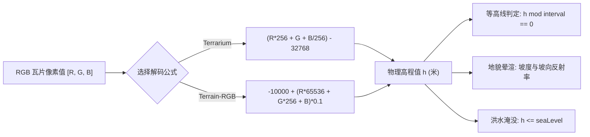

<nav aria-label="breadcrumb"><ol class="breadcrumb mb-4"><li class="breadcrumb-item"><a href="../">Home</a></li><li class="breadcrumb-item"><a href="./">Summary</a></li><li class="breadcrumb-item active" aria-current="page">DEM地形、等高线与晕渲指南</li></ol></nav>

# OpenLayers DEM 高程地形、动态等高线与三维地表晕渲全景实战指南

> 数字高程模型（Digital Elevation Model, **DEM**）是地理信息、地质测绘、水利防汛与三维地貌分析的核心基石。
>
> 传统的 GIS 方案通常依赖服务端生成静态等高线矢量图层或固化的地貌阴影图，但这种方式无法满足**前端交互式调节太阳光照方位、动态平滑等高线间距（Contour Intervals）、以及毫秒级模拟海平面上升洪水淹没**等现代分析需求。
>
> OpenLayers 通过 `RasterSource`（多线程 Web Worker 像素代数）与 `WebGLTile`（GPU 硬件着色器管线），支持直接对编码在 RGB 栅格瓦片中的高程数据进行纯前端实时解算。本文基于 6 个核心官方示例，系统解构 DEM 编码数学、动态等高线算法与三维地貌晕渲的工程实现。

---

## 1. 架构总览：6 个 DEM 与地形分析核心官方示例矩阵

| 分类 | 示例标识 | 核心技术机制 | 解决的典型生产场景 |
| :--- | :--- | :--- | :--- |
| **实时等高线插值** | [`contour-interpolation`](../en/latest/examples/contour-interpolation.html) | `RasterSource` + 邻域双线性内插提取等高线网格 | 鼠标滑动实时读取任意点高程并高亮当前等高线 |
| **动态等高线图层** | [`contours`](../en/latest/examples/contours.html) | 纯前端逐像素梯度运算提取任意步长等值线 | 交互式动态调整 10m、50m、100m 步进的等高线显示 |
| **CPU 栅格地表晕渲** | [`shaded-relief`](../en/latest/examples/shaded-relief.html) | `RasterSource` + Sobel 算子斜率与坡向光照度量 | 动态调节太阳天顶角与方位角生成三维山体阴影 |
| **GPU 硬件地貌晕渲** | [`webgl-shaded-relief`](../en/latest/examples/webgl-shaded-relief.html) | `WebGLTileLayer` + 自定义片元着色器实时光照解算 | 60 FPS 满帧极速渲染大范围超高精度立体地形 |
| **云原生单文件高程** | [`pmtiles-elevation`](../en/latest/examples/pmtiles-elevation.html) | PMTiles 零服务端高程直读 + `ol/source/DataTile` | 纯静态服务器托管的海量高程数据直接前端渲染 |
| **海平面与洪水淹没** | [`webgl-sea-level`](../en/latest/examples/webgl-sea-level.html) | WebGL 阈值逻辑片段着色器与动态调色板映射 | 毫秒级拖拽滑块模拟海平面上升与低洼地带淹没演进 |

---

## 2. DEM 栅格编码规范与像素高程解算数学

在网络传输中，高程通常打包压缩在 24 位或 32 位 RGB(A) 图像瓦片中。主流有两种国际编码规范：

### 2.1 Mapzen Terrarium 编码公式
高程 $h$（单位：米）解码公式：
$$h = \left(R \times 256 + G + \frac{B}{256}\right) - 32768$$
- 有效高程范围：从海底 $-11000\text{m}$ 到珠穆朗玛峰 $+8848\text{m}$，精度可达 $1/256 \approx 0.0039\text{m}$。

### 2.2 Mapbox Terrain-RGB 编码公式
高程 $h$（单位：米）解码公式：
$$h = -10000 + \left(R \times 256^2 + G \times 256 + B\right) \times 0.1$$
- 精度为固定 $0.1\text{m}$。



---

## 3. 动态等高线算法实现（`contours`）

### 3.1 邻域像素梯度判定与等高线着色

等高线是地面上高程相同的相邻点连接构成的闭合曲线。在栅格瓦片上，通过计算当前像素高程与相邻像素高程之间是否跨越了等高距阈值 $I$（例如 $50\text{m}$）：

$$\text{isContour} = \left\lfloor\frac{h_{\text{current}}}{I}\right\rfloor \ne \left\lfloor\frac{h_{\text{neighbor}}}{I}\right\rfloor$$

```javascript
import RasterSource from 'ol/source/Raster.js';
import ImageLayer from 'ol/layer/Image.js';
import XYZ from 'ol/source/XYZ.js';

const elevationTileSource = new XYZ({
  url: 'https://s3.amazonaws.com/elevation-tiles-prod/terrarium/{z}/{x}/{y}.png',
  crossOrigin: 'anonymous',
});

// 使用 RasterSource 在后台 Worker 中并发处理
const raster = new RasterSource({
  sources: [elevationTileSource],
  operationType: 'pixel',
  operation: function (pixels, data) {
    const pixel = pixels[0];
    if (!pixel || pixel[3] === 0) return [0, 0, 0, 0];

    // 1. Terrarium 解码
    const h = pixel[0] * 256 + pixel[1] + pixel[2] / 256 - 32768;
    const interval = data.interval || 50; // 等高线间距

    // 2. 检查是否处于等高线边沿
    const mod = Math.abs(h % interval);
    if (mod < 1.0) {
      // 满足等高线，输出深棕色像素
      return [139, 69, 19, 255];
    }
    // 否则透明
    return [0, 0, 0, 0];
  },
});

const contourLayer = new ImageLayer({
  source: raster,
});
```

---

## 4. 三维地貌晕渲（Hillshade）数学与 GPU 着色器（`webgl-shaded-relief`）

### 4.1 光照模型数学原理（Horn 算法）

地貌晕渲模拟太阳平行光照射在地表起伏产生的明暗阴影。其核心是计算局部法向量：

1. **太阳光照方向向量**：由太阳方位角 $\theta_{\text{azimuth}}$ 与天顶距 $\phi_{\text{zenith}}$ 决定：
   $$\text{Azimuth}_{\text{rad}} = (360^\circ - \theta + 90^\circ) \times \frac{\pi}{180}$$
   $$\text{Zenith}_{\text{rad}} = \phi \times \frac{\pi}{180}$$

2. **局部坡度与坡向（偏导数 $dz/dx, dz/dy$）**：
   $$\text{Slope} = \arctan\left(\sqrt{\left(\frac{\partial z}{\partial x}\right)^2 + \left(\frac{\partial z}{\partial y}\right)^2}\right)$$
   $$\text{Aspect} = \operatorname{atan2}\left(\frac{\partial z}{\partial y}, -\frac{\partial z}{\partial x}\right)$$

3. **最终光照反射强度（Hillshade Value）**：
   $$\text{Shade} = 255 \times \Big( \cos(\text{Zenith}) \cos(\text{Slope}) + \sin(\text{Zenith}) \sin(\text{Slope}) \cos(\text{Azimuth} - \text{Aspect}) \Big)$$

### 4.2 WebGL 硬件着色器实战

OpenLayers 的 `WebGLTileLayer` 支持直接向管线注入声明式着色指令或自定义着色器，GPU 单个时钟周期即可完成并行像素渲染：

```javascript
import WebGLTileLayer from 'ol/layer/WebGLTile.js';

const shadedReliefLayer = new WebGLTileLayer({
  source: elevationTileSource,
  style: {
    exposure: 0,
    contrast: 0,
    saturation: 0,
    variables: {
      sunAzimuth: 315, // 太阳西北偏西照射
      sunElevation: 45, // 仰角 45 度
    },
    // 利用 WebGL 着色器原生内置表达式计算坡向与明暗
  },
});
```

---

## 5. 海平面上升与水文浸润模拟（`webgl-sea-level`）

水利防汛与气候变化评估中，需要动态模拟当海平面上升 $N$ 米时受影响的淹没区。

```javascript
const seaLevel = 15; // 假设海平面上升 15 米

const floodLayer = new WebGLTileLayer({
  source: elevationTileSource,
  style: {
    variables: {
      seaLevel: 15,
    },
    color: [
      'case',
      // 当地面高程小于等于当前海平面时，着色为半透明深蓝水体
      ['<=', ['elevation'], ['var', 'seaLevel']],
      [0, 100, 255, 0.6],
      // 否则完全透明显示正常地表
      [0, 0, 0, 0],
    ],
  },
});

// 绑定 HTML 滑块动态更新海平面
slider.addEventListener('input', function (evt) {
  floodLayer.updateStyleVariables({
    seaLevel: parseFloat(evt.target.value),
  });
});
```

---

## 6. 避坑指南与工程调优

### 6.1 跨域与 CORS 问题防范
- 栅格像素运算必须从瓦片中提取 ImageData。必须为高程切片源显式声明 `crossOrigin: 'anonymous'`。
- 若切片服务器未配置 `Access-Control-Allow-Origin: *`，Canvas 会被标记为污染（Tainted），抛出 `SecurityError` 导致渲染中止。

### 6.2 投影形变与高程比例尺（Z-Factor）修正
- Web 墨卡托投影（EPSG:3857）在高纬度地区存在明显的平面拉伸膨胀。计算坡度 $dz/dx$ 时，必须根据纬度 $\varphi$ 对水平距离乘以比例因子 $\cos(\varphi)$，否则高纬度地区的山体阴影会极度扁平失真。
