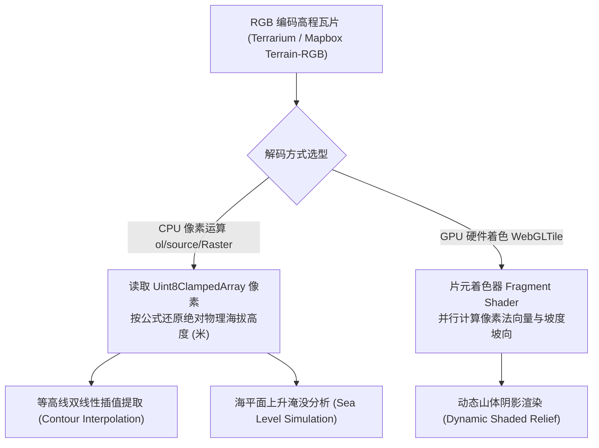

<nav aria-label="breadcrumb"><ol class="breadcrumb mb-4"><li class="breadcrumb-item"><a href="../">Home</a></li><li class="breadcrumb-item"><a href="./">Summary</a></li><li class="breadcrumb-item active" aria-current="page">数字高程与等高线地形指南</li></ol></nav>

# OpenLayers DEM 数字高程、等高线分析与地形渲染实战指南
> 针对数字高程模型（DEM）、地表等高线自动插值提取、海平面淹没模拟以及山体阴影（Hillshade / Shaded Relief）动态光照渲染，深入解构 RGB 物理高程解码、WebGL 栅格着色器与双线性插值算法实现。

---

## 1. 核心架构与物理高程编码机制

在传统 GIS 中，高程数据往往以沉重的 32 位浮点 GeoTIFF 文件存储。现代 WebGIS 则通过将真实地理高程压缩编码至常规的 24 位 RGB 栅格切片（PNG 格式）中，使得浏览器能够像加载普通街道切片一样秒级获取全球高程信息：



### 1.1 主流高程切片编码解码数学模型

| 数据标准 | 经典服务源 | 物理高程（米）解码公式 |
| :--- | :--- | :--- |
| **Mapbox Terrain-RGB** | Mapbox, MapTiler | $\text{Elevation} = -10000 + (R \cdot 256^2 + G \cdot 256 + B) \cdot 0.1$ |
| **Mapzen Terrarium** | AWS Open Data, Stadia Maps | $\text{Elevation} = (R \cdot 256 + G + \frac{B}{256}) - 32768$ |

通过该公式，单个 24 位 RGB 像素能够以 **0.1 米（分米级）精细度** 覆盖从海平面下 10,000 米深渊到珠穆朗玛峰以上的全部地球陆表高度。

---

## 2. 官方示例矩阵解构

| 示例标识 | 核心实现机制 | 典型生产应用场景 |
| :--- | :--- | :--- |
| [`contour-interpolation`](../en/latest/examples/contour-interpolation.html) | 高程瓦片取样 + 鼠标移动实时双线性插值 + 局部 Canvas 实时绘制闭合等高线 | 测绘工程勘察、登山越野路线等高距动态标注与坡度检测 |
| [`pmtiles-elevation`](../en/latest/examples/pmtiles-elevation.html) | `ol-pmtiles` + `DataTile` 解码单文件切片 + 自定义颜色表映射 | 无服务器（Serverless）架构下的全球三维数字地表快速呈现 |
| [`sea-level`](../en/latest/examples/sea-level.html) | `ol/source/Raster` 像素操作 + 滑块控制阈值 + 动态水体淹没掩膜 | 气候变暖极端海平面上升模拟、水库蓄水淹没面积测算 |
| [`shaded-relief`](../en/latest/examples/shaded-relief.html) | 计算局部 $3 \times 3$ 像素高程差解算地表坡度（Slope）与坡向（Aspect）+ 太阳方位角光照方程 | 真实三维立体地貌地表阴影渲染、增强平缓山峦的质感 |

---

## 3. 核心实现与典型范式

### 3.1 鼠标交互双线性等高线插值范式

在 `contour-interpolation.html` 中，展示了如何根据当前鼠标位置的物理坐标提取周围高程像素并插值绘制等高线：

```javascript
import Map from 'ol/Map';
import View from 'ol/View';
import ImageTileSource from 'ol/source/ImageTile';
import WebGLTileLayer from 'ol/layer/WebGLTile';

// 解码 Terrarium 物理高程
function getElevation(r, g, b) {
  return (r * 256 + g + b / 256) - 32768;
}

const demSource = new ImageTileSource({
  url: 'https://s3.amazonaws.com/elevation-tiles-prod/terrarium/{z}/{x}/{y}.png',
  crossOrigin: 'anonymous',
});

// 监听鼠标移动，从已加载的 Canvas 图像中直接采样
map.on('pointermove', function (evt) {
  const pixel = evt.pixel;
  // 采样当前像素中心及周围 4 个点执行双线性插值 (Bilinear Interpolation)
  // ...计算等高线几何路径并直接用矢量覆盖层绘制闭合环线
});
```

---

### 3.2 动态山体阴影（Hillshade）物理光照方程

在 `shaded-relief.html` 中，利用 Lambert 漫反射光照模型实时计算阴影强度 $I$：

$$I = \cos(\text{Zenith}) \cdot \cos(\text{Slope}) + \sin(\text{Zenith}) \cdot \sin(\text{Slope}) \cdot \cos(\text{Azimuth} - \text{Aspect})$$

其中 $\text{Azimuth}$（太阳方位角，通常为西北 $315^\circ$）、$\text{Zenith}$（太阳天顶角）为可调参数。计算完成后直接输出 0~255 的明暗灰度值，叠加到底图上即可呈现出逼真的立体地形质感。

---

## 4. 生产避坑指南与性能治理

### 4.1 跨域访问与画布污染（Tainted Canvas）
- **现象**：执行 `context.getImageData()` 提取高程像素时，控制台抛出 `SecurityError: The operation is insecure`。
- **根因**：加载第三方高程瓦片时，如果未显式声明 `crossOrigin: 'anonymous'`，浏览器将禁止读取像素内存。
- **防范规范**：在所有高程数据源中，必须显式配置 `crossOrigin: 'anonymous'`，且服务端必须响应 `Access-Control-Allow-Origin: *` 响应头。

### 4.2 垂直夸张系数（Z-Factor）随纬度自适应
- 在 Web 墨卡托投影（EPSG:3857）下，纬度越高地图形变越大（赤道 1 像素代表数十米，高纬度地区 1 像素仅代表数米）。
- 如果山体阴影的高程系数固定不变，会导致高纬度山峰极其陡峭突兀，而赤道山脉平缓无阴影。
- **治理法则**：在光照着色器中，将高程乘以自适应校正系数：
  $$Z_{\text{factor}} = \frac{1}{\cos(\text{Latitude})}$$
