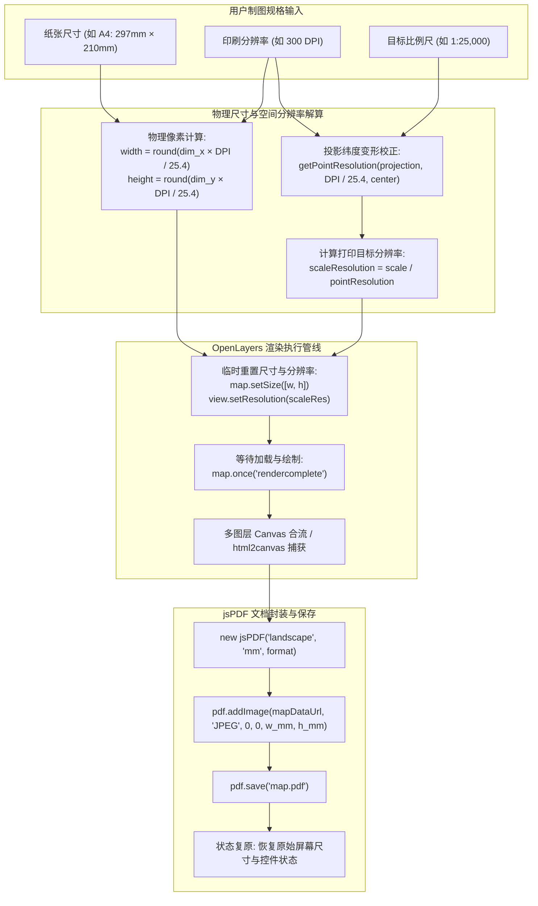

# OpenLayers 地图导出 PDF、工程测绘指定比例尺打印与 ScaleLine 深度实战指南

> 在自然资源调查、国土空间规划、水利水电勘察以及工程施工等专业 GIS 业务中，**地图出图与打印（Map Printing & Exporting）** 是一项至关重要的核心职能。
>
> 屏幕显示与纸质工程图纸有着本质区别：屏幕显示受制于设备屏幕分辨率与像素比，而印刷出版要求严格对齐 **国际标准纸张规格（A0~A5）**、**高精印刷分辨率（150~300 DPI）** 以及 **严格的法定工程比例尺（如 1:10,000、1:50,000）**。OpenLayers 提供了完整的空间投影变形校正与多图层合成机制。本文基于 3 个核心官方示例（`export-pdf.html`、`print-to-scale.html`、`scale-line.html`），系统解构高质量 PDF 导出、精确比例尺换算及比例尺控件定制的实战技术方案。

---

## 1. 架构总览：从屏幕视口到测绘级物理图纸

### 1.1 打印输出处理流与数学推导



### 1.2 方案选型综合特征对照表

| 维度 / 模式 | 视口常规 PDF 导出 | 测绘级指定比例尺打印 | 比例尺定制展示 |
| :--- | :--- | :--- | :--- |
| **典型示例** | `export-pdf.html` | `print-to-scale.html` | `scale-line.html` |
| **空间范围控制** | 严格继承当前屏幕所见范围 | **由比例尺与纸张尺寸决定**（屏幕仅定中心点） | 随视口漫游动态变化 |
| **比例尺保真度** | 无固定比例尺（按纸张拉伸） | **1:10,000 ~ 1:500,000 毫米级精准对应** | 实时显示当前纬度物理距离 |
| **图饰控件处理** | 仅导出纯地图画布 | **利用 html2canvas 完整捕获比例尺与版权** | 原生 DOM 控件动态配置 |
| **DPI 适配** | 72 / 150 / 300 DPI 动态调整 | 72 / 150 / 200 / 300 DPI 深度同步 | `scaleLine.setDpi()` 联动 |
| **主要第三方库** | `jspdf` | `jspdf` + `html2canvas` + `proj4` | 无（OpenLayers 原生） |

---

## 2. 多图层 Canvas 仿射矩阵合成与 jsPDF 导出（`export-pdf.html`）

在 `export-pdf.html` 中，核心难点在于 OpenLayers 的瓦片和矢量图层分散在不同的 `<canvas>` 节点中，且各自包含独立的 CSS `transform` 位移缩放矩阵与 CSS `opacity`。

### 2.1 物理像素换算与地图尺寸扩充
根据国际印刷标准，1 英寸等于 25.4 毫米：
```javascript
const dim = dims[format]; // 例如 A4 为 [297, 210] 毫米
const width = Math.round((dim[0] * resolution) / 25.4);
const height = Math.round((dim[1] * resolution) / 25.4);

// 临时放大地图画布，促使 OpenLayers 加载高分切片
map.setSize([width, height]);
const scaling = Math.min(width / size[0], height / size[1]);
map.getView().setResolution(viewResolution / scaling);
```

### 2.2 跨图层矩阵无损合流
在 `rendercomplete` 监听中，通过遍历图层画布并复现仿射矩阵：
```javascript
map.once('rendercomplete', function () {
  const mapCanvas = document.createElement('canvas');
  mapCanvas.width = width;
  mapCanvas.height = height;
  const mapContext = mapCanvas.getContext('2d');

  document.querySelectorAll('.ol-layer canvas').forEach((canvas) => {
    if (canvas.width > 0) {
      // 提取图层透明度
      const opacity = canvas.parentNode.style.opacity;
      mapContext.globalAlpha = opacity === '' ? 1 : Number(opacity);

      // 从 style.transform 中正则提取 matrix(a, b, c, d, e, f)
      const matrix = canvas.style.transform
        .match(/^matrix\(([^\(]*)\)$/)[1]
        .split(',')
        .map(Number);
      CanvasRenderingContext2D.prototype.setTransform.apply(mapContext, matrix);
      mapContext.drawImage(canvas, 0, 0);
    }
  });

  // 写入 PDF 并保存
  const pdf = new jsPDF('landscape', undefined, format);
  pdf.addImage(mapCanvas.toDataURL('image/jpeg'), 'JPEG', 0, 0, dim[0], dim[1]);
  pdf.save('map.pdf');
});
```

---

## 3. 测绘级指定比例尺打印核心数学模型（`print-to-scale.html`）

在工程规划中，必须保证打印出的图纸“拿尺子在纸上量 1 厘米等于实际 250 米”（即 1:25,000）。

### 3.1 墨卡托投影变形修正（`getPointResolution`）
在墨卡托投影（EPSG:3857）或高斯克吕格投影（EPSG:27700）中，单位投影坐标与地球表面物理距离随着纬度或中央经线距离存在拉伸。OpenLayers 提供了 `getPointResolution`：
$$\text{scaleResolution} = \frac{\text{scale}}{\text{getPointResolution}(\text{projection}, \frac{\text{DPI}}{25.4}, \text{center})}$$
- **参数说明**：
  - `scale`：比例尺分母（如 250 代表 1:250,000，25 代表 1:25,000）；
  - `DPI / 25.4`：每毫米包含的物理像素数；
  - `center`：当前视图中心点地理坐标。

### 3.2 借助 `html2canvas` 捕获 DOM 比例尺与版权
纯 Canvas 导出无法包含 HTML DOM 样式的比例尺。示例通过 `html2canvas` 对 `map.getViewport()` 执行全要素捕获，并利用 `ignoreElements` 智能剔除交互按钮：
```javascript
const exportOptions = {
  useCORS: true,
  ignoreElements: (el) => {
    const cls = el.className || '';
    // 屏蔽除比例尺和版权之外的所有控件
    return cls.includes('ol-control') &&
      !cls.includes('ol-scale') &&
      (!cls.includes('ol-attribution') || !cls.includes('ol-uncollapsible'));
  },
};
```

---

## 4. 比例尺控件体系全解（`scale-line.html`）

`ol/control/ScaleLine` 提供了专业制图所需的全套标尺表现形式：

### 4.1 核心配置与模式对比

```javascript
// 模式一：经典紧凑折角线 (ScaleLine)
const simpleLine = new ScaleLine({
  units: 'metric', // metric(公制), imperial(英制), us(美制), nautical(海里), degrees(度)
});

// 模式二：工程分段交替条 (ScaleBar)
const zebraBar = new ScaleLine({
  units: 'metric',
  bar: true,                    // 开启分段块渲染
  steps: 4,                     // 4 个等分子区间
  text: true,                   // 在分段点标注刻度数值
  minWidth: 140,                // 最小宽度像素约束
});
```

- **颜色反转（Invert Colors）**：通过为控件元素添加 `ol-scale-bar-inverted` 类名，将黑白相间反转为白黑相间，轻松适配深色底图或复杂航拍影像。
- **打印协同（`scaleLine.setDpi(resolution)`）**：在导出高 DPI PDF 时，必须同步调用 `setDpi`，控件将自动根据目标打印分辨率缩放其 CSS 物理尺寸。

---

## 5. 生产实践踩坑与性能调优指南

### 5.1 画布跨域污染（Tainted Canvas）报错排查
- **现象**：调用 `canvas.toDataURL()` 抛出 `SecurityError: Failed to execute 'toDataURL' on 'HTMLCanvasElement'`。
- **根本原因**：加载的栅格瓦片来自第三方未配置 CORS 响应头的源（如未经配置的内网 GeoServer 或特定商业切片）。
- **解决办法**：
  1. 为瓦片源配置 `crossOrigin: 'anonymous'`；
  2. 确保切片服务器响应头包含 `Access-Control-Allow-Origin: *`；
  3. 若数据源无法修改，需搭建 Nginx 反向代理层统一追加 CORS 响应头。

### 5.2 超大图纸（A0 / 300 DPI）的内存溢出崩溃
- **风险**：A0 纸张（1189mm × 841mm）在 300 DPI 下对应 $14043 \times 9933$ 像素，单个 Canvas 显存占用高达 550MB 以上。在 32 位浏览器或手机端执行必将导致浏览器进程崩溃（Out of Memory）。
- **优化方案**：
  - 针对 A1/A0 超大图纸，前端仅导出 150 DPI（公文级清晰度已足够）；
  - 300 DPI 测绘出版图纸建议将当前视图 Extent、图层列表与样式规则序列化打包发送给后端，由基于 Node-Canvas 或 Headless Chrome 集群的后端专用导出服务完成出图。

### 5.3 导出完成后的状态复原（State Cleanup）
在触发打印时临时放大了容器并修改了分辨率，一旦 PDF 生成完毕，必须在 `finally` 逻辑中恢复环境：
```javascript
scaleLine.setDpi(undefined);
map.getTargetElement().style.width = '';
map.getTargetElement().style.height = '';
map.updateSize();
map.getView().setResolution(viewResolution);
```
保证用户在导出完成后，屏幕视口能丝滑回滚到操作前的正常状态。
