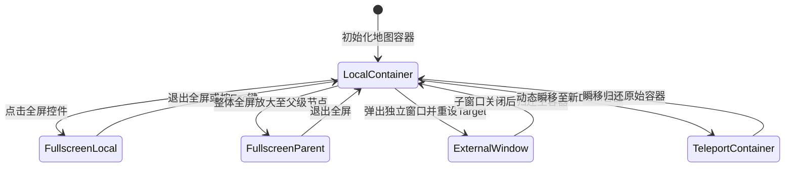

# OpenLayers 全屏沉浸式交互、多窗口弹窗联动与 DOM 容器动态瞬移实战架构指南

> 在传统的 WebGIS 开发观念中，地图通常被认为与一个固定的 `<div id="map">` 强绑定。然而在大型安防调度中心、指挥大屏、微前端标签页系统以及多显示器办公场景中，业务对地图的视口灵活性提出了前所未有的要求：
> 1. **全屏沉浸化**：不仅地图自身全屏，还需要将**侧边业务面板与控制工具栏**一并带入全屏；
> 2. **跨窗口独立化（Portals）**：将地图从当前网页中“弹离”，迁移至副屏或独立的外部子窗口中运行，并保持数据与操作互通；
> 3. **多容器瞬移化（Teleportation）**：在多个标签页（Tabs）或分屏布局之间瞬间迁移地图实例，**保持切片缓存不丢失、视图中心不重置、零销毁零白屏**。
>
> OpenLayers 拥有彻底解耦的 `map.setTarget()` 宿主机制，并深度适配了 W3C Fullscreen API。本文基于 4 个核心官方示例（`full-screen.html`、`full-screen-source.html`、`external-map.html`、`teleport.html`），系统解构全屏沉浸、多窗口联动与容器瞬移的底层原理与架构模式。

---

## 1. 架构总览：打破单一 DOM 容器桎梏的视口演进



### 1.1 四大视口拓扑模式对比

| 模式 / 特性 | 纯地图全屏 | 扩展父级全屏 | 外部独立子窗口 | DOM 容器动态瞬移 |
| :--- | :--- | :--- | :--- | :--- |
| **典型示例** | `full-screen.html` | `full-screen-source.html` | `external-map.html` | `teleport.html` |
| **核心 API** | `new FullScreen()` | `new FullScreen({ source })` | `window.open` + `map.setTarget` | `map.setTarget(newId)` |
| **全屏目标** | 仅 `#map` 元素 | 包含侧边栏的外层容器 | 外部独立浏览器 Window | 页面内的任意其它容器 |
| **实例生命周期** | 持续保活 | 持续保活 | 持续保活（零销毁重用） | 持续保活（零重载复用） |
| **适用业务场景** | 移动端地图全屏沉浸模式 | 智慧大屏、带控制台的调度中心 | 跨双显示器指挥监控平台 | 多 Tab 标签页切换、分屏对比 |

---

## 2. FullScreen 全屏沉浸式交互与父容器外扩

### 2.1 浏览器顶层（Top Layer）机制与纯地图全屏（`full-screen.html`）
W3C 全屏规范会将目标元素移入浏览器的顶层堆叠上下文（Top Layer）。`ol/control/FullScreen` 内部监听了厂商前缀各异的全屏事件，并在进入全屏时自动触发 `map.updateSize()`，迫使 WebGL / Canvas 渲染管线自适应屏幕分辨率。

### 2.2 扩展父级容器整体全屏（`full-screen-source.html`）
- **痛点**：若直接对地图执行全屏，位于地图旁边的侧边栏（Side Panel）会被丢在全屏之外，用户在全屏下无法进行业务操作。
- **架构方案**：通过指定 `source: 'fullscreen'`（包含地图与面板的共同父级 DIV）：
  ```javascript
  const map = new Map({
    controls: defaultControls().extend([
      new FullScreen({
        source: 'fullscreen', // 指定外层父级容器整体全屏
      }),
    ]),
    target: 'map',
    view: view,
  });
  ```
  结合外层的 Flex 弹性布局，全屏后地图与业务面板完美并存，控制台丝滑交互。

---

## 3. 跨窗口独立地图运行与双向生命周期（`external-map.html`）

在调度监控中心，业务人员常需要将地图“拔”出来拖拽到外接的大显示器上：

### 3.1 零重绘外部窗口挂载（Portals）
只要在同一浏览器进程中，通过 `window.open()` 打开的子窗口与父窗口共享同一个 JavaScript 执行线程：
```javascript
mapWindow = window.open('resources/external-map-map.html', 'MapWindow', 'width=800,height=600');
mapWindow.addEventListener('DOMContentLoaded', function () {
  const externalMapTarget = mapWindow.document.getElementById('map');
  localMapTarget.style.height = '0px'; // 收缩主窗口容器
  map.setTarget(externalMapTarget);    // 核心：直接将地图画布移入子窗口
});
```
地图无需重新加载瓦片，当前视角与动画状态毫秒级无损转移。

### 3.2 严密的双向生命周期闭环
1. **防止孤儿僵尸窗口**：主窗口监听 `pagehide`，在主页面刷新或跳转时协同关闭子窗口：
   ```javascript
   window.addEventListener('pagehide', () => mapWindow?.close());
   ```
2. **子窗口关闭自动归还**：监听子窗口的 `pagehide`，一旦用户关闭子窗口，主窗口立刻恢复尺寸并执行 `map.setTarget(localMapTarget)` 完璧归赵。
3. **主窗口状态掩模**：使用自定义控件 `UnusableMask extends Control`，在主窗口覆盖半透明文字提示，防止用户在主窗口发生空指针误操作。

---

## 4. 动态 DOM 容器瞬移与单例架构（`teleport.html`）

在包含“多标签页（Tabs）”的企业管理后台中，传统开发者常常在切换标签时反复 `map.dispose()` 并重新 `new Map()`，引发严重的内存卡顿与网络重复请求。

### 4.1 `map.setTarget` 瞬移的核心机制
```javascript
teleportButton.addEventListener('click', function () {
  const nextTarget = map.getTarget() === 'map1' ? 'map2' : 'map1';
  map.setTarget(nextTarget); // 瞬间完成 DOM 树转移
  map.updateSize();          // 确保网格与新容器尺寸对齐
});
```
- **核心收益**：
  - **瓦片缓存 100% 保留**：底层的 `TileCache` 与已下载的数百张切片无需重新发起网络请求；
  - **交互状态 100% 延续**：用户此前放大到的具体街区、正在进行的测量折线全部保留；
  - **CPU/GPU 零抖动**：避免了重复创建 WebGL 上下文引发的显存暴涨。

---

## 5. 生产级工程踩坑与避坑指南

### 5.1 浏览器弹窗拦截（Popup Blocker）防护
`window.open` 必须在**真实用户交互事件（如按钮的物理 `click`）的直接同步执行流**中调用。严禁在异步 `Promise.then` 或 `setTimeout` 中执行，否则 100% 被浏览器内核强制拦截。

### 5.2 外部窗口样式孤岛（CSS Isolation）
子窗口由 `window.open` 创建，拥有独立的 `document` 对象。若子窗口 HTML 中没有引入 `theme/ol.css`，移动到子窗口的 OpenLayers 控件将完全失去定位。子窗口 HTML 必须预先引入完整的样式表：
```html
<link rel="stylesheet" href="theme/ol.css" type="text/css">
```

### 5.3 iframe 权限声明与全屏穿透
在微前端或嵌入式系统中，如果外层存在 `<iframe>`，必须配置：
```html
<iframe src="..." allow="fullscreen"></iframe>
```
否则浏览器将无情阻断 `requestFullscreen` 请求。
