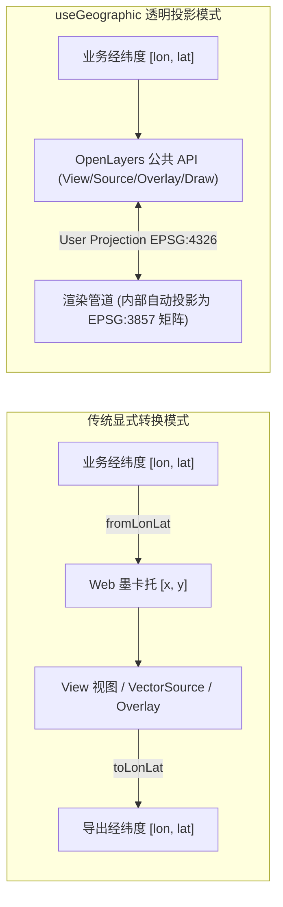
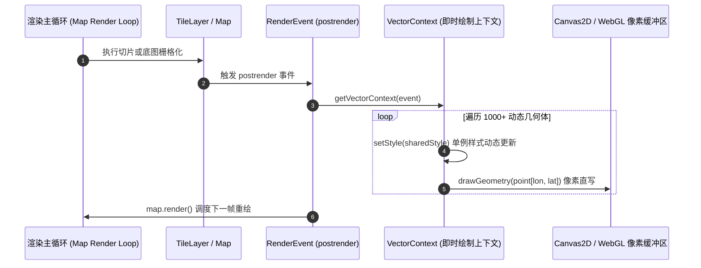

# OpenLayers 地理坐标系（useGeographic）与即时渲染深度实战指南

> 在现代 WebGIS 架构中，坐标系统是连接现实地理空间与屏幕像素的核心桥梁。长期以来，OpenLayers 内部默认以 Web 墨卡托投影（`EPSG:3857`）作为投影平面的度量基准，开发者在处理来自 GPS、GeoJSON、后台服务或用户输入的经纬度（`EPSG:4326`）数据时，不得不频繁编写 `fromLonLat([lon, lat])` 与 `toLonLat(coord)` 模板代码。
>
> OpenLayers 引入的 `useGeographic()` 机制打破了这一常规壁垒，它在框架级建立了**透明的用户投影（User Projection）重映射管线**，使应用层代码能直接使用直观的经纬度，而底层渲染引擎依然享受墨卡托平面切片与 GPU 加速的高性能变换。本文将深入解析该机制的实现原理、交互编辑系统集成以及高帧率即时渲染（Immediate Rendering）的最佳生产实践。

---

## 1. 架构总览：从显式投影转换到透明用户投影

### 1.1 传统模式 vs `useGeographic()` 模式

在未开启地理模式时，OpenLayers 要求所有与视图（View）、要素几何（Feature/Geometry）、叠加层（Overlay）及交互拾取（PointerEvent）相关的坐标均匹配视图投影：



### 1.2 `useGeographic()` 的底层工作机制

在 `ol/proj.js` 模块中，`useGeographic()` 执行的实质操作非常轻量但影响深远：

```javascript
import {setUserProjection} from './proj.js';

export function useGeographic() {
  setUserProjection('EPSG:4326');
}
```

当 `setUserProjection('EPSG:4326')` 被调用后：
1. **视图层（View）**：`view.getCenter()`、`view.setCenter()`、`view.calculateExtent()` 均按 `[lon, lat]` 格式与地理范围 `[minLon, minLat, maxLon, maxLat]` 工作；
2. **要素与几何体（Geometry）**：创建 `new Point([lon, lat])` 或 `new Polygon(...)` 时，构造函数识别到全局用户投影，自动将其注册为用户坐标，内部渲染时由 WebGL/Canvas 渲染器完成向投影平面的实时投影投射；
3. **交互系统（Interactions）**：`Draw` 绘制过程中生成的坐标、`Modify` 拖动修改的顶点、`Snap` 捕捉吸附计算、`Select` 选区过滤，全部透明输出并消费经纬度；
4. **覆盖物（Overlay）**：`overlay.setPosition([lon, lat])` 无需额外包装，直接锚定至经纬度位置。

---

## 2. 交互编辑体系集成：Draw, Modify, Snap 与 Select

在地理模式下进行矢量图层数字化编辑，体验与直接在 QGIS 或 ArcGIS Pro 中操作经纬度图层高度一致。

### 2.1 协同工作流水线

```mermaid
flowchart TD
    User(["用户鼠标操作"]) --> SnapInt["Snap 交互吸附"]
    SnapInt -->|校准吸附后的 [lon, lat]| ActiveMode{"当前激活模式"}
    ActiveMode -->|draw 模式| DrawInt["Draw 交互: 生成多边形"]
    DrawInt --> Source[("VectorSource 数据源")]
    ActiveMode -->|modify 模式| SelectInt["Select 交互: 拾取要素"]
    SelectInt --> FeatureCollection["Selected Features 集合"]
    FeatureCollection --> ModifyInt["Modify 交互: 拖动编辑顶点"]
    ModifyInt --> Source
```

### 2.2 编辑模式切换与交互互斥代码范式

在实现单页面的多模式切换时，交互冲突是常见问题（例如：在绘制时单机被 `Select` 拦截导致无法落点）。最佳实践是集中管理交互注销与按需挂载：

```javascript
import {useGeographic} from 'ol/proj';
import Map from 'ol/Map';
import View from 'ol/View';
import Draw from 'ol/interaction/Draw';
import Modify from 'ol/interaction/Modify';
import Select from 'ol/interaction/Select';
import Snap from 'ol/interaction/Snap';
import VectorSource from 'ol/source/Vector';
import VectorLayer from 'ol/layer/Vector';

useGeographic();

const source = new VectorSource();
const map = new Map({
  target: 'map',
  layers: [new VectorLayer({source})],
  view: new View({center: [116.4074, 39.9042], zoom: 10}),
});

const select = new Select();
const modify = new Modify({features: select.getFeatures()});
const draw = new Draw({source, type: 'Polygon'});
const snap = new Snap({source});

// 集中卸载所有可能冲突的交互
function removeInteractions() {
  map.removeInteraction(modify);
  map.removeInteraction(select);
  map.removeInteraction(draw);
  map.removeInteraction(snap);
}

// 根据业务状态动态装配
function setEditMode(mode) {
  removeInteractions();
  if (mode === 'draw') {
    map.addInteraction(draw);
    map.addInteraction(snap); // Snap 必须在编辑交互之后生效
  } else if (mode === 'modify') {
    map.addInteraction(select);
    map.addInteraction(modify);
    map.addInteraction(snap);
  }
}
```

---

## 3. 即时渲染 API（Immediate Rendering）与高性能动态粒子

在气象台风流场、雷达回波、低空无人机尾迹或实时 GPS 轨迹回放中，数以万计的点每秒高频更新。若通过常规的 `Feature` 实例与 `VectorSource` 托管，其创建属性字典、变更事件派发和空间 R 树索引（RBush）重建将产生巨大的 CPU 与垃圾回收（GC）开销。

### 3.1 即时渲染原理：跳过要素生命周期

通过监听渲染管线事件（如 `layer.on('postrender')`），OpenLayers 提供了轻量级的矢量即时绘制接口 `getVectorContext(event)`：



### 3.2 零 GC 压力的动态衰减流星雨代码范式

```javascript
import {useGeographic} from 'ol/proj';
import {getVectorContext} from 'ol/render';
import Point from 'ol/geom/Point';
import Style from 'ol/style/Style';
import Circle from 'ol/style/Circle';
import Fill from 'ol/style/Fill';
import {upAndDown} from 'ol/easing';

useGeographic();

// 1. 严格单例化样式对象，避免在每秒 60 帧中产生数万个临时对象导致 GC 掉帧
const particleImage = new Circle({
  radius: 6,
  fill: new Fill({color: 'rgba(255, 120, 0, 1)'}),
});
const particleStyle = new Style({image: particleImage});

const N = 1000;
const geometries = new Array(N);
for (let i = 0; i < N; ++i) {
  geometries[i] = new Point([
    Math.random() * 360 - 180,
    Math.random() * 180 - 90,
  ]);
}

// 2. 挂载到底图渲染完成钩子上
baseLayer.on('postrender', (event) => {
  const vectorContext = getVectorContext(event);

  for (let i = 0; i < N; ++i) {
    // 缓动曲线计算衰减权重
    const importance = upAndDown(Math.pow((N - i) / N, 0.15));
    if (importance < 0.05) continue;

    // 动态调整单例属性并立即直绘
    particleImage.setOpacity(importance);
    particleImage.setScale(importance);
    vectorContext.setStyle(particleStyle);
    vectorContext.drawGeometry(geometries[i]);
  }

  // 3. 滑动队列：淘汰陈旧点，入队新点
  geometries.push(new Point([Math.random() * 360 - 180, Math.random() * 180 - 90]));
  geometries.shift();

  // 4. 请求下一帧连续重绘
  map.render();
});
```

---

## 4. 跨日界线连续视口与世界循环（World Wrapping）

当用户在水平方向持续拖拽漫游地图时，墨卡托投影会无缝展开相邻的“虚拟世界”（World 1, World 2...），经度坐标会出现超出 $[-180^\circ, 180^\circ]$ 的连续延展（例如经度变为 $195^\circ$ 或 $-210^\circ$）。

### 4.1 浮动弹出框（Overlay）世界对齐算法

在 `geographic.html` 示例中，如果要素固定位于东京（`[139.753, 35.684]`），而用户在右侧连续世界（经度在 $400^\circ$ 附近）点击要素时，若不进行周期重映射，弹出框依然会弹回原始世界（经度 $139^\circ$），导致视觉跳跃。

解决该问题的标准世界平移对齐公式为：

$$\text{displayLon} = \text{targetLon} + \text{round}\left(\frac{\text{clickLon}}{360}\right) \times 360$$

对应实现代码：

```javascript
map.on('singleclick', (evt) => {
  const coordinate = evt.coordinate;
  // 计算当前视口处于哪一个世界副本中（0 为本初子午线主世界，1 为右侧第一个镜像世界，-1 为左侧镜像世界）
  const worldIndex = Math.round(coordinate[0] / 360);
  
  // 将目标要素的经度平移至当前展开的世界中
  const popupCoordinate = [
    targetFeatureLon + worldIndex * 360,
    targetFeatureLat,
  ];
  overlay.setPosition(popupCoordinate);
});
```

---

## 5. 生产避坑指南与工程规范

### 5.1 全局作用域污染陷阱
- **问题**：`useGeographic()` 会修改 OpenLayers 全局单例的 `userProjection`。
- **排查**：如果你的工程是一个大型微前端系统，或者引入了依赖米制平面坐标（如按米计算等距缓冲区、特定投影测量插件）的第三方组件，全局调用可能引发隐蔽的计算偏差。
- **解法**：在局部图层或模块中，若需保持传统隔离，可通过在 `VectorSource` 或 `GeoJSON` 读取时单独显式声明 `dataProjection: 'EPSG:4326', featureProjection: 'EPSG:3857'`。

### 5.2 坐标维度顺序严禁倒置
- **问题**：部分移动端地图 SDK（如早期的 Leaflet 或高德某些接口）采用 `[lat, lon]` 顺序，而数学与现代 GIS 工业规范统一使用 `[x, y]` 即 `[经度 lon, 纬度 lat]`。
- **排查**：在 `useGeographic()` 开启后，输入 `[39.9, 116.4]` 会直接导致几何体漂移至南极洲或非法纬度超出报错（纬度必须在 $[-90, 90]$ 之间）。
- **规范**：严格核验所有 API 参数，确保第一维度为经度（Longitude），第二维度为纬度（Latitude）。

### 5.3 即时渲染的无限递归重绘灾难
- **问题**：在 `postrender` 监听器内部调用 `map.render()` 会触发浏览器 `requestAnimationFrame` 的永动机式重绘。
- **排查**：在非活跃页面、地图容器被隐藏（`display: none`）或用户最小化窗口时，未停止的重绘会导致客户端笔记本风扇狂转、移动设备发热严重。
- **解法**：结合 `document.visibilityState` 或 `IntersectionObserver` 监听地图视口可见性；在隐藏时暂停调用 `map.render()`，恢复可见时再次唤醒。

---

## 6. 核心知识图谱与 API 对照表

| API / 组件 | 传统模式 (`EPSG:3857`) | 地理模式 (`useGeographic`) | 适用场景 |
| :--- | :--- | :--- | :--- |
| **`View.center`** | 米制坐标（如 `[12958000, 4830000]`） | 经纬度 `[116.40, 39.90]` | 全局视图定位与动态平移 |
| **`new Point(...)`** | 需要 `fromLonLat([lon, lat])` | 直接传 `[lon, lat]` | 矢量要素快速数字化建库 |
| **`Draw / Modify`** | 顶点数据为米制平面坐标 | 顶点数据直接为真实经纬度 | 业务端无缝对接 GeoJSON/WFS |
| **`getVectorContext`** | 支持像素/平面投影即时绘制 | 自动将经纬度几何体映射至当前帧画布 | 海量粒子、高频轨迹与雷达动态动画 |
| **`Overlay.position`** | 必须传入投影后坐标 | 直接支持经纬度（需处理世界循环偏移） | 提示弹窗、HTML 气泡组件定位 |
