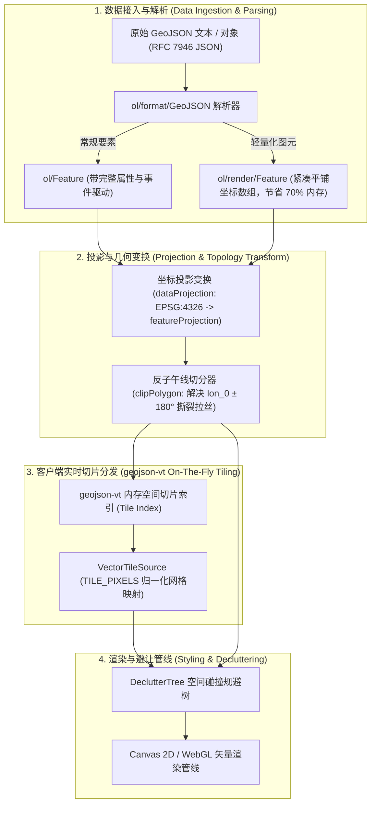
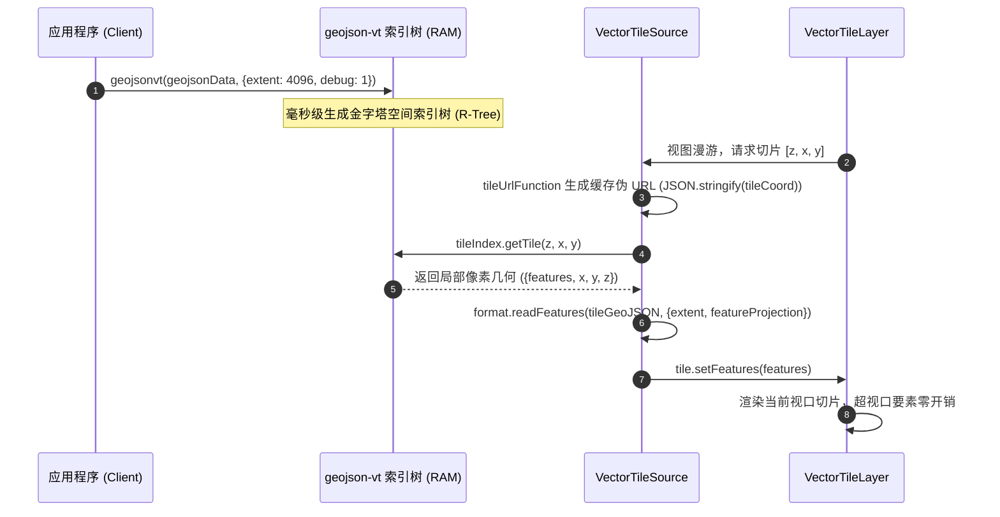
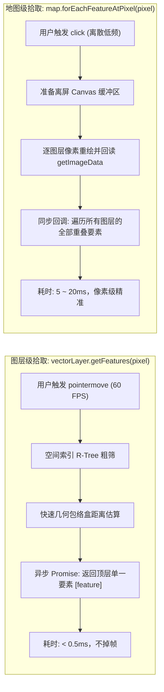

# OpenLayers GeoJSON 矢量数据体系与客户端渲染实战架构指南 (GeoJSON Vector Pipeline & Client-Side Architecture)

> 本指南基于 OpenLayers 官方 **geojson** 专题的核心示例群，深度解构 RFC 7946 标准几何对象的反序列化生命周期，剖析非墨卡托投影（如 Equal Earth 等面积投影）下的动态中央子午线重算与反子午线几何切分算法，实战演示利用 `geojson-vt` 在浏览器端进行毫秒级动态矢量切片的架构设计，并系统梳理声明式扁平样式（Flat Style）、注记碰撞避让（Declutter）与启发式空间拾取的工程最佳实践。

---

## 一、GeoJSON 客户端处理全景架构 (Architectural Overview)

在现代 WebGIS 前端架构中，GeoJSON 不仅仅是一种静态文件交换格式，更是连接服务端空间分析、前端动态渲染与高频交互的核心枢纽。整个流式管线涵盖数据解构、坐标转换、动态切片与 GPU 绘制四大阶段：



---

## 二、RFC 7946 规范与 OpenLayers 几何反序列化机制

### 1. 标准 7 大几何类型与 OpenLayers 对应模型

如 [`examples/geojson.html`](file:///d:/Users/Downloads/openlayers/examples/geojson.html) 所示，OpenLayers 的 `ol/format/GeoJSON` 原生完整映射了 OGC 简单要素规范中的所有几何拓扑：

| GeoJSON 几何类型 | 坐标数组维度 | OpenLayers 几何类 | 典型空间语义 |
| :--- | :--- | :--- | :--- |
| **Point** | `[x, y]` | `ol/geom/Point` | 单个 POI 点、监测站、气象浮标 |
| **MultiPoint** | `[[x, y], ...]` | `ol/geom/MultiPoint` | 离散岛屿群点、传感器点阵 |
| **LineString** | `[[x, y], ...]` | `ol/geom/LineString` | 道路、河流、轨迹线段 |
| **MultiLineString** | `[[[x, y], ...], ...]` | `ol/geom/MultiLineString` | 分叉管网、铁路网络 |
| **Polygon** | `[[[x, y], ...], ...]` | `ol/geom/Polygon` | 单个行政区、地块（含外环与内孔洞） |
| **MultiPolygon** | `[[[[x, y], ...], ...], ...]` | `ol/geom/MultiPolygon` | 跨国领土、群岛国家、非连通保护区 |
| **GeometryCollection** | 包含多种 geometries | `ol/geom/GeometryCollection` | 复杂复合资产包（如枢纽站场综合体） |
| **Circle (扩展)** | `center, radius` | `ol/geom/Circle` | **OpenLayers 特有扩展**（数学解析圆） |

### 2. 多态样式映射函数 (Polymorphic Style Dispatcher)
在同一个图层中混合存在多种几何类型时，无需创建多个图层，通过多态样式函数根据几何类型动态路由：

```javascript
const styles = {
  'Point': new Style({ image: pointMarker }),
  'LineString': new Style({ stroke: lineStroke }),
  'Polygon': new Style({ stroke: polyStroke, fill: polyFill }),
  'GeometryCollection': new Style({ stroke: gcStroke, fill: gcFill, image: gcPoint }),
  'Circle': new Style({ stroke: circleStroke, fill: circleFill }),
};

// 运行时根据要素几何类型分发对应样式
const styleFunction = function (feature) {
  return styles[feature.getGeometry().getType()];
};
```

### 3. `RenderFeature`：数万图斑的轻量化提速利器
如 [`examples/equal-earth-geojson.html`](file:///d:/Users/Downloads/openlayers/examples/equal-earth-geojson.html) 所示，在只读展示海量多边形时，通过配置 `featureClass: RenderFeature`，大幅精简对象元数据：

```javascript
const vectorSource = new VectorSource({
  features: new GeoJSON({
    featureProjection: projection,
    featureClass: RenderFeature, // 关键：生成轻量扁平图元，避免大内存开销
  }).readFeatures(geojson),
});
```

---

## 三、浏览器端动态切片体系：`geojson-vt` 集成实战

当 GeoJSON 数据量达到数兆至数十兆（如全球生态区、全国县界线、全省建筑轮廓）时，传统方案直接加载整个 GeoJSON 会导致浏览器卡死在初始化阶段。

如 [`examples/geojson-vt.html`](file:///d:/Users/Downloads/openlayers/examples/geojson-vt.html) 所示，Mapbox 开源的 `geojson-vt` 库能够在浏览器端构建动态切片索引，OpenLayers 通过将切片像素映射至虚拟坐标系，实现**无需任何 GIS 服务器的零门槛即时矢量瓦片**：



### 核心实现要素：
1. **`TILE_PIXELS` 虚拟投影声明**：
   ```javascript
   const format = new GeoJSON({
     dataProjection: new Projection({
       code: 'TILE_PIXELS',
       units: 'tile-pixels',
       extent: [0, 0, 4096, 4096],
     }),
   });
   ```
2. **切片数据替换器（Replacer）**：
   `geojson-vt` 内部为极致压缩，将类型编码为数字（1=点，2=线，3=面）。通过自定义 `replacer` 函数将其逆向还原为 GeoJSON 标准格式，无缝衔接 OpenLayers 的要素读取器。

---

## 四、动态中央子午线 Equal Earth 投影与反子午线切分

### 1. Equal Earth 投影数学定义与动态注册
墨卡托投影在高纬度地区存在剧烈的面积形变。Equal Earth 等面积投影专为全球主题制图打造。如 [`examples/equal-earth-geojson.html`](file:///d:/Users/Downloads/openlayers/examples/equal-earth-geojson.html) 所示，为了在平移漫游时保持全球外包椭圆居中，代码按经度步长动态重构中央子午线：

```javascript
function dynEqualEarth(center, round = 15) {
  const lon0 = Math.round(center[0] / round) * round;
  const code = `EqualEarth${lon0}`;
  let prj = getProjection(code);
  if (!prj) {
    proj4.defs(
      code,
      `+proj=eqearth +lon_0=${lon0} +x_0=0 +y_0=0 +R=6371008.7714 +units=m +no_defs +type=crs`,
    );
    register(proj4);
    prj = getProjection(code);
    prj.setGlobal(true);
    prj.setExtent([-17243959.06, -8392927.6, 17243959.06, 8392927.6]);
    prj.setWorldExtent([-180, -90, 180, 90]);
  }
  return prj;
}
```

### 2. 反子午线（Antimeridian）多边形撕裂与切分算法
在非圆柱连续投影中，当要素横跨 `lon_0 ± 180°` 切割边线时，屏幕两端的顶点连线会横切整个地图画面（产生贯穿东西的巨大撕裂多边形）。
`clipPolygon` 函数在要素送入图层前进行了几何预处理：
1. 检测几何外包在经度方向是否越过 `minX = lon_0 - 180°` 或 `maxX = lon_0 + 180°`；
2. 将多边形转为 `MultiPolygon`，在切线处钳位（Clamp）坐标，并将超出部分平移 $\pm 360^\circ$；
3. 防御性过滤因坐标重合退化的简并图元，彻底杜绝渲染拉丝缺陷。

---

## 五、声明式样式表达式与标注避让体系 (Declutter Engine)

### 1. 现代化声明式 Flat Style 表达式
如 [`examples/vector-layer.html`](file:///d:/Users/Downloads/openlayers/examples/vector-layer.html) 所示，自 OpenLayers 7 起引入的扁平样式语法摆脱了繁冗的对象创建：

```javascript
const vectorLayer = new VectorLayer({
  background: '#1a2b39', // 无底图模式下的海洋底色
  style: {
    // 动态属性提取与默认颜色兜底
    'fill-color': ['string', ['get', 'COLOR'], '#eee'],
    // 多级空值防御函数：若 ECO_NAME 为空则回退至 'unknown'
    'text-value': ['coalesce', ['get', 'ECO_NAME'], 'unknown'],
    'text-font': 'bold 12px "Open Sans", sans-serif',
    'text-fill-color': '#333',
    'text-stroke-color': 'rgba(255,255,255,0.8)',
    'text-stroke-width': 2,
    'text-declutter-mode': 'declutter', // 标注避让模式
  },
  declutter: true, // 开启图层级碰撞检测
});
```

### 2. 文本标注全维度控制工作台 (`ol/style/Text`)
如 [`examples/vector-labels.html`](file:///d:/Users/Downloads/openlayers/examples/vector-labels.html) 所示，OpenLayers 提供了完整的矢量注记控制参数矩阵：

| 属性名称 | 参数类型 / 选项 | 核心功能与制图场景 |
| :--- | :--- | :--- |
| **`placement`** | `'point'` \| `'line'` | `'point'` 锚定要素质心；`'line'` 计算线切线斜率使文字紧贴线段蜿蜒排列 |
| **`maxAngle`** | 弧度（如 $\pi/4 \approx 45^\circ$） | 沿线排版时允许的最大线段弯折角，超过阈值自动抑制标注，防止字形重叠扭曲 |
| **`overflow`** | `boolean` | 是否允许标注文字长度超出其实际线段物理长度（河流/道路必配） |
| **`declutterMode`** | `'declutter'` \| `'obstacle'` \| `'none'` | 参与碰撞避让、仅充当避让障碍物或强制穿透渲染 |
| **`textAlign`** | `'left'` \| `'center'` \| `'right'` \| `'start'` \| `'end'` | 文字水平锚点基准 |
| **`textBaseline`** | `'top'` \| `'middle'` \| `'bottom'` \| `'alphabetic'` | 文字垂直对齐基准（西文排版推荐 `'alphabetic'`，中文推荐 `'middle'`） |
| **`stroke`** | `Stroke({color, width})` | 文字光晕描边（Text Halo），在复杂多色底图上提供高对比度防护罩 |

---

## 六、矢量要素拾取检测性能对比与架构权衡

在富交互地图中，光标悬停与点击拾取是最高频的用户操作。[`examples/hitdetect-vector.html`](file:///d:/Users/Downloads/openlayers/examples/hitdetect-vector.html) 揭示了图层级与地图级两种不同检测路径的底层机制差异：



### 生产级高亮架构模式 (Feature Overlay Pattern)：
为了防止悬停时频繁调用 `feature.setStyle()` 触发主图层全量重新编译，推荐始终挂载一个独立的 `featureOverlay`：
```javascript
const featureOverlay = new VectorLayer({
  source: new VectorSource(),
  map: map,
  style: {
    'stroke-color': 'rgba(255, 255, 255, 0.7)',
    'stroke-width': 2,
  },
});

// 悬停命中时仅向 overlaySource 添加，主矢量图层保持只读纯净
if (feature) {
  featureOverlay.getSource().addFeature(feature);
}
```

---

## 七、GeoJSON 专题核心示例索引 (Examples Reference)

| 示例文件 | 核心技术点 | 关键类与模块 | 适用场景 |
| :--- | :--- | :--- | :--- |
| [`geojson.html`](file:///d:/Users/Downloads/openlayers/examples/geojson.html) | OGC 7 大标准几何类型与解析圆样式映射 | `ol/format/GeoJSON`, `ol/geom/*` | 格式规范合规性校验、多几何图元混合展示 |
| [`equal-earth-geojson.html`](file:///d:/Users/Downloads/openlayers/examples/equal-earth-geojson.html) | 动态中央子午线 Equal Earth 投影与多边形裁剪 | `dynEqualEarth`, `clipPolygon`, `RenderFeature` | 全球等面积科学制图、反子午线飞线缺陷修复 |
| [`geojson-vt.html`](file:///d:/Users/Downloads/openlayers/examples/geojson-vt.html) | 浏览器端内存切片与矢量瓦片源映射 | `geojson-vt`, `VectorTileSource`, `TILE_PIXELS` | 客户端零服务渲染数十兆海量多边形数据 |
| [`hitdetect-vector.html`](file:///d:/Users/Downloads/openlayers/examples/hitdetect-vector.html) | 高性能启发式图层拾取与悬停覆盖层 | `vectorLayer.getFeatures()`, `featureOverlay` | 高频鼠标漫游探测、60 FPS 流畅悬停反馈 |
| [`vector-layer.html`](file:///d:/Users/Downloads/openlayers/examples/vector-layer.html) | 声明式 AST 样式表达式与文字碰撞避让 | `VectorLayer.declutter`, `['coalesce', ...]` | 现代化前后端分离制图、无底图纯专题图 |
| [`vector-labels.html`](file:///d:/Users/Downloads/openlayers/examples/vector-labels.html) | 点线面注记排版全维度交互工作台 | `ol/style/Text`, `placement: 'line'`, `wrap` | 道路沿线文字蜿蜒排版、复杂字体注记排印 |
| [`style-renderer.html`](file:///d:/Users/Downloads/openlayers/examples/style-renderer.html) | Canvas 2D 绘图上下文自定义剪裁贴图 | `Style.renderer`, `toContext`, `context.clip()` | 国旗填充多边形、特殊纹理贴图与动画渲染 |
