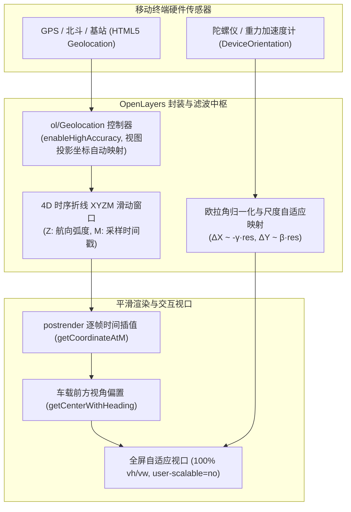
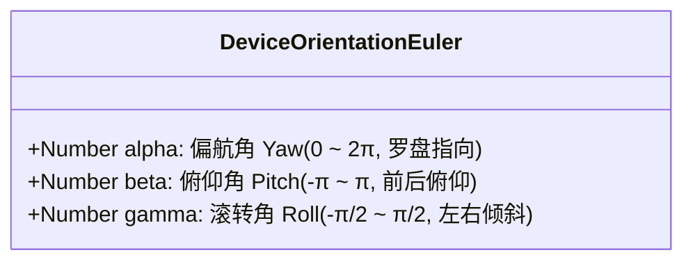

# OpenLayers 移动端全屏交互、高精度定位跟踪与姿态传感实战架构指南

> 随着移动智能终端、车载中控大屏与无人巡检设备的普及，WebGIS 的运行场景正全面从传统 PC 桌面端向移动端（Mobile Context）延展。在移动应用场景下，用户不再满足于静态的地图浏览，而是渴求**毫秒级自适应全屏布局**、**实时高精度 GPS/北斗卫星定位追踪**、**类似车载高德/百度的车头朝向平滑旋转导航**、以及**结合手机硬件陀螺仪（Gyroscope）的体感体态倾斜漫游**。
>
> OpenLayers 提供了强大的移动端生态支撑工具箱：通过封装 W3C 标准的 `ol/Geolocation` 控制器、**4D 时序折线几何体（`LineString XYZM`）**时间连续插值、**视角前方偏置变换（Heading Offset）**以及 **DeviceOrientation 空间欧拉角动力学映射**，开发者能够轻松打造出极致丝滑的工业级移动地图应用。本文基于 4 个核心官方示例，系统解构移动端空间定位与姿态传感的底层架构。

---

## 1. 架构总览：移动端空间感知与全屏响应拓扑

### 1.1 硬件传感器到地图渲染的数据流



---

## 2. 移动端全屏视口布局与初次定位自动聚焦

在 `mobile-full-screen.html` 中，展示了构建单页全屏 WebGIS 应用的标准 HTML 骨架：

```html
<meta name="viewport" content="initial-scale=1.0, user-scalable=no, width=device-width">
<style>
  html, body, .map {
    margin: 0;
    padding: 0;
    width: 100%;
    height: 100%;
    overflow: hidden;
  }
</style>
```

### 2.1 `geolocation.once('change:position')` 首次定位锁定

在移动端地图初始化时，若等待 GPS 获取到第一组有效坐标再展示给用户，最佳实践是使用单次事件监听：

```javascript
import Geolocation from 'ol/Geolocation';

const geolocation = new Geolocation({
  projection: view.getProjection(), // 自动转换至当前 View 投影（如 EPSG:3857）
  tracking: true,
});

// 单次监听初次定位成功事件：自动将视图中心平移至用户物理坐标，并设置精细街区级分辨率
geolocation.once('change:position', function () {
  view.setCenter(geolocation.getPosition());
  view.setResolution(2.388657133911758); // 相当于高缩放层级（Zoom ~16）
});
```

---

## 3. 高精度定位追踪与精度包围面（Accuracy Geometry）

在 `geolocation.html` 中，展示了全指标监控仪表盘与动态精度圆渲染：

```javascript
const geolocation = new Geolocation({
  trackingOptions: {
    enableHighAccuracy: true, // 核心：开启物理 GPS 芯片，确保 heading 与 speed 可读
    maximumAge: 10000,
    timeout: 600000,
  },
  projection: view.getProjection(),
});
```

### 3.1 精度包围面（Accuracy Polygon）自动构建

GPS 设备返回的不仅是一个坐标点，通常还伴随着一个以米为单位的误差范围 `accuracy`（如误差 15 米）。
OpenLayers 内部通过 `geolocation.getAccuracyGeometry()` 自动将当前中心点与误差半径投影为封闭的多边形几何体：

```javascript
const accuracyFeature = new Feature();
geolocation.on('change:accuracyGeometry', function () {
  accuracyFeature.setGeometry(geolocation.getAccuracyGeometry());
});
```
- **视觉反馈**：地图上实时呈现一个随着信号强弱而动态放大收缩的半透明半圆/多边形光晕，极大增强了终端用户对当前定位可信度的直观感知。

---

## 4. 车载/移动导航：4D 时序折线与航向角平滑插值

在真实的 GPS 定位中，原始数据通常每秒刷新一次（1 Hz），且带有网络延迟抖动。若直接在 `change` 事件中粗暴调用 `view.setCenter()`，屏幕上的车辆图标会呈现一秒一卡顿的“瞬移跳跃”，车头朝向也会剧烈晃动。

在 `geolocation-orientation.html` 中，OpenLayers 演示了顶级的**工业级导航平滑渲染流水线**。

### 4.1 4D 时序折线（LineString `XYZM`）滑动窗口

定义一个四维折线几何体：
- **X, Y**：投影平面坐标；
- **Z**：车辆运动航向角（Heading，单位：弧度）；
- **M**：时间戳（Timestamp，单位：毫秒）。

```javascript
import LineString from 'ol/geom/LineString';

const positions = new LineString([], 'XYZM');
```

### 4.2 最短旋转路径防跳跃算法

当车辆航向角在正北方向跨越 $0$ 与 $2\pi$ 边界时（例如从 $359^\circ$ 转向 $1^\circ$），如果直接进行数值插值，车头会在动画中沿反方向逆向旋转近 $358^\circ$。
示例中通过航向差分约束，将旋转步长强制限制在 $[-\pi, \pi]$ 区间内：

```javascript
let headingDiff = heading - mod(prevHeading);
if (Math.abs(headingDiff) > Math.PI) {
  const sign = headingDiff >= 0 ? 1 : -1;
  headingDiff = -sign * (2 * Math.PI - Math.abs(headingDiff));
}
heading = prevHeading + headingDiff;
```

### 4.3 延迟 1.5 倍采样周期的连续时间插值

将时钟人为延迟一个极短的时间（如 $1.5 \times \Delta t_{\text{mean}}$），确保插值算法始终在两个已知历史航迹点之间进行 Hermite/线性插值，利用 `positions.getCoordinateAtM(m, true)` 算出当前渲染帧的精确瞬时坐标与朝向：

```javascript
tileLayer.on('postrender', function () {
  const m = Date.now() - deltaMean * 1.5;
  const c = positions.getCoordinateAtM(m, true);
  if (c) {
    view.setCenter(getCenterWithHeading(c, -c[2], view.getResolution()));
    view.setRotation(-c[2]); // 地图逆向旋转，使得车头始终指向屏幕正上方
    marker.setPosition(c);
    map.render(); // 调度下一帧
  }
});
```

### 4.4 车载导航视角偏置（Navigation Perspective Offset）

传统地图的中心点直接对应车标，但汽车导航（如 Apple Maps 或高德）要求车辆位于屏幕下方约 1/4 处，前方保留 3/4 的开阔道路视野：

$$\text{offsetX} = -\frac{\sin(\theta) \cdot \text{height} \cdot \text{res}}{4}, \quad \text{offsetY} = \frac{\cos(\theta) \cdot \text{height} \cdot \text{res}}{4}$$

```javascript
function getCenterWithHeading(position, rotation, resolution) {
  const size = map.getSize();
  const height = size[1];
  return [
    position[0] - (Math.sin(rotation) * height * resolution) / 4,
    position[1] + (Math.cos(rotation) * height * resolution) / 4,
  ];
}
```

---

## 5. 移动姿态传感（DeviceOrientation 陀螺仪联动）

在 `device-orientation.html` 中，利用移动设备的内置三轴陀螺仪实现体感漫游。

### 5.1 欧拉角与物理平面平移映射



平移映射动力学方程：
```javascript
center[0] -= resolution * gamma * 25; // 左右倾斜沿 X 轴平移
center[1] += resolution * beta * 25;  // 前后仰合沿 Y 轴平移
view.setCenter(center);
```
乘以 `resolution` 实现了**与缩放层级无关的物理手感恒定性**。

---

## 6. 生产环境避坑指南与最佳实践

### 6.1 HTTPS 强制安全上下文（Secure Context）
- **现象**：在手机浏览器通过局域网 IP（如 `http://192.168.1.100:8080`）测试时，定位无响应且不弹窗。
- **根因**：现代 Web 安全规范强制要求 Geolocation 与 DeviceOrientation 必须运行在 HTTPS 安全连接下。
- **规范**：开发阶段配置本地自签名 SSL 证书（如 mkcert），生产环境配置合法域名与 SSL 证书。

### 6.2 iOS 13+ 陀螺仪权限显式授权
- **现象**：在 iPhone Safari 上打开页面，陀螺仪完全不动。
- **根因**：苹果强制要求必须由用户直接点击（用户手势事件）调用 `DeviceOrientationEvent.requestPermission()` 并获取授权。
- **最佳实践**：在 UI 界面增加一个“开启体感漫游”交互按钮，在点击事件中触发授权流程。

### 6.3 移动端电池续航与生命周期管理
- **排查**：后台静默运行的 `watchPosition` 会导致设备电量急剧消耗、手机发烫。
- **规范**：结合 Page Visibility API：
  ```javascript
  document.addEventListener('visibilitychange', () => {
    if (document.hidden) {
      geolocation.setTracking(false);
    } else if (userWantsTracking) {
      geolocation.setTracking(true);
    }
  });
  ```
