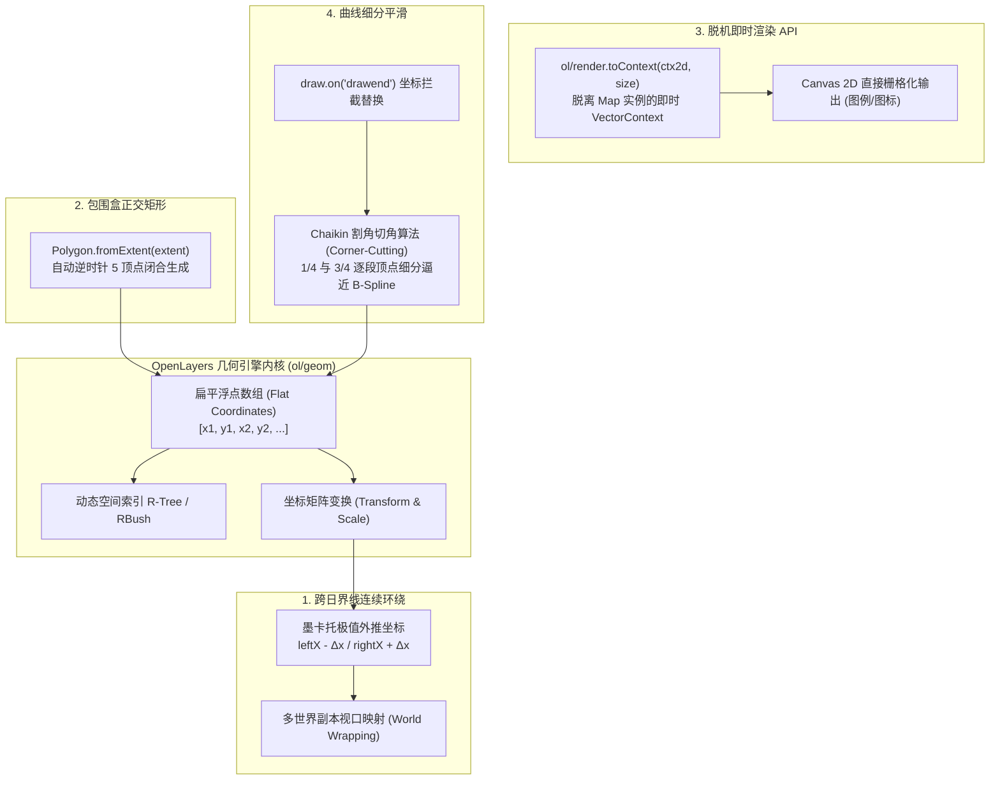
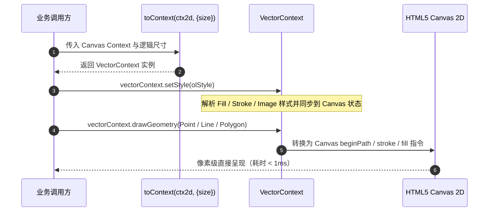

# OpenLayers 空间几何数学、跨日界线环绕与曲线平滑实战指南

> **专题标识**：`geometry-wrapping-smoothing`  
> **核心标签**：`geometry`、`smooth`、`chaikin`、`rectangle`、`wrap`、`render`  
> **涉及示例**：
> - [`polygon-wrapping`](../examples/polygon-wrapping.html) - 多边形跨日界线循环环绕渲染
> - [`rectangle`](../examples/rectangle.html) - 矩形几何与四至包围盒构建（fromExtent）
> - [`render-geometry`](../examples/render-geometry.html) - 即时渲染：将几何直接绘制到独立 Canvas
> - [`chaikin`](../examples/chaikin.html) - 基于 Chaikin 算法的折线平滑化

---

## 1. 架构总览：OpenLayers 空间几何核心模型

OpenLayers 拥有高度数学化且遵循 OGC Simple Features 规范的空间几何引擎（`ol/geom/*`）。从最基础的点（`Point`）、折线（`LineString`）、多边形（`Polygon`），到复杂的多几何体（`Multi*`）与集合（`GeometryCollection`），所有几何均以连续扁平化的数值浮点数组（Flat Coordinates）在底层存储，实现极致的内存紧凑性与遍历速度。

在实际工业级项目中，除了常规的矢量绘制，开发者经常会遭遇一系列深水区难题：
1. **跨日界线撕裂**：太平洋岛国、极地航线跨越 180° 经线时，如何避免图形横跨全球产生横向“拉丝撕裂”？
2. **矩形对象抽象**：为什么标准库没有 `Rectangle` 类？如何从 BBOX 高效构造正交多边形？
3. **脱离地图的纯几何渲染**：在图例生成、离屏 Canvas 导出或微组件中，如何无需创建 `Map` 实例直接使用 OpenLayers 的矢量样式排版？
4. **手绘平滑度提升**：人工手绘轨迹曲折生硬，如何利用计算机图形学经典割角算法（Chaikin）实时生成圆润的样条曲线？



---

## 2. 核心技术对比与方案选型

| 几何处理场景 | 传统纯手工实现方式 | OpenLayers 官方标准解决方案 | 架构优势与收益 |
| :--- | :--- | :--- | :--- |
| **矩形/包围盒生成** | 手动拼接 5 个点并计算首尾相同坐标 | `Polygon.fromExtent([minX, minY, maxX, maxY])` | 100% 保证逆时针拓扑外环，杜绝点位顺序混乱导致的渲染异常 |
| **跨日界线显示** | 强行将正经度截断折回负经度 | 坐标允许外推至世界边界之外（$\pm \Delta x$），配置 `updateWhileAnimating: true` | 彻底消除跨越 180° 经线时横跨整个地球的几何拉扯变形 |
| **图例/小图标绘制** | 实例化不可见的新 `Map` 挂载 DOM 渲染 | `toContext(canvas.getContext('2d'), { size })` | 无需 DOM 挂载、无需事件监听与投影系统，内存开销减少 95% |
| **折线平滑圆角** | CSS `stroke-linejoin: round`（仅拐角微圆） | `chaikin-smooth` 多轮割角迭代逼近二次 B 样条 | 真实的几何拓扑坐标重计算，支持后续测量、空间相交与导出 |

---

## 3. 关键机制深入剖析

### 3.1 跨日界线（Antimeridian）的多世界连续渲染机制

在 Web 墨卡托投影（EPSG:3857）中，全球经度范围被压缩在 $[-20037508.34, 20037508.34]$ 之间。

```
                    反子午线 / 日界线
西侧极值边界 (-180°)        |        东侧极值边界 (+180°)
leftX = -20037508.34        |        rightX = +20037508.34
       <---|----------------|----------------|--->
  世界副本 -1    |     主世界 (World 0)    |   世界副本 +1
```

如果一个要素跨越东经 180°（如某条航线从东京 $140^\circ\text{E}$ 飞往旧金山 $122^\circ\text{W}$），若旧金山坐标依然记作负数，几何连线就会被迫向西“倒着穿过亚欧非大陆”，形成横跨全球的巨型错误线条。

#### OpenLayers 的外推坐标解析机制
```javascript
// examples/polygon-wrapping.js
const proj = getProjection('EPSG:3857');
const extent = proj.getExtent();
const leftX = extent[0];
const rightX = extent[2];

// 允许 X 坐标超越极值边界：
// leftX - 2000000 意味着多边形延伸到了左侧连续环绕的世界副本中
new Feature(fromExtent([leftX - 2000000, 4500000, leftX + 4000000, 6500000]));
```
在图层配置中：
```javascript
new VectorLayer({
  updateWhileAnimating: true,   // 平移动画时持续实时计算环绕映射
  updateWhileInteracting: true, // 鼠标按住拖拽时实时更新
  source: vectorSource,
});
```
OpenLayers 的渲染器根据当前视口的中心经度，自动计算当前视口跨越了哪些“世界切片”，并将这些跨越边界的几何无缝映射到相邻视图中，从而呈现完美连续的环球视角。

---

### 3.2 矩形几何与 `Polygon.fromExtent` 的规范化

OpenLayers 遵循 OGC 标准，**未设计独立的 `Rectangle` 几何类**。所有矩形均作为标准 `ol/geom/Polygon` 运行。

```javascript
// examples/rectangle.js
import {fromExtent} from '../src/ol/geom/Polygon.js';

const rectangleGeom = fromExtent([-1000000, 5000000, 3000000, 7000000]);
```
其内部构造等价于：
```javascript
new Polygon([[
  [-1000000, 5000000], // 左下
  [-1000000, 7000000], // 左上
  [3000000, 7000000],  // 右上
  [3000000, 5000000],  // 右下
  [-1000000, 5000000], // 闭合起点
]]);
```
- **逆时针拓扑外环保证**：`fromExtent` 生成的外环点序严格符合 OGC 外环规范，直接与空间分析库（JSTS、Turf.js）互通，杜绝由于手写顺时针导致的面积取负或拓扑无效错误。

---

### 3.3 即时渲染引擎：`toContext` 独立 Canvas 绘制

在地图之外的业务中（例如制作**动态图例、标绘符号预览面板、PDF 导出中的微型指北针**），完全不需要庞大的 `new Map()` 实例。

```javascript
// examples/render-geometry.js
import {toContext} from '../src/ol/render.js';
import LineString from '../src/ol/geom/LineString.js';
import Polygon from '../src/ol/geom/Polygon.js';
import Point from '../src/ol/geom/Point.js';

const canvas = document.getElementById('canvas');
// 1. 创建即时模式渲染上下文
const vectorContext = toContext(canvas.getContext('2d'), {size: [100, 100]});

// 2. 注入 OpenLayers 标准样式
vectorContext.setStyle(style);

// 3. 在 Canvas 物理像素空间直接绘制几何
vectorContext.drawGeometry(new LineString([[10, 10], [90, 90]]));
vectorContext.drawGeometry(new Polygon([[[2, 2], [98, 2], [2, 98], [2, 2]]]));
vectorContext.drawGeometry(new Point([88, 88]));
```



---

### 3.4 几何曲线平滑：Chaikin 割角切角细分算法

在交互标绘（`Draw`）中，用户用鼠标或手写板绘制的线条通常充满硬折角。Chaikin 算法能够在不借助三阶贝塞尔曲线控制点的情况下，纯粹基于折线已有顶点实现自适应光滑逼近。

#### 数学递推公式
对折线上的任意一条线段 $P_i P_{i+1}$，在每次迭代中切掉原来的拐角，并在 $1/4$ 和 $3/4$ 处插入两个新点：
$$Q_i = \frac{3}{4}P_i + \frac{1}{4}P_{i+1}$$
$$R_i = \frac{1}{4}P_i + \frac{3}{4}P_{i+1}$$

```
原折角:             P2
                   /  \
                  /    \
                 /      \
               P1        P3

Chaikin 割角:       Q1--R1
                   /      \
                  /        \
                P1          P3
```
随着迭代进行，折线急速收敛于均匀二次 B 样条（Quadratic B-Spline）曲线。

#### 与 OpenLayers Draw 交互无缝集成
```javascript
// examples/chaikin.js
draw.on('drawend', function (event) {
  if (!shallSmoothen.checked) return;

  const feat = event.feature;
  const geometry = feat.getGeometry();
  const coords = geometry.getCoordinates();

  // 迭代平滑（建议轮次 3~5 轮）
  const smoothened = makeSmooth(coords, parseInt(numIterations.value, 10) || 5);
  geometry.setCoordinates(smoothened);
});
```

---

## 4. 生产实践踩坑与性能调优指南

### 4.1 Chaikin 算法的顶点爆炸防御
- **隐患**：每经过一轮 Chaikin 细分，折线的顶点数量几乎翻倍（$V_{n} \approx 2 V_{n-1}$）。若用户输入 10 轮迭代，一个原本 20 个点的线条将激增至上万个顶点，导致序列化为 GeoJSON 时体积膨胀上百倍，并拖垮渲染。
- **治理规范**：
  1. 迭代轮次强制夹紧在 $1 \sim 7$ 轮之间（视觉效果在 5 轮时已达到人眼平滑极限）；
  2. 平滑后若点数过密，在入库前可结合 `geometry.simplify(tolerance)`（Douglas-Peucker 算法）剔除共线多余点。

### 4.2 跨日界线 GeoJSON 存储与后端查询陷阱
- **隐患**：如果直接将 $leftX - 2000000$ 的外推坐标存储进 PostGIS，在 `ST_GeomFromGeoJSON` 时可能会报 `Coordinate out of range (-180 to 180)`。
- **解决策**：在与数据库交互时，若跨越日界线，应在入库前将其分割为位于经度范围内的两个有效多边形构成的 `MultiPolygon`；在前端仅作为展示层时才使用连续环绕坐标。

---

## 5. 总结与延伸阅读

本专题梳理了 OpenLayers 底层几何引擎的高级应用范式：
1. **多世界连续环绕**：理解投影边界外推坐标与视口映射机制；
2. **包围盒规范化**：熟练运用 `Polygon.fromExtent` 构建严谨正交几何；
3. **即时渲染**：脱离地图直接基于 `toContext` 实现毫秒级 Canvas 几何自绘制；
4. **曲线平滑细分**：运用 Chaikin 割角算法优化手绘折线的美学与数学表现。

建议结合以下专题交叉进阶学习：
- [OpenLayers 高级矢量拓扑编辑与空间分析指南](./openlayers-topology-analysis-guide.html)
- [OpenLayers 矢量切片高级架构与重投影实战指南](./openlayers-vector-tiles-grid-reprojected-guide.html)
- [OpenLayers 样式系统与富文本注记全景指南](./openlayers-style-guide.html)
