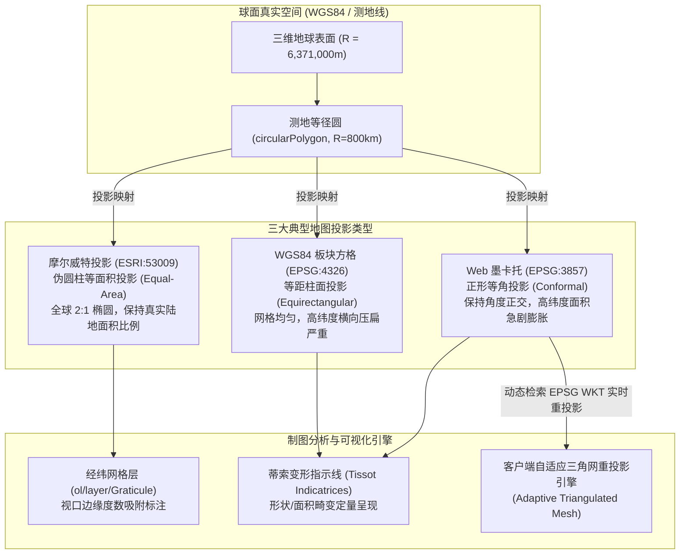
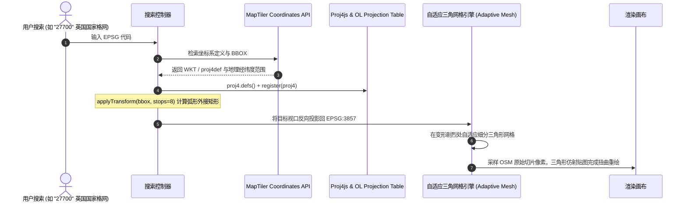
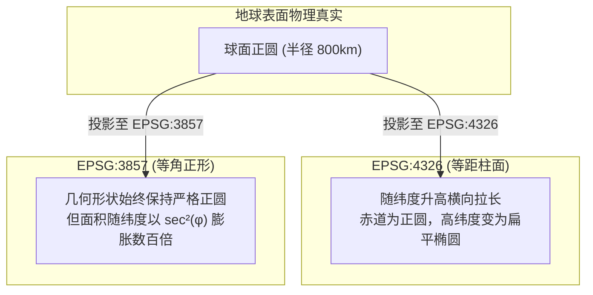

# OpenLayers 经纬网格网、等面积/异构投影与蒂索变形椭圆实战架构指南

> 地球是一个不规则的三维旋转椭球体，而屏幕与纸张是二维平坦介质。从球面到平面的数学映射过程，构成了地图学（Cartography）最古老而又最核心的学科支柱：
> 1. **空间地理基准（Graticule Coordinate Grid）**：如何在任意投影平面下自适应绘制经纬度网格线，并将经纬度度数标签智能吸附在视口边缘？
> 2. **等面积伪圆柱投影（Sphere Mollweide / ESRI:53009）**：如何利用 Proj4js 拓展非墨卡托投影，通过精确的数学椭圆半轴边界（$x_{\max}=2\sqrt{2}R, y_{\max}=\sqrt{2}R$）与 `worldExtent` 配置，实现全无畸变的全球大区面积对比？
> 3. **客户端即时任意投影转换（Reprojection by Code）**：如何动态检索 EPSG 代号，利用自适应三角网（Adaptive Triangulated Mesh）将标准 Web 墨卡托光栅瓦片在浏览器 Canvas 中实时扭曲重投影？
> 4. **投影失真几何可视化（Tissot's Indicatrix / 蒂索变形椭圆）**：如何利用大圆测地多边形（`circularPolygon`），通过在真实地球表面铺设等径圆，科学定量地揭示等角投影的“面积膨胀”与等距柱面投影的“横向拉伸”？
>
> 本文基于 4 个官方核心示例（`graticule.html`、`sphere-mollweide.html`、`reprojection-by-code.html`、`tissot.html`），系统解构投影几何学、经纬网格网以及客户端重采样引擎的底层奥秘。

---

## 1. 架构总览：地图投影变换与形变几何空间

地图投影本质上是球面坐标 $(\lambda, \varphi)$ 到平面直角坐标 $(x, y)$ 的可微映射函数：
$$x = f(\lambda, \varphi), \quad y = g(\lambda, \varphi)$$
不同的数学映射方式会导致不同性质的形变，OpenLayers 支持对各类投影进行深度适配与可视化：



### 1.1 四大投影与空间分析示例对比

| 示例 / 维度 | 经纬网格网 (`graticule`) | 摩尔威特等面积 (`sphere-mollweide`) | 任意代码重投影 (`reprojection-by-code`) | 蒂索变形椭圆 (`tissot`) |
| :--- | :--- | :--- | :--- | :--- |
| **典型示例** | `graticule.html` | `sphere-mollweide.html` | `reprojection-by-code.html` | `tissot.html` |
| **核心 API** | `new Graticule()` | `proj4.defs`, `worldExtent`, `extent` | `applyTransform`, `TileDebug`, `register` | `circularPolygon`, `geom.transform` |
| **投影特征** | EPSG:3857 墨卡托网格 | ESRI:53009 伪圆柱等面积 | 任意全球/局部坐标系（如 27700, 3031） | EPSG:4326 vs EPSG:3857 双图同屏 |
| **形变表现** | 垂直正交经纬虚线 | 对称半椭圆经线、平行纬线 | 依投影性质产生扇形/双曲形网格 | 墨卡托面积放大 / 4326 压扁椭圆 |
| **核心业务价值** | 航海/航空定位基准刻度 | 全球生物圈生态分布、统计专题图 | 支持跨国界局部高精度测绘工程坐标系 | 空间变形教学、制图误差校准分析 |

---

## 2. 经纬网格网图层与视口边缘标注（`graticule.html`）

### 2.1 动态自适应网格与边缘吸附算法

经纬网（Graticule）不仅需要根据当前地图分辨率自适应切换经纬线密度（如微观视角显示 $1^\circ$ 间隔，宏观视角切换为 $10^\circ$ 间隔），更具挑战性的是**度数标签的排版**。
如果将文本直接绘制在网格线上，会严重干扰地图中央的要素视觉。
`ol/layer/Graticule` 采用了创新的**视口边缘钉扎算法**：
1. 提取当前地图视口在屏幕上的四条物理边缘线段（Top, Bottom, Left, Right）；
2. 计算经纬线与视口边界的瞬时几何交点；
3. 将格式化后的度数文本（如 `4°E`, `48°N`）精准吸附在边界交点处，并在平移漫游时保持动态贴边。

```javascript
// 经纬网图层配置
new Graticule({
  // 网格线型样式：半透明橙色、点划线
  strokeStyle: new Stroke({
    color: 'rgba(255,120,0,0.9)',
    width: 2,
    lineDash: [0.5, 4],
  }),
  showLabels: true, // 开启视口边缘刻度吸附
  wrapX: false,     // 单一世界范围绘制，避免重复渲染
})
```

---

## 3. 摩尔威特全球等面积投影与数学边界（`sphere-mollweide.html`）

### 3.1 摩尔威特（Mollweide）数学原理与椭圆外包盒

德国数学家卡尔·摩尔威特（Karl Mollweide）于 1805 年提出该投影，用于在平面上真实展现不同大洲的实际面积比例（解决墨卡托投影中格陵兰岛虚假巨大的缺陷）。
全球投影为一个长宽比为 $2:1$ 的对称椭圆：
$$x = \frac{2\sqrt{2}}{\pi} R (\lambda - \lambda_0) \cos\theta, \quad y = \sqrt{2} R \sin\theta$$
其中辅助参量角 $\theta$ 通过迭代求解超越方程：$2\theta + \sin(2\theta) = \pi \sin\varphi$。

当球体半径 $R = 6,371,000\text{ m}$ 时：
- **半长轴（赤道跨度）**：$x_{\max} = 2\sqrt{2} R \approx 18,019,909.21\text{ m}$
- **半短轴（极点跨度）**：$y_{\max} = \sqrt{2} R \approx 9,009,954.61\text{ m}$

### 3.2 `worldExtent` 对经纬网图层的防奇异保护

由于椭圆在极点收敛为单点，如果经纬度范围直接包含 $\pm 90^\circ$ 和 $\pm 180^\circ$，浮点数极限会导致分母为 0 或线段断裂。
在定义 `Projection` 时，必须使用 `worldExtent` 进行适度微量内缩（如 $[-179, -89.99, 179, 89.99]$）：

```javascript
// 注册摩尔威特投影
proj4.defs(
  'ESRI:53009',
  '+proj=moll +lon_0=0 +x_0=0 +y_0=0 +a=6371000 +b=6371000 +units=m +no_defs',
);
register(proj4);

const sphereMollweideProjection = new Projection({
  code: 'ESRI:53009',
  extent: [
    -18019909.21177587, -9009954.605703328,
    18019909.21177587, 9009954.605703328,
  ],
  worldExtent: [-179, -89.99, 179, 89.99], // 避开数学奇异点
});
```

---

## 4. 客户端自适应三角网重投影引擎（`reprojection-by-code.html`）

### 4.1 任意坐标系动态重投影工作流

OpenLayers 拥有业界最先进的**纯前端客户端栅格重投影引擎**：



### 4.2 弧形边界细分采样（Subdivision Stops）

在非墨卡托投影（如极射投影）中，经纬度方框在平面上表现为复杂的弧线。
若直接对 4 个角点进行投影转换，得到的外接矩形会严重丢失两侧膨出的弧度。
OpenLayers 的 `applyTransform` 提供了第四个参数 `opt_stops = 8`：
```javascript
// 在经纬度 BBOX 的每条边上密集插入 8 个插值采样点，精准推算真实平面外包盒
const extent = applyTransform(bbox, fromLonLat, undefined, 8);
```

---

## 5. 蒂索变形指示线与投影失真分析（`tissot.html`）

### 5.1 测地球面圆（`circularPolygon`）与蒂索椭圆

在地图上直接画圆时，开发者往往调用平面圆算法，这会导致虚假的“平面正圆”。
OpenLayers 提供了 `circularPolygon([lon, lat], radius, 64)`，它基于大地测量学中的真实球面大圆方程，在 WGS84 椭球体表面生成真实等径的测地圆。



### 5.2 核心代码实现

```javascript
const radius = 800000; // 800 公里
let x, y;

// 全球 30 度网格循环撒点
for (x = -180; x < 180; x += 30) {
  for (y = -90; y <= 90; y += 30) {
    // 生成真实的球面测地圆（64 个顶点保证平滑）
    const circle4326 = circularPolygon([x, y], radius, 64);
    // 克隆并转换至墨卡托投影空间
    const circle3857 = circle4326.clone().transform('EPSG:4326', 'EPSG:3857');
    vectorLayer4326.getSource().addFeature(new Feature(circle4326));
    vectorLayer3857.getSource().addFeature(new Feature(circle3857));
  }
}
```

---

## 6. 生产实践踩坑与数学总结

| 考量维度 | 踩坑现象 | 底层原因 | 解决方案与最佳实践 |
| :--- | :--- | :--- | :--- |
| **极地投影断裂** | 经纬网在两极断裂或飞线 | 极点数学计算溢出（$\tan(90^\circ)=\infty$） | 显式配置 `worldExtent: [-179, -89.99, 179, 89.99]` |
| **重投影瓦片模糊** | 转换投影后光栅文字模糊 | 双线性插值在多级重采样中的像素虚化 | 开启 `source.setInterpolation(true)` 并配置 `maxZoom` 适当过度缩放 |
| **高纬度测距失真** | 在墨卡托地图上用直尺量算距离偏大数十倍 | 墨卡托投影面积膨胀因子极大 | 严禁使用平面欧几里得距离，必须调用 `ol/sphere` 中的 `getLength()` 与 `getArea()` 测地线算法 |
