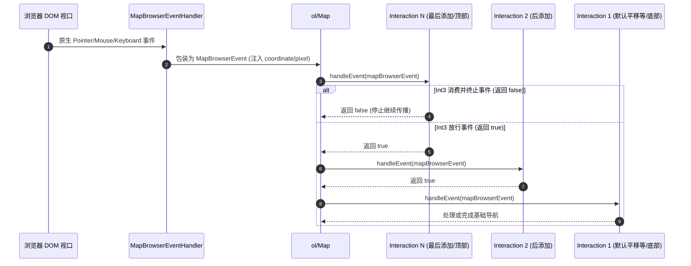
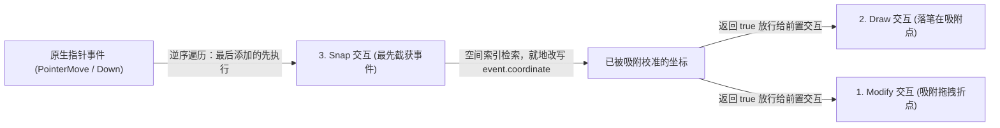
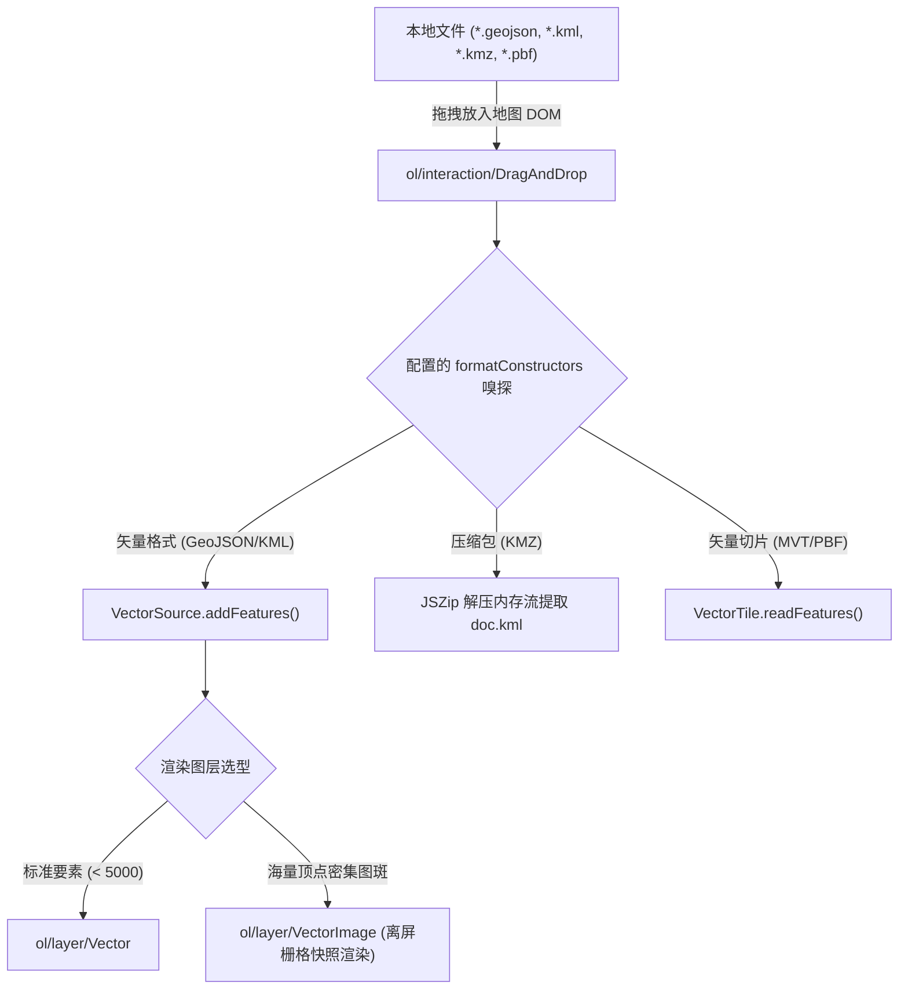

<nav aria-label="breadcrumb"><ol class="breadcrumb mb-4"><li class="breadcrumb-item"><a href="../">Home</a></li><li class="breadcrumb-item"><a href="./">Summary</a></li><li class="breadcrumb-item active" aria-current="page">Interaction 交互机制指南</li></ol></nav>

# OpenLayers 交互机制与实战架构精要指南
> 基于 26 个官方核心交互示例，深度解析事件调度管线、手势冲突仲裁、拓扑吸附描摹与客户端交互架构

---

## 引言：为什么需要深入理解 Interaction 机制

在 WebGIS 应用中，地图不仅仅是静态的数据渲染底图，更是用户与地理空间信息交互的媒介。用户通过鼠标、触控屏、快捷键对要素进行选取、拖拽编辑、精准拓扑标绘，乃至将本地文件直接拖放加载到视图中。

这些行为在底层都由 OpenLayers 的 **Interaction（交互）** 体系驱动。在实际工程落地中，开发者经常遇到以下典型难题：
1. **事件冒泡与手势冲突**：为什么添加了要素拖拽（`Translate`）或框选（`DragBox`）后，地图原有的平移（`DragPan`）会相互抢占导致界面卡死或误触发？
2. **逆序拦截机制理解偏差**：为什么交互列表的注册顺序直接决定了谁先拿到事件？`handleEvent` 返回 `true` 和 `false` 的实质影响是什么？
3. **高精度拓扑与吸附性能**：绘制边界时如何自动贴合已有要素（`Snap`）？面对数万级节点，拓扑吸附为什么容易引起帧率下跌？如何通过自定义线段分割器支持大圆航线或密集采样？
4. **状态与外部环境同步**：如何无刷新地将当前地图的中心点、缩放级别和旋转角实时双向绑定到浏览器 URL（`Link` 交互）？
5. **客户端文件零服务拖拽解析**：如何无需后端服务器中转，直接由浏览器解析 Shapefile、KMZ、GeoJSON 或 MVT 矢量切片并完成投影纠偏？

OpenLayers 设计了一套清晰解耦的事件响应管道。本文基于官方示例库中精选的 **26 个交互核心示例**，全面剖析交互体系的底层运转模型、协作规则与性能优化实践。

---

## 第一部分：全景视盘——26 个核心 Interaction 示例矩阵

下表将官方示例库中涉及 Interaction 的 26 个示例按技术流派与业务场景进行了分类整理：

| 业务分类 | 示例标识 | 核心类 / 关键 API | 解决的典型生产场景 |
| :--- | :--- | :--- | :--- |
| **视图漫游与手势控制** | [`double-click-drag-zoom`](../en/latest/examples/double-click-drag-zoom.html) | `ol/interaction/DblClickDragZoom` | 单手缩放支持：双击后不松开按键直接上下拖拽实现连续平滑缩放 |
| | [`drag-rotate-and-zoom`](../en/latest/examples/drag-rotate-and-zoom.html) | `ol/interaction/DragRotateAndZoom` | Shift + 鼠标拖拽同时调整地图视口旋转角与缩放级别 |
| | [`pinch-zoom`](../en/latest/examples/pinch-zoom.html) | `ol/interaction/PinchZoom` | 移动端与触摸屏双指捏合缩放视口手势 |
| | [`link`](../en/latest/examples/link.html) | `ol/interaction/Link` | 地图视图中心点、层级、旋转角与浏览器 URL 参数实时双向响应式同步 |
| **要素标绘与手绘输入** | [`draw-features`](../en/latest/examples/draw-features.html) | `ol/interaction/Draw` | 基础几何标绘：点、折线、多边形与圆形的交互式录入 |
| | [`draw-features-style`](../en/latest/examples/draw-features-style.html) | `Draw({style: ...})` | 绘制过程态视觉反馈：自定义橡皮筋线、顶点指示器与辅助高亮 |
| | [`draw-freehand`](../en/latest/examples/draw-freehand.html) | `Draw({freehand: true})` | 徒手流式手写涂鸦标绘，指针移动自动生成密集流式折线/面 |
| | [`draw-shapes`](../en/latest/examples/draw-shapes.html) | `Draw({geometryFunction: ...})` | 参数化几何构造：两点外接正方形、矩形包围盒、正多角星形交互生成 |
| | [`measure`](../en/latest/examples/measure.html) | `Draw` + `Overlay` + `getLength/getArea` | 空间量算：动态生成跟随指针的 Tooltip 实时展示测距测面数值 |
| **要素拾取与边界操作** | [`select-features`](../en/latest/examples/select-features.html) | `ol/interaction/Select` | 单击、双击、悬停（Hover）拾取要素，支持多选、反选与条件过滤 |
| | [`box-selection`](../en/latest/examples/box-selection.html) | `ol/interaction/DragBox` | 鼠标拉框多选：利用包围盒相交算法批量拾取空间要素 |
| | [`extent-interaction`](../en/latest/examples/extent-interaction.html) | `ol/interaction/Extent` | 地理范围框选器：通过八个角点与边手柄拖拉缩放修改范围矩形 |
| | [`extent-interaction-modify`](../en/latest/examples/extent-interaction-modify.html) | `Extent` + `condition: shiftKeyOnly` | 键盘按键协同：配合 Shift 键规避普通平移，微调特定区域范围 |
| **要素编辑与形变变换** | [`modify-features`](../en/latest/examples/modify-features.html) | `ol/interaction/Modify` | 经典顶点编辑：增加顶点、拖拽折点、Alt+点击删除顶点 |
| | [`modify-icon`](../en/latest/examples/modify-icon.html) | `Modify({hitDetection: ...})` | 图标要素修改：精确探测图元锚点与边框，实现带注记点要素的位置移动 |
| | [`modify-scale-and-rotate`](../en/latest/examples/modify-scale-and-rotate.html) | `Modify` + 旋转缩放条件修饰符 | 等比缩放与旋转：基于不变质心（Invariant Centroid）执行几何变换 |
| | [`translate-features`](../en/latest/examples/translate-features.html) | `ol/interaction/Translate` | 要素整体平移：按住指定要素拖动到新坐标，保持内部拓扑结构不变 |
| **拓扑关系、吸附与自动描摹** | [`snap`](../en/latest/examples/snap.html) | `ol/interaction/Snap` | 拓扑吸附：将输入指针吸附到最近的已有要素节点（vertex）与线段（edge） |
| | [`snap-custom-segmenter`](../en/latest/examples/snap-custom-segmenter.html) | `Snap({segmenter: ...})` | 自定义线段分割器：支持沿大圆航线（Great Circle）或密集插值吸附 |
| | [`tracing`](../en/latest/examples/tracing.html) | `Draw({trace: true})` + `Snap` | 自动拓扑描摹：沿已有复杂多边形或道路线自动追踪公共边界路径 |
| | [`draw-and-modify-features`](../en/latest/examples/draw-and-modify-features.html) | `Draw` + `Modify` + `Snap` 协同 | 标绘三剑客闭环：一边新增要素、一边编辑旧要素、全局保持拓扑重合 |
| **客户端文件零服务拖拽加载** | [`drag-and-drop`](../en/latest/examples/drag-and-drop.html) | `ol/interaction/DragAndDrop` | 拖放本地文件直读：GeoJSON、GPX、IGC、KML、TopoJSON 自动探测 |
| | [`drag-and-drop-image-vector`](../en/latest/examples/drag-and-drop-image-vector.html) | `DragAndDrop` + `VectorImage` | 高性能图像栅格化渲染：千万级顶点拖拽加载免卡顿 |
| | [`drag-and-drop-custom-kmz`](../en/latest/examples/drag-and-drop-custom-kmz.html) | `DragAndDrop` + 自定义解包函数 | 二进制压缩格式直读：在客户端解压 KMZ（JSZip）读取内置 `doc.kml` |
| | [`drag-and-drop-custom-mvt`](../en/latest/examples/drag-and-drop-custom-mvt.html) | `DragAndDrop` + `MVT` 切片解析器 | 矢量切片直接预览：拖拽单个 PBF/MVT 瓦片文件解析并在指定视图中渲染 |
| **底层扩展与自定义开发** | [`custom-interactions`](../en/latest/examples/custom-interactions.html) | 继承 `ol/interaction/Pointer` | 自定义交互基类开发：重写 `handleDownEvent`、`handleDragEvent`、`handleUpEvent` |

---

## 第二部分：架构全景——事件责任链与逆序派发机制

### 1. 事件生命周期与管线流程

OpenLayers 的交互体系基于**责任链模式（Chain of Responsibility）**构建。浏览器原生的 DOM 事件并不直接接触要素，而是经过统一的事件包装与逆序筛选：



### 2. 核心铁律：逆序分发规则（Reverse Dispatch Rule）

在 `ol/Map.js` 内部，交互集合保存在一个数组中：
```javascript
// OpenLayers 源码调度逻辑简要体现
const interactions = this.getInteractions().getArray();
for (let i = interactions.length - 1; i >= 0; --i) {
  const interaction = interactions[i];
  if (!interaction.getActive()) {
    continue;
  }
  const cont = interaction.handleEvent(mapBrowserEvent);
  if (!cont) {
    break; // 若 handleEvent 返回 false，立即阻断后续所有 interaction 的执行！
  }
}
```

> [!IMPORTANT]
> **交互事件调度的黄金法则**：
> 1. **后加入的交互优先获得执行权**：`map.addInteraction(interaction)` 将实例追加到数组末尾。由于采用逆序遍历，最后添加的交互位于责任链最前端。
> 2. **布尔返回值的语义**：
>    - `return true`：表示“放行此事件”，允许后续（即更早添加的）交互继续处理该事件；
>    - `return false`：表示“消费并终止此事件”，阻断传播，防止底层交互（如地图默认的 `DragPan` 或 `DoubleClickZoom`）产生误响应。
> 3. **激活开关（`setActive`）**：不需要移除交互对象，调用 `interaction.setActive(false)` 即可跳过其事件监听，避免频繁增删导致集合重新排布。

---

## 第三部分：手势冲突仲裁与 Condition 条件矩阵

当多个交互同时监听相同的指针动作（如鼠标左键拖拽）时，必须通过 `condition` 函数施加触发约束，否则会导致竞争冲突。

### 1. 常见冲突与防御性配置

- **冲突场景 1：框选（`DragBox`）与地图平移（`DragPan`）**
  - **现象**：按住鼠标左键拖拽时，既画出了选框，又平移了底图。
  - **解决方案**：为 `DragBox` 绑定 `platformModifierKeyOnly`（Windows 上为 Ctrl，macOS 上为 Cmd），使普通左键拖拽保留给 `DragPan`。
- **冲突场景 2：要素平移（`Translate`）与编辑折点（`Modify`）**
  - **现象**：点击折点准备微调时，整个要素被当成整体移动了位置。
  - **解决方案**：将 `Modify` 置于后方或通过选择集联动；或者仅对选中的要素启用 `Translate`。

### 2. `ol/events/condition` 条件修饰库矩阵

```javascript
import {
  shiftKeyOnly,
  platformModifierKeyOnly,
  altKeyOnly,
  singleClick,
  never,
  always
} from 'ol/events/condition';
```

| 条件函数 | 判定准则 | 常用协同交互示例 |
| :--- | :--- | :--- |
| `shiftKeyOnly` | 仅按下 Shift 键的同时触发指针动作 | `drag-rotate-and-zoom`, `extent-interaction-modify` |
| `platformModifierKeyOnly` | 仅按下系统修饰键（Win: Ctrl / Mac: Command） | `box-selection` (防止与普通平移冲突) |
| `altKeyOnly` | 仅按下 Alt / Option 键 | `modify-scale-and-rotate` (启动质心等比缩放) |
| `singleClick` | 判定为独立单次点击（过滤双击事件） | `select-features` (避免与双击缩放冲突) |
| `pointerMove` | 仅当鼠标悬停移动时触发 | `select-features` (实现 Hover 悬停高亮效果) |
| `never` | 永久不触发默认快捷动作 | 禁用某种内置手势时传入 |

---

## 第四部分：高级拓扑与吸附描摹引擎

在数字化作业和图斑绘制中，保证要素边界完全重合、消除公共缝隙是空间数据生产的核心诉求。

### 1. 经典三剑客共存：Draw、Modify 与 Snap 的装配顺序铁律

在数字化采编作业中，用户常常需要“一边绘制新要素，一边调整已有要素，且绘制或拖拽时折点必须严密贴合相邻图形”。

#### （1）26 个示例中是否存在三者同时存在的例子？
**存在，而且是 OpenLayers 官方最推崇的经典标绘闭环：**
- [`draw-and-modify-features`](../en/latest/examples/draw-and-modify-features.html)：**三者同时保持激活**（`active: true`）。鼠标点击空白处即可落笔绘制新多边形，悬停在已有图形折点上即可直接拖拽形变，同时整个过程全程保持顶点吸附。
- [`snap`](../en/latest/examples/snap.html)：内部同时实例化了 Draw、Modify 与 Snap。界面提供单选切换（通过 `Draw.setActive()` 与 `Modify.setActive()` 互斥切换状态），而 Snap 作为底层拓扑基准始终保持激活。

#### （2）三者共存时的装配先后顺序
**有极其严格的顺序要求：`Modify` 和 `Draw` 必须先添加，`Snap` 必须最后添加到地图中！**

```javascript
// 方式 A：通过 map.addInteraction 顺序挂载
map.addInteraction(modify); // 1. 先添加 Modify
map.addInteraction(draw);   // 2. 再添加 Draw
map.addInteraction(snap);   // 3. 必须最后添加 Snap！

// 方式 B：在 Map 初始化配置项中合并默认交互数组
import {defaults as defaultInteractions} from 'ol/interaction.js';

const map = new Map({
  // ...
  // 注意数组末尾放置 snap
  interactions: defaultInteractions().extend([modify, draw, snap]),
});
```

#### （3）底层运行机制：为什么 Snap 必须排在最后？



1. **逆序遍历事件链**：如第二部分所述，`ol/Map` 派发事件时，采用 `for (let i = interactions.length - 1; i >= 0; --i)` 从后往前倒序调用。
2. **坐标修正者（Mutator）与消费者（Consumer）的角色分工**：
   - `Snap` 的本质不是绘制几何，而是**坐标就地拦截与修正器**。它截获事件后，搜索 R-Tree 树，直接改写 `mapBrowserEvent.coordinate` 与 `mapBrowserEvent.pixel`，然后 `return true` 放行事件。
   - `Draw` 与 `Modify` 是**坐标消费者**。因为 `Snap` 后加入地图，所以在倒序遍历时最先拦截事件；当事件流转到 `Draw` 或 `Modify` 时，它们拿到的已经是被 `Snap` 修正并吸附后的坐标，落笔和顶点捕捉自然严丝合缝。
3. **反向装配的致命后果**：
   如果先添加 `Snap` 后添加 `Draw/Modify`，则 `Draw/Modify` 会在 `Snap` 之前接收事件。此时它们拿到的是原始鼠标像素坐标，`Snap` 的空间吸附计算对当前的绘制和编辑动作彻底失效，从而造成微小拓扑缝隙。

> [!NOTE]
> **官方源码注释佐证**：
> 在官方示例 [`examples/snap.js`](../en/latest/examples/snap.html) 的源码中，官方开发者留下了强制性注释：
> > *"The snap interaction must be added after the Modify and Draw interactions in order for its map browser event handlers to be fired first. Its handlers are responsible of doing the snapping."*
> > （Snap 交互必须在 Modify 和 Draw 交互之后添加到地图，以便它的事件处理函数最先执行并负责完成坐标吸附。）

### 2. 自定义线段分割器（Custom Segmenter）

在示例 [`snap-custom-segmenter`](../en/latest/examples/snap-custom-segmenter.html) 中，长距离航线在墨卡托投影下不是平面直线，而是大圆曲面航线（Great Circle）。
`Snap` 允许传入自定义 `segmenter`，对复杂几何线段进行密集化插值，使得吸附不仅局限于两点间的笛卡尔平面连线，更能贴合真实投影曲线。

### 3. 自动拓扑描摹（Tracing）

示例 [`tracing`](../en/latest/examples/tracing.html) 展示了现代 CAD/GIS 的高级交互能力：
- 配置 `Draw({trace: true})`；
- 配合 `Snap` 交互；
- 当用户在已有要素边界上连续点击时，OpenLayers 内部利用 Dijkstra 最短路径算法，沿已有几何线自动搜索并描摹出两点之间的公共边界线，大幅减少手工打点工作量。

---

## 第五部分：不变质心几何形变（Centroid Invariance）

在示例 [`modify-scale-and-rotate`](../en/latest/examples/modify-scale-and-rotate.html) 中，OpenLayers 的 `Modify` 交互展示了强大的非线性形变能力：

1. **质心锚定**：计算要素多边形的地理质心（Centroid）坐标 $(X_c, Y_c)$；
2. **旋转变换**：以质心为旋转中心，根据鼠标当前角度 $\theta$ 旋转全部坐标点：
   $$X' = X_c + (X - X_c)\cos\theta - (Y - Y_c)\sin\theta$$
   $$Y' = Y_c + (X - X_c)\sin\theta + (Y - Y_c)\cos\theta$$
3. **等比缩放**：根据拖拽点到质心的距离与初始距离之比 $S$，执行径向缩放：
   $$P' = C + S \cdot (P - C)$$

这种机制确保在缩放和旋转过程中，图形不会发生中心漂移，满足了高精度规整图斑编辑的要求。

---

## 第六部分：客户端零服务拖拽加载架构

示例 [`drag-and-drop`](../en/latest/examples/drag-and-drop.html) 及其衍生示例展示了纯前端驱动的现代化数据导入能力：



> [!TIP]
> **海量数据渲染选型**：
> 如示例 [`drag-and-drop-image-vector`](../en/latest/examples/drag-and-drop-image-vector.html) 所示，当拖入的矢量数据包含数十万个复杂节点时，使用 `ol/layer/VectorImage` 能在视口缩放平移时将矢量渲染为离屏快照，彻底规避每帧重新遍历 Canvas 路径带来的交互卡顿。

---

## 第七部分：生产工程最佳实践与避坑清单

1. **内存泄漏防范**：
   在单页面应用（Vue/React）销毁组件时，必须显式调用 `map.removeInteraction(interaction)`。如果交互中挂载了对 `source` 或 `view` 的事件监听（如 `drawend`、`modifyend`），要配合 `unByKey` 注销事件监听，防止脱离文档树的地图实例无法被垃圾回收。
2. **移动端触控优化**：
   在触摸屏设备上，应配置 `double-click-drag-zoom` 和 `pinch-zoom` 交互，并设置合适的 `hitTolerance`（例如 5~10 像素），提高手指触控点选要素的容错率。
3. **URL 双向响应式同步**：
   使用 `ol/interaction/Link` 时，交互会自动接管浏览器历史记录（`history.replaceState`）。若工程中已有 Vue Router 或 React Router，需注意 URL 参数前缀冲突，可通过 `prefix` 属性进行隔离。

---

## 附录：26 个交互核心示例直达索引

1. [box-selection (矩形框选批量要素)](../en/latest/examples/box-selection.html)
2. [custom-interactions (继承 PointerInteraction 自定义手势)](../en/latest/examples/custom-interactions.html)
3. [double-click-drag-zoom (双击垂直拖拽缩放)](../en/latest/examples/double-click-drag-zoom.html)
4. [drag-and-drop-custom-kmz (客户端解压加载 KMZ 压缩包)](../en/latest/examples/drag-and-drop-custom-kmz.html)
5. [drag-and-drop-custom-mvt (拖拽加载单文件 MVT 矢量切片)](../en/latest/examples/drag-and-drop-custom-mvt.html)
6. [drag-and-drop-image-vector (矢量图像快照图层拖拽直读)](../en/latest/examples/drag-and-drop-image-vector.html)
7. [drag-and-drop (原生拖拽解析 GeoJSON/GPX/KML)](../en/latest/examples/drag-and-drop.html)
8. [drag-rotate-and-zoom (Shift+拖拽实现旋转缩放复合变换)](../en/latest/examples/drag-rotate-and-zoom.html)
9. [draw-and-modify-features (标绘、编辑与吸附一体化闭环)](../en/latest/examples/draw-and-modify-features.html)
10. [draw-features (基础几何绘制点、线、多边形与圆)](../en/latest/examples/draw-features.html)
11. [draw-features-style (绘制过程动态样式与橡皮筋视觉反馈)](../en/latest/examples/draw-features-style.html)
12. [draw-freehand (徒手平滑流式涂鸦标绘)](../en/latest/examples/draw-freehand.html)
13. [draw-shapes (参数化两点框选矩形与正多角星)](../en/latest/examples/draw-shapes.html)
14. [extent-interaction-modify (基于 Shift 约束的范围选框精细修改)](../en/latest/examples/extent-interaction-modify.html)
15. [extent-interaction (八方向手柄矩形地理范围交互器)](../en/latest/examples/extent-interaction.html)
16. [link (视图位置与浏览器 URL 查询参数双向绑定)](../en/latest/examples/link.html)
17. [measure (空间距离与面积动态交互量算)](../en/latest/examples/measure.html)
18. [modify-features (经典多边形折点捕捉与增删编辑)](../en/latest/examples/modify-features.html)
19. [modify-icon (精确命中探测与点位图标拖拽)](../en/latest/examples/modify-icon.html)
20. [modify-scale-and-rotate (基于不变质心的等比缩放与自由旋转)](../en/latest/examples/modify-scale-and-rotate.html)
21. [pinch-zoom (移动设备双指张合手势缩放)](../en/latest/examples/pinch-zoom.html)
22. [select-features (要素单击、双击与悬停选取过滤)](../en/latest/examples/select-features.html)
23. [snap-custom-segmenter (自定义分割器大圆曲线吸附)](../en/latest/examples/snap-custom-segmenter.html)
24. [snap (节点与边线高精度拓扑吸附引擎)](../en/latest/examples/snap.html)
25. [tracing (基于最短路径搜索的公共边界拓扑描摹)](../en/latest/examples/tracing.html)
26. [translate-features (要素整体拓扑结构无损平移)](../en/latest/examples/translate-features.html)
