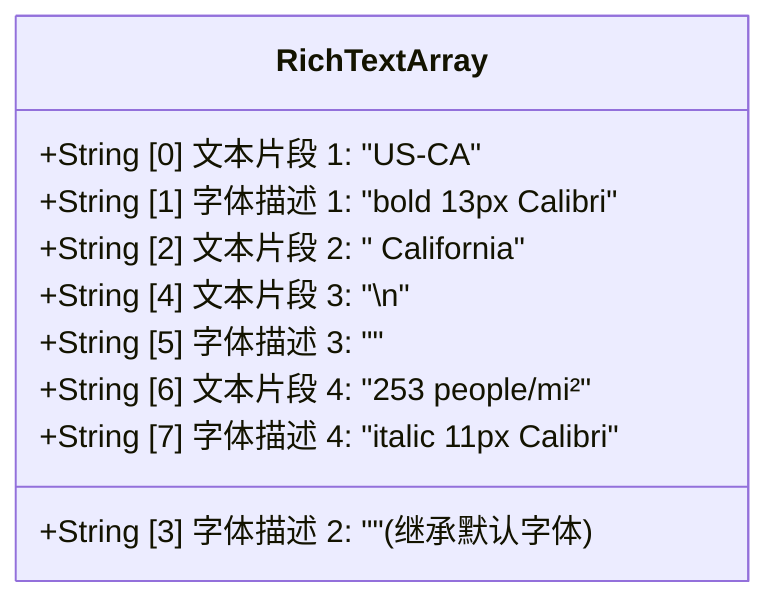
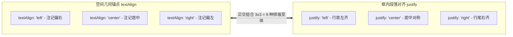

# OpenLayers 矢量文本注记渲染、富文本排版与智能避让实战架构指南

> 在地图制图学（Cartography）与现代 WebGIS 应用中，**地名与属性注记（Labels）**是承载地图可读性与信息传达的最核心要素。然而，随着地理要素密度的增加，文字互相重叠、小面积多边形注记丢失、图层之间文字遮挡冲突、样式单一无法突出层级、以及道路弯曲无法贴合等问题，往往成为困扰开发者的工程痛点。
>
> OpenLayers 拥有业内领先的矢量文字排版引擎与空间冲突检测机制。通过 **R-Tree 空间避让树（Decluttering）**、**命名隔离避让组（Declutter Groups）**、**数组化富文本排版（Rich Text）**、**几何锚点与段落对齐二维解耦（`textAlign` + `justify`）**以及**沿线弯曲切线排版（`placement: 'line'`）**，开发者能够构建出媲美专业出版级制图品质的高性能动态注记系统。本文基于 5 个核心官方示例，深度解构注记管线的实现原理与工程实践。

---

## 1. 架构总览：OpenLayers 文本渲染与避让冲突检测管线

### 1.1 文本光栅化与避让仲裁拓扑

在 OpenLayers 中，文本注记并不是简单的 HTML DOM 覆盖物，而是由矢量构建器（`TextBuilder`）计算排版后直接光栅化到 Canvas 纹理图集中：

```mermaid
flowchart TD
    subgraph FeaturePipeline [矢量要素与注记输入]
        direction TB
        F[矢量要素 Feature] --> StyleFunc[样式计算 style / text]
        StyleFunc --> TextDef["Text 样式对象 (font, placement, overflow)"]
    end

    subgraph DeclutterEngine [空间避让引擎 RBush]
        direction TB
        TextDef --> CheckOverflow{是否面要素 & 超出边界?}
        CheckOverflow -->|是且 overflow:false| Drop[丢弃注记]
        CheckOverflow -->|否或 overflow:true| CalcBox[计算屏幕像素包围盒 AABB / OBB]
        CalcBox --> DeclutterGroup{declutter 模式}
        DeclutterGroup -->|true| SharedTree[全局共享 R 树碰撞检测]
        DeclutterGroup -->|'separate' / 组名| IsolatedTree[专属命名 R 树碰撞检测]
        SharedTree --> Collide{是否与已有包围盒相交?}
        IsolatedTree --> Collide
        Collide -->|是 (低优先级)| Suppress[抑制隐藏当前文字]
        Collide -->|否 (成功占位)| Accept[注册包围盒并准予绘制]
    end

    subgraph CanvasOutput [Canvas 光栅化输出]
        Accept --> RenderEngine[Canvas 2D TextBuilder / GPU 纹理]
    end
```

### 1.2 关键配置维度全景矩阵

| 控制维度 | 核心配置项 | 典型取值 | 职责与效果 |
| :--- | :--- | :--- | :--- |
| **避让模式** | `VectorLayer.declutter` | `true` \| `'separate'` \| `'group-name'` | 控制是否防重叠碰撞，以及是否跨图层共享避让树 |
| **边界溢出** | `Text.overflow` | `true` \| `false`（默认） | 决定当文字长于多边形自身轮廓时，是否允许溢出显示并参与避让 |
| **空间排布** | `Text.placement` | `'point'`（默认） \| `'line'` | 水平点状锚接或沿折线道路弯曲跟随排布 |
| **几何锚点** | `Text.textAlign` | `'left'` \| `'center'` \| `'right'` | 控制注记框整体相对于点几何坐标的连接锚接位置 |
| **段落排版** | `Text.justify` | `'left'` \| `'center'` \| `'right'` | 控制多行段落文本在背景气泡框内部的行间水平对齐 |
| **富文本语法** | `Text.setText` | `string` \| `Array<string>` | 单一纯文本或交替式多字号、多字重富文本片段数组 |

---

## 2. 空间避让树（Decluttering）与命名分组隔离机制

### 2.1 全局避让 (`declutter: true`) 的工作原理

当矢量图层配置 `declutter: true` 时，OpenLayers 在渲染通道启动一个基于二维 R-Tree（RBush）的空间索引：
1. 按照图层渲染顺序，先绘制的文字被量化为屏幕像素包围盒（Bounding Box）；
2. 引擎在 R 树中查询该包围盒是否与之前已注册的包围盒相交；
3. 若无碰撞，则将当前包围盒插入 R 树，并将文字光栅化；若发生碰撞，直接跳过当前文字绘制。

### 2.2 命名分组隔离 (`declutter: 'separate'`) 解决业务冲突

在复杂 WebGIS 中，经常面临“业务标记（如警情点）必须优先展示，但底图矢量瓦片（如 Mapbox/MapTiler Streets）也有自己的文字避让”的情况。若盲目使用全局 `declutter: true`，业务图层的大面积文字可能直接把底图的关键路名或地名全部剔除。

在 `declutter-group.html` 中，通过赋予自定义字符串值实现命名分组隔离：

```javascript
const overlay = new VectorLayer({
  // 使用命名分组 'separate'，创建专有的避让通道
  declutter: 'separate',
  source: vectorSource,
  style: {
    'text-value': ['get', 'text'],
    'text-overflow': true,
  },
});
```

- **隔离效果**：`overlay` 图层内部的文字之间依然遵守防重叠避让，但**绝不与下方的 Mapbox 底图共享同一个碰撞池**，下层道路注记能够穿透上层多边形正常显示，避免了全局误吞。

---

## 3. 面要素注记容纳与 `overflow: true` 溢出放行机制

在默认情况下，OpenLayers 对 `Polygon` 和 `MultiPolygon` 要素执行保守的“几何容纳判定（Geometric Fit Test）”：若文字在当前视图层级下的外接矩形超出了多边形本体边界，引擎将直接弃用该文字。

在 `vector-label-decluttering.html` 示例中：
- 像美国东部面积极其狭小的特拉华州（Delaware）、罗德岛州（Rhode Island），若保持默认设置，其州名在全国缩放级别（Zoom 4）下完全不可见；
- 通过开启 `overflow: true`：
  ```javascript
  const labelStyle = new Style({
    text: new Text({
      font: '12px Calibri,sans-serif',
      overflow: true, // 强制放行超出多边形几何边界的长文字
      stroke: new Stroke({color: '#fff', width: 3}), // 白色光晕保证跨底色可读性
    }),
  });
  ```
- **换行压缩包围盒技巧**：配合 `name.split(' ').join('\n')` 将横向冗长的地名转换为近似正方形的多行文本，不仅大幅缩小水平 AABB 碰撞面积，更大幅提高了相邻多边形之间注记的容纳率。

---

## 4. 数组化富文本排版（Rich Text Labels）

常规注记往往全行单一字体，难以体现层次。OpenLayers 提供了开箱即用的**交替式富文本数组规范**，无需引入任何 HTML 覆盖物即可在 Canvas 上直接呈现混合排版。

### 4.1 语法规则与代码范式

在 `rich-text-labels.html` 中：

```javascript
labelStyle.getText().setText([
  feature.getId(), 'bold 13px Calibri,sans-serif', // 粗体前缀排序代号
  ` ${feature.get('name')}`, '',                  // 继承默认字体的州名
  '\n', '',                                       // 显式换行符
  `${feature.get('density')} people/mi²`, 'italic 11px Calibri,sans-serif', // 较小字号的斜体统计数据
]);
```



### 4.2 性能设计与单例复用
在矢量要素样式函数 `style: function(feature)` 中，切忌频繁 `new Style()`。通过操作外层单例 `labelStyle.getText().setText(...)` 并返回统一的静态数组引用，有效规避了海量要素渲染时的 GC 停顿。

---

## 5. 几何锚点（`textAlign`）与段落对齐（`justify`）的二维解耦

在 `vector-labels-justify-text.html` 示例中，清晰展示了 OpenLayers 对注记排版学的重要重构：



### 5.1 纯样式气泡卡片 (`backgroundFill` + `padding`)
无需制作背景图片，通过配置：
```javascript
new Text({
  textAlign: 'left',
  justify: 'center',
  backgroundFill: new Fill({color: 'rgba(168, 50, 153, 0.6)'}),
  padding: [4, 8, 4, 8], // 上、右、下、左内边距
})
```
OpenLayers 会根据多行文本的实际计算外框，自动生成带有留白的纯矢量背景卡片。

---

## 6. 沿线弯曲道路注记（`placement: 'line'`）

在城市路网与航海航线制图中，文字必须贴合道路弯曲延伸。在 `street-labels.html` 中：

```javascript
const style = new Style({
  text: new Text({
    font: 'bold 11px "Open Sans", sans-serif',
    placement: 'line', // 沿线折线路径排布
    fill: new Fill({color: 'white'}),
  }),
});
```

### 6.1 核心机制深入
- **切线参数化与逐字仿射旋转**：引擎沿着道路线状几何分段采样切线矢量，计算各字符中心在路径上的投影并独立施加局部旋转角；
- **防倒悬自动翻转（Keep Upright）**：当道路流向反转导致文字可能倒立时，内置算法自动翻转采样方向，确保始终正向符合阅读习惯；
- **曲率折角保护（`maxAngle`）**：默认限制锐角折弯，避免文字在转角处严重形变重叠。

---

## 7. 生产环境避坑指南与最佳实践

### 7.1 空白空格丢失陷阱
- **现象**：富文本数组拼接后，州代号与地名紧挨在一起（如 `US-CANew York`）。
- **根因**：数组项紧邻时光栅化引擎不会自动注入空格。
- **解决**：在后续片段首位显式加空格：`' ' + name`。

### 7.2 矢量要素线段碎片化导致的注记缺失
- **现象**：明明整条大道很长，但地图上完全不显示路名。
- **根因**：道路被交叉路口打散成了几十个数十像素的微小 LineString，单段线长无法容纳整个文字，被 `placement: 'line'` 自动静默隐藏。
- **解决**：在 GIS 数据加工阶段（如 QGIS/PostGIS）使用 `ST_LineMerge` 进行同名拓扑线段合并，或在前端按道路名称进行要素聚类合并。

### 7.3 全局 `declutter: true` 导致的注记“离奇失踪”
- **现象**：打开一个新业务图层后，底图上的省会城市名字突然全没了。
- **解决**：业务矢量图层应显式指定独立的组名，如 `declutter: 'business-poi'`，实现碰撞域隔离。
