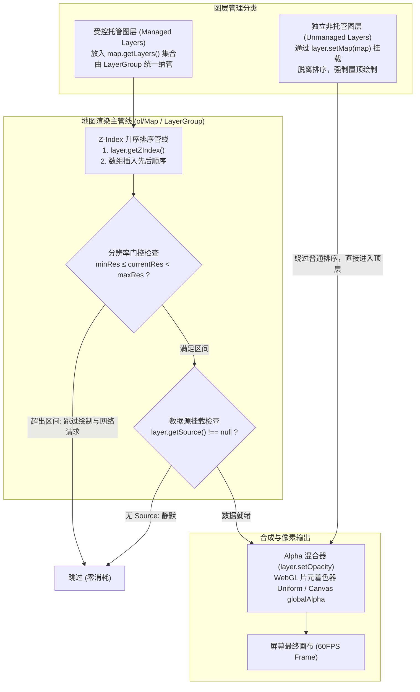
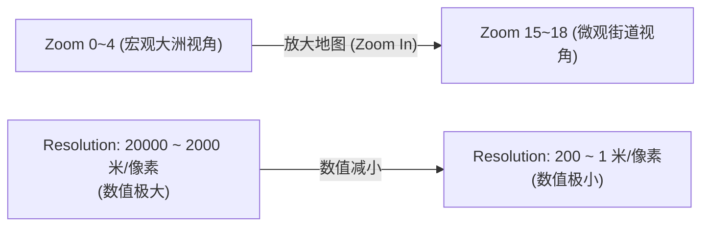

# OpenLayers 图层堆叠管理、透明度混合、层级深度与分辨率阈值控制实战架构指南

> 在现代复杂的企业级 WebGIS 平台中，地图视口往往需要承载数十甚至上百个专题图层（包括遥感卫星影像、电子导航底图、行政区划网格面、路网轨迹线、动态热力图以及实时标绘要素）。面对如此繁杂的图层树，如何保障渲染的高性能与视觉呈现的清晰可辨？
> 1. **多图层 Alpha 混合与透明度控制（Layer Opacity）**：如何通过硬件加速的片元着色器或 Canvas 全局合成，实现多时相/多源切片的高平滑度半透明透视融合？
> 2. **堆叠深度与托管/非托管图层特权机制（Z-Index & Managed/Unmanaged Layers）**：OpenLayers 内部如何对图层进行层级排序？为什么 `layer.setMap(map)` 挂载的非托管图层能够始终常驻在所有托管图层的最顶层？
> 3. **多尺度金字塔与分辨率区间门控（Min/Max Resolution）**：如何利用 $\text{minResolution} \le \text{res} < \text{maxResolution}$ 这一半开区间门控准则，从根源上阻断屏幕外图层的瓦片网络拉取与绘制开销？
> 4. **图层外壳与数据引擎解耦的懒加载架构（Lazy Source）**：面对庞大的图层目录树，如何实现按需即时挂载（`setSource`）并在关闭时彻底释放海量切片强引用，辅助浏览器垃圾回收（GC）？
>
> 本文基于 4 个核心官方示例（`layer-opacity.html`、`layer-z-index.html`、`min-max-resolution.html`、`lazy-source.html`），全方位解构 OpenLayers 图层生命周期、混合管线与堆叠排序的底层机制。

---

## 1. 架构总览：图层管线合成与四维控制矩阵

OpenLayers 对每一个图层（`ol/layer/Layer`）的生命周期与渲染调度，抽象出了由 **透明度（Opacity）、层级深度（Z-Index）、空间分辨率区间（Resolution Range）和数据源挂载状态（Source State）** 构成的四维控制矩阵：



### 1.1 四大图层控制机制对比

| 机制 / 维度 | 透明度混合 (`opacity`) | 层级深度排序 (`z-index`) | 分辨率门控 (`min/maxResolution`) | 按需懒加载 (`lazy-source`) |
| :--- | :--- | :--- | :--- | :--- |
| **典型示例** | `layer-opacity.html` | `layer-z-index.html` | `min-max-resolution.html` | `lazy-source.html` |
| **核心 API** | `setOpacity(number)` | `setZIndex(number)`, `setMap(map)` | `minResolution`, `maxResolution` | `setSource(source)`, `setSource(null)` |
| **控制维度** | 像素 Alpha 通道混合因子 (0~1) | 画面遮挡与绘制前后遍历次序 | 视口缩放比例尺可见性区间 | 数据源异步绑定与内存引用释放 |
| **性能收益** | 属性驱动局部重绘，零数据重载 | 避免重复重排，保障拓扑直观 | **节省网络切片并发与 GPU 绘制** | **彻底释放内存切片缓存，防止 OOM** |
| **典型场景** | 遥感影像与电子道路底图叠置 | 临时测量工具、高频标绘图层置顶 | 宏观卫星地貌与精细街道底图自动交接 | 复杂多图层树、按需开启的重度专题分析 |

---

## 2. 图层透明度与硬件加速混合（`layer-opacity.html`）

### 2.1 Alpha 通道与双渲染器混合原理

在多图层叠加显示时，上层图层的透明度控制着底层底图的透视可见程度：
$$\text{OutputColor} = \text{TopLayerColor} \times \alpha + \text{BottomLayerColor} \times (1 - \alpha)$$

在 OpenLayers 中：
1. **2D Canvas 渲染器**：在每一图层的绘制循环中设置 `ctx.globalAlpha = layer.getOpacity()`；
2. **WebGLTile 渲染器**：将 `opacity` 作为片元着色器（Fragment Shader）中的全局 Uniform 变量，在 GPU 硬件中以每秒数十亿次并行像素指令完成极速 Alpha 混合。

```javascript
// 遥感卫星底图 (WebGLTile 硬件加速)
const imagery = new TileLayer({
  className: 'ol-layer-imagery',
  source: new ImageTile({ ... }),
});

// 上层 OpenStreetMap 矢量切片底图
const osm = new TileLayer({ source: new OSM() });

// 响应滑块拖动，动态调整 OSM 透明度
function update() {
  const opacity = parseFloat(opacityInput.value);
  osm.setOpacity(opacity); // 派发 change:opacity 事件，触发下一帧平滑重绘
  opacityOutput.innerText = opacity.toFixed(2);
}
opacityInput.addEventListener('input', update);
```

---

## 3. 层级排序体系与非托管图层特权（`layer-z-index.html`）

### 3.1 托管图层排序管线算法

传入 `new Map({ layers: [...] })` 或通过 `map.addLayer()` 加入的图层属于**托管图层**。
其在内部绘制循环中的排序规则如下伪代码所示：

```typescript
function sortLayers(layers: Layer[]): Layer[] {
  return layers.slice().sort((a, b) => {
    const zIndexA = a.getZIndex() || 0;
    const zIndexB = b.getZIndex() || 0;
    if (zIndexA !== zIndexB) {
      return zIndexA - zIndexB; // 数值小者先绘制（底层），数值大者后绘制（顶层）
    }
    // Z-index 相同时的决平规则：保持原数组中的相对插入顺序
    return layers.indexOf(a) - layers.indexOf(b);
  });
}
```

### 3.2 独立非托管图层（Unmanaged Layer）的顶层特权

通过直接调用 `layer.setMap(map)` 绑定的图层称为**非托管图层**：
- **脱离图层树**：它不会出现在 `map.getLayers()` 的数组中，因此不会被图层管理树的全局遍历所干扰；
- **强制置顶（On Top）**：OpenLayers 渲染引擎在完成所有托管图层的 Canvas/WebGL 合成后，会额外独立遍历所有非托管图层并将它们直接绘制在最顶层。
- **最佳应用**：测量工具（Measure Tool）的动态虚线橡皮筋、框选查询临时矩形、测距距离标签等。

```javascript
// 创建五角星图层，并直接通过 setMap 声明为非托管层
const layer0 = createLayer([40, 40], styles.star);
layer0.setMap(map); // 无论其它图层的 Z-index 调多大，五角星始终居于最上方！

// 方形与三角形图层作为托管图层，通过 setZIndex 动态竞逐次序
layer1.setZIndex(1); // 蓝色方形在上
layer2.setZIndex(0); // 红色三角形在下
```

---

## 4. 多尺度金字塔与分辨率半开区间门控（`min-max-resolution.html`）

### 4.1 分辨率与缩放级别的反向数学关系

在 WebGIS 中，分辨率 $\text{Resolution}$ 定义为“单像素代表的物理地面距离”（单位：米/像素）：
$$\text{Resolution} = \frac{\text{EquatorLength} \times \cos(\text{latitude})}{256 \times 2^{\text{zoom}}}$$
- **级别越大（Zoom 宏观 $\to$ 微观）**：单个像素代表的地理范围越小，$\text{Resolution}$ 数值**急剧减小**；
- **级别越小（Zoom 微观 $\to$ 宏观）**：单个像素覆盖整个大洲甚至半球，$\text{Resolution}$ 数值**急剧变大**。



### 4.2 半开区间门控与无缝平滑交接

图层渲染器在每一帧通过闭开区间进行判定：
$$\text{minResolution} \le \text{currentResolution} < \text{maxResolution}$$

```javascript
const map = new Map({
  layers: [
    // 街道微观层：仅在分辨率 200 ~ 2000（高放大级别）渲染
    new TileLayer({
      source: new OSM(),
      minResolution: 200,
      maxResolution: 2000,
    }),
    // 地貌宏观层：仅在分辨率 2000 ~ 20000（低放大级别）渲染
    new TileLayer({
      source: new TileJSON({ ... }),
      minResolution: 2000,
      maxResolution: 20000,
    }),
  ],
  ...
});
```
在交界点 `2000` 处，由于下边界闭合、上边界开放，两个图层无缝交接，既不会出现同时渲染的双重视图重叠，也不会出现空白丢图帧。

---

## 5. 图层与数据引擎解耦的懒加载架构（`lazy-source.html`）

### 5.1 图层容器与数据引擎的独立性

在 OpenLayers 中，`TileLayer`、`VectorLayer` 是负责与 Map 对接的渲染容器外壳；而 `Source` 是提供要素和切片瓦片的数据流引擎。
图层在构造时完全可以不传入任何 Source：

```javascript
// 1. 实例化无源图层（空外壳）
const layer = new TileLayer();

// 2. 挂载到地图（此时静默，不发起任何 HTTP 请求与绘制）
const map = new Map({
  layers: [layer],
  target: 'map',
  view: new View({ center: [0, 0], zoom: 2 }),
});

// 3. 用户在 UI 勾选时按需即时挂载
document.getElementById('set-source').onclick = () => {
  layer.setSource(source); // 触发瓦片并发拉取并启动渲染管线
};

// 4. 用户关闭时彻底释放
document.getElementById('unset-source').onclick = () => {
  layer.setSource(null); // 切断对底层切片缓存与要素集合的强引用
};
```

### 5.2 性能对比：`setVisible(false)` vs `setSource(null)`

| 操作手段 | `layer.setVisible(false)` | `layer.setSource(null)` |
| :--- | :--- | :--- |
| **图层外壳状态** | 保留在图层树中 | 保留在图层树中 |
| **切片/要素内存占用** | **强引用驻留内存**（数兆至数百兆） | **解除引用**，允许浏览器 V8 彻底 GC 回收 |
| **再次激活速度** | 0 毫秒瞬间呈现（命中内存切片缓存） | 需重新发起网络请求与数据解析 |
| **网络请求状态** | 中断当前排队请求，但已缓存瓦片保留 | 彻底清空对应切片池（TileCache） |
| **适用业务场景** | 用户频繁来回勾选的常用业务图层 | 庞大点云、高精度正射影像、内存受限移动端 |

---

## 6. 生产实践踩坑与企业级优化指南

### 6.1 负数 Z-Index 与底图遮挡“盲区”

新手在组织图层时，有时为了让特定要素位于其他矢量层下方，随意给其设置负数（如 `zIndex: -1`）。
由于底图瓦片层（如 OSM 或天地图切片）的默认 Z-Index 通常为 0，设置了 `-1` 的图层将直接沉入底图切片下方，虽然控制台没有任何报错，但在屏幕上完全被底图遮挡导致“不可见”。
**企业级规范**：为图层树划分明确的阶梯式常量空间：
```javascript
export const LAYER_Z_INDEX = {
  BASE_MAP: 0,        // 底图切片: 0 ~ 9
  POLYGON_AREA: 10,   // 面状网格要素: 10 ~ 19
  LINE_ROUTE: 20,     // 线状轨迹要素: 20 ~ 29
  POINT_MARKER: 30,   // POI 点位图标: 30 ~ 39
  HEATMAP: 40,        // 热力图与聚合层: 40 ~ 49
  MEASURE_SKETCH: 100 // 标绘与测量临时层: 100+
};
```

### 6.2 分数缩放（Fractional Zoom）与分辨率边界跳变

当用户使用双指缩放触控板或手机触屏时，地图会出现连续的分数级别（如 `zoom: 5.378`）。
若业务系统直接根据整数 zoom 级别切换图层，可能会在临界浮点数处发生微小抖动。
推荐始终以物理分辨率 `view.getResolution()` 为准，并为图层配置 `minResolution` 和 `maxResolution`，OpenLayers 内部的数学比对完全支持任意浮点数精度的无级平滑判定。
