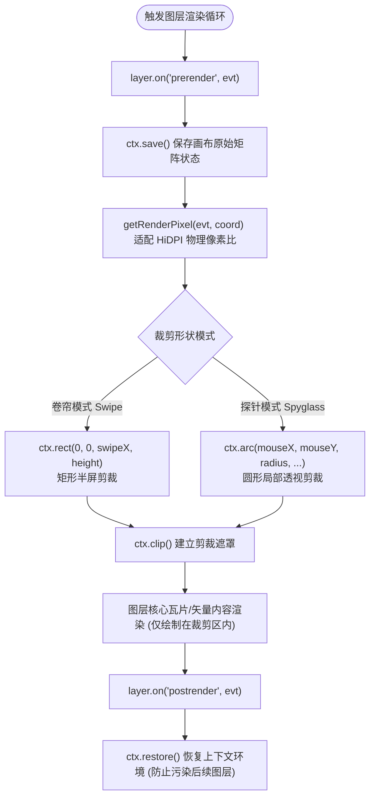

<nav aria-label="breadcrumb"><ol class="breadcrumb mb-4"><li class="breadcrumb-item"><a href="../">Home</a></li><li class="breadcrumb-item"><a href="./">Summary</a></li><li class="breadcrumb-item active" aria-current="page">图层卷帘对比与放大镜指南</li></ol></nav>

# OpenLayers 图层卷帘对比、放大镜与像素视口裁剪实战指南
> 针对历史影像比对、多源时相遥感监测与地物细节探查等高频业务需求，深入解析基于 Canvas 渲染管线生命周期的动态视口裁剪（`ctx.clip`）、卷帘分屏（Layer Swipe）、探针透镜（Spyglass）与像素级放大镜（Magnify）实现机制。

---

## 1. 核心架构与底层裁剪机制

在 WebGIS 中，“卷帘（Swipe）”和“探针（Spyglass）”并非依赖多个独立的 Map 视口拼接，而是通过在**同一个 Map 视口内的单个图层渲染生命周期**中，动态拦截 Canvas 2D 上下文或 WebGL 剪裁通道实现的：



### 1.1 屏幕 CSS 像素与物理渲染像素的转换

现代移动设备和视网膜高清屏（HiDPI / Retina）的设备像素比（Device Pixel Ratio, DPR）通常为 2 或 3。如果直接将鼠标的 CSS 像素坐标 `event.clientX` 传给 Canvas 的绘图 API，裁剪区域将缩小一倍或产生严重偏移。

OpenLayers 专门提供了 `getRenderPixel` 辅助工具函数完成转换：

$$P_{\text{canvas}} = P_{\text{css}} \cdot \text{pixelRatio}$$

```javascript
import {getRenderPixel} from 'ol/render';

// 在 prerender 回调中自动根据当前渲染帧的物理像素比映射坐标
const renderPixel = getRenderPixel(event, [mouseCssX, mouseCssY]);
```

---

## 2. 官方示例矩阵解构

| 示例标识 | 核心实现机制 | 业务落地场景 |
| :--- | :--- | :--- |
| [`layer-swipe`](../en/latest/examples/layer-swipe.html) | Canvas 2D 图层 `prerender` / `postrender` 拦截 + 垂直/水平滑动条联动 | 新旧历史航拍影像对比、规划建设用地前后变化评估 |
| [`webgl-layer-swipe`](../en/latest/examples/webgl-layer-swipe.html) | `WebGLTileLayer` 下利用 `gl.scissor` 剪裁测试或 CSS 遮罩 | 遥感多光谱图像大图无卡顿卷帘对比，60 FPS 硬件加速 |
| [`layer-spy`](../en/latest/examples/layer-spy.html) | 监听鼠标 `pointermove` 动态计算半径，利用 `ctx.arc` 限制单图层渲染范围 | 现代街道图透视历史手绘古地图、地下管网穿透透视探查 |
| [`magnify`](../en/latest/examples/magnify.html) | 双分辨率视口抽样 + 离屏 Canvas 双线性放大插值 | 高密矢量标注密集区放大阅读、遥感断裂带微小裂缝定位 |

---

## 3. 核心实现与典型范式

### 3.1 经典交互卷帘（Layer Swipe）实现范式

在 `layer-swipe.html` 中，顶层影像图层通过监听 HTML 滑块的输入值调整裁切范围：

```javascript
import Map from 'ol/Map';
import View from 'ol/View';
import TileLayer from 'ol/layer/Tile';
import OSM from 'ol/source/OSM';
import XYZ from 'ol/source/XYZ';
import {getRenderPixel} from 'ol/render';

// 底层基准图层：OpenStreetMap
const osmLayer = new TileLayer({source: new OSM()});

// 顶层对比图层：高分辨率卫星影像
const imageryLayer = new TileLayer({
  source: new XYZ({
    url: 'https://server.arcgisonline.com/ArcGIS/rest/services/World_Imagery/MapServer/tile/{z}/{y}/{x}',
    maxZoom: 19,
  }),
});

const map = new Map({
  target: 'map',
  layers: [osmLayer, imageryLayer],
  view: new View({center: [0, 0], zoom: 2}),
});

const swipeInput = document.getElementById('swipe');

// 关键步骤 1：在顶层图层渲染前建立剪裁路径
imageryLayer.on('prerender', function (event) {
  const ctx = event.context;
  const mapSize = map.getSize();
  const width = mapSize[0] * (parseFloat(swipeInput.value) / 100);

  // 转换为物理像素坐标
  const tl = getRenderPixel(event, [width, 0]);
  const tr = getRenderPixel(event, [mapSize[0], 0]);
  const bl = getRenderPixel(event, [width, mapSize[1]]);
  const br = getRenderPixel(event, mapSize);

  ctx.save();
  ctx.beginPath();
  ctx.moveTo(tl[0], tl[1]);
  ctx.lineTo(tr[0], tr[1]);
  ctx.lineTo(br[0], br[1]);
  ctx.lineTo(bl[0], bl[1]);
  ctx.closePath();
  ctx.clip(); // 仅允许渲染右半边影像
});

// 关键步骤 2：在图层渲染后立即释放上下文环境
imageryLayer.on('postrender', function (event) {
  const ctx = event.context;
  ctx.restore();
});

// 滑块滑动时触发地图重绘
swipeInput.addEventListener('input', function () {
  map.render();
});
```

---

### 3.2 鼠标探针透视镜（Spyglass）范式

在 `layer-spy.html` 中，将矩形裁剪替换为鼠标周围的圆形路径：

```javascript
let mousePosition = null;
const radius = 75; // 透镜半径 (CSS 像素)

map.on('pointermove', function (evt) {
  mousePosition = evt.pixel;
  map.render();
});

imageryLayer.on('prerender', function (event) {
  const ctx = event.context;
  ctx.save();
  ctx.beginPath();
  if (mousePosition) {
    // 将鼠标屏幕中心与半径映射到 Canvas 物理像素
    const pixel = getRenderPixel(event, mousePosition);
    const offset = getRenderPixel(event, [mousePosition[0] + radius, mousePosition[1]]);
    const pixelRadius = offset[0] - pixel[0];

    ctx.arc(pixel[0], pixel[1], pixelRadius, 0, 2 * Math.PI);
    ctx.lineWidth = (5 * ctx.canvas.width) / map.getSize()[0];
    ctx.strokeStyle = 'rgba(0,0,0,0.5)';
    ctx.stroke();
  }
  ctx.clip();
});

imageryLayer.on('postrender', function (event) {
  event.context.restore();
});
```

---

## 4. 生产避坑指南与性能治理

### 4.1 必须成对出现 `ctx.save()` 与 `ctx.restore()`
- **现象**：开启卷帘后，地图上的矢量点、注记文本或比例尺控件全部神秘消失，或者下层图层只显示半截。
- **根因**：如果在 `prerender` 中执行了 `ctx.clip()`，但没有在 `postrender` 中调用 `ctx.restore()`，Canvas 上下文的剪裁区域会永久生效，导致该图层之后的所有图层和覆盖物全部被裁剪丢弃。

### 4.2 WebGL 图层与 2D Canvas 混合时的上下文差异
- `ol/layer/WebGLTile` 在内部直接操作 WebGL 上下文，并不触发 2D Canvas 的 `event.context.clip()`。
- **解法**：在 WebGL 图层中，官方推荐利用 DOM 容器 CSS 遮罩（如 `clip-path: polygon(...)`）或者 WebGL 专用的底层 `gl.scissor` 剪裁测试实现，避免将 2D 绘图命令发往 WebGL 上下文报错。

### 4.3 鼠标高频移动时的重绘防抖
- `pointermove` 触发频率通常为每秒 60 次甚至更高。在透镜跟随鼠标移动时，直接调用 `map.render()` 是完全安全的，因为 OpenLayers 内部自动通过 `requestAnimationFrame` 将多次绘制请求合并在同一显示帧执行，开发者无需外挂 Lodash 防抖。
