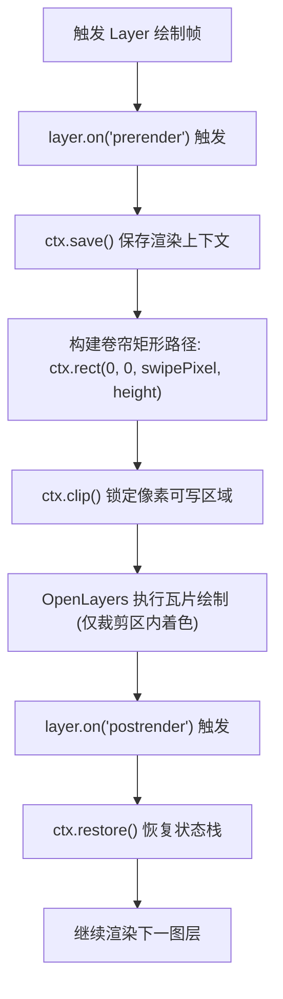
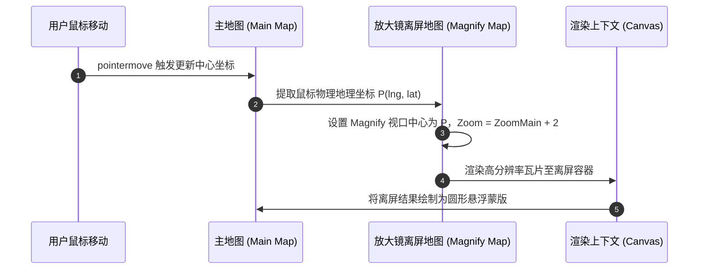

<nav aria-label="breadcrumb"><ol class="breadcrumb mb-4"><li class="breadcrumb-item"><a href="../">Home</a></li><li class="breadcrumb-item"><a href="./">Summary</a></li><li class="breadcrumb-item active" aria-current="page">卷帘对比与图层像素裁剪指南</li></ol></nav>

# OpenLayers 卷帘对比、透视镜探查与图层像素裁剪全景实战指南

> 在地理信息系统（GIS）与遥感影像解译中，**多时相变化监测（Temporal Change Detection）**与**多源底图差异对比（Multi-source Imagery Comparison）**是核心的高频业务诉求。
>
> 传统的左右分屏或透明度滑块往往难以实现像素级精细比对。OpenLayers 提供了基于 Canvas 2D 渲染上下文生命周期钩子（`prerender` / `postrender`）与 WebGL 硬件裁剪（Scissor Test）的整套视觉掩膜体系：涵盖**左右/上下卷帘分割（Layer Swipe）**、**光标探照透视镜（Spy Glass）**、**显微放大镜（Magnify）**以及**行政区划几何掩膜裁剪（Vector Geometry Clipping）**。
>
> 本文基于 6 个核心官方示例，系统解构像素级图层裁剪的底层渲染管线与高帧率交互实践。

---

## 1. 架构总览：6 个图层裁剪与对比官方示例矩阵

| 分类 | 示例标识 | 核心技术机制 | 解决的典型生产场景 |
| :--- | :--- | :--- | :--- |
| **Canvas 2D 卷帘** | [`layer-swipe`](../en/latest/examples/layer-swipe.html) | `prerender` / `postrender` + `ctx.clip()` | 历史遥感正射影像与现状高分卫星图垂直/水平滑块拖拽对比 |
| **WebGL 硬件卷帘** | [`webgl-layer-swipe`](../en/latest/examples/webgl-layer-swipe.html) | `gl.enable(gl.SCISSOR_TEST)` + `gl.scissor()` | 高性能 WebGL 栅格瓦片/张量图层硬件加速极速卷帘 |
| **探照透视镜** | [`layer-spy`](../en/latest/examples/layer-spy.html) | 跟随鼠标坐标动态构建 `ctx.arc()` 圆形视口掩膜 | 鼠标悬停处动态透视地表下方隐藏的测绘图层或管网资产 |
| **局部显微放大镜** | [`magnify`](../en/latest/examples/magnify.html) | 双视口坐标投影映射 + 高倍率离屏 Canvas 局部重绘 | 局部超高分辨率建筑物细节、密集标牌无级放大探查 |
| **视口视窗遮罩** | [`layer-clipping`](../en/latest/examples/layer-clipping.html) | 屏幕矩形区域动态限制与 CSS 动画补间结合 | 炫酷开场揭幕动画、限定窗口范围内的瓦片动态渲染 |
| **行政几何掩膜** | [`layer-clipping-vector`](../en/latest/examples/layer-clipping-vector.html) | 多边形要素坐标向 Canvas 路径转换 + 复杂拓扑裁剪 | 仅显示省市行政边界内部地图，外部区域纯白或蒙版遮罩 |

---

## 2. Canvas 2D 像素裁剪原理与卷帘实现（`layer-swipe`）

### 2.1 渲染生命周期沙箱机制

在 Canvas 2D 渲染器中，OpenLayers 在绘制每个图层时都会触发 `prerender` 与 `postrender` 事件，并向监听回调传入 `evt.context`（原生 `CanvasRenderingContext2D`）。

要在特定图层上实现半屏卷帘，关键在于利用 Canvas 状态栈：
1. 在 `prerender` 中保存上下文状态（`ctx.save()`）；
2. 构造可见区域路径并执行裁剪（`ctx.clip()`）；
3. OpenLayers 内部仅在此裁剪路径内绘制该图层瓦片；
4. 在 `postrender` 中恢复上下文状态（`ctx.restore()`），确保不污染后续图层。



### 2.2 生产级高分屏（Retina）适配卷帘代码范式

> [!IMPORTANT]
> 在高 DPI 屏幕（Retina）下，Canvas 的物理像素尺寸与 CSS 逻辑像素存在缩放比 `window.devicePixelRatio`。若未对裁剪坐标乘以此比例，卷帘分界线会出现错位。

```javascript
import Map from 'ol/Map.js';
import TileLayer from 'ol/layer/Tile.js';
import OSM from 'ol/source/OSM.js';
import XYZ from 'ol/source/XYZ.js';
import { getRenderPixel } from 'ol/render.js';

// 底层底图：标准路网
const baseLayer = new TileLayer({
  source: new OSM(),
});

// 上层图层：航空卫星图（待卷帘裁剪）
const aerialLayer = new TileLayer({
  source: new XYZ({
    url: 'https://server.arcgisonline.com/ArcGIS/rest/services/World_Imagery/MapServer/tile/{z}/{y}/{x}',
    maxZoom: 19,
  }),
});

const map = new Map({
  target: 'map',
  layers: [baseLayer, aerialLayer],
  view: new View({ center: [0, 0], zoom: 2 }),
});

const swipeInput = document.getElementById('swipe');

// 1. prerender 阶段：建立裁剪掩膜
aerialLayer.on('prerender', function (event) {
  const ctx = event.context;
  const mapSize = map.getSize();
  const width = mapSize[0] * (swipeInput.value / 100);

  // 利用 getRenderPixel 自动处理 devicePixelRatio 缩放基准
  const tl = getRenderPixel(event, [width, 0]);
  const tr = getRenderPixel(event, [mapSize[0], 0]);
  const bl = getRenderPixel(event, [width, mapSize[1]]);
  const br = getRenderPixel(event, mapSize);

  ctx.save();
  ctx.beginPath();
  ctx.moveTo(tl[0], tl[1]);
  ctx.lineTo(tr[0], tr[1]);
  ctx.lineTo(br[0], br[1]);
  ctx.lineTo(bl[0], bl[1]);
  ctx.closePath();
  ctx.clip(); // 仅允许右侧区域绘制卫星图
});

// 2. postrender 阶段：恢复上下文，避免影响后续图层
aerialLayer.on('postrender', function (event) {
  const ctx = event.context;
  ctx.restore();
});

// 3. 滑块拖拽事件绑定
swipeInput.addEventListener('input', function () {
  map.render(); // 强制触发地图重绘以刷新帧
});
```

---

## 3. WebGL 图层硬件加速裁剪（`webgl-layer-swipe`）

### 3.1 为什么 Canvas 2D 裁剪无法用于 WebGL 图层？

当使用 `WebGLTileLayer` 时，图层直接输出至 WebGL 渲染管线，其 `event.context` 是 `WebGLRenderingContext`，根本不存在 2D Canvas 的 `ctx.clip()` 方法。

WebGL 提供了专用的**硬件剪裁测试（Scissor Test）**能力：
$$x_{\text{gl}} = x, \quad y_{\text{gl}} = H - (y + h), \quad w_{\text{gl}} = w, \quad h_{\text{gl}} = h$$

> [!NOTE]
> WebGL 的屏幕坐标原点位于**左下角**（Y 轴向上），而 DOM 与 2D Canvas 的原点位于**左上角**（Y 轴向下），计算剪裁矩形纵坐标时必须用视口总高度进行反转。

### 3.2 WebGL 卷帘实战代码范式

```javascript
import WebGLTileLayer from 'ol/layer/WebGLTile.js';

const webglLayer = new WebGLTileLayer({
  source: sourceB,
});

webglLayer.on('prerender', function (event) {
  const gl = event.context;
  const pixelRatio = event.inversePixelTransform[0]; // 获取设备缩放比例倒数
  const width = map.getSize()[0] * (swipeInput.value / 100);

  gl.enable(gl.SCISSOR_TEST);

  // 坐标转换：将 DOM 左上角转换为 WebGL 左下角坐标
  const canvasHeight = gl.canvas.height;
  const scissorWidth = width * window.devicePixelRatio;
  const scissorHeight = canvasHeight;

  // 仅在左半侧激活渲染
  gl.scissor(0, 0, scissorWidth, scissorHeight);
});

webglLayer.on('postrender', function (event) {
  const gl = event.context;
  gl.disable(gl.SCISSOR_TEST); // 恢复全视口绘制
});
```

---

## 4. 动态探照透视镜与局部放大镜（`layer-spy` / `magnify`）

### 4.1 探照透视镜（Spy Glass）算法

探照镜通常以鼠标当前指针位置为圆心 $(x_0, y_0)$，以固定半径 $r$（如 $120\text{px}$）创建圆形镂空区域：

$$\text{Circle}(x, y) = (x - x_0)^2 + (y - y_0)^2 \le r^2$$

```javascript
let mousePosition = null;
const radius = 100;

document.addEventListener('mousemove', function (evt) {
  mousePosition = map.getEventPixel(evt);
  map.render();
});

imageryLayer.on('prerender', function (event) {
  const ctx = event.context;
  if (!mousePosition) return;

  const pixel = getRenderPixel(event, mousePosition);
  const r = radius * (event.frameState.pixelRatio || 1);

  ctx.save();
  ctx.beginPath();
  // 以当前鼠标像素为圆心构造圆形剪裁路径
  ctx.arc(pixel[0], pixel[1], r, 0, 2 * Math.PI);
  ctx.clip();
});

imageryLayer.on('postrender', function (event) {
  event.context.restore();
});
```

### 4.2 局部显微放大镜（Magnify）的双重变换机制

与仅透视不同，放大镜（`magnify`）需要在透镜内部呈现更高缩放等级（Zoom Level）的细节。



---

## 5. 行政区划几何掩膜裁剪（`layer-clipping-vector`）

在业务大屏展示中，通常只希望展示本省/本市范围内的卫星遥感影像，其余区域保持纯黑或空白。

### 5.1 矢量坐标到 Canvas 绘图指令映射

利用 OpenLayers 内部几何渲染通道，将 `Polygon` / `MultiPolygon` 的空间坐标动态投影转换为 Canvas 屏幕像素路径：

```javascript
import { toContext } from 'ol/render.js';
import Style from 'ol/style/Style.js';
import Fill from 'ol/style/Fill.js';

// 获取行政区划要素
const boundaryFeature = vectorSource.getFeatures()[0];

tileLayer.on('prerender', function (event) {
  const ctx = event.context;
  ctx.save();

  // 使用 toContext 获取高精度即时渲染上下文
  const vectorContext = toContext(ctx, {
    pixelRatio: event.frameState.pixelRatio,
  });

  // 构造纯色填充样式，作为剪裁区域的载体
  const clipStyle = new Style({
    fill: new Fill({ color: 'black' }),
  });

  // 将矢量多边形绘制进路径并锁定裁剪
  ctx.beginPath();
  vectorContext.setStyle(clipStyle);
  vectorContext.drawGeometry(boundaryFeature.getGeometry());
  ctx.clip();
});

tileLayer.on('postrender', function (event) {
  event.context.restore();
});
```

---

## 6. 避坑指南与性能最佳实践

### 6.1 致命陷阱：漏写 `ctx.restore()` 导致全图崩溃
- **现象**：地图拖拽时除目标图层外，其他所有底图和标注突然消失或被不可逆裁剪。
- **根因**：Canvas 状态栈（State Stack）未恢复。OpenLayers 在整个地图视图共用一个主 Canvas（Canvas 2D 模式下）。如果在 `postrender` 中未对称调用 `ctx.restore()`，裁剪作用域会直接泄漏到后续执行绘制的图层。
- **解法**：养成防御性编程习惯，在 `prerender` 中只要调用过 `ctx.save()`，必须确保 `postrender` 中成对执行 `ctx.restore()`。

### 6.2 高分屏模糊与偏移防范
- 严禁直接使用 DOM 事件中的 `evt.offsetX` 或 `evt.clientX` 作为裁剪坐标。
- 必须使用 `ol/render` 导出的 `getRenderPixel(event, domPixel)` 进行高分辨率物理设备像素变换。

### 6.3 交互性能防抖与调度
- 卷帘拖拽时，滑块绑定 `input` 事件，直接调用 `map.render()` 即可触发帧调度。
- 严禁在 `input` 回调中重复创建 `Layer` 或修改 `Source`，仅需修改裁剪阈值变量并通知重新渲染，可轻松维持 60 FPS 满帧滑动。
