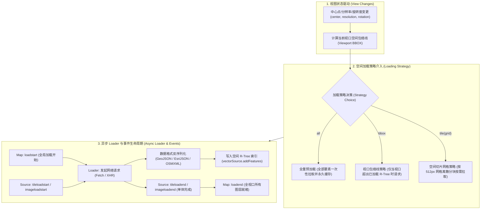
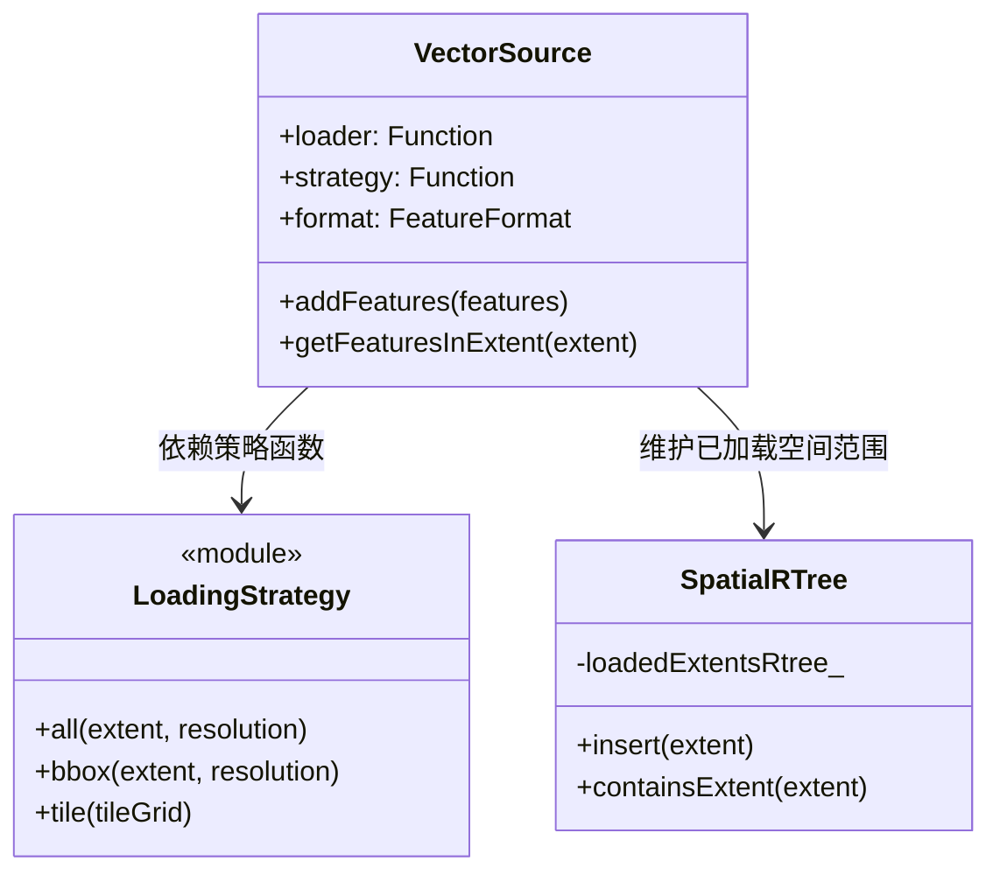
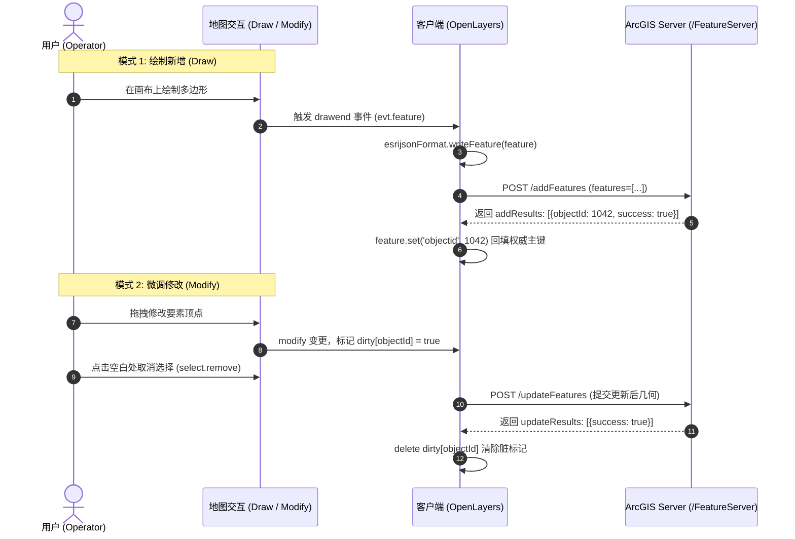

# OpenLayers 异步加载策略与资源生命周期体系全景实战指南 (Loading Strategies & Resource Lifecycle)

> 本指南基于 OpenLayers 官方 **loading** 核心专题群的 8 个代表性示例，深度解构地图容器、切片网格与光栅图像的多级加载生命周期事件流，剖析 `all`、`bbox` 与 `tile` 三大空间矢量加载策略的算法机制，并实战演示对接 ArcGIS REST FeatureServer、OGC WFS 与 Overpass OSM XML 远程要素服务的完整架构方案。

---

## 一、加载架构全景脑图 (Architectural Overview)

在 WebGIS 应用中，地图数据的加载从来不是单一的静态文件读取，而是一个兼顾**视口几何求交、空间分块索引、网络并发调度、数据格式反序列化与 GPU 纹理上传**的复杂异步流水线：



---

## 二、地图与图层加载生命周期体系 (Loading Lifecycle & Events)

OpenLayers 构建了从**宏观地图容器**到**微观数据源（Source）**的层次化加载事件派发管道：

### 1. 宏观地图容器级加载事件 (`ol/Map`)

`ol/Map` 维护着全局渲染管线的空闲状态机：
- `loadstart`：当底层任意图层开始拉取新数据且当前未处于 loading 状态时触发；
- `loadend`：当视口内所有图层的所有切片、图像和矢量数据全部加载解析完毕、画布完成首帧呈现时触发。

#### 极简 CSS 旋转器微动效方案
如 [`examples/load-events.html`](file:///d:/Users/Downloads/openlayers/examples/load-events.html) 所示，通过在 `loadstart` 与 `loadend` 时切换类名，配合 GPU 加速的 CSS 伪元素，实现零侵入式的加载指示：

```javascript
// 监听地图全局加载开始与结束事件
map.on('loadstart', function () {
  map.getTargetElement().classList.add('spinner');
});
map.on('loadend', function () {
  map.getTargetElement().classList.remove('spinner');
});
```

### 2. 瓦片切片池事件 (`ol/source/Tile` / `ImageTile`)

切片数据源在一次漫游中会并发拉取数十个切片。切片加载事件包括：
- `tileloadstart`：单张瓦片加入下载队列并向网络发起请求；
- `tileloadend`：单张瓦片图像二进制完全下载并解码就绪；
- `tileloaderror`：瓦片 404/500、网络超时或跨域被拦截。

#### 累积比率进度计算模型 (Cumulative Progress Model)
如 [`examples/tile-load-events.html`](file:///d:/Users/Downloads/openlayers/examples/tile-load-events.html) 所示，瓦片进度条采用动态比率算法：

$$\text{Progress} = \left( \frac{\text{loaded}}{\text{loading}} \times 100 \right)\%$$

```javascript
function Progress(el) {
  this.el = el;
  this.loading = 0;
  this.loaded = 0;
}

Progress.prototype.addLoading = function () {
  ++this.loading;
  this.update();
};

Progress.prototype.addLoaded = function () {
  ++this.loaded;
  this.update();
};

Progress.prototype.update = function () {
  const width = ((this.loaded / this.loading) * 100).toFixed(1) + '%';
  this.el.style.width = width;
};

// 严禁漏掉 tileloaderror，否则发生错误时 loaded 将永远无法追赶上 loading
source.on('tileloadstart', () => progress.addLoading());
source.on(['tileloadend', 'tileloaderror'], () => progress.addLoaded());
```

### 3. 单张图像数据源事件 (`ol/source/Image` / `ImageWMS`)

如 [`examples/image-load-events.html`](file:///d:/Users/Downloads/openlayers/examples/image-load-events.html) 所示，单张图像源在每次视口停顿时向服务端请求单张大幅面光栅图片：
- 细粒度事件：`imageloadstart`、`imageloadend`、`imageloaderror`；
- 配合延迟重置机制（`setTimeout(..., 250)`），使进度条在跑满 100% 后平滑淡出并归零，避免视觉反向闪烁。

---

## 三、矢量空间加载策略三大体系 (`ol/loadingstrategy`)

OpenLayers 内置了三种标准空间加载策略，定义了矢量数据源在视口变更时何时触发 `loader` 以及传入的目标包络线范围：

| 加载策略 | 实现函数 | 空间划分机制 | HTTP 缓存友好度 | 典型应用场景 |
| :--- | :--- | :--- | :--- | :--- |
| **全量加载 (All)** | `ol/loadingstrategy.all` | 单次无穷大范围 `[-Infinity, -Infinity, Infinity, Infinity]` | 一次加载，永久本地缓存 | 全球国界、行政区划、点位数量小于 2000 的轻量静态数据集 |
| **视口包络线 (Bbox)** | `ol/loadingstrategy.bbox` | 视口当前投影的外包矩形 `[minX, minY, maxX, maxY]` | **差**（平移 1 像素即产生新 URL，无法命中 CDN） | 密集编辑系统、高频数据更新、范围不规则的动态查询 |
| **瓦片切片分块 (Tile)** | `ol/loadingstrategy.tile(tileGrid)` | 按照标准金字塔网格切分为离散瓦片包络线（如 512px 网格） | **极佳**（行列号固化，完美命中浏览器与 CDN 缓存） | 海量要素分块浏览、ArcGIS FeatureServer、大型 GeoServer WFS |



---

## 四、远程要素服务协议实操与数据反序列化

### 1. ArcGIS REST FeatureServer 瓦片化加载与在线编辑

[`examples/vector-esri.html`](file:///d:/Users/Downloads/openlayers/examples/vector-esri.html) 与 [`examples/vector-esri-edit.html`](file:///d:/Users/Downloads/openlayers/examples/vector-esri-edit.html) 演示了对接 Esri FeatureServer 的企业级实践：

#### (1) 瓦片化空间查询 URL 构造
ArcGIS REST API 的 `query` 接口要求几何参数为 JSON 格式包络线，且投影标识符（WKID）必须为纯数字：

```javascript
const vectorSource = new VectorSource({
  format: new EsriJSON(),
  url: function (extent, resolution, projection) {
    // 剥离投影前缀，提取纯数字 SRID（如从 'EPSG:3857' 提取 '3857'）
    const srid = projection.getCode().split(/:(?=\d+$)/).pop();

    return serviceUrl + layer + '/query/?f=json&' +
      'returnGeometry=true&spatialRel=esriSpatialRelIntersects&geometry=' +
      encodeURIComponent(JSON.stringify({
        xmin: extent[0],
        ymin: extent[1],
        xmax: extent[2],
        ymax: extent[3],
        spatialReference: {wkid: Number(srid)},
      })) +
      '&geometryType=esriGeometryEnvelope&inSR=' + srid +
      '&outFields=*&outSR=' + srid;
  },
  strategy: tileStrategy(createXYZ({tileSize: 512})),
});
```

#### (2) 在线绘制新增与修改更新事务闭环


### 2. OGC WFS (Web Feature Service 1.1.0) 标准实践

#### (1) `bboxStrategy` 模式 ([`examples/vector-wfs.html`](file:///d:/Users/Downloads/openlayers/examples/vector-wfs.html))
适用于视口当前墨卡托投影下的直接请求：
```javascript
const vectorSource = new VectorSource({
  format: new GeoJSON(),
  url: function (extent) {
    return (
      'https://ahocevar.com/geoserver/wfs?service=WFS&' +
      'version=1.1.0&request=GetFeature&typename=osm:water_areas&' +
      'outputFormat=application/json&srsname=EPSG:3857&' +
      'bbox=' + extent.join(',') + ',EPSG:3857'
    );
  },
  strategy: bboxStrategy,
});
```

#### (2) `useGeographic()` 与 `tile` 结合模式 ([`examples/vector-wfs-geographic.html`](file:///d:/Users/Downloads/openlayers/examples/vector-wfs-geographic.html))
调用 `useGeographic()` 后，全局坐标系统一为 `[lon, lat]`，`extent` 直接输出 `[minLon, minLat, maxLon, maxLat]`，配合瓦片切片策略极大简化了地理经纬度服务集成：
```javascript
useGeographic(); // 开启全局经纬度输入输出

const vectorSource = new VectorSource({
  format: new GeoJSON(),
  url: function (extent) {
    return (
      'https://ahocevar.com/geoserver/wfs?service=WFS&' +
      'version=1.1.0&request=GetFeature&typename=osm:water_areas&' +
      'outputFormat=application/json&srsname=EPSG:4326&' +
      'bbox=' + extent.join(',') + ',EPSG:4326'
    );
  },
  strategy: tile(createXYZ({tileSize: 512})),
});
```

### 3. OpenStreetMap Overpass API 自定义 Loader 与 XML 解析

如 [`examples/vector-osm.html`](file:///d:/Users/Downloads/openlayers/examples/vector-osm.html) 所示，通过编写自定义异步 `loader`，直接连接外部非标准 REST 接口：

```javascript
const vectorSource = new VectorSource({
  format: new OSMXML(),
  loader: function (extent, resolution, projection, success, failure) {
    // 1. 将墨卡托视口外包范围重投影为经纬度
    const epsg4326Extent = transformExtent(extent, projection, 'EPSG:4326');
    
    // 2. 经度钳位在 [-180, 180]，防止日界线溢出
    const minLon = Math.max(epsg4326Extent[0], -180);
    const maxLon = Math.min(epsg4326Extent[2], 180);
    
    // 3. 构造 Overpass QL 查询语句
    const query = `(node(${epsg4326Extent[1]},${minLon},${epsg4326Extent[3]},${maxLon});rel(bn)->.foo;way(bn);node(w)->.foo;rel(bw););out meta;`;
    
    const client = new XMLHttpRequest();
    client.open('POST', 'https://overpass-api.de/api/interpreter');
    client.addEventListener('load', function () {
      // 4. 利用内置 OSMXML 解析拓扑节点为 LineString/Polygon
      const features = new OSMXML().readFeatures(client.responseText, {
        featureProjection: map.getView().getProjection(),
      });
      vectorSource.addFeatures(features);
      success(features); // 通知加载器成功
    });
    client.addEventListener('error', failure); // 通知加载器失败，释放加载锁
    client.send(query);
  },
  strategy: bboxStrategy,
});
```

---

## 五、企业级避坑指南与高可用工程实践

### 1. 瓦片挂起与超时兜底 (Timeout Fallback)
在公共互联网或内网弱网环境中，若个别瓦片由于 TCP 连接假死未能返回，全局 `loadend` 事件可能会被无限期挂起。生产级应用必须挂载超时守卫：

```javascript
let loadingTimer = null;

map.on('loadstart', () => {
  spinner.show();
  clearTimeout(loadingTimer);
  // 设置 8 秒最大超时兜底，防止遮罩层永久卡死
  loadingTimer = setTimeout(() => {
    spinner.hide();
  }, 8000);
});

map.on('loadend', () => {
  clearTimeout(loadingTimer);
  spinner.hide();
});
```

### 2. 极速平移与滚轮缩放中的请求风暴消减 (AbortController)
使用 `bboxStrategy` 时，若用户连续高速滚动鼠标滚轮，会在短时间内激发出数十个废弃的范围请求。建议配合 `AbortController` 实现“发起新请求、中断旧请求”：

```javascript
let currentAbortController = null;

const vectorSource = new VectorSource({
  loader: async function (extent, resolution, projection) {
    if (currentAbortController) {
      currentAbortController.abort(); // 取消上一帧废弃请求
    }
    currentAbortController = new AbortController();

    try {
      const response = await fetch(buildUrl(extent), {
        signal: currentAbortController.signal,
      });
      const data = await response.json();
      return format.readFeatures(data, {featureProjection: projection});
    } catch (err) {
      if (err.name === 'AbortError') {
        return []; // 忽略主动中断
      }
      throw err;
    }
  },
  strategy: bboxStrategy,
});
```

### 3. 要素跨瓦片边界缝隙与主键去重 (Feature ID Deduplication)
当使用 `tileStrategy` 拉取多边形要素时，跨越瓦片边界的图斑可能会在相邻瓦片中重复返回。
> **黄金法则**：在数据源配置中，必须确保每个要素具备全局唯一的 `id`（例如 GeoJSON 的 `feature.id` 或 ArcGIS 的 `OBJECTID`）。OpenLayers 的 `VectorSource` 在执行 `addFeatures()` 时会自动根据 ID 检查内部 R-Tree，跳过已存在的相同要素，避免内存泄漏与半透明样式重叠加深导致的“接缝（Seams）”缺陷。

---

## 六、核心示例索引与代码速查 (Examples Reference)

| 示例文件 | 核心技术点 | 空间策略 / 数据源 | 关键 API 与事件 |
| :--- | :--- | :--- | :--- |
| [`load-events.html`](file:///d:/Users/Downloads/openlayers/examples/load-events.html) | 地图全局加载状态与 CSS 旋转器 | `ol/Map` 容器级状态 | `map.on('loadstart')`, `map.on('loadend')` |
| [`tile-load-events.html`](file:///d:/Users/Downloads/openlayers/examples/tile-load-events.html) | 切片级流式进度条与百分比计算 | `ImageTile` 瓦片池 | `tileloadstart`, `tileloadend`, `tileloaderror` |
| [`image-load-events.html`](file:///d:/Users/Downloads/openlayers/examples/image-load-events.html) | 单张大幅面图像加载进度监控 | `ImageWMS` 视口单图 | `imageloadstart`, `imageloadend`, `imageloaderror` |
| [`vector-wfs.html`](file:///d:/Users/Downloads/openlayers/examples/vector-wfs.html) | GeoServer WFS 视口矩形动态拉取 | `bboxStrategy` + EPSG:3857 | `url(extent)`, 扁平样式字面量 |
| [`vector-wfs-geographic.html`](file:///d:/Users/Downloads/openlayers/examples/vector-wfs-geographic.html) | 全局经纬度模式下的 WFS 瓦片化加载 | `tileStrategy` + EPSG:4326 | `useGeographic()`, `tile(createXYZ({tileSize: 512}))` |
| [`vector-esri.html`](file:///d:/Users/Downloads/openlayers/examples/vector-esri.html) | ArcGIS REST 要素服务分块查询与属性探测 | `tileStrategy` + `EsriJSON` | `spatialReference: {wkid}`, `map.forEachFeatureAtPixel` |
| [`vector-esri-edit.html`](file:///d:/Users/Downloads/openlayers/examples/vector-esri-edit.html) | 可编辑 ArcGIS 要素服务与在线事务同步 | `tileStrategy` + 在线编辑 | `Draw`, `Modify`, `Select`, `/addFeatures`, `/updateFeatures` |
| [`vector-osm.html`](file:///d:/Users/Downloads/openlayers/examples/vector-osm.html) | Overpass API 自定义异步加载与 XML 解析 | `bboxStrategy` + `OSMXML` | `transformExtent`, `readFeatures`, 标签规则样式表 |
