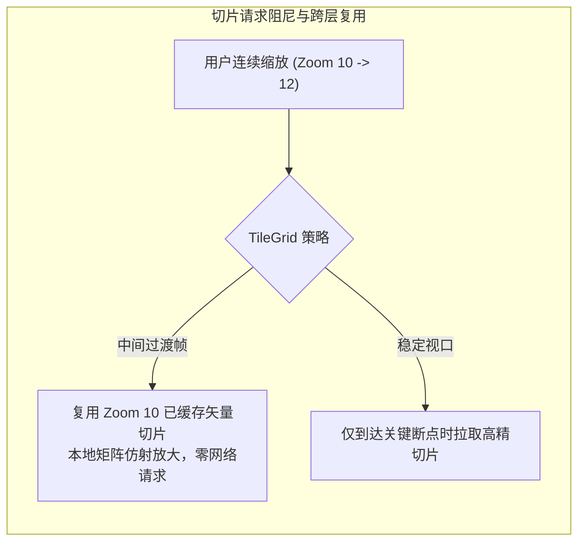

<nav aria-label="breadcrumb"><ol class="breadcrumb mb-4"><li class="breadcrumb-item"><a href="../">Home</a></li><li class="breadcrumb-item"><a href="./">Summary</a></li><li class="breadcrumb-item active" aria-current="page">Mapbox 矢量切片生态指南</li></ol></nav>

# OpenLayers Mapbox 矢量切片生态与样式引擎全景指南

> 基于 Protocol Buffers 二进制压缩的 **Mapbox 矢量切片（MVT, Mapbox Vector Tile）** 与 **Mapbox 样式规范（Mapbox Style Specification）** 是当今数字地图制图工业的事实标准。相比传统栅格瓦片，矢量切片体积降低达 80% 以上，并赋予防抖动高清注记、客户端自由样式变换与图元动态高亮能力。
>
> OpenLayers 拥有业内领先的矢量切片处理管线，从原生高效率的 **`ol/format/MVT`** 解析器，到多级切片缓存与跨层级复用优化，再到集成 **`ol-mapbox-style`** 样式转换器与嵌入 **Mapbox GL JS** 异构双核渲染引擎。本文立足 5 个核心官方示例，系统解构 OpenLayers 在 Mapbox 矢量切片生态中的全链路工程实践。

---

## 1. 架构总览：5 个 Mapbox 矢量切片核心示例矩阵

| 分类                       | 示例标识                                                                                  | 核心机制 / 关键 API                                  | 解决的典型生产场景                                                      |
| :------------------------- | :---------------------------------------------------------------------------------------- | :--------------------------------------------------- | :---------------------------------------------------------------------- |
| **基础 MVT 切片加载**      | [`mapbox-vector-tiles`](../en/latest/examples/mapbox-vector-tiles.html)                   | `VectorTileLayer` + `ol/format/MVT`                  | 接入商业/自建 MVT 切片服务并使用 OpenLayers 样式函数渲染                |
| **跨层级复用与移动端优化** | [`mapbox-vector-tiles-advanced`](../en/latest/examples/mapbox-vector-tiles-advanced.html) | 自定义 `TileGrid` + 跨 Zoom 层级复用（Cache Re-use） | 移动弱网环境下减少 60% 瓦片请求，节省设备流量与解码 CPU                 |
| **样式规范一键映射**       | [`mapbox-vector-layer`](../en/latest/examples/mapbox-vector-layer.html)                   | `ol-mapbox-style` 工具库                             | 直接加载 Mapbox Studio 设计好的 `style.json` 并在 OpenLayers 中完美呈现 |
| **双核渲染引擎混编**       | [`mapbox-layer`](../en/latest/examples/mapbox-layer.html)                                 | 自定义 `Layer` 包装 Mapbox GL Map 实例               | 在同一个地图视口内融合 OpenLayers 控制体系与 Mapbox GL 原生 WebGL 渲染  |
| **开源开源瓦片图层解构**   | [`osm-vector-tiles`](../en/latest/examples/osm-vector-tiles.html)                         | OSM / Mapzen 矢量切片分层（Water/Roads/Buildings）   | 剖析开源多源矢量图层结构，执行分图层样式与注记碰撞过滤                  |

---

## 2. 矢量切片加载管线与图层过滤

### 2.1 MVT 解码与图层按需选择

一个 MVT 文件内部打包了若干个逻辑图层（如 `water`、`landuse`、`road`、`building`）。若前端只关注特定图层，可在 `ol/format/MVT` 中通过 `layers` 参数执行前置过滤，避免无关图元进入内存：

```javascript
import VectorTileLayer from "ol/layer/VectorTile";
import VectorTileSource from "ol/source/VectorTile";
import MVT from "ol/format/MVT";

const vectorTileLayer = new VectorTileLayer({
  source: new VectorTileSource({
    format: new MVT({
      // 仅解码并提取水体与道路图层，忽略大体积建筑物轮廓，大幅降低解码时间
      layers: ["water", "road"],
      // 指定图元要素 ID 属性名，便于高效做状态追踪
      idProperty: "osm_id",
    }),
    url: "https://api.maptiler.com/tiles/v3/{z}/{x}/{y}.pbf?key=YOUR_KEY",
  }),
});
```

---

## 3. 进阶切片网格与移动端流量调优（`mapbox-vector-tiles-advanced`）

在移动端或弱网环境下，用户快速捏合缩放（Pinch-to-zoom）会触发大量中间层级的切片请求，极易造成网络风暴与设备发热掉帧。



### 3.1 跨层级缓存复用核心配置

通过自定义 `TileGrid` 缩小请求层级分辨率阶梯，使相近的连续缩放优先复用已加载的切片数据：

```javascript
import TileGrid from "ol/tilegrid/TileGrid";
import { get as getProjection } from "ol/proj";

const projection = getProjection("EPSG:3857");
const extent = projection.getExtent();

// 仅在关键层级（如 0, 4, 8, 12, 14）定义切片网格断点
const tileGrid = new TileGrid({
  extent: extent,
  resolutions: [
    156543.03392804097, 9783.93962050256, 611.49622628141, 38.21851414258813,
    9.554628535647032,
  ],
  tileSize: 512,
});
```

---

## 4. Mapbox 样式规范（Style Spec）集成方案对照

| 维度              | 方案 A：`ol-mapbox-style` (推荐)                              | 方案 B：双核混编 (`mapbox-layer`)                              |
| :---------------- | :------------------------------------------------------------ | :------------------------------------------------------------- |
| **实现机制**      | 将 Mapbox JSON 规则解析转化为 OpenLayers 原生 `StyleFunction` | 将 Mapbox GL JS 实例作为底图自定义图层挂入 OpenLayers 视口循环 |
| **底层渲染器**    | 纯 Canvas 2D / OpenLayers 内部 WebGL                          | Mapbox GL JS 原生 WebGL 着色器流水线                           |
| **3D 地形与建筑** | 支持 2.5D 平面透视                                            | **完整支持 3D 倾斜、阴影、三维建筑物与地形网格**               |
| **交互与事件**    | 统一由 OpenLayers 责任链调度（Select/Modify 无缝协同）        | 需要在两个引擎之间手动同步视口中心与缩放级别                   |
| **打包体积**      | 仅引入解析转换库（轻量）                                      | 需同时打包 OpenLayers 与 Mapbox GL JS 两个大型引擎             |

### 4.1 使用 `ol-mapbox-style` 快速接入（`mapbox-vector-layer`）

```javascript
import { apply } from "ol-mapbox-style";
import Map from "ol/Map";

// 一行代码将 Mapbox Studio 导出的样式 JSON 挂载到 OpenLayers Map 实例
const map = new Map({ target: "map" });
apply(map, "https://api.maptiler.com/maps/basic/style.json?key=YOUR_KEY");
```

---

## 5. 生产工程避坑指南

1. **Overzooming（超出最大切片层级）**：公开 MVT 切片通常只生成到 Zoom 14。若用户放大至 Zoom 18，必须配置 `maxZoom: 14`，使 OpenLayers 在 Zoom 15~18 自动对 Zoom 14 的矢量数据进行客户端本地几何放大，避免 404 错误；
2. **文本注记碰撞避让（Decluttering）**：矢量切片包含密集注记，在 `VectorTileLayer` 上务必开启 `declutter: true`，开启 OpenLayers 全局 R-Tree 智能避让树，杜绝文字重叠覆盖；
3. **要素跨瓦片接缝重复问题**：道路线要素被瓦片切分成多段时，若端点样式带有平头（butt）线帽，在接缝处可能产生微小缝隙；在样式中推荐配置 `cap: 'round'` 与 `join: 'round'` 实现接缝自然贴合。

---

## 附录：5 个官方 Mapbox 矢量切片核心示例直达索引

1. [`mapbox-vector-tiles`](../en/latest/examples/mapbox-vector-tiles.html) &mdash; Mapbox MVT 矢量切片基础加载与客户端样式函数
2. [`mapbox-vector-tiles-advanced`](../en/latest/examples/mapbox-vector-tiles-advanced.html) &mdash; 进阶切片网格、跨层级复用与移动端流量调优
3. [`mapbox-vector-layer`](../en/latest/examples/mapbox-vector-layer.html) &mdash; 使用 ol-mapbox-style 一键解析并渲染 Mapbox 样式规范
4. [`mapbox-layer`](../en/latest/examples/mapbox-layer.html) &mdash; 嵌入 Mapbox GL JS 实例实现双核异构 WebGL 混合渲染
5. [`osm-vector-tiles`](../en/latest/examples/osm-vector-tiles.html) &mdash; OpenStreetMap 矢量切片多图层解构与 TopoJSON 对比
