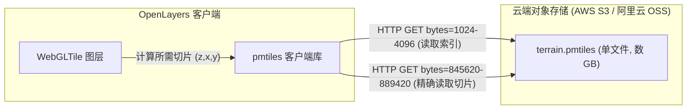

<nav aria-label="breadcrumb"><ol class="breadcrumb mb-4"><li class="breadcrumb-item"><a href="../">Home</a></li><li class="breadcrumb-item"><a href="./">Summary</a></li><li class="breadcrumb-item active" aria-current="page">现代数据切片指南</li></ol></nav>

# OpenLayers 云原生瓦片与现代数据切片全景实战指南

> 传统的 Web 地图切片技术严重依赖于切片服务器（Tile Server）动态生成或在服务端解压存储成千上万个散列图片文件。随着云原生空间数据（Cloud Native Geospatial）的发展，**PMTiles 单文件归档**、**`DataTile` 原生数据数组切片**、**IIIF 国际图像互操作框架**与**静态独立图像**正在重塑地理空间与超高清视觉数据的分发范式。
>
> OpenLayers 深度融合了这些现代切片技术，允许开发者直接利用 HTTP Range 请求从对象存储直读单文件切片，并借助 WebGL 实现实时高程阴影渲染与科学多维数据解算。本文基于 4 个核心官方示例，系统解构现代数据切片的数据流模型与高性能实践。

---

## 1. 架构总览：4 个现代切片核心官方示例矩阵

| 分类                  | 示例标识                                                            | 核心机制 / 关键 API                             | 解决的典型生产场景                                 |
| :-------------------- | :------------------------------------------------------------------ | :---------------------------------------------- | :------------------------------------------------- |
| **云原生单文件切片**  | [`pmtiles-elevation`](../en/latest/examples/pmtiles-elevation.html) | PMTiles + `WebGLTile` + 动态山体阴影着色器      | 零切片服务器直连 S3 对象存储，实时生成三维地貌阴影 |
| **原生数据切片**      | [`data-tiles`](../en/latest/examples/data-tiles.html)               | `ol/source/DataTile` + `loader` 直传 TypedArray | 科学计算、气象网格或客户端纯数学动态切片生成       |
| **超高清艺术品/文献** | [`iiif`](../en/latest/examples/iiif.html)                           | `ol/source/IIIF` + 深度缩放图像金字塔           | 博物馆超高分辨率数字化画作、显微切片与古籍扫描     |
| **平面独立图像映射**  | [`static-image`](../en/latest/examples/static-image.html)           | `ol/source/ImageStatic` + 像素坐标系映射        | 室内商场平面图、手绘景区导览图、非地理漫画展示     |

---

## 2. PMTiles 云原生切片：零服务端直读单文件

**PMTiles（Protomaps）** 是专为云存储设计的单文件切片归档格式。它将数百万个切片整合为单个二进制文件，在头部维护了多级 B-Tree 索引表。



### 2.1 高程地形山体阴影渲染（`pmtiles-elevation`）

在 `pmtiles-elevation` 示例中，切片包含的是 Mapbox Terrain-RGB 编码的高程数据，通过 WebGL 片元着色器实时计算地形坡度与太阳入射光照，生成逼真的山体阴影（Hillshade）：

```javascript
import WebGLTileLayer from "ol/layer/WebGLTile";
import DataTileSource from "ol/source/DataTile";
import { PMTiles } from "pmtiles";

const p = new PMTiles(
  "https://r2-public.protomaps.com/protomaps-sample-datasets/terrarium_z9.pmtiles",
);

const layer = new WebGLTileLayer({
  source: new DataTileSource({
    loader: async (z, x, y) => {
      const response = await p.getZxy(z, x, y);
      if (!response) return null;
      // 解码为图片像素并送往 GPU
      return await createImageBitmap(
        new Blob([response.data], { type: "image/png" }),
      );
    },
  }),
  style: {
    // WebGL 样式表达式：动态提取高程并计算阴影
    color: [
      "interpolate",
      ["linear"],
      ["band", 1],
      0,
      [0, 0, 0, 1],
      255,
      [255, 255, 255, 1],
    ],
  },
});
```

---

## 3. `ol/source/DataTile`：从 DOM 图片到原始数值内存数组

传统 `ol/source/TileImage` 只能处理 `HTMLImageElement`，即只能加载 RGB 图像。而 **`DataTile`** 允许 loader 直接返回 `Uint8Array`、`Float32Array` 等类型化数组，这使得水文流速、气温场、雷达反射率等原始科学数值切片无需编码为虚假颜色即可直通 GPU。

### 3.1 客户端纯数学动态切片生成（`data-tiles`）

```javascript
import DataTileSource from "ol/source/DataTile";
import WebGLTileLayer from "ol/layer/WebGLTile";

const source = new DataTileSource({
  loader: function (z, x, y) {
    const halfWidth = 128;
    const data = new Uint8Array(256 * 256 * 4);
    // 纯数学生成曼德博集合（Mandelbrot）或动态网格数值
    for (let row = 0; row < 256; ++row) {
      for (let col = 0; col < 256; ++col) {
        const i = (row * 256 + col) * 4;
        data[i] = (col / 256) * 255; // R
        data[i + 1] = (row / 256) * 255; // G
        data[i + 2] = 128; // B
        data[i + 3] = 255; // A
      }
    }
    return data;
  },
});

const layer = new WebGLTileLayer({ source });
```

---

## 4. IIIF 与静态独立图像（非地理坐标系）

### 4.1 国际图像互操作框架 IIIF（`iiif`）

对于数十亿像素（Gigapixel）的博物馆超高清历史档案或艺术画作，IIIF Image API 定义了标准的切片级别与区域缩放协议。OpenLayers 提供了专用的 `ol/source/IIIF`：

```javascript
import IIIF from "ol/source/IIIF";
import TileLayer from "ol/layer/Tile";

fetch("https://iiif.bodleian.ox.ac.uk/iiif/image/info.json")
  .then((res) => res.json())
  .then((info) => {
    const iiifSource = new IIIF({
      serviceInfo: info, // 自动解析 IIIF JSON-LD 元数据
    });
    const layer = new TileLayer({ source: iiifSource });
  });
```

### 4.2 静态单张图片映射（`static-image`）

在建筑室内设计图、园区示意图或 XKCD 漫画展示中，使用 `ImageStatic` 并配合平面直角坐标系（`Projection({units: 'pixels'})`）：

```javascript
import ImageStatic from "ol/source/ImageStatic";
import ImageLayer from "ol/layer/Image";
import Projection from "ol/proj/Projection";

const extent = [0, 0, 1024, 968]; // 图片真实物理像素宽高
const projection = new Projection({
  code: "xkcd-image",
  units: "pixels",
  extent: extent,
});

const imageLayer = new ImageLayer({
  source: new ImageStatic({
    url: "https://imgs.xkcd.com/comics/online_communities_2.png",
    projection: projection,
    imageExtent: extent,
  }),
});
```

---

## 5. 现代切片技术生产选型对比

| 场景需求                      | 最佳方案                 | 核心优势                                                 |
| :---------------------------- | :----------------------- | :------------------------------------------------------- |
| **无服务器静态部署海量瓦片**  | **PMTiles**              | 零后端运维，单个文件存入 S3/CDN 即可支撑全球高并发访问   |
| **遥感/气象高程原始数值流**   | **DataTile + WebGLTile** | 避免 RGB 伪彩转换精度损失，GPU 毫秒级着色器运算          |
| **超大艺术图像/医学病理切片** | **IIIF**                 | 兼容全球顶尖文化遗产数字化机构标准，支持多阶深层无损放大 |
| **非地理平面户型图/园区图**   | **ImageStatic**          | 配置轻量、零切片预处理，结合像素投影精准定位 Overlay     |

---

## 附录：4 个官方现代数据切片核心示例直达索引

1. [`pmtiles-elevation`](../en/latest/examples/pmtiles-elevation.html) &mdash; PMTiles 单文件切片直读与高程栅格动态山体阴影
2. [`data-tiles`](../en/latest/examples/data-tiles.html) &mdash; DataTileSource 原生内存数组切片与动态着色
3. [`iiif`](../en/latest/examples/iiif.html) &mdash; 国际图像互操作框架 IIIF 超高清金字塔图像接入
4. [`static-image`](../en/latest/examples/static-image.html) &mdash; 单张静态独立图片与非地理像素坐标系投影
