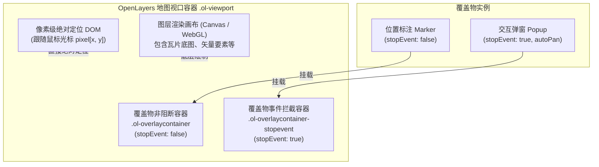

# OpenLayers 覆盖物（Overlay）、交互弹窗与悬浮提示框（Tooltip）实战指南

> 在 WebGIS 应用开发中，地图不仅用于静态展现空间数据，更需要承载丰富的用户交互。**信息弹窗（Popup）**、**地理标记（Marker）**与**悬浮提示（Tooltip）**是连接地图要素与业务详情的核心桥梁。
>
> OpenLayers 提供了强大的 `ol/Overlay` 覆盖物体系，使开发者能够将原生的 HTML DOM 节点无缝“钉”在地图的地理投影坐标上；同时，针对高频的光标移动要素探测，亦可通过原生的像素定位实现超轻量级的悬浮提示。本文基于 3 个核心官方示例（`overlay.html`、`popup.html`、`tooltip-on-hover.html`），全面解构覆盖物、弹窗与提示框的底层架构、API 细节与生产最佳实践。

---

## 1. 架构总览：Overlay 覆盖物 vs 像素级浮层的设计权衡

在 OpenLayers 中实现浮层信息展示，主要存在两种技术路径：**地理坐标锚定（`ol/Overlay`）** 与 **屏幕像素锚定（Pixel Tooltip）**。

### 1.1 架构拓扑与 DOM 层级



### 1.2 方案选型综合特征对照表

| 维度 / 特征 | 地理覆盖物 (`ol/Overlay`) | 像素级悬浮框 (Pixel Tooltip) | 矢量标注样式 (`ol/style/Style`) |
| :--- | :--- | :--- | :--- |
| **坐标依赖** | 地理投影坐标（如 EPSG:3857/4326） | 屏幕像素坐标（`evt.pixel`） | 地理几何对象（`ol/geom/Point`） |
| **宿主载体** | 原生 HTML DOM 节点 | 原生 HTML DOM 节点 | Canvas / WebGL 像素缓冲 |
| **地图平移/缩放** | 实时计算 CSS `transform` 随地图联动 | 不随地图移动，跟随光标或视口 | 随地图视图矩阵在画布内重绘 |
| **事件穿透** | 支持由 `stopEvent` 决定是否阻断地图 | 通常设置 `pointer-events: none` | 由 `forEachFeatureAtPixel` 判定 |
| **适用场景** | 详细信息弹窗、交互按钮、复杂 HTML 标注 | 鼠标划过即时展示的单行微提示 | 成千上万海量点位、图标和文本标记 |
| **性能极限** | 几十到上百个（DOM 过多会引发卡顿） | 单个全局实例（极度轻量，零开销） | 数万到数十万要素并发流畅渲染 |

---

## 2. `ol/Overlay` 核心机制与核心参数

`ol/Overlay` 本质上是一个将外部原生 DOM 元素与地图空间参考系统绑定的桥梁。

### 2.1 关键配置项详解

```javascript
import Overlay from 'ol/Overlay';

const overlay = new Overlay({
  element: document.getElementById('popup'), // 宿主 DOM 元素
  position: [116.39, 39.9],                   // 地理坐标（未设置时保持隐藏）
  positioning: 'bottom-center',             // 锚点对齐方式
  offset: [0, -10],                         // 像素偏移 [x, y]
  stopEvent: true,                          // 是否阻止鼠标事件冒泡到地图
  autoPan: {                                // 视图自动平移（防止弹窗溢出边界）
    animation: {
      duration: 250,
    },
    margin: 20,                             // 距视口边缘的保留安全间距 (px)
  },
  insertFirst: false,                       // 是否置于覆盖物最底层
});
map.addOverlay(overlay);
```

- **`positioning` 锚点对齐**：控制 DOM 元素的哪一个角对齐到地理坐标点。可选值包括 `top-left`、`top-center`、`top-right`、`center-left`、`center-center`、`bottom-left`、`bottom-center`、`bottom-right`。通常气泡弹窗使用 `bottom-center`，使得尖角恰好对准目标点。
- **`stopEvent` 阻断机制**：
  - `stopEvent: true`（默认）：将 DOM 挂载在 `.ol-overlaycontainer-stopevent` 中。在弹窗内选中文本、点击按钮或滚动鼠标滚轮时，**不会**触发底图的拖拽平移或滚轮缩放。
  - `stopEvent: false`：将 DOM 挂载在 `.ol-overlaycontainer` 中。点击或拖拽穿透到底图，适合不干扰地图操作的图钉或纯展示标签（如 `overlay.html` 中的 Vienna Marker）。
- **`autoPan` 视口自适应**：当设置了新的 `position` 且弹窗有一部分超出地图视口边缘时，OpenLayers 会自动平移地图 `View`，确保整个弹窗完整可视。

---

## 3. 经典交互气泡弹窗实战（`popup.html`）

在 `popup.html` 示例中，展示了生产环境中最为标准的自定义样式气泡弹窗架构：

### 3.1 弹窗结构与 CSS 尖角设计

```html
<div id="popup" class="ol-popup">
  <a href="#" id="popup-closer" class="ol-popup-closer"></a>
  <div id="popup-content"></div>
</div>
```

```css
.ol-popup {
  position: absolute;
  background-color: white;
  box-shadow: 0 1px 4px rgba(0,0,0,0.2);
  padding: 15px;
  border-radius: 10px;
  border: 1px solid #cccccc;
  bottom: 12px;
  left: -50px;
  min-width: 280px;
}
/* 利用 ::after 与 ::before 伪元素绘制指示箭头 */
.ol-popup:after, .ol-popup:before {
  top: 100%;
  border: solid transparent;
  content: " ";
  height: 0;
  width: 0;
  position: absolute;
  pointer-events: none;
}
.ol-popup:after {
  border-top-color: white;
  border-width: 10px;
  left: 48px;
  margin-left: -10px;
}
.ol-popup:before {
  border-top-color: #cccccc;
  border-width: 11px;
  left: 48px;
  margin-left: -11px;
}
```

### 3.2 逻辑绑定与 singleclick 防冲突

```javascript
// 1. 关闭按钮逻辑
closer.onclick = function () {
  overlay.setPosition(undefined); // 将坐标置为 undefined 即可优雅隐藏
  closer.blur();
  return false;
};

// 2. 地图单击展示弹窗
map.on('singleclick', function (evt) {
  const coordinate = evt.coordinate;
  const hdms = toStringHDMS(toLonLat(coordinate));

  content.innerHTML = '<p>您点击的位置是：</p><code>' + hdms + '</code>';
  overlay.setPosition(coordinate); // 设置地理坐标，触发 autoPan 自动平移
});
```

> **为什么必须使用 `singleclick` 而非普通的 `click`？**  
> 在桌面端和触控设备上，用户双击地图进行缩放（Double Click Zoom）时，普通的 `click` 会被触发两次，导致弹窗一闪而过甚至误弹。而 `singleclick` 会启动约 250ms 的防抖检测，在确认用户不是发起双击时才执行回调，交互体验更为精准。

---

## 4. 像素级轻量悬浮提示框实战（`tooltip-on-hover.html`）

在数据探索、生态调查或热力图中，用户需要鼠标划过（Hover）即刻查看要素属性。若对频繁移动的光标使用 `ol/Overlay`，频繁的地理坐标换算与 DOM 重排会带来不必要的开销。

### 4.1 像素绝对定位设计

```javascript
const info = document.getElementById('info');
let currentFeature;

const displayFeatureInfo = function (pixel, target) {
  // 排除点击在地图 Zoom/Rotate 等原生控件上的误命中
  const feature = target.closest('.ol-control')
    ? undefined
    : map.forEachFeatureAtPixel(pixel, (feat) => feat);

  if (feature) {
    info.style.left = pixel[0] + 'px';
    info.style.top = pixel[1] + 'px';
    // 仅在命中要素切换时更新 DOM 文本，避免频繁重排
    if (feature !== currentFeature) {
      info.style.visibility = 'visible';
      info.innerText = feature.get('ECO_NAME');
    }
  } else {
    info.style.visibility = 'hidden';
  }
  currentFeature = feature;
};
```

### 4.2 事件优化与状态守护

- **拖拽保护（`evt.dragging`）**：
  ```javascript
  map.on('pointermove', function (evt) {
    if (evt.dragging) {
      info.style.visibility = 'hidden';
      currentFeature = undefined;
      return;
    }
    displayFeatureInfo(evt.pixel, evt.originalEvent.target);
  });
  ```
- **离开视口销毁（`pointerleave`）**：
  ```javascript
  map.getTargetElement().addEventListener('pointerleave', function () {
    currentFeature = undefined;
    info.style.visibility = 'hidden';
  });
  ```

---

## 5. 生产级踩坑指南与性能调优

### 5.1 千万不要为海量点位创建多个 Overlay（单例复用原则）
- **反模式**：接口返回 2000 个设备点位，直接 `new Overlay()` 循环创建 2000 个 DOM 节点挂载到地图上。会导致地图在平移时，浏览器被迫在每帧重新计算 2000 个 DOM 的 CSS Transform，帧率瞬间跌至个位数。
- **最佳实践**：所有点位使用 `VectorLayer`（Canvas / WebGL）绘制；地图上**全局仅初始化一个 `ol/Overlay` 弹窗**。用户点击具体点位时，读取该要素的坐标与属性，直接 `overlay.setPosition(featCoord)` 动态更新弹窗内容并展示。

### 5.2 严防 XSS 跨站脚本注入
直接将从数据库或第三方 GeoJSON 获取的属性拼接到 `content.innerHTML` 具有极高安全隐患。
```javascript
// ❌ 存在 XSS 风险
content.innerHTML = `<h3>${feature.get('title')}</h3>`;

// ✅ 安全方式一：使用 innerText / textContent
const titleEl = document.createElement('h3');
titleEl.textContent = feature.get('title');
content.replaceChildren(titleEl);

// ✅ 安全方式二：通过 DOMPurify 过滤净化
content.innerHTML = DOMPurify.sanitize(rawHtml);
```

### 5.3 提示框防闪烁（`pointer-events: none`）
在自定义像素级 Tooltip 时，Tooltip 的 DOM 默认会接收鼠标事件。如果光标滑动过程中 Tooltip 移动到了光标正下方，下一步的 `pointermove` 目标元素就会变成 Tooltip 本身而非底层的 Map Canvas，导致 `forEachFeatureAtPixel` 判定失准，出现明显的浮窗抖动和闪烁。必须为 Tooltip 的 CSS 添加：
```css
#info {
  pointer-events: none; /* 彻底放行鼠标事件穿透 */
}
```
