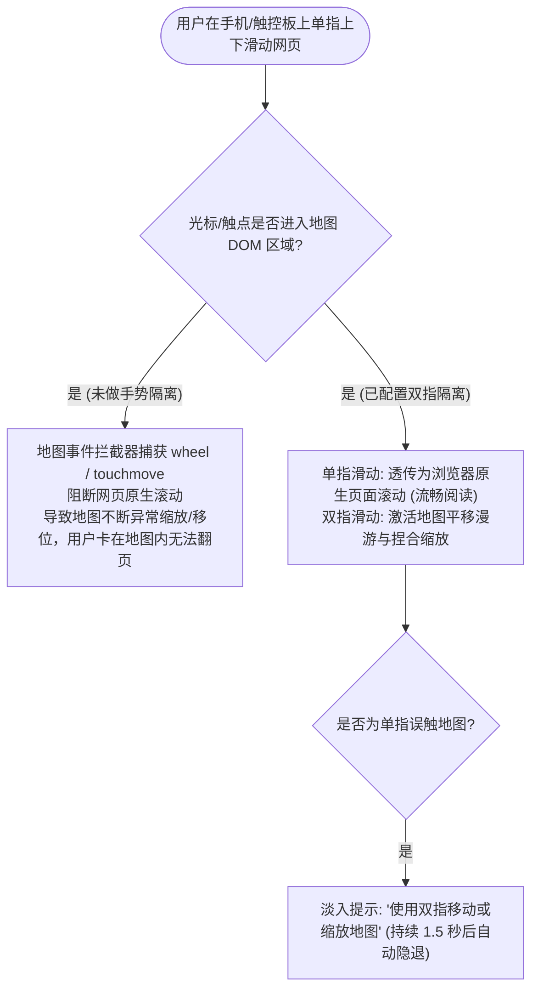

<nav aria-label="breadcrumb"><ol class="breadcrumb mb-4"><li class="breadcrumb-item"><a href="../">Home</a></li><li class="breadcrumb-item"><a href="./">Summary</a></li><li class="breadcrumb-item active" aria-current="page">页面滚动与双指手势指南</li></ol></nav>

# OpenLayers 页面滚动防误触与移动端双指交互实战指南
> 针对长篇图文报告、门户新闻、数据大屏等嵌入式地图场景中常见的“滚轮陷阱（Scroll Trap）”，系统解构滚轮条件约束、移动端双指漫游（Two-Finger Pan）、以及桌面触控板平滑手势拦截与遮罩引导设计。

---

## 1. 核心痛点与“地图陷阱”现象

在现代响应式网页中，当全宽或大尺寸地图嵌入在长页面（包含上下滚动条的网页）正文中时，经常发生极为糟糕的用户体验事故——**地图陷阱（Map / Scroll Trap）**：



---

## 2. 官方示例矩阵解构

| 示例标识 | 核心实现机制 | 典型生产应用场景 |
| :--- | :--- | :--- |
| [`page-scroll`](../en/latest/examples/page-scroll.html) | `MouseWheelZoom` 绑定 `platformModifierKeyOnly` + 嵌入长文本滚动流 | 新闻特稿、博客、电子政务门户长文档内嵌交互式插图地图 |
| [`two-finger-pan-scroll`](../en/latest/examples/two-finger-pan-scroll.html) | `DragPan` 条件绑定单指/双指判断 + 动态触摸浮层指引 | 移动端 H5 混合应用、微信公众号内嵌地图、手机端数据看板 |

---

## 3. 核心实现与典型范式

### 3.1 桌面端平台修饰键约束（Ctrl / Cmd + 滚轮）

在 `page-scroll.html` 中，通过约束默认的 `MouseWheelZoom` 交互，只有在按住修饰键时才允许缩放：

```javascript
import Map from 'ol/Map';
import View from 'ol/View';
import TileLayer from 'ol/layer/Tile';
import OSM from 'ol/source/OSM';
import {defaults as defaultInteractions, MouseWheelZoom} from 'ol/interaction';
import {platformModifierKeyOnly} from 'ol/events/condition';

const map = new Map({
  target: 'map',
  layers: [new TileLayer({source: new OSM()})],
  view: new View({center: [0, 0], zoom: 2}),
  // 自定义交互集合
  interactions: defaultInteractions({
    mouseWheelZoom: false, // 禁用默认的无限制滚轮缩放
  }).extend([
    new MouseWheelZoom({
      // 只有在按下 Ctrl (Windows/Linux) 或 Command (macOS) 时，滚轮才生效
      condition: platformModifierKeyOnly,
    }),
  ]),
});
```

---

### 3.2 移动端双指漫游与单指透传范式

在 `two-finger-pan-scroll.html` 中，展示了类似 Apple Maps 和 Google Maps 的移动端体验标准：

```javascript
import DragPan from 'ol/interaction/DragPan';

// 自定义 DragPan 条件：触点数 >= 2 时才激活平移
const twoFingerDragPan = new DragPan({
  condition: function (event) {
    // 检查原始触摸事件中的接触点数量
    const origEvent = event.originalEvent;
    return origEvent.touches && origEvent.touches.length >= 2;
  },
});

// 结合手势提示遮罩
let timeoutId;
map.getViewport().addEventListener('touchmove', function (evt) {
  if (evt.touches.length === 1) {
    // 单指滑动地图时，显示提示覆盖层
    const overlay = document.getElementById('gesture-tip');
    overlay.classList.add('visible');
    clearTimeout(timeoutId);
    timeoutId = setTimeout(() => overlay.classList.remove('visible'), 1500);
  }
});
```

---

## 4. 生产避坑指南与性能治理

### 4.1 提示遮罩层必须设置 `pointer-events: none`
- **高危陷阱**：弹出的“请使用双指移动地图”提示层如果是一个常规的 `<div>`，它会阻断底层的触摸事件传播，导致用户在看到提示后即便换成双指也无法操作。
- **解法**：手势遮罩必须声明：
  ```css
  #gesture-tip {
    pointer-events: none; /* 保证触控事件完全穿透至底层地图 */
    transition: opacity 0.3s ease;
  }
  ```

### 4.2 避免使用全局 `preventDefault()`
- 很多开发者试图在 `touchstart` 或 `touchmove` 上直接调用 `event.preventDefault()`。
- **严重事故**：在移动端浏览器（尤其是 iOS Safari）中，这会直接把整个父级 Web 页面的原生垂直滚动完全锁死。正确的做法是完全交由 OpenLayers 的内部事件条件机制控制。
