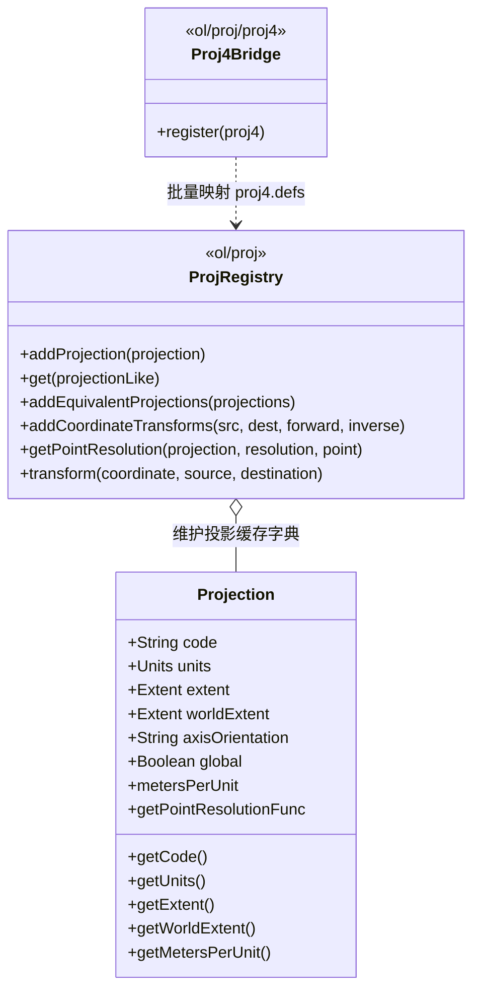
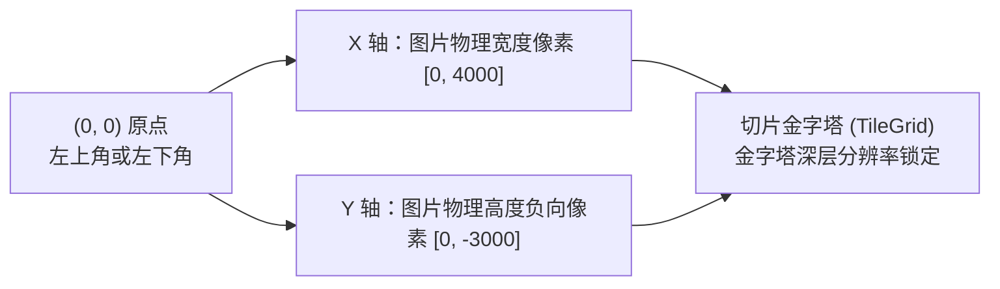
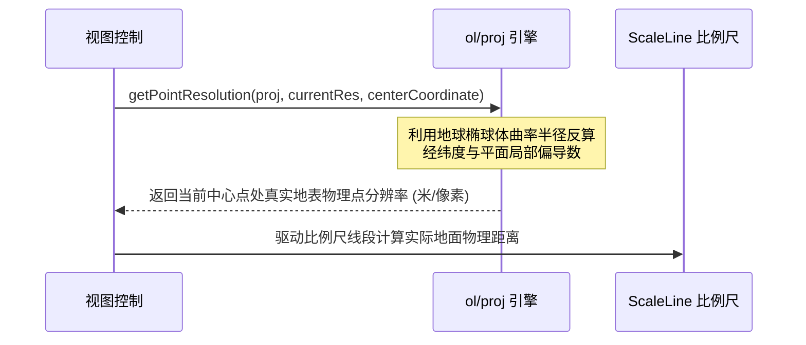

<nav aria-label="breadcrumb"><ol class="breadcrumb mb-4"><li class="breadcrumb-item"><a href="../">Home</a></li><li class="breadcrumb-item"><a href="./">Summary</a></li><li class="breadcrumb-item active" aria-current="page">Projection 坐标基准指南</li></ol></nav>

# OpenLayers 投影系统与坐标基准全景实战指南

> 基于 7 个核心投影官方示例，深度解析坐标系定义、大地基准面、尺度变形控制与像素空间工程实践

---

## 引言：为什么需要深刻理解 Projection

在地理信息系统（GIS）与地图工程中，地球并非标准球体，而是一个不规则的旋转椭球体。**地图投影（Map Projection）**与**坐标参考系统（Coordinate Reference System, CRS）**确立了现实三维物理空间与数字世界二维笛卡尔坐标之间的映射度量基准。

如果脱离动态重投影（Reprojection）而单看**投影基准定义本身**，开发者经常面临以下关键挑战：

1. **独立坐标系与本地工程网格**：国内城市独立坐标系、地方水利水文网格、或瑞士 CH1903 等地方投影，如何不依赖冗余转换库在前端直接直传？
2. **包体积敏感下的轻量运算**：生产环境中若仅需换算少量经纬度坐标，引入庞大的 Proj4js 库是否必要？
3. **真实比例尺失真难题**：墨卡托投影在高纬度面积严重膨胀，同一分辨率在赤道与高纬对应的真实地面物理距离相差数倍，如何让比例尺控件（ScaleLine）保持物理保真？
4. **非地理图像数字化**：病理显微切片、超高清艺术画作扫描并非地球椭球，如何构建原生纯像素（Pixel Space）金字塔？

OpenLayers 具备高度模块化、轻量弹性的投影定义体系。本文立足于官方示例库中精选的 **7 个 Projection 核心示例**，全面解构 OpenLayers 的坐标定义底层模型、数学原理与工程落地策略。

> [!TIP]
> 如果你的业务涉及“跨两个不同坐标系的栅格瓦片实时拉伸/矢量切片重投影”，请参阅专项姊妹篇：[《OpenLayers 客户端动态重投影（Reprojection）全景实战指南》](./openlayers-reprojection-guide.html)。

---

## 第一部分：全景视盘——7 个核心 Projection 示例矩阵

下表系统梳理了聚焦于“坐标系定义、尺度计算与像素空间”的 7 个核心官方示例：

| 分类                   | 示例标识                                                                                                                                                               | 核心机制 / 关键 API                                    | 解决的典型生产场景                                                                      |
| :--------------------- | :--------------------------------------------------------------------------------------------------------------------------------------------------------------------- | :----------------------------------------------------- | :-------------------------------------------------------------------------------------- |
| **基础与尺度保真**     | [`projection-and-scale`](../en/latest/examples/projection-and-scale.html)                                                                                              | `getPointResolution()` 真实地表点分辨率推算            | 解决墨卡托纬度拉伸导致的比例尺失真，动态平滑过渡视图物理尺度                            |
|                        | [`epsg-4326`](../en/latest/examples/epsg-4326.html)                                                                                                                    | 原生 `EPSG:4326` 视图直连与度数单位比例尺              | 原生经纬度底图直出，配合 `ScaleLine({units: 'degrees'})` 呈现真实球面经纬度度数跨度     |
| **极简与轻量转换**     | [`wms-no-proj`](../en/latest/examples/wms-no-proj.html)                                                                                                                | 仅配置 `{code, units}` 的极简 Projection 对象          | 纯平面直角坐标直传直显，零客户端转换开销的同投影工程展示                                |
|                        | [`wms-custom-proj`](../en/latest/examples/wms-custom-proj.html)                                                                                                        | `addCoordinateTransforms()` 注册轻量级多项式正反算函数 | 免引入完整 Proj4js 库（节省数十 KB），微秒级完成瑞士 CH1903 极高精度拟合                |
| **单幅图像与地方投影** | [`wms-image-custom-proj`](../en/latest/examples/wms-image-custom-proj.html)                                                                                            | `proj4.defs()` + `register(proj4)` + `ImageWMS`        | 非标准地方投影下单幅 WMS 请求，防止切片注记被网格边界截断                               |
|                        | [`scaleline-indiana-east`](../en/latest/examples/scaleline-indiana-east.html) <span class="badge bg-warning text-dark"><i class="fa fa-link me-1"></i> 双核复合</span> | NAD83 州平面投影基准（SPCS）+ 美制测量英尺（Foot_US）  | 跨非公制长度单位配置，同时驱动 OSM 客户端重投影与 `ScaleLine({units: 'us'})` 比例尺联动 |
| **非地理像素空间**     | [`zoomify`](../en/latest/examples/zoomify.html)                                                                                                                        | 纯像素笛卡尔投影 + 分辨率锁定 + Retina 2x 高清瓦片比   | 医学显微病理切片、博物馆超高清艺术品数字化深层浏览                                      |
| **云端动态投影解析**   | [`cog-projection`](../en/latest/examples/cog-projection.html)                                                                                                          | `loadMissingProjection: true` 动态按需拉取 proj4 定义  | 现代云原生 GeoTIFF 自动化 EPSG 元数据嗅探与按需加载                                     |

> [!TIP]
>
> ### 🔗 双核全链路枢纽提示（Dual-Core Hybrid Hub）
>
> 在 OpenLayers 示例库中，存在 **6 个同时被打上 `projection` 与 `reprojection` 标签的端到端复合示例**：
>
> 1. [`scaleline-indiana-east`](../en/latest/examples/scaleline-indiana-east.html)（本篇重点）：注册 SPCS 地方投影基准与美制英尺，同时驱动 OSM 栅格跨系重投影；
> 2. [`reprojection`](../en/latest/examples/reprojection.html)：Proj4js 注册 8 种投影与范围，同时驱动多源异构栅格自适应三角网重投影；
> 3. [`reprojection-by-code`](../en/latest/examples/reprojection-by-code.html)：在线动态检索注册 EPSG，同时自适应 8 点插值计算弧形包围盒；
> 4. [`reprojection-image`](../en/latest/examples/reprojection-image.html)：定义单张高精历史古图地理基准，同时进行双线性插值重投影；
> 5. [`reprojection-wgs84`](../en/latest/examples/reprojection-wgs84.html)：确立 EPSG:3857 与 4326 基准，同时将墨卡托瓦片拉伸为 2:1 等经纬度网格；
> 6. [`multiple-cogs`](../en/latest/examples/multiple-cogs.html)：定义跨 UTM 31N/32N 遥感源，同时在 WebGL 片元着色器中并行拼接重投影。
>
> 💡 **进阶指引**：关于这些示例中涉及的**自适应三角剖分网格、双线性插值采样、极地矢量切片重投影与 WebGL GPU 硬件重采样流水线**，请阅读进阶篇：[《OpenLayers 客户端动态重投影全景实战指南》](./openlayers-reprojection-guide.html)。

---

## 第二部分：架构全景——OpenLayers 投影定义模型

OpenLayers 内部将投影管理设计为一个函数式查找表与轻量类体系：



### 关键属性的物理内涵

1. **`code`**：投影标识符字符串（如 `'EPSG:4326'`、`'EPSG:3857'` 或自定义代号 `'EPSG:21781'`）；
2. **`units`**：坐标单位。支持 `'degrees'`（角度）、`'m'`（公制米）、`'ft'`（英尺）、`'us-ft'`（美制测量英尺）、`'pixels'`（非地理像素）等；
3. **`extent`**：该投影在平面直角坐标系下的有效投影范围 $[minX, minY, maxX, maxY]$，直接决定切片金字塔 Zoom 0 的计算范围；
4. **`worldExtent`**：该投影对应的真实地理经纬度范围 $[minLon, minLat, maxLon, maxLat]$，供经纬网（Graticule）与全球裁剪算法定位；
5. **`axisOrientation`**：坐标轴顺序，默认 `'enu'`（East, North, Up，即经度在前，纬度在后）。某些测绘规范为 `'neu'`（North, East, Up），定义不当会导致坐标轴颠倒。

---

## 第三部分：四大核心投影实现范式

### 1. 同系直通模式（零转换开销直传）

**对应示例**：[`wms-no-proj`](../en/latest/examples/wms-no-proj.html)

**业务痛点**：公司内部或局域网部署了独立坐标系（如地方城市独立网格）的 GIS 服务，前端无需任何换算，仅需原样发送和渲染坐标。

**实现机制**：无需加载 Proj4js，直接声明最简 `Projection` 对象并注册：

```javascript
import Projection from "ol/proj/Projection.js";
import { addProjection } from "ol/proj.js";

// 仅声明 code 与 units，建立极简基准
const projection = new Projection({
  code: "EPSG:21781",
  units: "m",
});
addProjection(projection);

const map = new Map({
  layers: [
    new TileLayer({
      source: new TileWMS({
        url: "https://...",
        params: { LAYERS: "water" },
        projection: projection, // 直接向服务端传递该坐标系
      }),
    }),
  ],
  view: new View({
    projection: projection,
    center: [600000, 200000],
    zoom: 3,
  }),
});
```

> [!NOTE]
> 该模式下，前端不执行任何坐标转换计算，网络请求中的 `BBOX` 直接以米制平面坐标原样传递，客户端零性能消耗。

---

### 2. 免 Proj4js 的轻量多项式拟合

**对应示例**：[`wms-custom-proj`](../en/latest/examples/wms-custom-proj.html)

**业务痛点**：生产环境对前端打包体积要求严苛（如移动端或离线 SDK），只需在 `EPSG:4326` 与某一地方坐标系（如瑞士 CH1903）之间换算，引入整套 Proj4js 库性价比极低。

**实现机制**：利用高斯展开近似多项式正反算公式，通过 `addCoordinateTransforms` 注册双向转换函数：

```javascript
import Projection from "ol/proj/Projection.js";
import { addCoordinateTransforms, addProjection } from "ol/proj.js";

const swissProjection = new Projection({
  code: "EPSG:21781",
  units: "m",
});
addProjection(swissProjection);

// 注册从 EPSG:4326 到 EPSG:21781 的轻量数学正算函数
addCoordinateTransforms(
  "EPSG:4326",
  swissProjection,
  function (coordinate) {
    return [
      WGStoCHy(coordinate[1], coordinate[0]),
      WGStoCHx(coordinate[1], coordinate[0]),
    ];
  },
  function (coordinate) {
    return [
      CHtoWGSlng(coordinate[0], coordinate[1]),
      CHtoWGSlat(coordinate[0], coordinate[1]),
    ];
  },
);
```

#### 瑞士测绘官方多项式近似公式

在瑞士全境范围内，该近似公式与严密椭球投影的误差小于 $0.1$ 米，计算耗时仅为 Proj4js 通用解析器的 $\frac{1}{20}$：
$$Y' = \frac{\lambda_{\text{秒}} - 26782.5}{10000}, \quad X' = \frac{\varphi_{\text{秒}} - 169028.66}{10000}$$
$$y_{\text{CH}} = 600000 + 211455.93 Y' - 10938.51 Y' X' - 0.36 Y' X'^2 - 44.54 Y'^3$$
$$x_{\text{CH}} = 200000 + 308807.95 X' + 3745.25 Y'^2 + 76.63 X'^3 - 194.56 Y'^2 X'$$

---

### 3. 纯像素非地理空间（Pixel Space & Deep Zoom）

**对应示例**：[`zoomify`](../en/latest/examples/zoomify.html)

**业务痛点**：数字病理学切片（数十亿像素扫描件）、博物馆高精名画、芯片晶圆缺陷检查等，图像并非地球表面，没有经纬度和椭球体概念。



**实现机制**：

```javascript
const source = new Zoomify({
  url: "https://example.com/zoomify/",
  size: [4000, 3000], // 图像全部分辨率下的真实像素宽高
  zDirection: -1, // 渲染器优先选择当前或更高层级切片，避免放大时模糊
});

const map = new Map({
  view: new View({
    // 关键点 1：锁定瓦片网格的原生分辨率数组，禁止非线性缩放产生模糊插值
    resolutions: source.getTileGrid().getResolutions(),
    extent: source.getTileGrid().getExtent(),
    // 关键点 2：仅约束中心点在图像范围内，允许边缘平滑滚动至视口之外
    constrainOnlyCenter: true,
  }),
});
```

#### Retina 2x 高清屏适配奥秘

在 MacBook 或 4K 显示屏上，若直接渲染普通切片会显得模糊。通过巧妙搭配 `tilePixelRatio` 与半尺寸 `tileSize`，可无损榨干高分屏：

```javascript
const source = new Zoomify({
  url: "...",
  size: [width, height],
  tilePixelRatio: 2, // 声明切片实际像素密度为两倍
  tileSize: 128, // 逻辑切片边长为 128px（实际拉取 256px 瓦片）
});
```

---

### 4. 云原生动态按需投影解析

**对应示例**：[`cog-projection`](../en/latest/examples/cog-projection.html)

**业务痛点**：加载未知的云原生 GeoTIFF 影像时，其元数据可能包含任意小众地方投影代号（如 `EPSG:32636`），前端不可能预先全量打包全球数千种 Proj4 字符串。

**实现机制**：开启 `loadMissingProjection`，在运行时拦截未注册投影，自动向 `epsg.io` 发起跨域检索并动态注册：

```javascript
import { loadMissingProjection } from "ol/proj.js";

const source = new GeoTIFF({
  sources: [{ url: "https://example.com/unregistered-utm.tif" }],
});

// 当解析到未知投影代码时，后台自动拉取 https://epsg.io/<code}.proj4
// 完成动态注册后再渲染影像，实现全球投影动态即插即用
```

---

## 第四部分：核心难点——尺度失真与真实点分辨率

### 1. 墨卡托投影的纬度拉伸本质

**对应示例**：[`projection-and-scale`](../en/latest/examples/projection-and-scale.html)

Web 墨卡托（`EPSG:3857`）是一种**等角正圆柱投影（Conformal Projection）**。保角的代价是面积严重失真，其局部长度拉伸变形系数 $k$ 随着纬度 $\varphi$ 剧烈递增：
$$k = \sec(\varphi) = \frac{1}{\cos(\varphi)}$$

| 纬度 $\varphi$ |   代表地理区域    | 局部变形系数 $k$ | 物理意义                                             |
| :------------: | :---------------: | :--------------: | :--------------------------------------------------- |
| **$0^\circ$**  |       赤道        |    **$1.00$**    | 标称 1 像素代表 100 米，真实地表即为 100 米          |
| **$30^\circ$** |   上海 / 休斯顿   |    **$1.15$**    | 膨胀 15%                                             |
| **$60^\circ$** | 圣彼得堡 / 奥斯陆 |    **$2.00$**    | 地面距离膨胀一倍（同一屏幕像素仅代表真实地面 50 米） |
| **$80^\circ$** |   格陵兰岛北部    |    **$5.76$**    | 极度膨胀接近 6 倍                                    |

---

### 2. 真实点分辨率（`getPointResolution`）对齐算法

如果在切换视图坐标系或度量距离时，盲目使用视口标称 `view.getResolution()`，将导致高纬度测量严重失真、比例尺控件（ScaleLine）数值错位。

**OpenLayers 的解决算法**：



**工程平滑重置代码**：

```javascript
// 在切换坐标系时，保持地表物理尺寸与比例尺视觉一致
function setProjection(newProj) {
  const oldProj = view.getProjection();
  const center = view.getCenter();
  const oldRes = view.getResolution();

  // 1. 获取当前中心点处的真实地表物理点分辨率（米/像素）
  const pointRes = getPointResolution(oldProj, oldRes, center);

  // 2. 坐标点跨系映射
  const newCenter = transform(center, oldProj, newProj);

  // 3. 反推新坐标系下达到相同地表物理分辨率所需的目标 nominal resolution
  const targetPointRes = getPointResolution(newProj, 1, newCenter);
  const newRes = pointRes / targetPointRes;

  // 4. 重置视图，视角缩放与比例尺无缝衔接
  map.setView(
    new View({
      projection: newProj,
      center: newCenter,
      resolution: newRes,
    }),
  );
}
```

---

## 第五部分：生产选型指南与避坑清单

1. **同系优先选直传**：局域网内展示独立测绘坐标系数据时，**必须优先使用极简定义** `new Projection({code, units: 'm'})`，避免引入多余库；
2. **移动端包体积敏感**：若仅需转换两三处已知坐标系，**采用 `addCoordinateTransforms` 自行编写多项式正反算**，立省 Proj4js 打包体积；
3. **切片金字塔严禁漏配 Extent**：自定义注册投影必须尽可能明确声明 `extent: [minX, minY, maxX, maxY]`，否则引擎无法自动推导 TileGrid 各级切片范围；
4. **美制单位英尺换算陷阱**：美国州平面（SPCS）广泛采用美制测量英尺（`us-ft`，定义为 $\frac{1200}{3937} \text{ m} \approx 0.3048006 \text{ m}$），切勿误设为国际英尺（`ft`，恒等于 $0.3048 \text{ m}$），在大范围工程坐标计算中该微小差异会导致数米级系统偏位。

---

## 附录：8 个官方 Projection 核心示例源码导航

1. [`projection-and-scale`](../en/latest/examples/projection-and-scale.html) &mdash; 投影切换与地表物理比例尺精准对齐
2. [`epsg-4326`](../en/latest/examples/epsg-4326.html) &mdash; 原生 EPSG:4326 经纬度视图直连与度数单位比例尺
3. [`wms-no-proj`](../en/latest/examples/wms-no-proj.html) &mdash; 纯直角坐标直传与零开销极简投影
4. [`wms-custom-proj`](../en/latest/examples/wms-custom-proj.html) &mdash; 基于多项式正反算的高精度轻量投影变换
5. [`wms-image-custom-proj`](../en/latest/examples/wms-image-custom-proj.html) &mdash; 单幅 ImageWMS 跨自定义投影请求与渲染
6. [`scaleline-indiana-east`](../en/latest/examples/scaleline-indiana-east.html) &mdash; 美国州平面投影与英制测量单位比例尺联动
7. [`zoomify`](../en/latest/examples/zoomify.html) &mdash; 纯像素笛卡尔非地理空间切片金字塔与高清适配
8. [`cog-projection`](../en/latest/examples/cog-projection.html) &mdash; 现代云原生 GeoTIFF 动态按需投影定义检索
