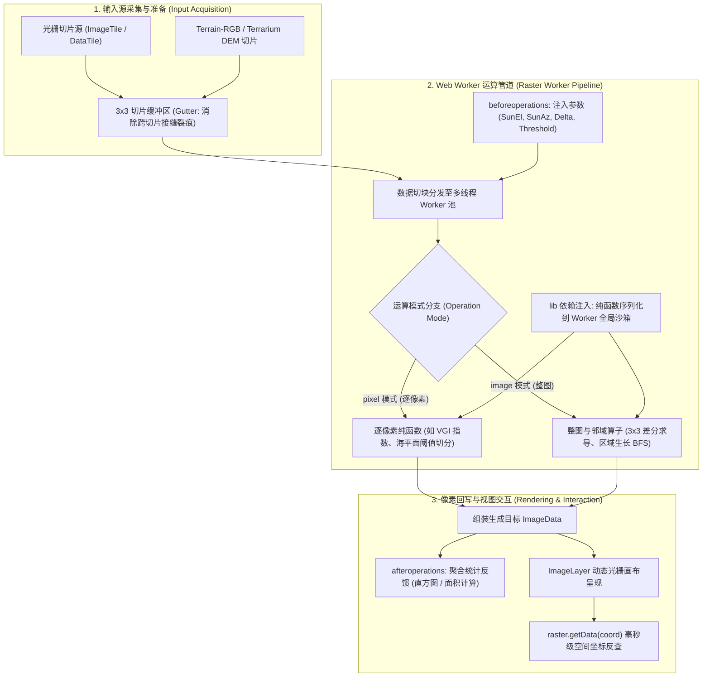
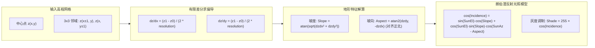

# OpenLayers 光栅像素处理与地形分析全景实战架构指南 (Raster Manipulation & Topographic Analysis Architecture)

> 本指南基于 OpenLayers 官方 **raster** 核心专题群的代表性示例，深度解构 `ol/source/Raster` 依托多线程 Web Worker 实现的客户端逐像素与整图级运算流水线，详解 Mapbox Terrain-RGB 与 Mapzen Terrarium 两大数字高程模型（DEM）编解码标准，剖析基于 3x3 邻域梯度的朗伯日照山体阴影（Hillshade）物理模型，并系统演示动态等高线插值、区域生长分割、植被绿度指数（VGI）双向统计与云原生 PMTiles 单文件切片读取的高阶工程实践。

---

## 一、光栅运算流水线全景架构 (Architectural Overview)

在现代 WebGIS 中，面对海量数字高程模型（DEM）与多光谱遥感影像，传统依赖 GIS 服务端重绘切片的模式延迟高、吞吐瓶颈明显。`ol/source/Raster` 通过在浏览器后台开辟 Web Worker 线程池，开创了纯客户端、零服务器运算的分布式空间光栅分析架构：



---

## 二、`ol/source/Raster` Web Worker 多线程计算架构

`ol/source/Raster` 实现了高效的非阻塞计算管道，其核心设计模式包括：

### 1. 逐像素模式 (`operationType: 'pixel'`) vs 整图模式 (`operationType: 'image'`)

| 维度 | 逐像素模式 (`'pixel'`) | 整图模式 (`'image'`) |
| :--- | :--- | :--- |
| **执行颗粒度** | 每次调用处理单个像素点 | 每次调用处理当前视口的整幅 `ImageData` |
| **入参特征** | `pixels: Array<Array<number>>`（各输入源对应点的 RGBA 数组） | `inputs: Array<ImageData>`（包含完整 `width`、`height` 与像素缓冲区） |
| **邻域访问** | **无法访问**周边邻居像素 | **可自由寻址**四周任意 $3 \times 3$ 或 $5 \times 5$ 空间卷积核 |
| **典型算子** | 植被指数（VGI/NDVI）、海平面阈值淹没、波段代数相加 | 山体阴影（Hillshade）、Sobel 边缘检测、区域生长（Flood Fill） |
| **示例参考** | [`examples/raster.html`](file:///d:/Users/Downloads/openlayers/examples/raster.html)、[`examples/sea-level.html`](file:///d:/Users/Downloads/openlayers/examples/sea-level.html) | [`examples/shaded-relief.html`](file:///d:/Users/Downloads/openlayers/examples/shaded-relief.html)、[`examples/region-growing.html`](file:///d:/Users/Downloads/openlayers/examples/region-growing.html) |

### 2. `lib` 函数注入与 Worker 沙箱隔离机制
Web Worker 拥有完全独立的全局上下文，无法访问主线程闭包。`RasterSource` 提供了 `lib` 选项，在初始化 Worker 时将 JavaScript 纯函数序列化并动态注入到 Worker 的 `self` 作用域中：

```javascript
const raster = new RasterSource({
  sources: [imagery],
  operationType: 'image',
  operation: growRegion,
  // 必须通过 lib 显式声明依赖函数，否则 Worker 执行时将抛出 ReferenceError
  lib: {
    next4Edges: next4Edges,
  },
});
```

### 3. 双向状态管道：`beforeoperations` 与 `afteroperations`
- `beforeoperations`：在运算启动前触发，主线程将外部动态状态（如滑块阈值、光照角、视口分辨率等）挂入 `event.data` 随同像素数组传入 Worker；
- `afteroperations`：在所有切片运算完毕后触发，主线程可读取 Worker 汇总的统计报表（如各分箱频数计数值），用于驱动外围 UI（如 D3.js 图表）。

---

## 三、数字高程模型（DEM）解析与微观地形分析

### 1. 两大主流 DEM 编码标准对比

目前工业界最主流的高程编码瓦片标准均使用 24 位 RGB 存储海拔数据（单位：米）：

| 标准类型 | 提出机构 / 服务商 | 高程解码数学公式 | 垂直分辨率 | 基础偏移量 |
| :--- | :--- | :--- | :--- | :--- |
| **Mapbox / MapTiler Terrain-RGB** | Mapbox / MapTiler | $\text{Height} = -10000 + (R \cdot 256^2 + G \cdot 256 + B) \times 0.1$ | $0.1\text{ m}$ (10 厘米) | $-10000\text{ m}$ |
| **Mapzen Terrarium** | Mapzen / Tilezen / AWS | $\text{Height} = -32768 + (R \cdot 256 + G + \frac{B}{256})$ | $\approx 0.0039\text{ m}$ (分米/厘米级) | $-32768\text{ m}$ |

### 2. 为什么高程切片必须禁用双线性插值 (`interpolate: false`)？
如 [`examples/sea-level.html`](file:///d:/Users/Downloads/openlayers/examples/sea-level.html) 所示：
> **制图铁律**：普通照片的 RGB 通道表示连续颜色，插值混合能产生平滑视觉；但 Terrain-RGB 瓦片的每个通道代表数值的高位、中位与低位字节。一旦开启双线性插值，相邻像素的 $R$ 通道（权重高达 $6553.6\text{ m}$）发生过渡混色，将在两点之间凭空创造出数千米的异常突变尖刺或假断崖。**读取高程数据时必须配置 `interpolate: false` 强制使用最近邻采样**。

### 3. 3x3 瓦片 Gutter 裙边机制消隐接缝
如 [`examples/contour-interpolation.html`](file:///d:/Users/Downloads/openlayers/examples/contour-interpolation.html) 所示，在进行高程连续插值或等高线计算时，切片四周边缘像素因缺失外部相邻点而在切缝处产生截断破损。
通过编写自定义 3x3 加载器，在内存中外扩 1 像素裙边（`gutter: 1`），使得每个切片在边界处均具备完整的周边梯度信息，彻底消除跨切片等高线断裂缺陷。

---

## 四、朗伯漫反射日照山体阴影算法 (Hillshade Shading)

如 [`examples/shaded-relief.html`](file:///d:/Users/Downloads/openlayers/examples/shaded-relief.html) 所示，山体阴影通过模拟太阳光线照在不平整地表上的明暗分布展现三维起伏质感：



### 核心物理公式与代码实现：
1. **有限差分求偏导**：
   $$\frac{\partial z}{\partial x} = \frac{z(x+1, y) - z(x-1, y)}{2 \times \text{Resolution}}$$
   $$\frac{\partial z}{\partial y} = \frac{z(x, y+1) - z(x, y-1)}{2 \times \text{Resolution}}$$
2. **坡度与坡向解算**：
   $$\text{Slope} = \arctan\left(\sqrt{\left(\frac{\partial z}{\partial x}\right)^2 + \left(\frac{\partial z}{\partial y}\right)^2}\right)$$
   $$\text{Aspect} = \frac{\pi}{2} - \text{atan2}\left(\frac{\partial z}{\partial y}, -\frac{\partial z}{\partial x}\right)$$
3. **朗伯漫反射入射余弦值**：
   $$\cos(\theta) = \sin(\text{SunEl}) \cdot \cos(\text{Slope}) + \cos(\text{SunEl}) \cdot \sin(\text{Slope}) \cdot \cos(\text{SunAz} - \text{Aspect})$$
4. **光学反转错觉规避**：
   人类视觉系统具有“顶光假定”。制图时**太阳方位角（`sunAz`）应始终置于偏北方向（如 $315^\circ$ 西北或 $45^\circ$ 东北）**，若置于南方会导致山脊在视觉上被误判为凹陷的峡谷。

---

## 五、环境遥感指数与交互式影像分割

### 1. 植被绿度指数（VGI）与 D3.js 响应式统计联动
如 [`examples/raster.html`](file:///d:/Users/Downloads/openlayers/examples/raster.html) 所示，针对普通 RGB 遥感正射切片，通过绿色通道比率反演地表健康植被：
$$\text{VGI} = \frac{2G - R - B}{2G + R + B}$$
通过将直方图分箱统计嵌入 Worker 计算循环，主线程在 `afteroperations` 中驱动 D3.js 条形图，并依据视口物理分辨率：
$$\text{Area} = \text{Resolution}^2 \times \text{Count} \quad (\text{转换换算为英亩 Acres})$$
实现“鼠标滑过图表柱条 $\leftrightarrow$ 地图即时高亮特定植被分级”的双向实时联动。

### 2. 交互式区域生长算法 (Region Growing / BFS Flood Fill)
如 [`examples/region-growing.html`](file:///d:/Users/Downloads/openlayers/examples/region-growing.html) 所示，在整图模式下利用广度优先搜索（BFS）实现连通水体或农田提取：
- 用户点击获得种子点像素 $(X_{\text{seed}}, Y_{\text{seed}})$；
- 4-邻域连通搜索，满足 $|R - R_{\text{seed}}| < \Delta \land |G - G_{\text{seed}}| < \Delta \land |B - B_{\text{seed}}| < \Delta$ 的边界扩张；
- **原地标记优化**：通过设置 `inputData[ci + 3] = 0` 原地记录访问状态，无需额外内存消耗，支持 4K 大屏超快速收敛。

### 3. 海平面上升与亚米级高程反查
如 [`examples/sea-level.html`](file:///d:/Users/Downloads/openlayers/examples/sea-level.html) 所示，利用 `raster.getData(coordinate)` 直接穿透读取输入切片的原始像素，在鼠标悬停时毫秒级解算出当前鼠标所在位置的真实海拔：
```javascript
const pixels = raster.getData(event.coordinate);
const height = -10000 + (pixels[0][0] * 65536 + pixels[0][1] * 256 + pixels[0][2]) * 0.1;
elevationLabel.innerText = Math.round(height) + ' m';
```

---

## 六、云原生单文件切片容器：PMTiles 架构实践

如 [`examples/pmtiles-image.html`](file:///d:/Users/Downloads/openlayers/examples/pmtiles-image.html) 所示，PMTiles 是目前最受推崇的云原生瓦片格式：

```javascript
const tiles = new PMTiles('https://example.com/satellite.pmtiles');

const source = new ImageTileSource({
  async loader(z, x, y, {signal}) {
    // 发起精细的 HTTP Range 字节范围请求
    const response = await tiles.getZxy(z, x, y, signal);
    const blob = new Blob([response.data]);
    const src = URL.createObjectURL(blob);
    const image = await loadImage(src);
    URL.revokeObjectURL(src); // 立即释放 Blob URL 避免内存泄露
    return image;
  },
});
```

- **零服务端架构**：直接托管在 S3、OSS 或 Cloudflare R2，利用 HTTP Range 头获取单个切片，完全免去维护传统瓦片服务器（TileServer）的集群运维开销；
- **请求取消防护**：通过 OpenLayers 传入的 `{signal}`（`AbortSignal`），在快速缩放时自动中止已废弃的切片传输，保障网络高吞吐。

---

## 七、Raster 专题核心示例索引 (Examples Reference)

| 示例文件 | 核心技术点 | 运算模式 / 算法模型 | 关键 API 与模块 |
| :--- | :--- | :--- | :--- |
| [`raster.html`](file:///d:/Users/Downloads/openlayers/examples/raster.html) | 植被绿度指数（VGI）逐像素计算与 D3 直方图联动 | `operationType: 'pixel'` / VGI 植被指数 | `ol/source/Raster`, `d3-scale`, `d3-selection` |
| [`shaded-relief.html`](file:///d:/Users/Downloads/openlayers/examples/shaded-relief.html) | 3x3 邻域有限差分坡度坡向与朗伯日照阴影 | `operationType: 'image'` / 朗伯漫反射 | `Terrarium DEM`, `atan2`, `sinSunEl`, `cosIncidence` |
| [`sea-level.html`](file:///d:/Users/Downloads/openlayers/examples/sea-level.html) | Terrain-RGB 逐像素高程解码与海平面上升模拟 | `operationType: 'pixel'` / 阈值切分 | `Terrain-RGB`, `interpolate: false`, `raster.getData()` |
| [`contour-interpolation.html`](file:///d:/Users/Downloads/openlayers/examples/contour-interpolation.html) | 3x3 瓦片 Gutter 裙边插值与动态等高距等高线 | `operationType: 'image'` / 4-邻域跨距判别 | `DataTile.gutter`, `OES_texture_float_linear` |
| [`region-growing.html`](file:///d:/Users/Downloads/openlayers/examples/region-growing.html) | 种子点广度优先搜索（BFS）区域生长影像分割 | `operationType: 'image'` / 泛洪连通性 | `BFS 队列`, 原地 Alpha 访问标记, `lib` 依赖注入 |
| [`pmtiles-image.html`](file:///d:/Users/Downloads/openlayers/examples/pmtiles-image.html) | 云原生单文件 PMTiles HTTP Range 异步切片读取 | 云原生单文件存储 / 零服务端架构 | `pmtiles`, `ImageTile.loader`, `URL.createObjectURL` |
