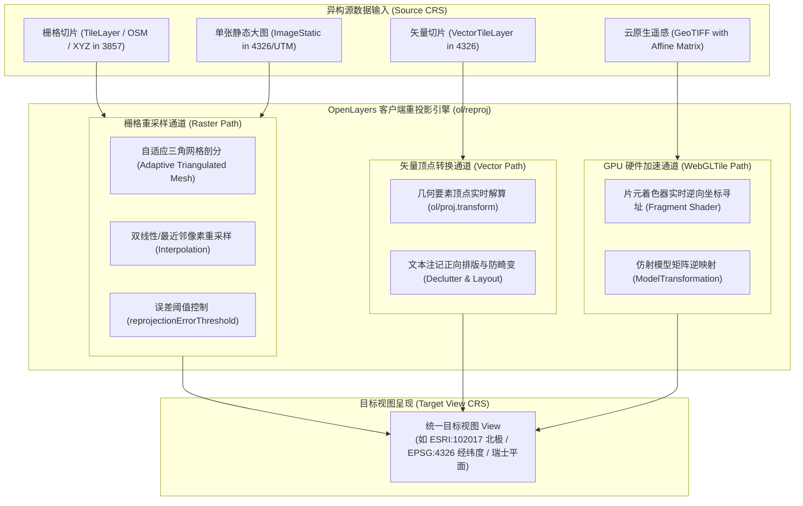
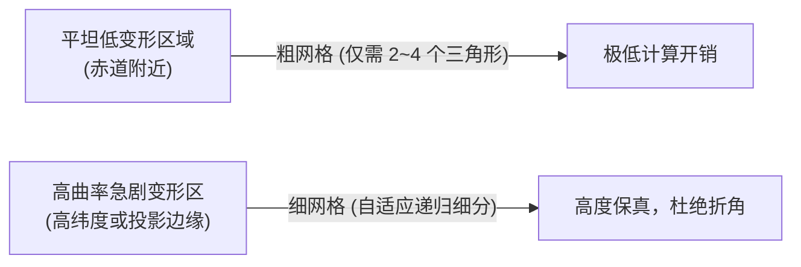

<nav aria-label="breadcrumb"><ol class="breadcrumb mb-4"><li class="breadcrumb-item"><a href="../">Home</a></li><li class="breadcrumb-item"><a href="./">Summary</a></li><li class="breadcrumb-item active" aria-current="page">Reprojection 动态重投影指南</li></ol></nav>

# OpenLayers 客户端动态重投影（Reprojection）全景实战指南
> 基于 9 个核心重投影官方示例，深度解析跨坐标系转换、栅格自适应三角网、极地矢量切片重投影与 WebGL 硬件加速

---

## 引言：打破多源异构数据的“坐标系壁垒”

在实际 WebGIS 系统搭建中，数据源往往来自不同的部门、历史测绘项目或第三方供应商：
- **公共底图**：来自 OpenStreetMap 或 Google Map，采用标准 Web 墨卡托（`EPSG:3857`）；
- **遥感卫星底图**：来自 Sentinel、Landsat 或机载雷达，采用各分带通用横轴墨卡托（UTM）；
- **业务专题数据**：气象海流数据采用 WGS84 经纬度（`EPSG:4326`），统计制图采用全球等面积摩尔威特（Mollweide），极地科考采用北极朗伯等面积方位投影（LAEA）。

传统方案必须在 GIS 服务器端预先切片或进行代价高昂的二次切片渲染。**OpenLayers 客户端动态重投影（Reprojection）引擎**彻底打破了这一桎梏：允许浏览器在接收到原始栅格瓦片或矢量切片后，**在客户端毫秒级动态拉伸、旋转、剖分并无缝叠合在同一个目标视图中**。

> [!NOTE]
> 如果你的诉求是“理解单坐标系的定义、注册独立坐标系、计算比例尺点分辨率或非地理像素空间”，请参阅基础篇：[《OpenLayers 投影系统与坐标基准全景实战指南》](./openlayers-projection-guide.html)。

---

## 第一部分：全景视盘——9 个核心 Reprojection 示例矩阵

下表系统梳理了聚焦于“跨系动态转换、三角剖分网格与 GPU 硬件加速”的 9 个核心官方示例：

| 分类 | 示例标识 | 核心机制 / 关键 API | 解决的典型生产场景 |
| :--- | :--- | :--- | :--- |
| **经典栅格重采样** | [`reprojection-wgs84`](../en/latest/examples/reprojection-wgs84.html) <span class="badge bg-warning text-dark"><i class="fa fa-link me-1"></i> 双核复合</span> | 内置 `EPSG:3857` $\to$ `EPSG:4326` 零配置重投影 | 浏览器端将方形墨卡托瓦片拉伸为 2:1 等经纬度全景底图 |
| | [`reprojection`](../en/latest/examples/reprojection.html) <span class="badge bg-warning text-dark"><i class="fa fa-link me-1"></i> 双核复合</span> | 混合 OSM、WMS、WMTS + 8 种目标投影 + `isGlobal()` 防重影 | 复杂异构 GIS 底图统一接入，调节误差阈值平衡帧率 |
| | [`reprojection-image`](../en/latest/examples/reprojection-image.html) <span class="badge bg-warning text-dark"><i class="fa fa-link me-1"></i> 双核复合</span> | `ImageStatic` 单张高分辨率静态图重投影 + `interpolate` | 历史纸质地图、扫描倾斜大图跨投影叠加，双线性插值防锯齿 |
| **自适应边界与动态代码** | [`reprojection-by-code`](../en/latest/examples/reprojection-by-code.html) <span class="badge bg-warning text-dark"><i class="fa fa-link me-1"></i> 双核复合</span> | 在线检索 EPSG + `applyTransform` 8 点采样 + 日界线补偿 | 在线检索全球任意 EPSG 代号，自适应曲线边界并重投影瓦片 |
| | [`sphere-mollweide`](../en/latest/examples/sphere-mollweide.html) | 摩尔威特等面积伪圆柱投影（ESRI:53009）+ `worldExtent` | 统计专题制图、经纬网（Graticule）弧线渲染与局域图层范围裁剪 |
| **矢量切片与极地突破** | [`vector-tiles-reprojected`](../en/latest/examples/vector-tiles-reprojected.html) | `VectorTileLayer` 客户端几何坐标变换 + 极地 LAEA 投影 | 突破墨卡托 $85^\circ$ 极地失效极限，EPSG:4326 矢量切片无损转北极视图 |
| **云原生遥感 (COG)** | [`geotiff-reprojection`](../en/latest/examples/geotiff-reprojection.html) | 内置 UTM 投影元数据自动探测 + WebGL 栅格重投影 | 自动读取 GeoTIFF 内嵌 UTM 投影，免 Proj4js 配置实时转换至墨卡托 |
| | [`cog-modeltransformation`](../en/latest/examples/cog-modeltransformation.html) | 解析 GeoTIFF Tag 34264 模型仿射矩阵（包含旋转与剪切） | 机载雷达 / 合成孔径雷达（SAR）斜视倾斜成像实时校正重投影 |
| | [`multiple-cogs`](../en/latest/examples/multiple-cogs.html) <span class="badge bg-warning text-dark"><i class="fa fa-link me-1"></i> 双核复合</span> | 单图层跨 UTM 31N/32N 相邻分带拼接 + 多波段假彩色合成 | 哨兵 2 号跨带卫星遥感影像无缝拼接与实时 NDVI 植被分析 |

> [!TIP]
> ### 🔗 双核全链路枢纽提示（Dual-Core Hybrid Hub）
> 动态重投影的前提是“引擎必须首先认识源投影与目标投影的数学基准”。上述示例中，`reprojection`、`reprojection-by-code`、`reprojection-image`、`reprojection-wgs84`、`multiple-cogs` 以及 [`scaleline-indiana-east`](../en/latest/examples/scaleline-indiana-east.html) 均被打上 **`projection`** 与 **`reprojection`** 双标签。
> 
> 💡 **基准指引**：若要深入掌握这些示例中涉及的**坐标系类模型属性（`extent`/`worldExtent`）、Proj4 桥接注册底层、多项式正反算展开与地表真实点分辨率保真**，请跳转研读基准篇：[《OpenLayers 投影系统与坐标基准全景实战指南》](./openlayers-projection-guide.html)。

---

## 第二部分：架构全景——双通道重投影流水线

OpenLayers 将重投影流水线划分为两大截然不同的计算通道：**栅格像元重采样网格（Raster Triangulated Mesh）** 与 **矢量几何顶点变换（Vector Geometry Transform）**。



---

## 第三部分：五大重投影核心范式深入剖析

### 1. 经典栅格重采样与自适应三角网调优
**对应示例**：[`reprojection-wgs84`](../en/latest/examples/reprojection-wgs84.html)、[`reprojection`](../en/latest/examples/reprojection.html)

#### 运行原理
当我们将 OSM（Web 墨卡托）图层放入一个 WGS84（`EPSG:4326`）视图中时，墨卡托切片不能简单地整体贴上去，因为墨卡托纬线间距随纬度非线性增加，而 WGS84 经纬度网格是均匀分布的。

OpenLayers 内部采用**自适应三角形剖分网格（Adaptive Triangulated Mesh）**：
1. 将目标视口反向细分为三角形网络；
2. 反算各三角形顶点在源切片上的坐标；
3. 如果三角形中心点的重投影偏差超过允许误差，则将其四等分递归细分；
4. 利用 Canvas 2D 绘图上下文的 `ctx.drawImage` 仿射变换渲染每个微小三角形。



#### 生产性能调优（`reprojectionErrorThreshold`）
* **默认值**：`0.5` 像素（极端苛刻的高保真度，三角形数量多）；
* **工业调优建议**：对于大范围背景卫星底图或地形晕渲图，将 `reprojectionErrorThreshold` 提高至 `2.0` 或 `3.0`：
  ```javascript
  new TileWMS({
    url: 'https://...',
    reprojectionErrorThreshold: 2.5, // 减少约 70% 的三角面细分与重绘制开销，低端设备帧率立升
  });
  ```

---

### 2. 单幅静态影像重投影与抗锯齿控制
**对应示例**：[`reprojection-image`](../en/latest/examples/reprojection-image.html)

**业务痛点**：对于历史数字化古地图扫描件、局部建筑规划总图等单幅大型栅格图（`ImageStatic`），在跨投影变换时极易产生锯齿和阶梯走样。

```javascript
import Static from 'ol/source/ImageStatic.js';

const imageSource = new Static({
  url: 'data/historical-map.jpg',
  imageExtent: [-123, 37, -122, 38], // 源投影地理范围 (EPSG:4326)
  projection: 'EPSG:4326',
  interpolate: true, // 核心属性：启用双线性插值平滑滤波
});
```
> [!IMPORTANT]
> **插值开关黄金准则**：
> - **`interpolate: true`（双线性插值）**：适用于照片、遥感影像、晕渲图，消除马赛克与折痕；
> - **`interpolate: false`（最近邻采样）**：适用于土地利用分类、气象预警等级图，严格防止在像元交界处插值出不存在的中间伪分类值。

---

### 3. 弧形弯曲边界与自适应 8 点采样
**对应示例**：[`reprojection-by-code`](../en/latest/examples/reprojection-by-code.html)、[`sphere-mollweide`](../en/latest/examples/sphere-mollweide.html)

在兰勃特等角圆锥（LCC）或极射赤平投影中，原本在经纬度下的矩形包围盒 $[minLon, minLat, maxLon, maxLat]$ 投影到平面后并不是直线矩形，而是弯曲的扇环或月牙弧线：

```
[minLon, maxLat] -----------> (向上弧形隆起) -----------> [maxLon, maxLat]
      |                                                        |
      v                                                        v
[minLon, minLat] -----------> (向下弧形弯曲) -----------> [maxLon, minLat]
```

如果仅仅转换矩形的 4 个角点，计算出的外接矩形会将弯曲隆起的部分裁切截断。

**OpenLayers 解决方案**：
```javascript
import {applyTransform} from 'ol/extent.js';
import {getTransform} from 'ol/proj.js';

// 第 4 个参数 8 表示在每条直角边上密集插入 8 个插值采样点 (Stops)
const transformFn = getTransform('EPSG:4326', targetProjection);
const safeExtent = applyTransform(sourceBbox, transformFn, undefined, 8);
```
此外，当包围盒跨越 180° 国际日界线时（`bbox[0] > bbox[2]`），算法自动执行 `bbox[2] += 360` 经度补偿，确保投影外包矩形万无一失。

---

### 4. 矢量切片客户端几何重投影（极地等面积破局）
**对应示例**：[`vector-tiles-reprojected`](../en/latest/examples/vector-tiles-reprojected.html)

与传统栅格瓦片必须重采样像素不同，OpenLayers 的 `VectorTileLayer` 实现了直接对切片内部矢量几何（Point、LineString、Polygon）顶点的客户端投影转换。

#### 栅格重投影 vs. 矢量切片重投影本质对比
| 维度 | 传统栅格切片重投影 (Raster) | 矢量切片重投影 (Vector Tile) |
| :--- | :--- | :--- |
| **变换对象** | 像素（Pixels）/ 三角剖分网格 | 几何要素顶点（Vertices） |
| **渲染清晰度** | 存在插值模糊或阶梯伪影 | **100% 矢量无损**，任意缩放极速超清 |
| **文字与注记** | 注记随同像素被拉伸旋转畸变 | 文本始终沿变换后的几何线**正向清晰排版** |
| **样式与交互** | 像素颜色固定不可变 | 配合 `ol-mapbox-style` 实时换肤与要素过滤 |

#### 极地高纬度破局与北极投影（LAEA）
Web 墨卡托投影（`EPSG:3857`）公式为：
$$y = R \ln \left( \tan \left( \frac{\pi}{4} + \frac{\varphi}{2} \right) \right)$$
当纬度 $\varphi \to \pm 90^\circ$ 时，$\tan(...) \to \infty$，导致 $\pm 85.051129^\circ$ 以上无法渲染。

**极地方案**：
采用全球全纬度覆盖（$[-180, -90, 180, 90]$）的 `EPSG:4326` 矢量切片，通过 Proj4js 注册北极朗伯等面积方位投影（North Pole Lambert Azimuthal Equal Area, `ESRI:102017`），OpenLayers 矢量渲染器直接在北极视角下重投影渲染：
```javascript
proj4.defs(
  'ESRI:102017',
  '+proj=laea +lat_0=90 +lon_0=0 +x_0=0 +y_0=0 +datum=WGS84 +units=m +no_defs +type=crs'
);
register(proj4);

const layer = new VectorTileLayer({
  declutter: true,
  source: new VectorTileSource({
    projection: 'EPSG:4326',
    tileGrid: createXYZ({ extent: [-180, -90, 180, 90], tileSize: 512, maxResolution: 180 / 512, maxZoom: 13 }),
  }),
});
applyStyle(layer, 'https://api.maptiler.com/maps/basic-4326/style.json?key=...');

const map = new Map({
  target: 'map',
  layers: [layer],
  view: new View({
    projection: 'ESRI:102017',
    center: fromLonLat([0, 90], 'ESRI:102017'),
    zoom: 4,
  }),
});
```

---

### 5. 云原生遥感 WebGL 硬件级重投影与仿射矩阵校正
**对应示例**：[`geotiff-reprojection`](../en/latest/examples/geotiff-reprojection.html)、[`cog-modeltransformation`](../en/latest/examples/cog-modeltransformation.html)、[`multiple-cogs`](../en/latest/examples/multiple-cogs.html)

在海量遥感卫星影像（COG）重投影中，若继续依赖 CPU 三角剖分会导致主线程完全卡死。OpenLayers 提供了基于 WebGL 的全硬件加速管道：

#### ① 内置 UTM 投影零配置嗅探
OpenLayers 内置所有标准 UTM 分带（如 UTM Zone 36N，即 `EPSG:32636`），无需 Proj4js：
```javascript
const source = new GeoTIFF({
  sources: [{url: 'https://.../sentinel-s2-l2a-cogs/.../TCI.tif'}],
});

// 异步读取 IFD 头信息后直接定位，着色器自动硬件重采样至墨卡托视图
source.getView().then((sourceView) => {
  const center = transform(sourceView.center, sourceView.projection, map.getView().getProjection());
  map.getView().setCenter(center);
});
```

#### ② SAR 倾斜雷达 Tag 34264 仿射矩阵校正
合成孔径雷达（SAR）卫星沿轨道倾斜扫描成像时，图像坐标系相对于地面存在明显的**旋转角（Rotation）与剪切（Skew）**。
GeoTIFF Tag 34264（`ModelTransformationTag`）定义了仿射矩阵：
$$\begin{bmatrix} X \\ Y \\ 1 \end{bmatrix} = \begin{bmatrix} a & b & c \\ d & e & f \\ 0 & 0 & 1 \end{bmatrix} \begin{bmatrix} \text{col} \\ \text{row} \\ 1 \end{bmatrix}$$
OpenLayers 的 `WebGLTile` 在片元着色器中执行该矩阵的逆运算，实现雷达斜视图像与地理底图的微秒级亚像素贴合。

#### ③ 跨相邻 UTM 分带无缝合成
在 `multiple-cogs` 中，相邻两景哨兵卫星影像分别位于 UTM 31N 与 UTM 32N。OpenLayers 仅用一个 `WebGLTile` 图层同时加载两个源，显卡自动将两景异构投影拼接并实时计算 NDVI 植被指数。

---

## 第四部分：生产避坑与排错 Checklist

### 1. 避免全球全景下的局域图层重影（Ghost Prevention）
当全局投影（如摩尔威特 `ESRI:54009`、WGS84 `EPSG:4326`）开启世界环绕（`wrapX: true`）时，局域图层（如英国国家格网 `EPSG:27700`）可能会在球面展开周期中产生多个虚假重影副本。

**标准工程实践**：
```javascript
function updateViewProjection(newProj) {
  map.setView(new View({ projection: newProj, ... }));

  // 如果目标视图是全球投影，必须为局域图层显式限制裁剪范围
  if (newProj.isGlobal()) {
    layerBNG.setExtent(
      transformExtent(proj27700.getExtent(), proj27700, newProj, 2)
    );
  } else {
    layerBNG.setExtent(undefined);
  }
}
```

### 2. 重投影性能瓶颈排查表
| 现象 | 根本诱因 | 解决方案 |
| :--- | :--- | :--- |
| 地图平移卡顿、掉帧严重 | 大量栅格图层使用了默认 `0.5` 像素阈值，三角面超数万个 | 提高 `reprojectionErrorThreshold: 2.0` |
| 边界处瓦片缺失或截断 | 弧形投影下仅转换了 4 个角点包围盒 | 使用 `applyTransform(bbox, transform, undefined, 8)` 增加采样点 |
| 遥感多波段影像加载缓慢 | 采用了 CPU Canvas 传统图层重投影 | 换用 `ol/layer/WebGLTile`，由显卡并行计算 |
| 分类栅格图边缘颜色混淆 | 误开启了双线性插值 | 设置 `interpolate: false` 保持像元纯净 |

---

## 附录：9 个官方 Reprojection 核心示例源码导航

1. [`reprojection-wgs84`](../en/latest/examples/reprojection-wgs84.html) &mdash; OpenStreetMap 客户端 WGS84 重投影
2. [`reprojection`](../en/latest/examples/reprojection.html) &mdash; 多源异构底图栅格重投影与自适应三角网调优
3. [`reprojection-image`](../en/latest/examples/reprojection-image.html) &mdash; 单幅高分辨率静态扫描图像重投影与抗锯齿插值
4. [`reprojection-by-code`](../en/latest/examples/reprojection-by-code.html) &mdash; 动态 EPSG 代码在线检索与自适应 8 点边界重投影
5. [`sphere-mollweide`](../en/latest/examples/sphere-mollweide.html) &mdash; 摩尔威特伪圆柱等面积投影与全球经纬网
6. [`vector-tiles-reprojected`](../en/latest/examples/vector-tiles-reprojected.html) &mdash; 矢量切片客户端几何动态重投影与北极朗伯投影
7. [`geotiff-reprojection`](../en/latest/examples/geotiff-reprojection.html) &mdash; GeoTIFF 内置 UTM 投影自动嗅探与客户端动态重投影
8. [`cog-modeltransformation`](../en/latest/examples/cog-modeltransformation.html) &mdash; SAR 倾斜雷达成像模型仿射矩阵实时校正
9. [`multiple-cogs`](../en/latest/examples/multiple-cogs.html) &mdash; 多 COG 跨相邻分带拼接与波段多光谱合成
