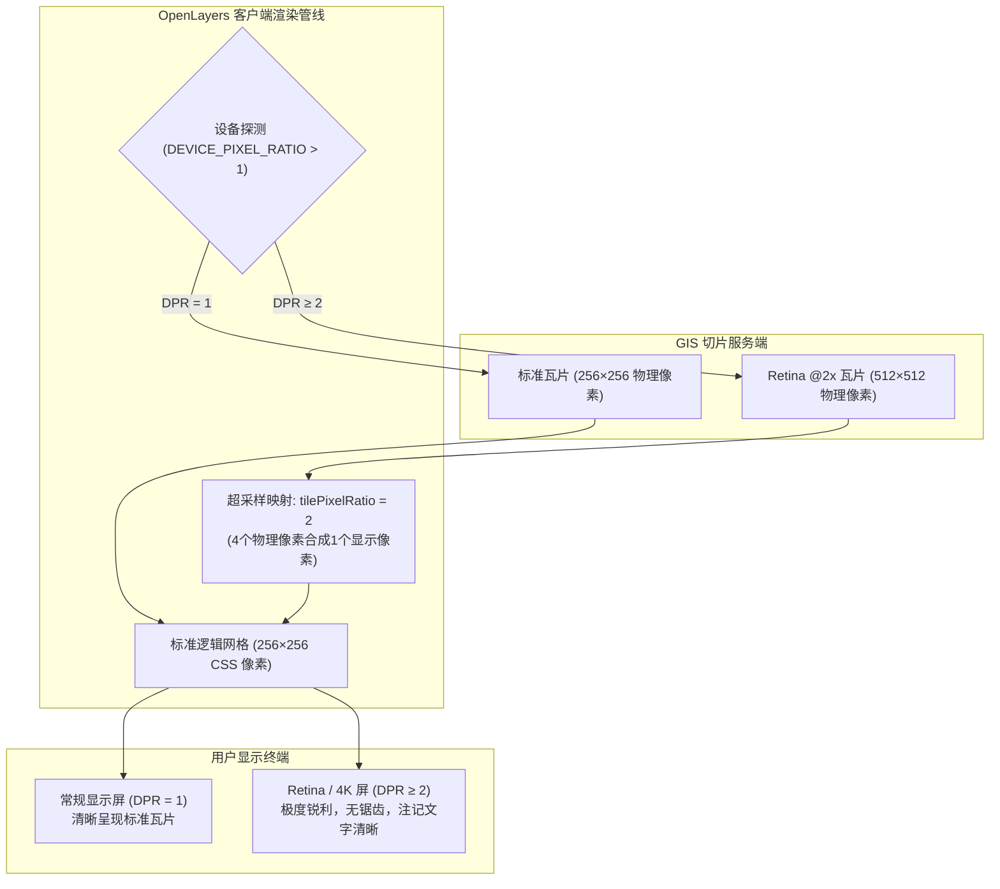

# OpenLayers 视网膜高清屏适配（Retina / HiDPI）与像素比优化实战指南

> 在现代终端设备中，智能手机、平板电脑、4K 高清大屏以及以苹果 MacBook 为代表的 Retina 视网膜显示设备已成为主流。这些设备的**设备像素比（`window.devicePixelRatio`，简称 DPR）**通常达到 2.0 甚至 3.0。
>
> 传统的 WebGIS 切片通常基于 90.7 DPI、256×256 物理像素标准制作。若直接在 HiDPI 屏幕上渲染，浏览器会强制执行双线性拉伸插值，造成地图文字注记发虚、等高线与道路边界锯齿模糊。OpenLayers 提供了完整的端到端高分渲染管线。本文基于 3 个核心官方示例（`xyz-retina.html`、`wmts-hidpi.html`、`stadia-maps.html`），系统解构 Retina / HiDPI 渲染原理、关键 API 与生产工程最佳实践。

---

## 1. 架构总览：物理像素、逻辑像素与超采样管线

### 1.1 视网膜高清采样的核心逻辑



### 1.2 方案选型综合特征对照表

| 维度 / 模式 | XYZ 静态直连 (@2x) | WMTS 规范高分图层 | 商业数据源专用 (StadiaMaps) |
| :--- | :--- | :--- | :--- |
| **典型示例** | `xyz-retina.html` | `wmts-hidpi.html` | `stadia-maps.html` |
| **切片规格** | 512×512 物理像素 (`@2x.png`) | 512×512 物理像素 (独立 Layer) | 512×512 自动追加 (`@2x`) |
| **渲染图层** | `ol/layer/WebGLTile` (硬件加速) | `ol/layer/Tile` (Canvas) | `ol/layer/Tile` (Canvas) |
| **DPR 感知** | 固定加载 `@2x` 或由 URL 模板按需拼接 | 显式通过 `DEVICE_PIXEL_RATIO` 动态路由 | `retina: true` 自动开启 |
| **网格参数** | 隐式缩放或 `tileSize: 512` | 必须配置 `tilePixelRatio: 2` | 内部自动绑定 `tilePixelRatio: 2` |
| **适用场景** | 自建切片服务、MapTiler 墨卡托底图 | 政府/国家级测绘 WMTS 服务 | 精美国际风格主题与暗黑底图大屏 |

---

## 2. XYZ 高清切片与 WebGL 硬件加速（`xyz-retina.html`）

在 `xyz-retina.html` 中，展示了结合 WebGL 与 512×512 高清切片的极致流畅架构：

```javascript
import Map from 'ol/Map.js';
import View from 'ol/View.js';
import WebGLTileLayer from 'ol/layer/WebGLTile.js';
import ImageTileSource from 'ol/source/ImageTile.js';
import {useGeographic} from 'ol/proj.js';

useGeographic(); // 开启原生 WGS84 经纬度

const map = new Map({
  target: 'map',
  layers: [
    new WebGLTileLayer({
      source: new ImageTileSource({
        // 请求 512×512 物理像素的 @2x 瓦片
        url: 'https://api.maptiler.com/maps/outdoor-v2/256/{z}/{x}/{y}@2x.png?key=KEY',
      }),
    }),
  ],
  view: new View({
    center: [-112.2132, 36.1053], // 大峡谷国家公园
    zoom: 13,
  }),
});
```

### 核心机理剖析：
1. **WebGLTile 纹理压缩与 Mipmap**：512×512 高清图片直接载入 GPU 纹理显存，显卡利用三线性过滤（Trilinear Filtering）自动生成降采样纹理链，即使在地图连续旋转或倾斜时也不会产生摩尔纹（Moiré pattern）。
2. **逻辑网格映射**：URL 路径中的 `/256/` 声明了逻辑切片网格坐标，服务端在此坐标空间内生成 512 像素图像；OpenLayers 接收后自动将其缩小 50% 映射到 256 CSS 逻辑网格中，达成双倍像素密度。

---

## 3. OGC WMTS 规范高分切片与端侧自适应（`wmts-hidpi.html`）

在政府和企事业单位的标准 GIS 架构中，数据通常以 OGC WMTS 标准发布。WMTS 元数据定义了严苛的 `TileMatrixSet`（如 `google3857`）。

### 3.1 动态探测与图层分流

```javascript
import {DEVICE_PIXEL_RATIO} from 'ol/has.js';
import WMTS, {optionsFromCapabilities} from 'ol/source/WMTS.js';

// 动态判断设备像素比：Retina 屏选 bmaphidpi，普通屏选 geolandbasemap
const hiDPI = DEVICE_PIXEL_RATIO > 1;
const layer = hiDPI ? 'bmaphidpi' : 'geolandbasemap';
const tilePixelRatio = hiDPI ? 2 : 1;

fetch(capabilitiesUrl)
  .then((res) => res.text())
  .then((xmlText) => {
    const result = new WMTSCapabilities().read(xmlText);
    const options = optionsFromCapabilities(result, {
      layer: layer,
      matrixSet: 'google3857',
      style: 'normal',
    });
    // 关键配置：告知 OpenLayers 瓦片物理尺寸与网格逻辑尺寸的放大倍数
    options.tilePixelRatio = tilePixelRatio;

    map.addLayer(new TileLayer({ source: new WMTS(options) }));
  });
```

### 3.2 `tilePixelRatio` 的数学本质
若不设置 `tilePixelRatio: 2`，OpenLayers 会假定接收到的是 256×256 瓦片，将其作为 512 逻辑像素扩大排布，导致地图空间几何比例尺放大整整一倍，注记位置发生严重漂移。配置 `tilePixelRatio: 2` 后：
$$\text{Tile Render Width (CSS px)} = \frac{\text{Image Width}}{\text{tilePixelRatio}} = \frac{512}{2} = 256\text{px}$$
保证空间投影坐标严密对齐。

---

## 4. 商业级开箱即用视网膜暗黑大屏方案（`stadia-maps.html`）

对于现代化数字孪生和监控大屏，Stadia Maps 提供了最简洁的调用封装：

```javascript
import TileLayer from 'ol/layer/Tile.js';
import StadiaMaps from 'ol/source/StadiaMaps.js';

const layer = new TileLayer({
  source: new StadiaMaps({
    layer: 'alidade_smooth_dark',
    retina: true, // 一键激活 @2x 高分流并配置 tilePixelRatio: 2
  }),
});
```

- **视觉表现**：在暗黑模式下，细如发丝的次级路网和轮廓线在普通屏上容易断裂或模糊，而在 2× Retina 渲染下能够保持极高反差的视觉可读性。

---

## 5. 生产实践踩坑与性能调优指南

### 5.1 带宽开销与按需加载策略
- **陷阱**：无条件全量开启 `@2x` 高分瓦片。512×512 PNG 图像单张体积通常为 80~200KB（标准 256px 仅为 20~50KB）。在移动端 4G/弱网环境下，会导致首屏白屏时间成倍增加。
- **最佳实践**：必须根据 `DEVICE_PIXEL_RATIO` 动态判断，仅在 `dpr > 1` 的高清设备上按需加载 `@2x` 瓦片，兼顾视觉质量与加载吞吐量。

### 5.2 跨屏幕拖拽（DPR 突变）处理
在双显示器办公场景中，用户常将浏览器从 4K 外接显示器拖动到 1080P 笔记本屏幕上。此时 `window.devicePixelRatio` 发生改变。
```javascript
// 监听屏幕像素比变化并动态重载
const mqString = `(resolution: ${window.devicePixelRatio}dppx)`;
window.matchMedia(mqString).addEventListener('change', () => {
  // 重新评估 DPR 并更新图层数据源
  updateMapSourceForCurrentDPR();
});
```

### 5.3 栅格切片 vs 矢量切片（MVT）的高清对比
- **光栅切片（Raster Tile）**：制作固定物理分辨率（256px 或 512px），无论是否设置 `@2x`，持续无级缩放时在两级之间仍会有短暂拉伸插值。
- **矢量切片（VectorTile / MVT）**：矢量数据在客户端直接根据当前屏幕物理分辨率绘制几何线条与文本，天然具备**无限分辨率自适应**特性。对于高精度数据可视化场景，推荐将底层升级为 `ol/layer/VectorTile`。
