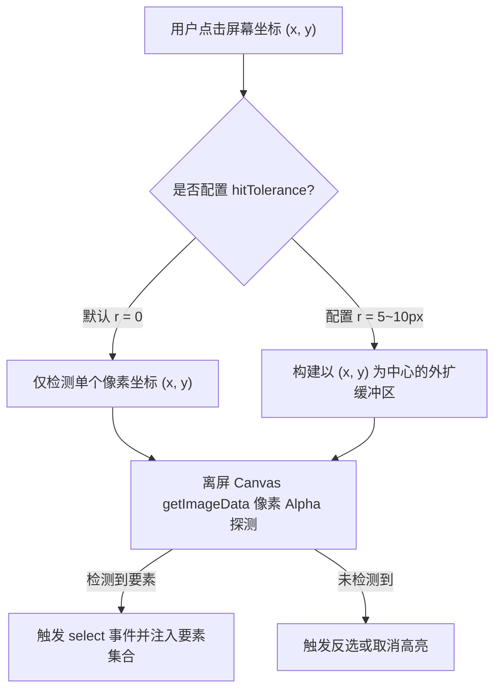

<nav aria-label="breadcrumb"><ol class="breadcrumb mb-4"><li class="breadcrumb-item"><a href="../">Home</a></li><li class="breadcrumb-item"><a href="./">Summary</a></li><li class="breadcrumb-item active" aria-current="page">要素拾取与容差判定指南</li></ol></nav>

# OpenLayers 交互式要素拾取、悬停反馈与容差判定精要指南

> 在地图业务交互中，空间要素的**命中拾取（Hit Detection）**与**选中状态维护（Selection Management）**是触发业务弹窗、详情查看与二次编辑的第一入口。
>
> 随着终端从传统 PC 桌面扩展至高分触控屏与移动端，细线、单点图元面临“鼠标指不准、手指点不中”的触达难题。OpenLayers 提供了完整的交互式拾取架构：从鼠标悬停即时反馈（Hover）、多要素连续选择（Multi-select），到底层硬件像素拾取容差（`hitTolerance`）算法。本文基于 3 个核心官方示例，系统解构要素命中拾取的内部运行机制与工程调优。

---

## 1. 架构总览：3 个要素拾取核心官方示例矩阵

| 分类               | 示例标识                                                                          | 核心机制 / 关键 API                      | 解决的典型生产场景                       |
| :----------------- | :-------------------------------------------------------------------------------- | :--------------------------------------- | :--------------------------------------- |
| **悬停即时高亮**   | [`select-hover-features`](../en/latest/examples/select-hover-features.html)       | `Select` 交互 + `condition: pointerMove` | 鼠标滑过要素时即刻高亮并浮现简要 Tooltip |
| **多选与集合管理** | [`select-multiple-features`](../en/latest/examples/select-multiple-features.html) | `Select` + `multi: true` + Shift 键修饰  | 批量勾选多个资产要素、表格多选与联动高亮 |
| **触控与拾取容差** | [`hit-tolerance`](../en/latest/examples/hit-tolerance.html)                       | `hitTolerance` 像素容差半径动态调节      | 提升细线与微小点位在触屏上的点击命中率   |

---

## 2. 拾取容差（`hitTolerance`）算法原理与触控优化

### 2.1 像素拾取判定机理

当用户点击地图上的某一个像素坐标 $[x, y]$ 时，若未配置容差，系统仅探测该单像素点处的几何覆盖：

- 对于 1 像素宽度的细线或半径 3 像素的小点，用户点击只要偏离 1 个屏幕物理像素，就会判定为未命中（Miss）。
- 开启 `hitTolerance: r`（单位：像素）后，OpenLayers 内部在离屏 Canvas 检测以 $[x, y]$ 为中心、半径为 $r$ 的圆形/正方形缓冲区区域：

$$\text{Hit Area} = [x - r, y - r, x + r, y + r]$$



### 2.2 生产环境动态容差配置范式（`hit-tolerance`）

```javascript
import Select from "ol/interaction/Select";

// 针对 PC 端与移动触控端动态适配容差半径
const isTouchDevice = "ontouchstart" in window;
const tolerance = isTouchDevice ? 10 : 3;

const selectInteraction = new Select({
  hitTolerance: tolerance, // 触屏设备赋予更大容差，大幅降低点选落空概率
  style: highlightStyle, // 选中后的高亮样式
});

map.addInteraction(selectInteraction);
```

---

## 3. 悬停（Hover）与点击（Click）双态交互解耦

在许多敏捷监控大屏中，用户希望“鼠标移动到要素上高亮预览，点击后固定选中并打开详情抽屉”。

### 3.1 双 Select 协同架构（`select-hover-features`）

```javascript
import Select from "ol/interaction/Select";
import { pointerMove, click } from "ol/events/condition";

// 1. 悬停交互：负责 Hover 临时预览（指针移开即自动复原）
const selectHover = new Select({
  condition: pointerMove,
  style: hoverPreviewStyle,
});

// 2. 点击交互：负责固定选中
const selectClick = new Select({
  condition: click,
  style: activeSelectedStyle,
});

// 3. 按照责任链顺序添加（Click 优先）
map.addInteraction(selectClick);
map.addInteraction(selectHover);
```

---

## 4. 多要素连续批量选择（`select-multiple-features`）

在空间资产盘点、统计分析中，需要支持用户批量勾选要素。

### 4.1 修饰键协同选择机制

```javascript
import Select from "ol/interaction/Select";
import { shiftKeyOnly, click } from "ol/events/condition";

const select = new Select({
  condition: click,
  // 仅在按下 Shift 键点击时允许向已选集合追加/移除要素
  toggleCondition: shiftKeyOnly,
  multi: true, // 允许单次点击同时命中垂直重叠的多层要素
});

// 监听选中集合变化，联动业务侧边栏表格
select.getFeatures().on("add", (e) => {
  console.log("新增选中要素:", e.element.getId());
});

select.getFeatures().on("remove", (e) => {
  console.log("移除选中要素:", e.element.getId());
});
```

---

## 5. 生产避坑指南

1. **悬停拾取的 CPU 占用陷阱**：在海量矢量数据图层（超过 5000 个面要素）上开启 `pointerMove` 悬停探测，若未做防抖，鼠标快速滑动会导致帧率骤降。建议对鼠标移动事件引入 16ms（约 1 帧）的 `requestAnimationFrame` 防抖；
2. **多图层拾取过滤（Filter）**：如果不希望底图标注或辅助网格被误选，必须显式配置 `layers` 过滤函数：
   ```javascript
   const select = new Select({
     layers: (layer) => layer === businessLayer, // 仅允许拾取特定业务图层
   });
   ```
3. **触控设备的右键与长按穿透**：移动端长按可能会触发浏览器的原生上下文菜单，需通过 CSS `touch-action: none;` 或禁用默认长按手势保证拾取手势纯净。

---

## 附录：3 个官方要素拾取核心示例直达索引

1. [`select-hover-features`](../en/latest/examples/select-hover-features.html) &mdash; 鼠标指针悬停要素高亮拾取与样式反馈
2. [`select-multiple-features`](../en/latest/examples/select-multiple-features.html) &mdash; 要素连续多选与反选交互集合管理
3. [`hit-tolerance`](../en/latest/examples/hit-tolerance.html) &mdash; 拾取容差半径算法与移动端触控屏防误触调优
