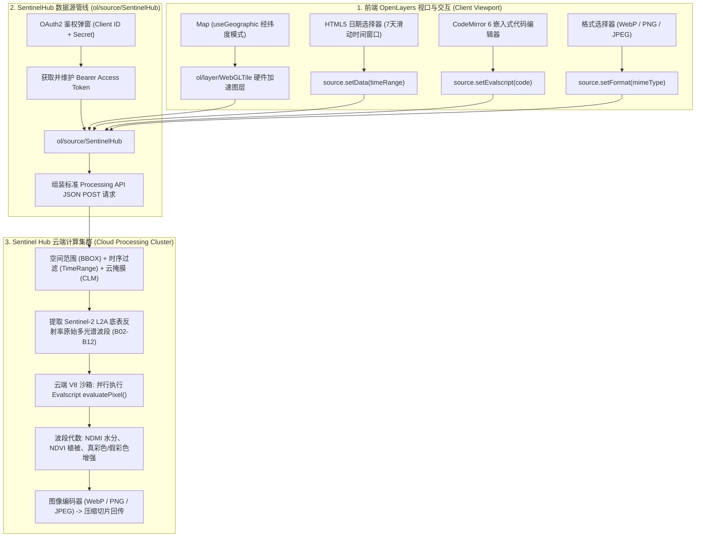
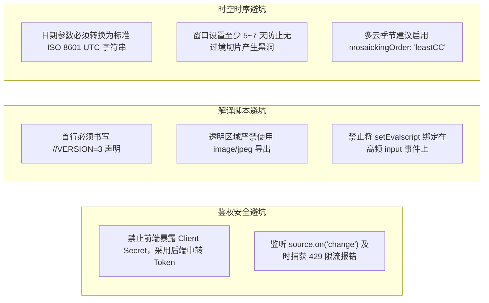

# OpenLayers 欧空局哨兵卫星影像与实时多光谱解译实战架构指南 (Sentinel Hub EO & Real-Time Multi-Spectral Remote Sensing Architecture)

> 本指南基于 OpenLayers 官方 **Sentinel Hub** 核心专题群的代表性示例，深度解构基于欧洲航天局（ESA）Sentinel-2 遥感星座的云原生即时解译架构。系统剖析 `ol/source/SentinelHub` 数据源与 `ol/layer/WebGLTile` 硬件加速切片流、OAuth2 客户端凭据鉴权流水线、Evalscript 像素级云端波段代数运算（假彩色增强、NDMI 归一化差值水分指数）、多时相（Multi-temporal）过境卫星滑动观测窗口过滤，以及 WebP/PNG/JPEG 切片格式动态热更的工程级最佳实践。

---

## 一、云原生遥感解译全景架构 (Architectural Overview)

在传统遥感 GIS 项目中，获取卫星影像往往需要离线批量下载数吉字节的压缩包，随后在专业软件中经历繁重的辐射定标、大气校正、正射纠正与波段融合。`ol/source/SentinelHub` 依托 Sentinel Hub Processing API 开辟了纯云原生的**按需即时多光谱解译（On-the-fly Multi-Spectral Processing）**全景架构：



---

## 二、OAuth2 鉴权模型与企业级安全架构

Sentinel Hub Processing API 是一项高价值计算型商业与科研云服务，所有数据交互均依托 OAuth2 保护。

### 1. Client Credentials 鉴权流程
在开发测试阶段，`ol/source/SentinelHub` 支持直接注入 Client ID 与 Client Secret：
```javascript
source.setAuth({
  clientId: 'fa02a066-fc80-4cb4-af26-aae0af26cbf1',
  clientSecret: 'rate_limit_secret',
});
```
数据源内部会自动向 `https://services.sentinel-hub.com/oauth/token` 发起 POST 请求，换取短生命周期（通常为数小时）的 `access_token`，并在切片加载请求头中自动注入 `Authorization: Bearer <token>`。

### 2. 企业级生产环境防御
> [!CAUTION]
> **绝对禁止在生产前端代码中暴露 Client Secret**！
> 在公网交付时，应当由企业后端服务集中维护 Client Secret，由后端调用 Sentinel Hub 接口换取临时的 Token，前端仅接收短期 Token 并调用 `source.setAuth({ token: tempToken })`，避免凭证泄露造成巨额计费账单。

---

## 三、Evalscript 云端边缘计算与波段解译深度实战

Evalscript 是运行在 Sentinel Hub 云端的大规模并行 JavaScript 算法脚本，是遥感即时解译的灵魂。

### 1. `//VERSION=3` 规范与核心签名
每个现代 Evalscript 脚本必须以 `//VERSION=3` 开头，并包含两个核心导出函数：
- `setup()`：向云端数据源申报所需拉取的原始光谱波段与输出图像通道数；
- `evaluatePixel(sample)`：为切片中的每个像素逐一执行数学变换，入参 `sample` 包含已校正的各波段反射率浮点数值（通常在 $0.0 \sim 1.0$ 之间）。

### 2. 归一化差值水分指数（NDMI）实战
在 [`examples/sentinel-hub-custom-script.html`](file:///d:/Users/Downloads/openlayers/examples/sentinel-hub-custom-script.html) 中，展示了埃及尼罗河与法尤姆绿洲的水分遥感探测：
```javascript
//VERSION=3
function setup() {
  return {
    input: ['B02', 'B03', 'B04', 'B08', 'B11'], // 提取可见光与近红外、短波红外
    output: {bands: 3},
  };
}

function evaluatePixel(sample) {
  // NDMI = (近红外 - 短波红外) / (近红外 + 短波红外)
  const ndmi = (sample.B08 - sample.B11) / (sample.B08 + sample.B11);
  if (ndmi <= 0) {
    // 干燥裸岩与沙漠：输出 3 倍增强的真彩色
    return [3 * sample.B04, 3 * sample.B03, 3 * sample.B02];
  }
  if (ndmi <= 0.2) {
    return [0, 0.8, 0.9]; // 低水分植被：浅蓝绿
  }
  if (ndmi <= 0.4) {
    return [0, 0.5, 0.9]; // 湿润农田：湖青蓝
  }
  return [0, 0, 0.7];     // 纯水体与极高湿度区：深蓝色
}
```

### 3. CodeMirror 6 嵌入式编辑器动态热更
前端集成现代 CodeMirror 6 语法高亮编辑器，用户在线调整公式并提交后，通过：
```javascript
source.setEvalscript(editor.state.doc.toString());
```
该方法会更新数据源配置、自动清理当前视口切片缓存并重新发送 Processing API 请求，实现秒级所见即所得的算法调优。

---

## 四、多时相时序演变与滑动时间窗口 (`Time-Range Filtering`)

Sentinel-2 由 A、B 两颗太阳同步极轨卫星组成，全球重访周期为 5 天。

### 1. 滑动时间窗口容差设计
在 [`examples/sentinel-hub-date-picker.html`](file:///d:/Users/Downloads/openlayers/examples/sentinel-hub-date-picker.html) 中：
- 若将时间精确锁定在某一天，由于卫星未必在当天正上方过境，且可能遭受厚云遮挡，地图将产生大面积黑色无数据黑洞；
- **7 天滑动回溯策略**：以用户选择的日期为截止点，向前推移 7 天：
  ```javascript
  const toDate = new Date(picker.value);
  const fromDate = new Date(toDate.getTime());
  fromDate.setDate(fromDate.getDate() - 7); // 滑动回溯 7 天
  ```
  该 7 天窗口保证至少包含 1~2 次完整的卫星过境观测，云端自动执行时间就近镶嵌合成。

### 2. `source.setData()` 响应式数据过滤
```javascript
source.setData([
  {
    type: 'sentinel-2-l2a',
    dataFilter: {
      timeRange: {
        from: fromDate.toISOString(), // 严格遵循 ISO 8601 UTC 格式
        to: toDate.toISOString(),
      },
    },
  },
]);
```
调用 `setData` 后，当前图层在不重新挂载 DOM 的前提下，平滑更新所有瓦片纹理。

---

## 五、切片格式动态切换与带宽调优 (`Image Format`)

[`examples/sentinel-hub-custom-format.html`](file:///d:/Users/Downloads/openlayers/examples/sentinel-hub-custom-format.html) 演示了运行时图像传输编码的动态切换：

| 格式名称 | 压缩机制 | 透明通道 (Alpha) | 典型体积对比 | 生产推荐场景 |
| :--- | :--- | :--- | :--- | :--- |
| **`image/webp`** | 现代高压缩比算法 | 支持 | 极小（节约 40%~60% 带宽） | **商用系统首选**，高保真且加载最快 |
| **`image/png`** | 无损压缩 | 完美支持 | 较大（基准 100%） | 包含云掩膜、精准像素分割、科研绘图 |
| **`image/jpeg`** | 经典有损离散余弦 | **不支持**（强制不透明） | 较小 | 纯陆地全覆盖真彩色正射航测图 |

```javascript
// 切换格式并触发切片刷新
source.setFormat('image/webp');
```

---

## 六、Sentinel Hub 核心示例矩阵 (Examples Matrix)

| 示例文件与链接 | 技术切入点 | 核心 API / 关键技术 | 典型业务落地场景 |
| :--- | :--- | :--- | :--- |
| [`examples/sentinel-hub.html`](file:///d:/Users/Downloads/openlayers/examples/sentinel-hub.html) | Processing API 基础集成 | `ol/source/SentinelHub`, `WebGLTile`, `useGeographic` | 欧空局哨兵2号多光谱数据实时接入与真/假彩色展现 |
| [`examples/sentinel-hub-custom-format.html`](file:///d:/Users/Downloads/openlayers/examples/sentinel-hub-custom-format.html) | 切片格式带宽调优 | `source.setFormat('image/webp')` | 移动端与弱网环境下遥感切片低延迟轻量化交付 |
| [`examples/sentinel-hub-custom-script.html`](file:///d:/Users/Downloads/openlayers/examples/sentinel-hub-custom-script.html) | Evalscript 在线边缘解译 | `source.setEvalscript()`, CodeMirror 6, NDMI 水分指数 | 水体分布监测、旱情预警、植被叶绿素探测 |
| [`examples/sentinel-hub-date-picker.html`](file:///d:/Users/Downloads/openlayers/examples/sentinel-hub-date-picker.html) | 多时相时序回溯 | `source.setData()`, 7 天滑动窗口, ISO 8601 UTC | 森林火灾灾前灾后对比、汛期淹没演变、季节物候分析 |

---

## 七、生产级工程避坑指南 (Production Pitfalls Checklist)



1. **Processing Units（PU）免费配额耗尽与 429 速率限制**：
   Sentinel Hub 依据请求切片的像素数与波段复杂度计算 PU 消耗。在线编辑 Evalscript 或选择日期时，务必使用防抖（Debounce）或显式提交按钮，切忌在每次按键或拖动滑块时疯狂重发请求，否则会瞬间触发 429 速率限制并在控制台抛出 `Too Many Requests`。
2. **时区偏差引发的时空断层**：
   HTML `<input type="date">` 返回的是本地时间（如 `2024-06-01`）。在中国标准时间（UTC+8）下，直接转换可能产生 8 小时偏差。必须通过 `toISOString()` 显式将时间格式化为严格的零时区（UTC）字符串，确保服务端准确检索目标过境时刻的数据。
3. **JPEG 格式抹杀透明度**：
   若使用 Evalscript 对云层或水体进行了透明处理（返回带 Alpha 通道的数据），若切片格式误选为 `image/jpeg`，所有透明像素将被强制填充为纯黑底色。带有透明度逻辑的解译必须强制选用 `image/png` 或 `image/webp`。
