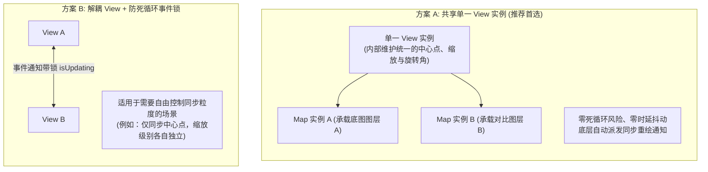

<nav aria-label="breadcrumb"><ol class="breadcrumb mb-4"><li class="breadcrumb-item"><a href="../">Home</a></li><li class="breadcrumb-item"><a href="./">Summary</a></li><li class="breadcrumb-item active" aria-current="page">分屏联动与视口同步指南</li></ol></nav>

# OpenLayers 双屏多屏分屏联动与视口状态同步实战指南
> 针对规划前后对比大屏、跨时期多屏同步对比以及指挥中心双屏联动等经典场景，系统解构共享 View 零死循环架构、独立 View 双向事件锁、十字准星指针联动以及单数据源多地图复用（Reusable Source）优化技巧。

---

## 1. 核心架构：共享 View vs 双向事件同步

在实现两个或多个地图视口联动时，很多开发者习惯在两个 Map 上各自注册 `change:center` 监听器并互相调用 `setCenter`，极易因精度舍入误差引发可怕的**事件无限震荡死循环（Event Loop Ping-Pong）**。

在 OpenLayers 的松耦合架构中，官方推荐了两种截然不同但优雅稳健的解决方案：



---

## 2. 官方示例矩阵解构

| 示例标识 | 核心实现机制 | 典型生产应用场景 |
| :--- | :--- | :--- |
| [`side-by-side`](../en/latest/examples/side-by-side.html) | 将同一个 `ol/View` 实例同时挂载至两个独立的 `ol/Map` 容器 | 街道底图与卫星遥感图双屏实时并排漫游比对 |
| [`reusable-source`](../en/latest/examples/reusable-source.html) | 单一数据源（Source）同时挂载至多个不同样式/不同投影的图层 | 共享瓦片网络请求与内存缓存，节省 50% 内存消耗 |

---

## 3. 核心实现与典型范式

### 3.1 极简优雅的共享单一 View 范式

在 `side-by-side.html` 中，展示了实现两屏或四屏 100% 绝对同步的最简实现：

```javascript
import Map from 'ol/Map';
import View from 'ol/View';
import TileLayer from 'ol/layer/Tile';
import OSM from 'ol/source/OSM';
import XYZ from 'ol/source/XYZ';

// 1. 核心关键：仅创建一个全局唯一的 View 实例
const sharedView = new View({
  center: [0, 0],
  zoom: 3,
});

// 2. 左屏地图：加载 OpenStreetMap 标准路网
const map1 = new Map({
  target: 'map1',
  layers: [new TileLayer({source: new OSM()})],
  view: sharedView, // 绑定共享视图
});

// 3. 右屏地图：加载 Esri 卫星影像
const map2 = new Map({
  target: 'map2',
  layers: [
    new TileLayer({
      source: new XYZ({
        url: 'https://server.arcgisonline.com/ArcGIS/rest/services/World_Imagery/MapServer/tile/{z}/{y}/{x}',
      }),
    }),
  ],
  view: sharedView, // 绑定完全相同的视图实例
});
```

当用户在左侧窗口缩放、在右侧窗口平移、甚至使用右键旋转地图时，底层共享的 `sharedView` 会自动同步驱动两个 Canvas 容器按完全相同的矩阵重绘，**彻底从底层根除了死循环代码**。

---

### 3.2 跨屏十字准星光标联动（Crosshair Sync）

在很多高精测绘与遥感比对大屏中，用户希望在左屏移动鼠标时，右屏能同步呈现一个跟随的准星光标：

```javascript
// 创建右屏准星覆盖物 (Overlay)
const crosshair = document.createElement('div');
crosshair.className = 'crosshair-marker';
const crosshairOverlay = new Overlay({
  element: crosshair,
  positioning: 'center-center',
  stopEvent: false,
});
map2.addOverlay(crosshairOverlay);

// 监听左屏鼠标移动，实时投影至右屏对应地理坐标
map1.on('pointermove', function (evt) {
  if (evt.dragging) return;
  const coordinate = evt.coordinate;
  crosshairOverlay.setPosition(coordinate);
});

// 移出左屏时隐藏准星
map1.getViewport().addEventListener('mouseleave', function () {
  crosshairOverlay.setPosition(undefined);
});
```

---

## 4. 生产避坑指南与性能治理

### 4.1 容器宽度/高度变化时的尺寸同步（`updateSize`）
- **现象**：在支持分屏拖拽拉伸（Split Panel）的布局中，拖动中轴分割条后，其中一个地图视口拉伸变形或出现白边。
- **根因**：OpenLayers 默认通过监听 `window.resize` 感知尺寸变化。当仅局部的 `<div>` 容器宽度变窄或变宽时，Map 内部的 Canvas 缓冲区并未更新。
- **治理法则**：在分屏拖拽手柄滑动或窗口布局切换完成时，必须显式调用：
  ```javascript
  map1.updateSize();
  map2.updateSize();
  ```

### 4.2 数据源跨图层复用（Reusable Source）内存治理
- 当两个图层或两个地图展示同一份底层矢量要素（如一个显示普通符号，另一个显示热力图），或者加载同一份瓦片服务时，**必须直接复用同一个 `source` 实例**：
  ```javascript
  const sharedSource = new VectorSource({ ... });
  const layerA = new VectorLayer({ source: sharedSource, style: styleA });
  const layerB = new VectorLayer({ source: sharedSource, style: styleB });
  ```
  这样两处只会建立一套底层空间索引，瓦片网络请求自动合并，内存占用直降 50%。
