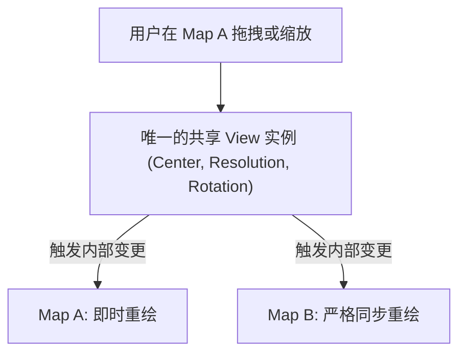

<nav aria-label="breadcrumb"><ol class="breadcrumb mb-4"><li class="breadcrumb-item"><a href="../">Home</a></li><li class="breadcrumb-item"><a href="./">Summary</a></li><li class="breadcrumb-item active" aria-current="page">多图联动与长页面交互指南</li></ol></nav>

# OpenLayers 多地图并排联动、视口同步与长页面交互全景实战指南

> 在现代数字孪生看板、遥感双屏比对大屏、以及富文本门户网站中，地图不再总是以孤立的全屏单一实例出现。
>
> 开发者经常面临复杂的布局交互挑战：
> 1. **双图/多图联动**：左屏显示矢量路网，右屏显示卫星影像，拖拽任意一侧，另一侧需毫秒级保持中心与层级完全同步；
> 2. **侧边栏与浮层遮挡**：当左侧弹出业务分析面板时，地图几何要素需要自动避开遮挡，居中在“净空可视区域”；
> 3. **DOM 容器热迁移（Teleport）**：在弹窗展开或多 Tab 切换时迁移地图 DOM，而不能重新初始化地图导致状态丢失；
> 4. **长网页滚轮冲突**：用户上下滚动浏览网页文章时，光标一旦滑过地图区域，网页滚动被劫持变成了地图缩放。
>
> 本文基于 5 个核心官方示例，系统解构多地图同步、视口动态 Padding、容器热漂移以及长页面手势冲突治理方案。

---

## 1. 架构总览：5 个多图联动与复杂交互官方示例矩阵

| 分类 | 示例标识 | 核心技术机制 | 解决的典型生产场景 |
| :--- | :--- | :--- | :--- |
| **双图并排联动** | [`side-by-side`](../en/latest/examples/side-by-side.html) | 多 `Map` 实例共享同一个 `View` 实例 | 左右分屏/四分屏对比，拖拽缩放 100% 物理级同步 |
| **视口可视内边距** | [`view-padding`](../en/latest/examples/view-padding.html) | `view.padding: [top, right, bottom, left]` | 侧边栏/底部抽屉展开时，几何图元智能锚定在有效视窗中央 |
| **容器 DOM 热迁移** | [`teleport`](../en/latest/examples/teleport.html) | `map.setTarget(domNode)` 动态切换容器 | 弹窗放大、多标签页切换无损保留切片缓存与交互状态 |
| **网页滚动解耦** | [`page-scroll`](../en/latest/examples/page-scroll.html) | `MouseWheelZoom` 条件拦截与页面滚动协同 | 博客、新闻长页面中嵌入小地图，滚轮优先滚动网页而非缩放 |
| **双指触控平移** | [`two-finger-pan-scroll`](../en/latest/examples/two-finger-pan-scroll.html) | `DragPan` 绑定双指触控手势（Two-finger pan） | 移动端移动网页上下滑动与地图拖拽完全分离 |

---

## 2. 多地图并排联动的两种架构方案（`side-by-side`）

### 2.1 方案 A：共享单个 View 实例（极简推荐）

当多个地图使用相同的坐标系与投影时，最优雅的解法是直接让两个 `Map` 实例引用同一个 `View` 对象。底层完全无需事件监听与状态中继：



```javascript
import Map from 'ol/Map.js';
import View from 'ol/View.js';
import TileLayer from 'ol/layer/Tile.js';
import OSM from 'ol/source/OSM.js';
import XYZ from 'ol/source/XYZ.js';

// 1. 创建全局唯一共享视图
const sharedView = new View({
  center: [0, 0],
  zoom: 2,
});

// 2. 左侧地图：OpenStreetMap 路网
const map1 = new Map({
  target: 'map1',
  layers: [new TileLayer({ source: new OSM() })],
  view: sharedView, // 绑定共享视图
});

// 3. 右侧地图：卫星遥感影像
const map2 = new Map({
  target: 'map2',
  layers: [
    new TileLayer({
      source: new XYZ({
        url: 'https://server.arcgisonline.com/ArcGIS/rest/services/World_Imagery/MapServer/tile/{z}/{y}/{x}',
      }),
    }),
  ],
  view: sharedView, // 绑定相同视图
});
```

### 2.2 方案 B：独立 View 事件中继与死循环规避

如果两个地图投影不同（如左图 EPSG:3857，右图 EPSG:4326），则必须创建两个独立的 `View` 并通过事件同步。

> [!CAUTION]
> 必须引入互斥锁（Flag / Mutex），否则 Map A 变更触发 Map B，Map B 变更反向触发 Map A，会陷入无限事件死循环导致浏览器卡死崩溃。

```javascript
let isSyncing = false;

viewA.on('change:center', function () {
  if (isSyncing) return;
  isSyncing = true;
  viewB.setCenter(transform(viewA.getCenter(), 'EPSG:3857', 'EPSG:4326'));
  isSyncing = false;
});
```

---

## 3. 视口内边距（View Padding）与智能中心偏置（`view-padding`）

在业务大屏或复杂 GIS 系统中，左侧通常有悬浮的资产列表（宽 400px），底部有时间轴面板（高 200px）。

若直接调用 `view.fit(extent)` 或 `view.setCenter(coord)`，要素会被左侧面板遮挡。

### 3.1 视口可视净空区数学模型

通过配置 `padding: [top, right, bottom, left]`，OpenLayers 内部会自动将逻辑中心点偏移到净空区域的几何中心：

$$\Delta x = \frac{\text{left} - \text{right}}{2}, \quad \Delta y = \frac{\text{bottom} - \text{top}}{2}$$

```javascript
const view = new View({
  center: [0, 0],
  zoom: 4,
  padding: [20, 20, 200, 420], // 预留左侧 420px 侧边栏与底部 200px 面板
});

// 当左侧面板收起时，动态更新 padding
function toggleSidebar(collapsed) {
  const leftPadding = collapsed ? 20 : 420;
  view.padding = [20, 20, 200, leftPadding];
  // 结合 fit 自动平滑平移至新中央净空区
  view.fit(selectedExtent, { duration: 500 });
}
```

---

## 4. 地图容器 DOM 热迁移（`teleport`）

在多模态页面或大屏弹窗最大化时，若销毁原地图并重新创建，会导致地图已加载的几百张瓦片重新发起网络请求，用户体验极差。

OpenLayers 允许直接在运行时更换宿主容器（DOM Re-parenting）：

```javascript
// 从常规窗口无缝“传送”至全屏模态框
function teleportMap(newContainerId) {
  map.setTarget(newContainerId);
  // 必须调用 updateSize 重新计算新容器的宽高与分辨率映射
  map.updateSize();
}
```

---

## 5. 网页滚动与长文本手势冲突治理（`page-scroll` / `two-finger-pan-scroll`）

### 5.1 网页滚轮防劫持（Page Scroll）

长页面中嵌入的小地图，最让人崩溃的是向下浏览网页时，鼠标滚轮一滑进地图，网页停止滚动而地图狂飙缩放。

**最佳解决方案**：限制 `MouseWheelZoom` 的触发条件，要求必须按住 `Ctrl` 或 `Meta` 键，或仅在点击地图激活焦点后才允许滚轮缩放：

```javascript
import { defaults as defaultInteractions, MouseWheelZoom } from 'ol/interaction.js';
import { platformModifierKeyOnly } from 'ol/events/condition.js';

const map = new Map({
  interactions: defaultInteractions({
    mouseWheelZoom: false, // 禁用默认粗暴的滚轮缩放
  }).extend([
    new MouseWheelZoom({
      condition: platformModifierKeyOnly, // 仅在按住 Ctrl (Mac 下 Cmd) 时才允许缩放地图
    }),
  ]),
});
```

### 5.2 移动端双指平移（Two-Finger Pan）

在手机端浏览长文章时，单指滑过地图继续滚动文章；唯有用户使用**两根手指**同时触碰地图时，才激活地图平移（DragPan）：

```javascript
import DragPan from 'ol/interaction/DragPan.js';

const dragPan = new DragPan({
  condition: function (event) {
    // 仅当触控点为 2 个时才允许拖拽平移地图
    return event.originalEvent.touches && event.originalEvent.touches.length === 2;
  },
});
```
