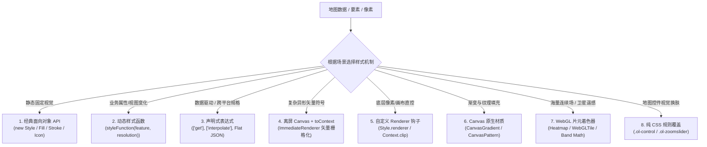

<nav aria-label="breadcrumb"><ol class="breadcrumb mb-4"><li class="breadcrumb-item"><a href="../">Home</a></li><li class="breadcrumb-item"><a href="./">Summary</a></li><li class="breadcrumb-item active" aria-current="page">Style 体系全景指南</li></ol></nav>

# OpenLayers 样式（Style）体系全景指南与实战架构精要

> 基于 27 个官方示例的场景解构、机制剖析与性能优化

---

## 引言：从视觉呈现到渲染架构

在 WebGIS 开发中，样式（Style）决定了地理数据在屏幕上的最终表现形式。随着业务复杂度的提高，样式的职责已经超出简单的颜色填充与线条描边：

- 在 2D 矢量图层中，样式需要处理要素符号化、专题制图、注记避让与交互反馈；
- 在空间分析与聚合场景中，样式需要联动凸包计算与重叠点展开；
- 在遥感与科学栅格场景中，样式深入到 GPU 片元着色器（Fragment Shader），用于执行波段代数（Band Math）、植被指数计算（NDVI）与直方图拉伸（Contrast Stretch）。

OpenLayers 支持面向对象定义、声明式表达式、离屏 Canvas 绘制和 WebGL 着色器计算等多种机制。本文结合官方示例库中带有 `style` 标签的 27 个示例，梳理 OpenLayers 样式的核心实现方式、适用场景与性能优化准则。

---

## 第一部分：全景视盘——27 个官方 Style 示例矩阵

下表将 27 个示例按技术流派与业务场景进行了分类整理：

| 分类                          | 示例标识                                                                          | 核心实现机制                                                       | 解决的典型业务场景                                                   |
| :---------------------------- | :-------------------------------------------------------------------------------- | :----------------------------------------------------------------- | :------------------------------------------------------------------- |
| **基础点位与图标标绘**        | [`icon`](../en/latest/examples/icon.html)                                         | `ol/style/Icon` 静态贴图与锚点（`anchor`）配置                     | 基础地标点位标记、点击弹窗联动                                       |
|                               | [`icon-color`](../en/latest/examples/icon-color.html)                             | `Icon.color` 动态着色通道（单色白模图片复用）                      | 报警级别着色、多状态图标着色与纹理共享                               |
|                               | [`icon-width`](../en/latest/examples/icon-width.html)                             | `Icon.width` / `height` 显式像素定宽定高                           | SVG / 异形图标自适应，解决跨端拉伸变形                               |
|                               | [`icon-scale`](../en/latest/examples/icon-scale.html)                             | `Icon.scale` 与 `Text.scale` 联动变换                              | 随缩放级别动态放大缩小的点位与注记                                   |
|                               | [`icon-negative`](../en/latest/examples/icon-negative.html)                       | 内存离屏 Canvas 像素反色滤镜运算                                   | 纯前端图像处理、暗黑模式/夜景底图图标适配                            |
|                               | [`icon-repeat`](../en/latest/examples/icon-repeat.html)                           | `Icon` 沿折线连续重复排布与切向旋转（`placement: 'line', repeat`） | 航线流动箭头、单行道导向标识、铁路线枕木沿线切向自动排版             |
| **几何轮廓与高阶矢量**        | [`line-styles`](../en/latest/examples/line-styles.html)                           | 多重 `Stroke` 复合渲染、`lineDash` 虚线、偏移描边                  | 双线道路外轮廓、铁路线斑马线、航线动态虚线                           |
|                               | [`polygon-styles`](../en/latest/examples/polygon-styles.html)                     | 复合样式数组 + 自定义 `geometry` 函数提取顶点                      | 多边形面要素填充同时绘制各顶点手柄（MultiPoint）                     |
|                               | [`regularshape`](../en/latest/examples/regularshape.html)                         | `ol/style/RegularShape` 参数化生成正多边形/星形                    | 无需切图的十字准星、五角星、三角形、X 形符号                         |
|                               | [`canvas-gradient-pattern`](../en/latest/examples/canvas-gradient-pattern.html)   | `CanvasGradient` 线性渐变 / `CanvasPattern` 纹理注入 `Fill`        | 区域填充彩虹渐变、地质斜线阴影填充、草地贴图                         |
| **专题制图与离屏绘制**        | [`kml-earthquakes`](../en/latest/examples/kml-earthquakes.html)                   | 动态 `style` 回调 + `CircleStyle` 映射震级 + 悬停 Tooltip          | 科学数据专题制图、气泡图（Bubble Map）、单点拾取                     |
|                               | [`earthquake-custom-symbol`](../en/latest/examples/earthquake-custom-symbol.html) | `toContext` 离屏绘制复杂多边形 + 包装为 `Icon` + 高分屏倍率        | 复杂异形符号动态生成（闪电、风标）、避免静态切图                     |
|                               | [`kml-timezones`](../en/latest/examples/kml-timezones.html)                       | 太阳时角计算 + 动态计算多边形 `Fill` 透明度                        | 全球时区昼夜交替光照模拟、时差动态可视化                             |
|                               | [`wind-arrows`](../en/latest/examples/wind-arrows.html)                           | `RegularShape` 组合叠加 + 动态旋转角与偏移                         | 气象风场风向风速标（风向标箭头与风翎组合）                           |
|                               | [`topojson`](../en/latest/examples/topojson.html)                                 | TopoJSON 数据拓扑共享边界与区域分级色彩填充                        | 行政区划边界轻量化传输与分级统计图（Choropleth）                     |
| **聚类降维与空间微交互**      | [`earthquake-clusters`](../en/latest/examples/earthquake-clusters.html)           | `Cluster` 数据源 + 动态分辨率统计缓存 + 鼠标悬停星形散开           | 地震点位密集聚合，悬停原地展开为真实震中五角星                       |
|                               | [`clusters-dynamic`](../en/latest/examples/clusters-dynamic.html)                 | 三图层架构（凸包层 + 聚合层 + 蛛网展开层）                         | 聚合点鼠标悬停预览凸多边形包络、同址重叠点环形蛛网展开（Spiderfier） |
| **GPU 密度与着色器连续场**    | [`heatmap-earthquakes`](../en/latest/examples/heatmap-earthquakes.html)           | `ol/layer/Heatmap` WebGL 离屏着色器累加 + 动态 weight 函数         | 地震震级权重热力图、人口密度场、高斯模糊核密度分析                   |
| **交互与量算过程态反馈**      | [`draw-features-style`](../en/latest/examples/draw-features-style.html)           | `Draw` 交互的 `style` 配置（手绘过程草图样式）                     | 绘制中虚线辅助线、吸附顶点高亮、首尾闭合指示                         |
|                               | [`measure-style`](../en/latest/examples/measure-style.html)                       | 动态样式函数中挂载分段长度与总距离 `Text` 标签                     | 空间距离与面积量算工具、实时分段标注、图纸标尺                       |
| **前沿声明式与底层扩展**      | [`style-expressions`](../en/latest/examples/style-expressions.html)               | 扁平化规则对象（JSON Array 语法树：`['get']`, `['case']`）         | WebGL 与 2D 统一的规则驱动样式、属性驱动半径/文本                    |
|                               | [`style-renderer`](../en/latest/examples/style-renderer.html)                     | `Style.renderer` 低级 Canvas 上下文自绘钩子（Clip 剪裁）           | 国旗贴图裁剪注入多边形面内、高度定制的 Canvas 特效                   |
|                               | [`animated-gif`](../en/latest/examples/animated-gif.html)                         | `postrender` 地图重绘循环 + 离屏逐帧解码 Canvas 贴图               | 雷达波纹、旋转地球、气象云图动效（GIF 逐帧播放）                     |
| **遥感影像与 WebGL 栅格样式** | [`cog-style`](../en/latest/examples/cog-style.html)                               | `WebGLTile` 波段代数计算（`['band', n]`）与 NDVI 渐变插值          | 卫星影像真彩色、标准假彩色合成、植被指数实时渲染                     |
|                               | [`cog-stretch`](../en/latest/examples/cog-stretch.html)                           | 动态多波段反射率极值百分比拉伸（Contrast Stretch）                 | 遥感遥测图像去雾、直方图拉伸增强显示                                 |
|                               | [`geozarr-stretch`](../en/latest/examples/geozarr-stretch.html)                   | 多维数组（Zarr）波段选择与对比度拉伸                               | 气象气候多维网格数据（NetCDF / Zarr）实时渲染                        |
|                               | [`webgl-tile-style`](../en/latest/examples/webgl-tile-style.html)                 | WebGLTile 动态变量（`variables`）曝光度、对比度调色                | 栅格瓦片实时色彩滤镜滤镜（夜间模式、暗黑增强）                       |
| **控件层 UI 纯 CSS 定制**     | [`zoomslider`](../en/latest/examples/zoomslider.html)                             | 纯 CSS 伪元素与 SVG 背景图重写 `ol-zoomslider`                     | 地图缩放滑块视觉换肤、适配产品 UI 设计规范                           |

---

## 第二部分：机制解构——OpenLayers 样式的八大创建与实现范式

从底层实现来看，OpenLayers 支持以下 8 种样式创建方式：



---

### 1. 经典面向对象 API（OOP Style Instances）

**对应示例**：[`icon`](https://gisnotes.github.io/openlayers/en/latest/examples/icon.html)、[`regularshape`](https://gisnotes.github.io/openlayers/en/latest/examples/regularshape.html)、[`line-styles`](https://gisnotes.github.io/openlayers/en/latest/examples/line-styles.html)、[`polygon-styles`](https://gisnotes.github.io/openlayers/en/latest/examples/polygon-styles.html)

通过组装 OpenLayers 提供的各类样式原子类构建静态样式：

```javascript
const style = new Style({
  fill: new Fill({ color: "rgba(0, 102, 204, 0.6)" }),
  stroke: new Stroke({ color: "#ffffff", width: 2, lineDash: [4, 4] }),
  image: new RegularShape({
    points: 5,
    radius: 10,
    radius2: 4,
    fill: new Fill({ color: "orange" }),
  }),
  text: new Text({ text: "标注名称", font: "12px sans-serif" }),
});
```

- **结构特点**：强类型结构清晰，适合样式固定的点线面图层。
- **复合叠加**：图层或要素可接受样式数组（`Style[]`），OpenLayers 会按顺序依次绘制。例如在 `line-styles` 中用于实现带白色外边框（Casing）的双层道路线条，或在 `polygon-styles` 中同时绘制多边形面和顶点圆点。

---

### 2. 动态样式函数（Dynamic Style Function）

**对应示例**：[`kml-earthquakes`](https://gisnotes.github.io/openlayers/en/latest/examples/kml-earthquakes.html)、[`earthquake-clusters`](https://gisnotes.github.io/openlayers/en/latest/examples/earthquake-clusters.html)、[`clusters-dynamic`](https://gisnotes.github.io/openlayers/en/latest/examples/clusters-dynamic.html)、[`measure-style`](https://gisnotes.github.io/openlayers/en/latest/examples/measure-style.html)、[`kml-timezones`](https://gisnotes.github.io/openlayers/en/latest/examples/kml-timezones.html)

当要素的视觉表现需要根据要素属性（如震级、时区）、交互状态（悬停、选中）或当前地图分辨率（`resolution`）动态改变时使用：

```javascript
function styleFunction(feature, resolution) {
  const magnitude = feature.get('magnitude');
  let style = styleCache[magnitude];
  if (!style) {
    style = new Style({ ... });
    styleCache[magnitude] = style;
  }
  return style;
}
```

- **核心价值**：支持根据数据属性与视图状态动态调整样式。
- **复合几何绑定**：样式函数返回的 `Style` 实例可通过 `geometry` 属性显式重定向几何对象。例如在 `earthquake-clusters` 选中时，聚合要素（点）返回一组样式，每个样式的 `geometry` 指向聚合包内子要素真实的震中坐标，从而实现在点击时将聚合点分散为原始位置的星形符号。

---

### 3. 声明式表达式与规则过滤（Flat JSON & Style Expressions）

**对应示例**：[`style-expressions`](https://gisnotes.github.io/openlayers/en/latest/examples/style-expressions.html)

OpenLayers 引入了扁平化的 JSON 表达式规范，支持在 2D 矢量和 WebGL 图层中使用：

```javascript
const layer = new VectorLayer({
  style: [
    {
      filter: [">", ["get", "population"], 1000000],
      style: {
        "circle-radius": [
          "interpolate",
          ["linear"],
          ["get", "population"],
          1000000,
          4,
          10000000,
          16,
        ],
        "circle-fill-color": "red",
      },
    },
    {
      else: true,
      style: {
        "circle-radius": 3,
        "circle-fill-color": "gray",
      },
    },
  ],
});
```

- **核心价值**：数据驱动，无需在 JS 中编写过程式逻辑；支持序列化传输与服务端统一下发配置，底层可直接映射为 WebGL 着色器指令。

---

### 4. 立即渲染器与离屏画布（Immediate Renderer & `toContext`）

**对应示例**：[`earthquake-custom-symbol`](https://gisnotes.github.io/openlayers/en/latest/examples/earthquake-custom-symbol.html)、[`animated-gif`](https://gisnotes.github.io/openlayers/en/latest/examples/animated-gif.html)

内置的 `RegularShape` 仅支持对称正多边形，无法直接绘制倾斜折线闪电、非对称标头等复杂矢量。如果预制静态 PNG 图片，在尺寸随属性连续变化时需要过多图片资源。
`toContext` 允许在离屏 Canvas 上将矢量几何直接栅格化为位图：

```javascript
// 1. 创建离屏画布并包装为立即渲染器
const canvas = document.createElement("canvas");
const vectorContext = toContext(canvas.getContext("2d"), {
  size: [width, height],
  pixelRatio: DEVICE_PIXEL_RATIO, // Retina 高分屏超采样
});

// 2. 复用 OpenLayers 样式与几何 API 直接绘制到离屏 Canvas
vectorContext.setStyle(new Style({ fill, stroke }));
vectorContext.drawGeometry(polygonOutline);

// 3. 将离屏 Canvas 作为 Icon 图像使用
const style = new Style({
  image: new Icon({
    img: canvas,
    scale: 1 / DEVICE_PIXEL_RATIO, // 缩回 CSS 逻辑像素，保证清晰度
  }),
});
```

- **核心价值**：兼顾矢量几何根据属性自由缩放的灵活性，以及 `Icon` 符号批量渲染的吞吐量。

---

### 5. 自定义底层 Canvas 渲染器钩子（Custom `Style.renderer`）

**对应示例**：[`style-renderer`](https://gisnotes.github.io/openlayers/en/latest/examples/style-renderer.html)

当内置几何绘制方法无法满足复杂需求（例如：使用国旗图片对国家多边形进行蒙版裁剪填充，或调用原生 Canvas 的 `shadowBlur` 模糊效果）时，可以在 `Style` 中声明 `renderer` 回调：

```javascript
const style = new Style({
  renderer: function (pixelCoordinates, state) {
    const ctx = state.context; // 原生地图 Canvas 2D 上下文
    ctx.save();
    ctx.beginPath();
    // 根据像素坐标构建路径并应用裁剪
    ...
    ctx.clip();
    ctx.drawImage(flagImage, x, y, w, h);
    ctx.restore();
  }
});
```

- **核心价值**：直接使用原生 Canvas 2D 绘图 API，支持自定义路径裁剪与像素操作。

---

### 6. 原生 Canvas 材质注入（`CanvasGradient` & `CanvasPattern`）

**对应示例**：[`canvas-gradient-pattern`](https://gisnotes.github.io/openlayers/en/latest/examples/canvas-gradient-pattern.html)

OpenLayers 的 `Fill.color` 支持直接传入浏览器的 `CanvasGradient`（渐变对象）与 `CanvasPattern`（平铺图案对象）：

```javascript
// 创建跨越屏幕物理像素宽度的线性渐变
const gradient = ctx.createLinearGradient(0, 0, 1024 * DEVICE_PIXEL_RATIO, 0);
gradient.addColorStop(0, "red");
gradient.addColorStop(1, "purple");

// 直接作为 Fill 颜色传入
const style = new Style({
  fill: new Fill({ color: gradient }),
});
```

- **核心价值**：无需额外编写渲染循环，即可在多边形填充中实现渐变色或纹理贴图。

---

### 7. WebGL 片元着色器样式（WebGLTile & Heatmap Shader）

**对应示例**：[`heatmap-earthquakes`](https://gisnotes.github.io/openlayers/en/latest/examples/heatmap-earthquakes.html)、[`cog-style`](https://gisnotes.github.io/openlayers/en/latest/examples/cog-style.html)、[`cog-stretch`](https://gisnotes.github.io/openlayers/en/latest/examples/cog-stretch.html)、[`geozarr-stretch`](https://gisnotes.github.io/openlayers/en/latest/examples/geozarr-stretch.html)、[`webgl-tile-style`](https://gisnotes.github.io/openlayers/en/latest/examples/webgl-tile-style.html)

利用 WebGL 在 GPU 中完成像素着色与计算：

- **热力图（`HeatmapLayer`）**：在 WebGL 中将点位累加到离屏纹理，根据模糊半径（`blur`）与热力半径（`radius`）进行卷积运算，最后根据色谱查找表着色。
- **遥感多波段栅格（`WebGLTile`）**：通过表达式直接在 GPU 中对像元执行波段代数运算：
  ```javascript
  const ndvi = {
    color: [
      "interpolate",
      ["linear"],
      ["/", ["-", nir, red], ["+", nir, red]], // (NIR - Red) / (NIR + Red)
      -0.2,
      [191, 191, 191],
      0.6,
      [46, 117, 34],
    ],
  };
  ```
- **核心价值**：在客户端利用 GPU 直接计算像元数据，拖动滑块调色时无需重新请求瓦片。

---

### 8. 控件与 UI 层的纯 CSS 样式定制（CSS & Control Skinning）

**对应示例**：[`zoomslider`](https://gisnotes.github.io/openlayers/en/latest/examples/zoomslider.html)

地图控件（ZoomSlider、ScaleLine、OverviewMap）使用标准 CSS 类控制外观。在 `zoomslider` 示例中，通过覆盖 `.ol-zoomslider` 和 `.ol-zoomslider-thumb` 等类选择器，可自定义滑块尺寸、背景图与滑块游标。

---

## 第三部分：实战场景大观——从业务需求看 Style 的设计模式

### 场景 1：点位标绘——单图多色复用与防畸变法则

- **颜色多态复用（`icon-color`）**：在安防监控或物联网大屏中，若只需改变图标颜色（在线/离线/报警），无需为每种状态切单独图片。可准备一张白色剪影图，使用 `new Icon({ src: 'white-pin.png', color: [255, 0, 0, 1] })` 动态混色。
- **高分屏与异形图防变形（`icon-width` & `icon-scale`）**：对于非正方形的 SVG 图标，建议显式指定 `width` 和 `height`，或配合 `scale: 1 / DEVICE_PIXEL_RATIO` 防止拉伸失真。

### 场景 2：海量点数据聚合与空间微交互

面对密集点位时，不同数据量和交互要求对应不同方案：

- **静态气泡图（`kml-earthquakes`）**：使用单个矢量图层 + 半径随震级缩放的圆圈 + 样式缓存，适合中小数据量的离散点展示。
- **连续核密度场（`heatmap-earthquakes`）**：放弃离散几何体，借助 GPU 生成连续热力场，适合宏观空间密度趋势分析。
- **三层聚合交互体系（`clusters-dynamic`）**：
  ```mermaid
  sequenceDiagram
      autonumber
      actor User as 用户交互
      participant LayerTop as 顶层: clusterCircles (蛛网展开)
      participant LayerMid as 中层: clusters (常规聚合圆/单图标)
      participant LayerBot as 底层: clusterHulls (凸包多边形)

      User->>LayerMid: 鼠标悬停 (pointermove)
      LayerMid->>LayerBot: 计算包围点最小凸多边形 (monotoneChainConvexHull)
      LayerBot-->>User: 渲染半透明浅灰色凸包多边形

      User->>LayerMid: 鼠标点击 (click)
      alt 子要素范围较广
          LayerMid-->>User: map.getView().fit(extent) 平滑缩放聚焦
      else 已达最大缩放级或同址重叠点
          LayerMid->>LayerTop: 触发 Spiderfier 蛛网算法 (generatePointsCircle)
          LayerTop-->>User: 原地以放射状圆周线缆展开各个子要素图标
      end
  ```
  该架构通过底层凸包预览、中层聚合展示、顶层同址展开，解决了点位密集压盖与下钻查看问题。

### 场景 3：科学计算与动态时空推演

- **全球昼夜光照（`kml-timezones`）**：根据当前 UTC 时间与各时区经度时角差，动态计算距当地正午的偏移量，实时更新多边形填充透明度（`opacity: 0 ~ 0.75`），模拟全球昼夜交替。
- **气象风场动向（`wind-arrows`）**：将正三角形与短线段两个 `RegularShape` 组合为风向标符号，利用 `angle` 绑定风向，`scale` 绑定风速，直观表达流体矢量。

---

## 第四部分：工程化与性能治理准则（Architecture & Performance Rules）

在样式渲染中，以下四点对性能影响较大：

### 铁律 1：享元模式与样式缓存字典（`styleCache`）

> [!IMPORTANT]
> **避免在 `styleFunction` 中重复创建 `Style` 实例。**
> 地图平移、缩放与悬停交互时，`styleFunction` 会被高频调用。若每次都重新实例化 `Style`、`Fill`、`Stroke` 或绘制 `<canvas>`，会引起内存抖动和频繁的垃圾回收。

- **属性离散化缓存**：针对震级、状态码等属性，建立 `styleCache[key]` 字典复用实例。
- **分辨率缓存**：对于需要计算屏幕像素半径的聚合图层，增加 `if (resolution !== currentResolution)` 判断，仅在缩放级别变化时重新计算。

### 铁律 2：高分屏（Retina / HiDPI）像素适配

在 Mac、4K 屏或高分移动设备上，1 个 CSS 逻辑像素对应多个物理像素（`DEVICE_PIXEL_RATIO`）。

- **离屏绘制处理步骤**（参考 `earthquake-custom-symbol`）：
  1. 调用 `toContext(ctx, { size: [w, h], pixelRatio: DEVICE_PIXEL_RATIO })`，按物理分辨率超采样绘制；
  2. 构造 `new Icon({ img: canvas, scale: 1 / DEVICE_PIXEL_RATIO })`，缩回 CSS 逻辑尺寸，保证清晰度。
- **CanvasGradient 跨度校准**：渐变坐标定义在物理像素坐标系中，终点坐标需要乘以 `DEVICE_PIXEL_RATIO`，避免渐变区域缩小。

### 铁律 3：数据预处理中的静默写入（`silent = true`）

> [!WARNING]
> 从 KML 或 GeoJSON 提取属性并写入要素时，调用 `feature.set('key', value)` 默认会触发要素的 `change` 事件并通知图层重绘。

`earthquake-custom-symbol` 中提供了标准处理方式：

```javascript
vector.getSource().on("featuresloadend", function (evt) {
  evt.features.forEach((f) => {
    // 第三个参数传入 true（silent: true），静默更新属性，不派发 change 事件
    f.set("magnitude", parseMagnitudeFromName(f.get("name")), true);
  });
});
```

在批量写入要素属性时，该参数可避免连续触发图层重绘，减少首屏加载卡顿。

### 铁律 4：标注碰撞避让（`declutter: true`）

在文本标注密集场景（如 `style-expressions` 中的地名标注），开启图层的 `declutter: true` 配置。OpenLayers 底层通过 R-Tree 空间索引在渲染阶段执行屏幕包围盒相交检测，自动隐藏冲突注记，避免文字重叠。

---

## 结语：OpenLayers 样式选型路线图

根据业务需求选择合适的样式机制：

```
面对业务需求：
│
├── 卫星遥感 / 多波段连续影像
│   └── 选用 WebGLTile + Band Math Expressions (cog-style, cog-stretch)
│
├── 海量离散点宏观密度分布
│   └── 选用 HeatmapLayer (heatmap-earthquakes)
│
├── 密集点位聚类与下钻微交互
│   └── 选用 Cluster + 多图层联动架构 (clusters-dynamic, earthquake-clusters)
│
├── 复杂异形矢量符号（闪电、特殊风标）
│   └── 选用 toContext 离屏 Canvas + styleCache 缓存 (earthquake-custom-symbol)
│
├── 常规点线面业务数据
│   ├── 规则简单/静态：面向对象 Style 实例 (icon, regularshape, line-styles)
│   ├── 属性驱动/状态变化：动态 styleFunction + styleCache 字典 (kml-earthquakes)
│   └── 规则多样/跨端规范：声明式 Style Expressions (style-expressions)
│
└── 复杂自定义效果（图片蒙版裁剪、原生粒子）
    └── 选用 Style.renderer 低级钩子直控 Canvas (style-renderer)
```

掌握这些样式机制与优化规则，有助于在视觉呈现与渲染性能之间取得平衡。

---

## 附录：27 个 Style 官方示例相对地址汇总

以下为本文所涉及的全部 27 个包含 `style` 标签的 OpenLayers 官方示例线上运行与源码地址：

1. [icon](../en/latest/examples/icon.html)
2. [icon-color](../en/latest/examples/icon-color.html)
3. [icon-width](../en/latest/examples/icon-width.html)
4. [icon-scale](../en/latest/examples/icon-scale.html)
5. [icon-negative](../en/latest/examples/icon-negative.html)
6. [line-styles](../en/latest/examples/line-styles.html)
7. [polygon-styles](../en/latest/examples/polygon-styles.html)
8. [regularshape](../en/latest/examples/regularshape.html)
9. [canvas-gradient-pattern](../en/latest/examples/canvas-gradient-pattern.html)
10. [kml-earthquakes](../en/latest/examples/kml-earthquakes.html)
11. [earthquake-custom-symbol](../en/latest/examples/earthquake-custom-symbol.html)
12. [kml-timezones](../en/latest/examples/kml-timezones.html)
13. [wind-arrows](../en/latest/examples/wind-arrows.html)
14. [topojson](../en/latest/examples/topojson.html)
15. [earthquake-clusters](../en/latest/examples/earthquake-clusters.html)
16. [clusters-dynamic](../en/latest/examples/clusters-dynamic.html)
17. [heatmap-earthquakes](../en/latest/examples/heatmap-earthquakes.html)
18. [draw-features-style](../en/latest/examples/draw-features-style.html)
19. [measure-style](../en/latest/examples/measure-style.html)
20. [style-expressions](../en/latest/examples/style-expressions.html)
21. [style-renderer](../en/latest/examples/style-renderer.html)
22. [animated-gif](../en/latest/examples/animated-gif.html)
23. [cog-style](../en/latest/examples/cog-style.html)
24. [cog-stretch](../en/latest/examples/cog-stretch.html)
25. [geozarr-stretch](../en/latest/examples/geozarr-stretch.html)
26. [webgl-tile-style](../en/latest/examples/webgl-tile-style.html)
27. [zoomslider](../en/latest/examples/zoomslider.html)
28. [icon-repeat](../en/latest/examples/icon-repeat.html)
