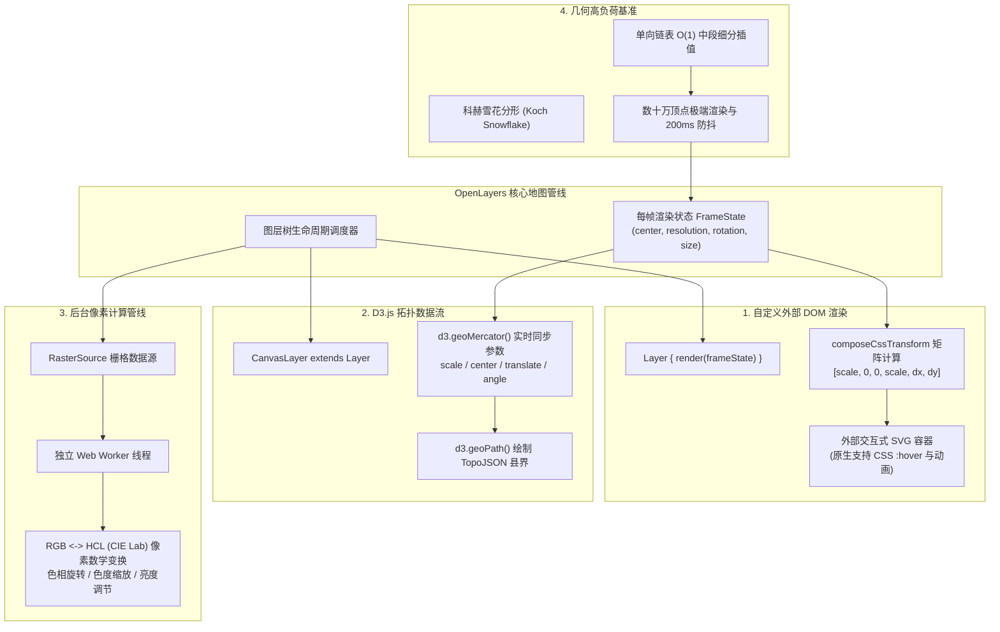
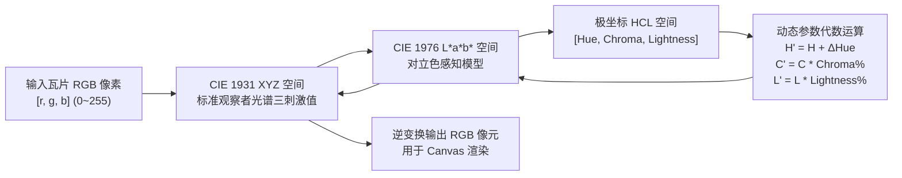

# OpenLayers 自定义图层渲染、SVG 仿射矩阵与像素色彩空间变换实战指南

> **专题标识**：`svg-canvas-transform-color`  
> **核心标签**：`svg`、`layer`、`render`、`transform`、`color`、`d3`、`fractal`  
> **涉及示例**：
> - [`svg-layer`](../examples/svg-layer.html) - 交互式 SVG 图层与仿射矩阵同步
> - [`color-manipulation`](../examples/color-manipulation.html) - 栅格像素级色彩空间变换（HCL/RGB）
> - [`d3`](../examples/d3.html) - D3.js 矢量可视化集成与投影同步
> - [`fractal`](../examples/fractal.html) - 分形几何（科赫雪花）高密度图元极限渲染

---

## 1. 架构总览：OpenLayers 开放式渲染引擎与跨生态融合

在标准的 GIS 开发范式中，开发者通常习惯于使用内置的 `TileLayer`、`VectorLayer` 或 `WebGLTileLayer`。然而，面对现代前端高度定制化的数据大屏、跨学科数据可视化（D3.js）、富交互矢量图形（SVG）以及数字图像处理（像元级色彩调和），传统的黑盒封装图层往往难以满足需求。

OpenLayers 拥有高度解耦且开放的底层渲染架构：
1. **自定义图层渲染协议 (`Layer.prototype.render`)**：开发者可以重写 `render(frameState)` 方法，直接接管视口绘制，将原生 SVG DOM 树、WebGL 画布或 D3 拓扑容器直接编排进地图渲染循环；
2. **2D 仿射变换矩阵 (`composeCssTransform`)**：将视口地理中心、分辨率、物理尺寸和旋转角度转化为标准的 6 参数矩阵，实现外部 DOM 与地理坐标的毫秒级高精度贴合；
3. **Web Worker 栅格代数计算管线 (`RasterSource`)**：脱离主线程在后台多核并行执行逐像素数学计算，实现感知均匀的 HCL 色彩空间转换；
4. **极限几何渲染抗压能力**：高效的扁平化顶点管理，轻松承载数十万顶点的分形（Fractal）与复杂拓扑渲染。



---

## 2. 核心技术对比与方案选型

| 技术方案 | 渲染宿主 / 载体 | 坐标/矩阵同步方式 | 优势与典型应用场景 | 局限与性能边界 |
| :--- | :--- | :--- | :--- | :--- |
| **标准 `VectorLayer`** | HTML5 Canvas / WebGL | OpenLayers 内部自动投影转换与 R-Tree 裁剪 | 内存占用低，支持百万级要素点位，内置拾取碰撞检测 | 无法直接使用 CSS `:hover`、动画及复杂 SVG 滤镜 |
| **自定义 SVG 图层 (`svg-layer`)** | 外部 DOM 树 (`<svg>`) | `composeCssTransform` 矩阵实时注入 `style.transform` | 完美支持 CSS `:hover` 伪类、SMIL / CSS 矢量动画、富文本排版 | 大比例缩放时 GPU 显存消耗高，要素极多时 DOM 节点过载 |
| **D3.js 融合图层 (`d3`)** | D3 动态维护的 SVG 节点 | `d3Projection.scale().center().translate()` | 完美继承 D3 丰富的统计图表、流向图及 TopoJSON 拓扑结构 | 每帧需重建 SVG `path.d` 属性，大数据量下平移会有微小延迟 |
| **`RasterSource` 像素变换** | Web Worker 离屏像素流 | 逐瓦片像素矩阵映射 | 后台多核计算，不阻塞 UI 渲染；支持感知均匀色彩调节与遥感波段代数 | 跨域图片受 CORS 严格限制；数据需在 Worker 与主线程间序列化传递 |

---

## 3. 关键机制深入剖析

### 3.1 外部 DOM 视口对齐：`composeCssTransform` 仿射矩阵数学原理

为了让外部静态的 SVG 图像或 DOM 元素能够严丝合缝地贴在地理空间上，OpenLayers 封装了 `composeCssTransform` 函数：

```javascript
// examples/svg-layer.js
import {composeCssTransform} from '../src/ol/transform.js';

const scale = svgResolution / frameState.viewState.resolution;
const center = frameState.viewState.center;
const size = frameState.size;

const cssTransform = composeCssTransform(
  size[0] / 2,                           // 视口水平中心（屏幕像素）
  size[1] / 2,                           // 视口垂直中心（屏幕像素）
  scale,                                 // X 轴缩放比例
  scale,                                 // Y 轴缩放比例
  frameState.viewState.rotation,         // 地图旋转弧度
  -center[0] / svgResolution - width / 2,// 锚点 X 偏移（SVG 像素空间）
  center[1] / svgResolution - height / 2 // 锚点 Y 偏移（SVG 像素空间）
);

svgContainer.style.transform = cssTransform;
```

#### 数学推导与变换流水线
`composeCssTransform` 输出标准 2D 矩阵 `matrix(a, b, c, d, e, f)`，其内部执行了如下复合变换：
1. **Translate to Origin**：将当前视口中心坐标转换到 SVG 图像内部的原点；
2. **Scale**：应用缩放比 $S = \text{svgResolution} / \text{resolution}$；
3. **Rotate**：绕原点旋转指定角度 $\theta$；
4. **Translate to Screen Center**：平移至屏幕画布中心 $(\text{width}/2, \text{height}/2)$。

这保证了无论用户如何自由缩放、拖拽还是双指旋转地图，SVG 矢量边界始终与地理经纬网完全重合，且内部的多边形能原生响应浏览器级的 CSS 样式与伪类选择器：
```css
/* 纯 CSS 实现国家轮廓悬停动画，无需任何 JS 监听 */
.svg-layer path:hover {
  fill: #ff5722 !important;
  stroke: #fff;
  stroke-width: 2px;
  cursor: pointer;
  transition: fill 0.2s ease-in-out;
}
```

---

### 3.2 像素级感知均匀色彩变换：HCL 色彩空间代数

在数字图像处理中，很多业务需要动态调整底图的色相、饱和度与亮度（如深色夜间模式切换、热力图强调）。

#### 为什么弃用 RGB / HSV，改用 HCL？
- **RGB**：硬件通道，红、绿、蓝对人眼的刺激亮度极度不对称（绿色感知亮度为红色的 3 倍多），调节单一通道会剧烈破坏图像层次；
- **HSV / HSL**：虽然分离了色相与饱和度，但在不同色相下感知亮度极不一致（纯黄色比纯蓝色“看起来亮得多”）；
- **HCL（基于 CIE L\*a\*b\*）**：具有**感知均匀性（Perceptual Uniformity）**。调节色相（$H$）时感知亮度（$L$）严格恒定，调节色度（$C$）时颜色纯度线性缩放。



#### 在 Web Worker 中安全执行 `RasterSource`
由于颜色空间变换涉及大量的开方（`Math.sqrt`）、三角函数（`Math.atan2`、`Math.cos`、`Math.sin`）与指数幂次运算，OpenLayers 采用多线程隔离：
```javascript
// examples/color-manipulation.js
const raster = new RasterSource({
  sources: [stamenTileSource],
  operation: function (pixels, data) {
    const hcl = rgb2hcl(pixels[0]);
    // 旋转色相
    hcl[0] += (Math.PI * data.hue) / 180;
    // 调节色度与亮度
    hcl[1] *= data.chroma / 100;
    hcl[2] *= data.lightness / 100;
    return hcl2rgb(hcl);
  },
  lib: { rgb2hcl, hcl2rgb, rgb2xyz, lab2xyz, xyz2lab, xyz2rgb, /* ...常量 */ }
});
```

---

### 3.3 D3.js 拓扑数据流深度整合

D3.js 并不依赖地图底图，但通过自定义 `CanvasLayer extends Layer`，我们可以让 D3 的地理生成器（`geoPath`）成为 OpenLayers 的图层从属：

```javascript
// examples/d3.js
class CanvasLayer extends Layer {
  render(frameState) {
    const width = frameState.size[0];
    const height = frameState.size[1];
    const projection = frameState.viewState.projection;

    // 1. 同步地理包围盒与像素包围盒比例
    const scale = r / frameState.viewState.resolution;
    const center = toLonLat(getCenter(frameState.extent), projection);
    const angle = (-frameState.viewState.rotation * 180) / Math.PI;

    // 2. 注入 D3 墨卡托投影器
    d3Projection
      .scale(scale)
      .center(center)
      .translate([width / 2, height / 2])
      .angle(angle);

    // 3. 动态重算 TopoJSON 县域路径
    d3Path(this.features);
    this.svg.attr('width', width).attr('height', height);
    this.svg.select('path').attr('d', d3Path);

    return this.svg.node();
  }
}
```

---

### 3.4 几何极限抗压测试：科赫雪花分形与单向链表优化

在对地理信息引擎进行压力测试时，通常需要构建极端复杂的几何多边形。科赫雪花（Koch Snowflake）分形具有在有限面积内包含无限周长的数学特性。

#### 数组插入 vs 单向链表性能抉择
在递归构造中，每一轮需要在线段中间插入 3 个新点：
- **普通数组（`Array.splice`）**：单次插入为 $O(N)$，全图迭代时间复杂度高达 $O(N^2)$。当顶点达到 10,000 时浏览器主线程严重假死。
- **单向链表（`coordsToGraph`）**：
  ```javascript
  // examples/fractal.js
  function injectNodes(startNode) {
    const endNode = startNode.next;
    // 常数级时间复杂度 O(1) 修改指针引用
    startNode.next = firstNode;
    firstNode.next = secondNode;
    secondNode.next = thirdNode;
    thirdNode.next = endNode;
  }
  ```
  在链表结构下，每次迭代仅需执行一次单向线性遍历，复杂度稳降至 $O(N)$，在毫秒级即可生成数十万顶点的海量几何。

---

## 4. 生产实践踩坑与性能调优指南

### 4.1 缩放时的 SVG GPU 纹理溢出
- **现象**：地图放大到 16 级以上时，SVG 容器在 Chrome/Safari 中突然变黑或整页崩溃。
- **根因**：浏览器为了给 `transform` 进行硬件加速，会尝试为巨大的 SVG 分配离屏纹理。当尺寸超过 GPU 最大纹理上限（如 $16384 \times 16384$ 像素）时显存溢出。
- **解决对策**：在图层上配置 `maxResolution`，仅在宏观与中观尺度下启用 SVG；或在大比例尺下将其转为 Canvas/切片格式。

### 4.2 栅格计算跨域资源污染（CORS Tainted Canvas）
- **现象**：`RasterSource` 抛出 `SecurityError: The operation is insecure.`。
- **解决对策**：输入瓦片源必须配置 `crossOrigin: 'anonymous'`，且切片服务端响应头中必须返回 `Access-Control-Allow-Origin: *`。

---

## 5. 总结与延伸阅读

本专题展示了 OpenLayers 的高阶扩展能力与图形学生态整合：
1. **开放式图层架构**：通过自定义 `render(frameState)` 挂载任意原生 DOM/SVG 树；
2. **精密仿射变换**：利用 `composeCssTransform` 保持外部图元与地理视口高保真贴合；
3. **后台并发像元处理**：利用 `RasterSource` 与感知均匀 HCL 模型实现平滑色彩控制；
4. **复杂几何算法优化**：结合单向链表与防抖机制高效驾驭极端海量顶点。

建议结合以下专题交叉进阶学习：
- [OpenLayers 空间几何数学、跨日界线环绕与曲线平滑实战指南](./openlayers-geometry-wrapping-smoothing-guide.html)
- [OpenLayers Canvas 视口裁剪、滤镜与图层蒙版实战指南](./openlayers-canvas-clipping-guide.html)
- [OpenLayers Web Worker 与离屏画布并发渲染指南](./openlayers-worker-offscreen-canvas-guide.html)
