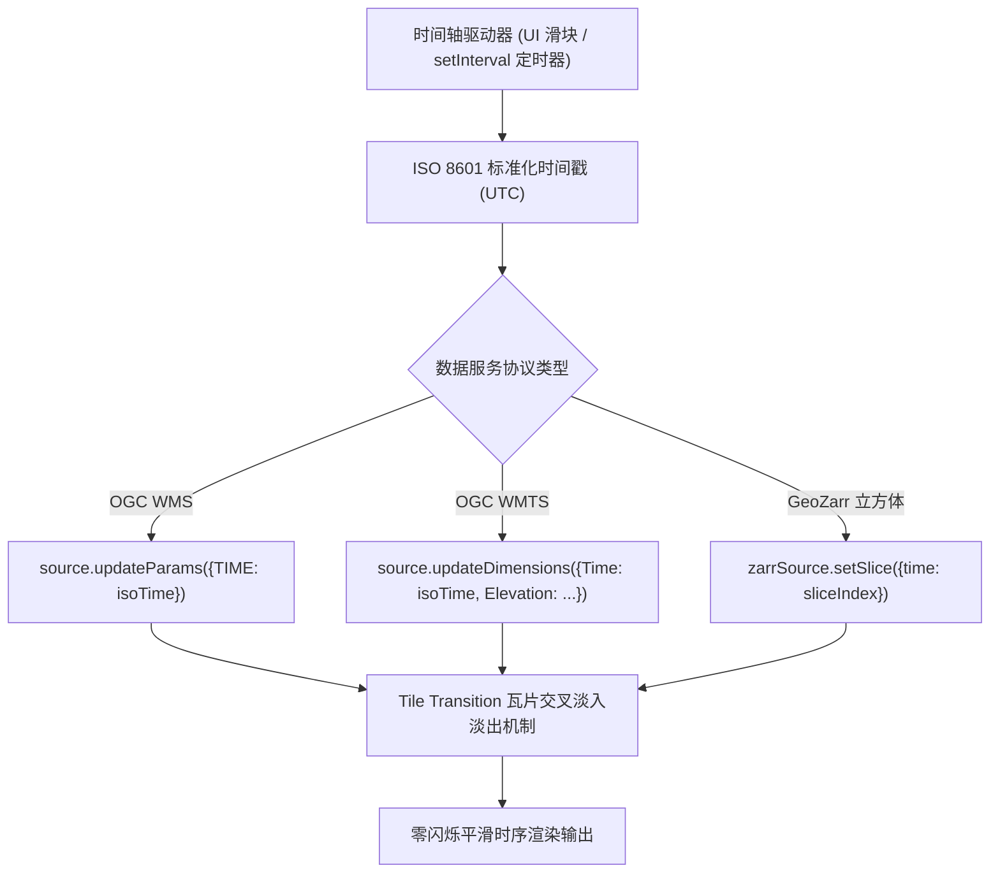

<nav aria-label="breadcrumb"><ol class="breadcrumb mb-4"><li class="breadcrumb-item"><a href="../">Home</a></li><li class="breadcrumb-item"><a href="./">Summary</a></li><li class="breadcrumb-item active" aria-current="page">时空多维分析与时序图层指南</li></ol></nav>

# OpenLayers 时空多维分析与时序动态图层全景实战指南
> 针对气象雷达回波动态播放、卫星遥感时相序列监测与海洋高程等多维科学数据，系统解构 WMS Time、WMTS Dimensions 以及 GeoZarr 时空立方体的协议对接、平滑过渡动画（Tile Transition）与双缓冲预加载技术。

---

## 1. 核心架构与多维时空数据模型

地理信息数据正在从传统的静态 2D 平面图，向包含时间轴（$T$）、高程/深度（$Z$）以及传感器波段（$B$）的 $4\text{D} / 5\text{D}$ 时空数据立方体演进。

在 OpenLayers 中，处理多维时序数据的核心链路如下图所示：



### 1.1 OGC 规范与 ISO 8601 时间格式

在 OGC WMS 与 WMTS 规范中，时序查询遵循 ISO 8601 国际标准：
- **瞬时时间点（Instant）**：`2026-10-15T12:00:00Z`
- **时间范围（Interval）**：`2026-10-01/2026-10-15/P1D`（表示从 1 号至 15 号，以 1 天为周期间隔）
- **多维组合维度**：除时间外，还常携带深度参数，例如 `&ELEVATION=-500`（海平面下 500 米海洋洋流数据）。

---

## 2. 官方示例矩阵解构

| 示例标识 | 核心技术与数据源 | 典型生产应用场景 |
| :--- | :--- | :--- |
| [`wms-time`](../en/latest/examples/wms-time.html) | `TileWMS` + `updateParams({TIME})` + 播放/暂停时间轴控制器 | 气象降雨雷达多时相连续动态播放、台风气旋轨迹回溯 |
| [`wms-time-webgl`](../en/latest/examples/wms-time-webgl.html) | `WebGLTile` + WMS 时序请求 + GPU 硬件级瓦片平滑淡入 | 超高频气象云图渲染、消除 CPU 软件渲染切换时的卡顿 |
| [`wmts-dimensions`](../en/latest/examples/wmts-dimensions.html) | `WMTS` + `updateDimensions` 动态注入时态与自定义切片矩阵参数 | 气象海洋国家标准切片服务接入、时序 WMTS 影像漫游 |
| [`geozarr-dimensions`](../en/latest/examples/geozarr-dimensions.html) | 多维科学数组（Zarr）的 `time` 轴动态切片索引提取 | 气候科学全球降水网格、洋流温跃层时序多维切片解算 |

---

## 3. 核心实现与典型范式

### 3.1 动态时序更新与零闪烁参数注入（`updateParams`）

在 `wms-time.html` 中，展示了气象 NEXRAD 动态雷达图的优雅播放方式：

```javascript
import Map from 'ol/Map';
import View from 'ol/View';
import TileLayer from 'ol/layer/Tile';
import TileWMS from 'ol/source/TileWMS';

const startDate = new Date('2026-10-15T00:00:00Z');
let currentDate = startDate;

const wmsSource = new TileWMS({
  url: 'https://mesonet.agron.iastate.edu/cgi-bin/wms/nexrad/n0r-t.cgi',
  params: {
    LAYERS: 'nexrad-n0r-wmst',
    TRANSPARENT: true,
    FORMAT: 'image/png',
    TIME: currentDate.toISOString(),
  },
  // 关键：开启 250ms 瓦片过渡动画，在新瓦片到达前保持旧瓦片不透明度
  transition: 250,
});

const radarLayer = new TileLayer({source: wmsSource});

// 时间步进控制器
function advanceTime() {
  currentDate = new Date(currentDate.getTime() + 15 * 60 * 1000); // 步进 15 分钟
  // 关键：使用 updateParams 触发增量更新，而非重新实例化数据源
  wmsSource.updateParams({TIME: currentDate.toISOString()});
  document.getElementById('time-display').innerText = currentDate.toISOString();
}

let timer = setInterval(advanceTime, 1000);
```

---

### 3.2 WMTS 自定义维度动态注入（`updateDimensions`）

在 `wmts-dimensions.html` 中，当服务为预生成的 WMTS 切片时，使用 `updateDimensions`：

```javascript
import WMTS from 'ol/source/WMTS';
import WMTSTileGrid from 'ol/tilegrid/WMTS';

const wmtsSource = new WMTS({
  url: 'https://example.com/wmts',
  layer: 'TEMPORAL_TEMPERATURE',
  matrixSet: 'EPSG:3857',
  format: 'image/png',
  dimensions: {
    Time: '2026-10-15T00:00:00Z',
    Elevation: '0',
  },
  tileGrid: tileGrid,
});

// 动态切换时间或高度
function setElevationLevel(level) {
  wmtsSource.updateDimensions({
    Elevation: level.toString(),
  });
}
```

---

## 4. 生产避坑指南与性能治理

### 4.1 严禁销毁并重建 `Source`
- **常见误区**：每次时间改变时，调用 `layer.setSource(new TileWMS(...))`。
- **灾难后果**：这会清空 OpenLayers 内部建立的瓦片缓存池与请求队列，并在每次时间变更时引发整屏白屏闪烁（Flicker），同时产生大量待垃圾回收的死对象。
- **黄金准则**：必须调用 `source.updateParams({ TIME: ... })`。OpenLayers 会保留旧瓦片作为底衬，直到新时间戳的瓦片下载并渲染完毕后执行淡入切换。

### 4.2 本地时区偏差导致的请求 404
- **现象**：在浏览器本地执行 `date.toString()` 传给后端 WMS 时，服务器频繁返回 400（Bad Request）或 404（No Data Available）。
- **根因**：多数 GIS 服务器（如 GeoServer、MapServer、THREDDS）均严格以 **UTC（零时区）** 存储时序快照，而客户端默认输出本地时区字符串（如 `GMT+0800`）。
- **防范规范**：必须统一使用 `date.toISOString()` 输出带 `Z` 结尾的标准时间字符串。

### 4.3 高速播放时的网络堆积与内存暴涨
- **治理法则**：在自动播放模式下，如果用户设置播放速率过快（如每 100ms 一帧），而网络加载单帧需要 300ms，会导致大量过期的瓦片请求堆积在浏览器并发队列中。
- **最佳实践**：监听数据源的 `tileloadend` 事件或利用“双缓冲异步队列”，保证前一帧的主要视口切片就绪后再派发下一帧时间步进。
