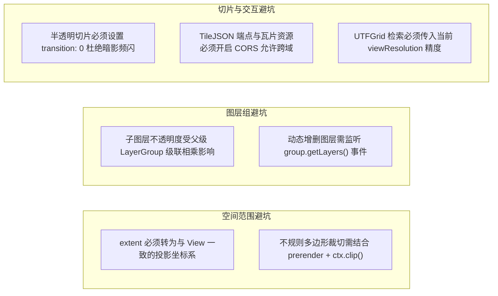

# OpenLayers TileJSON 元数据规范与多图层组织架构全景指南 (TileJSON Specification & Multi-Layer Management Architecture)

> 本指南基于 OpenLayers 官方 **tilejson** 核心专题群的代表性示例，深度解构切片地图自描述标准 TileJSON 协议规范。系统剖析 `ol/source/TileJSON` 异步元数据解析与参数自适配管道、`ol/layer/Group` 树级图层组织与双向数据绑定、`layer.setExtent()` 空间包围盒像素级裁剪、CSS 类名驱动的底图灰度滤镜与半透明切片 `transition: 0` 频闪防护，以及基于 `UTFGrid` 字符矩阵的零网络延迟离线属性交互架构。

---

## 一、TileJSON 与多图层管理全景架构 (Architectural Overview)

在现代 WebGIS 架构中，随着地图服务由单一底图向多元专题叠加演化，切片元数据规范与图层组织管理成为工程落地的中枢基石：

```mermaid
flowchart TD
    subgraph TileJSONPipeline["1. TileJSON 异步自配置管道 (TileJSON Source Pipeline)"]
        TileJSONUrl["TileJSON 清单端点 (.json)"] --> FetchManifest["异步获取元数据清单"]
        FetchManifest --> ParseConfig["自动解析切片模板 URL, 缩放区间 (min/max), bounds, attributions"]
        ParseConfig --> AutoConfig["自动生成 TileGrid 与 TileUrlFunction, 状态变更为 'ready'"]
    end

    subgraph LayerGroupTree["2. 图层树复合架构 (LayerGroup Composite Pattern)"]
        RootGroup["map.getLayerGroup()"] --> BaseLayers["底图图层 (OSM / Google / 高德)"]
        RootGroup --> SubGroup["专题图层组 (LayerGroup)"]
        SubGroup --> LayerA["专题 A: 粮食安全分布 (TileJSON)"]
        SubGroup --> LayerB["专题 B: 全球国界轮廓 (TileJSON)"]
        
        SubGroup --> CascadeRule["级联规则: 父组 setVisible(false) 全量跳过渲染"]
        SubGroup --> MultiplyOpacity["透明度相乘: Opacity = Parent * Child"]
    end

    subgraph LayerExtentRender["3. 空间范围裁剪与滤镜 (Extent Masking & Filters)"]
        SetExtent["layer.setExtent(projectedExtent)"] --> ClipMask["Canvas 硬件级 ctx.clip() 裁剪"]
        ClipMask --> NetworkSave["仅请求与包围盒相交的切片，外部网络静默"]
        LayerClass["layer.className = 'bw'"] --> CSSFilter["CSS 滤镜: filter: grayscale(100%) 灰度底衬"]
        ZeroTransition["transition: 0 彻底消除半透明切片淡入重叠暗影"]
    end

    subgraph UTFGridHitTest["4. UTFGrid 字符矩阵离线交互 (UTFGrid Hit-Testing)"]
        GridSource["ol/source/UTFGrid: 同步加载 64x64 字符矩阵切片"]
        PointerMove["鼠标悬停 pointermove (coordinate, resolution)"] --> MatrixLookup["常数时间 O(1) 字符解码与字典寻址"]
        MatrixLookup --> InstantTooltip["零网络延迟弹出国家名与 Base64 国旗浮层"]
    end
```



---

## 二、TileJSON 核心规范与异步自配置管道

在传统的瓦片切片配置中，开发者需要逐一手工配置 URL 模板、切片原点、分辨率序列与版权信息。Mapbox 发起的 TileJSON 规范将这些碎片信息标准化为一个自描述 JSON 文档。

### 1. TileJSON 元数据标准字段
一个典型的 TileJSON 响应文件包含以下关键字段：
```json
{
  "tilejson": "2.2.0",
  "name": "NaturalEarth",
  "tiles": ["https://maps.gnosis.earth/.../{z}/{x}/{y}.png"],
  "minzoom": 0,
  "maxzoom": 6,
  "bounds": [-180, -85.0511, 180, 85.0511],
  "attribution": "© Natural Earth",
  "grids": ["https://maps.gnosis.earth/.../{z}/{x}/{y}.grid.json"]
}
```

### 2. `ol/source/TileJSON` 极简初始化
在 [`examples/tilejson.html`](file:///d:/Users/Downloads/openlayers/examples/tilejson.html) 中，开发者只需提供清单 URL：
```javascript
new TileLayer({
  source: new TileJSON({
    url: 'https://maps.gnosis.earth/ogcapi/collections/.../WebMercatorQuad?f=tilejson',
    crossOrigin: 'anonymous',
  }),
});
```
OpenLayers 接收到响应后，会在内存中自动实例化适配的 `TileGrid`、注册跨域参数，并在视图缩放超出范围时自动依据元数据约束行为。

---

## 三、`ol/layer/Group` 复合树状组织与双向数据绑定

在企业级地理信息平台中，图层通常被划分为“基础底图”、“业务专题”、“监测设备”、“行政区划”等多个层级。

### 1. 复合设计模式（Composite Pattern）
[`examples/layer-group.html`](file:///d:/Users/Downloads/openlayers/examples/layer-group.html) 展现了树状图层管理：
- `LayerGroup` 继承自 `BaseLayer`，与普通 `TileLayer` 共享完全一致的属性接口；
- **级联隐显控制**：当调用 `layerGroup.setVisible(false)` 时，内部所有子图层在渲染循环中直接被跳过，无需逐一遍历修改每个子图层；
- **透明度相乘机制**：父图层组与子图层的透明度为乘法复合，即：
  $$\text{RenderOpacity} = \text{GroupOpacity} \times \text{LayerOpacity}$$

### 2. 递归深度遍历与 UI 自动绑定算法
```javascript
function setup(id, group) {
  group.getLayers().forEach(function (layer, i) {
    const layerid = id + i;
    // 绑定当前节点的可见性与透明度控件
    bindInputs(layerid, layer);
    // 遇子图层组，递归深入遍历
    if (layer instanceof LayerGroup) {
      setup(layerid, layer);
    }
  });
}
setup('#layer', map.getLayerGroup());
```
通过递归遍历 `map.getLayerGroup()`，任何层级深度的图层目录均能自动映射为前端 DOM 树中的复选框与滑动条，实现双向实时绑定。

---

## 四、图层空间包围盒裁剪与动态切换 (`Layer Extent Masking`)

特定业务图层往往只在特定国家、省份或施工红线内有效，超出边界后不应显示多余的无效内容。

[`examples/layer-extent.html`](file:///d:/Users/Downloads/openlayers/examples/layer-extent.html) 演示了图层空间边界的动态控制：

### 1. 坐标系转换与包围盒设置
图层 `extent` 属性所使用的坐标必须与当前视图的投影系统完全一致：
```javascript
// 必须将 WGS84 经纬度包围盒转为 Web 墨卡托 EPSG:3857 投影坐标
function transform(extent) {
  return transformExtent(extent, 'EPSG:4326', 'EPSG:3857');
}

const overlay = new TileLayer({
  extent: transform([68.17665, 7.96553, 97.40256, 35.49401]), // 印度国家包围盒
  source: new TileJSON({ ... }),
});

// 运行时动态更新裁剪包围盒
overlay.setExtent(newProjectedExtent);
```

### 2. 渲染机制与网络节流
OpenLayers 在准备瓦片加载队列时，会执行 `intersects(tileExtent, layerExtent)` 快速空间相交判定：
- **完全不相交的切片**：**绝不会向服务器发起网络请求**，大幅减少并发消耗与服务器负载；
- **边缘相交的切片**：下载后在当前 Canvas 上利用 `ctx.clip()` 执行硬件级物理像素矩形裁切，产生平整清晰的边界轮廓。

---

## 五、半透明图层后处理与 CSS 滤镜架构

在展现专题密度（如地震灾情、人口密度、降雨量热力图）时，常规彩色底图会干扰专题数据的色彩表现。

[`examples/semi-transparent-layer.html`](file:///d:/Users/Downloads/openlayers/examples/semi-transparent-layer.html) 给出了优雅的图底视觉解决方案：

### 1. CSS 滤镜降级底图
通过为底图图层赋予 `className: 'bw'`，配合纯 CSS：
```css
.bw {
  filter: grayscale(100%); /* 纯 CSS GPU 加速转为黑白底图 */
}
```
无需耗费 CPU 逐像素转灰度，即可将底图降级为安静的背景衬托，凸显上层彩色专题切片。

### 2. 半透明切片淡入重叠 Bug 与 `transition: 0` 根治
OpenLayers 瓦片默认带有 250ms 的淡入过渡动画（`transition: 250`）。对于包含半透明通道的专题切片，新旧切片在淡入过渡期同时半透明重叠，会导致**叠加区域颜色急剧变深、闪烁出现暗影边缘**。
> [!IMPORTANT]
> 对于任何**自身具有透明通道（Alpha）的专题切片图层**，必须显式配置 `transition: 0` 禁用淡入，保证渲染像素坚实稳定。

---

## 六、UTFGrid 字符矩阵与毫秒级客户端属性拾取

在面对数十万个行政区划多边形时，传统矢量加载极易爆内存，而服务端 `GetFeatureInfo` 交互延迟过高。

[`examples/utfgrid.html`](file:///d:/Users/Downloads/openlayers/examples/utfgrid.html) 展现了极致性能的客户端属性探测技术：

### 1. UTFGrid 数据结构解密
UTFGrid 将每个切片的多边形在服务端栅格化为一个微型 $64 \times 64$ 字符矩阵，并配以一个属性字典：
```json
{
  "grid": ["   !!!!\"\"\"\"###", "   !!!!\"\"\"\"###", ...],
  "keys": ["", "101", "102", "103"],
  "data": {
    "101": { "admin": "China", "flag_png": "iVBORw0KGgo..." },
    "102": { "admin": "Japan", "flag_png": "iVBORw0KGgo..." }
  }
}
```
字符在 UTF-8 编码中的偏移量直接对应 `keys` 中的要素索引。

### 2. $O(1)$ 常数时间坐标反查
鼠标在视口上移动时，`UTFGrid` 在浏览器本地内存中执行微秒级数学解算：
```javascript
const displayCountryInfo = function (coordinate) {
  const viewResolution = view.getResolution();
  gridSource.forDataAtCoordinateAndResolution(
    coordinate,
    viewResolution,
    function (data) {
      mapElement.style.cursor = data ? 'pointer' : '';
      if (data) {
        // 直接从内存中同步提取国名与 Base64 国旗图标，零网络往返耗时！
        flagElement.src = 'data:image/png;base64,' + data['flag_png'];
        nameElement.innerHTML = data['admin'];
      }
      infoOverlay.setPosition(data ? coordinate : undefined);
    },
  );
};

map.on('pointermove', function (evt) {
  if (evt.dragging) return;
  displayCountryInfo(map.getEventCoordinate(evt.originalEvent));
});
```

---

## 七、TileJSON 与图层管理核心示例矩阵 (Examples Matrix)

| 示例文件与链接 | 技术切入点 | 核心 API / 关键技术 | 典型业务落地场景 |
| :--- | :--- | :--- | :--- |
| [`examples/tilejson.html`](file:///d:/Users/Downloads/openlayers/examples/tilejson.html) | 切片元数据规范自适配 | `ol/source/TileJSON`, `crossOrigin` | 接入 Mapbox / Gnosis / 自建 TileServer 切片服务 |
| [`examples/layer-group.html`](file:///d:/Users/Downloads/openlayers/examples/layer-group.html) | 图层树级分层组织 | `ol/layer/Group`, 递归树遍历, 双向表单绑定 | 企业级复杂多专题图层目录树、批量分层显隐与调光 |
| [`examples/layer-extent.html`](file:///d:/Users/Downloads/openlayers/examples/layer-extent.html) | 空间范围包围盒裁剪 | `layer.setExtent()`, `transformExtent` | 施工红线边界遮罩、特定行政区划限定展现、网络请求节流 |
| [`examples/semi-transparent-layer.html`](file:///d:/Users/Downloads/openlayers/examples/semi-transparent-layer.html) | 半透明叠加与 CSS 滤镜 | `className: 'bw'`, `transition: 0` | 灾情热力图、气象降雨图、图底灰度对比度增强 |
| [`examples/utfgrid.html`](file:///d:/Users/Downloads/openlayers/examples/utfgrid.html) | 字符矩阵高频属性探测 | `ol/source/UTFGrid`, `forDataAtCoordinateAndResolution` | 全球海量多边形极速悬停提示、离线国旗与指标弹窗 |

---

## 八、生产级工程避坑指南 (Production Pitfalls Checklist)



1. **半透明切片淡入重叠引发的视觉残影**：
   在开发环境调试半透明灾情图或热力瓦片时，如果发现切片加载瞬间边缘有一层明显的黑圈或闪烁，99% 的原因是未设置 `transition: 0`。默认的 250ms 淡入机制会将旧瓦片的半透明像素与新瓦片叠加，导致过渡期 Alpha 通道异常加深。
2. **`extent` 投影未转换导致图层静默消失**：
   开发者常常误将经纬度 `[minLon, minLat, maxLon, maxLat]` 直接赋给 `layer.setExtent()`。在 Web 墨卡托投影下，数值在 $[-180, 180]$ 之间的范围被视为大西洋中心仅几百米大的微观区域，导致图层在当前国境内完全被裁切隐藏。切记通过 `transformExtent(extent, 'EPSG:4326', 'EPSG:3857')` 转换！
3. **TileJSON 跨域安全与 Canvas 污染**：
   TileJSON 数据源涉及两阶段网络请求：首先通过 AJAX 获取 JSON 元数据，其次通过图片标签加载 PNG/JPG 瓦片。如果服务端未对切片图片返回 `Access-Control-Allow-Origin: *`，且前端没有声明 `crossOrigin: 'anonymous'`，在后续截屏导出或像素拾取时将抛出严重的安全异常。
