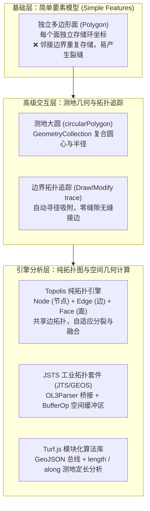
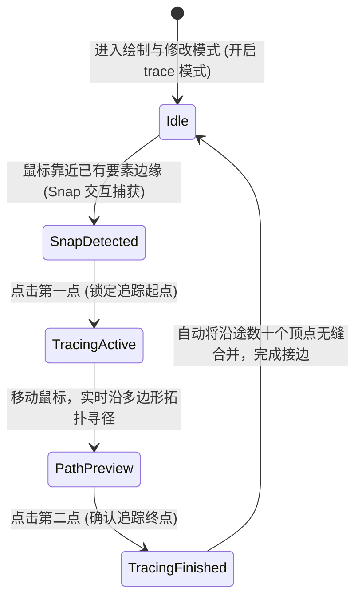

# OpenLayers 高级矢量拓扑编辑、测地几何与空间拓扑分析实战架构指南

> 在现代高阶 WebGIS 应用中，简单的“点线面打点绘制”已经远远无法满足国土测绘、地籍确权、城市规划以及网格化精细治理的业务要求：
> 1. **大圆测地几何与真实物理覆盖（Geodesic Circles）**：如何在墨卡托等角投影下绘制并交互编辑代表地球真实物理半径的大圆，并利用 `GeometryCollection` 复合几何实现圆心平移与边缘调径的协同？
> 2. **边界拓扑描摹与无缝贴合（Boundary Tracing & Snapping）**：在绘制相邻宗地时，如何避免繁琐的人工重复描点与微小缝隙（Slivers），利用 `trace` 选项实现沿邻近要素边缘的最短路径自动拓扑追踪？
> 3. **节点-边-面纯拓扑信息模型（Topolis Integration）**：如何突破“简单要素（Simple Features）”的数据冗余桎梏，通过引入 ISO 13249-3 拓扑图模型，实现多面共享公共边、动态构网与穿线删边自动合并？
> 4. **工业级空间分析扩展引擎（JSTS & Turf.js）**：面对复杂的空间缓冲区（Buffer 40m）与等间距里程桩分析（Along 200m），如何无缝桥接 JSTS（Java Topology Suite 移植版）与轻量级模块化 Turf.js？
>
> 本文基于 5 个核心官方示例（`draw-and-modify-geodesic.html`、`draw-modify-trace-snap.html`、`topolis.html`、`jsts.html`、`turf.html`），全方位解构高级拓扑编辑、测地算法与第三方空间分析引擎的深度集成架构。

---

## 1. 架构总览：从简单要素到拓扑计算引擎的演进

在地理空间信息科学中，几何处理存在由浅入深的三个层次：



### 1.1 五大核心技术方案对比

| 技术方案 / 维度 | 测地大圆编辑 | 边界拓扑追踪 | Topolis 拓扑图 | JSTS 缓冲区分析 | Turf.js 沿线定长取点 |
| :--- | :--- | :--- | :--- | :--- | :--- |
| **典型示例** | `draw-and-modify-geodesic.html` | `draw-modify-trace-snap.html` | `topolis.html` | `jsts.html` | `turf.html` |
| **核心 API / 库** | `circular`, `GeometryCollection` | `trace: true`, `traceSource` | `topolis.createTopology` | `OL3Parser`, `BufferOp` | `@turf/along`, `@turf/length` |
| **底层几何模型** | 64/128 点测地多边形集合 | LineString / Polygon | Node / Edge / Face 拓扑网 | JSTS Geometry | GeoJSON Feature |
| **核心算法** | 半正矢大圆距离 (`getDistance`) | 顶点图最短路径自动追踪 | 欧拉示性数与半边有向图 | 矢量多边形外扩骨架线算法 | 球面测地线距离累加二分插值 |
| **典型业务场景** | 导弹射程、雷达探测圈、灾害预警 | 国土宗地调查、规划地块分割 | 土地利用现状图、道路网络拓扑建模 | 道路红线退让、河流污染防护区 | 高速公路里程桩、管线巡检等间距打点 |

---

## 2. 测地大圆与复合几何交互架构（`draw-and-modify-geodesic.html`）

### 2.1 墨卡托投影下的测地大圆形变

在 Web 墨卡托投影中，直接绘制的平面圆 `ol/geom/Circle` 在图纸上是正圆，但随着纬度升高，其真实物理覆盖面积急剧缩水。
而在地球表面以固定物理半径（如 500 公里）绘制的大圆，在墨卡托投影上必然呈现为向东西两侧延展的横向椭圆形。
`Polygon.circular(center, radius, 128)` 能够在 WGS84 椭球体表面精确生成该大圆多边形。

### 2.2 `GeometryCollection` 解决 Modify 交互圆心平移

默认的 `Modify` 交互只能抓取线或面的已有顶点，无法拖动多边形的中心。
示例将测地圆多边形与中心点 `Point` 打包放入 `GeometryCollection` 中：

```javascript
// 几何集合：包含外圈大圆多边形与圆心点
const geometries = [circlePolygon, new Point(center)];
const collection = new GeometryCollection(geometries);

// Modify 交互定制逻辑：
// 1. 若拖动点与 center 重合 -> 判定为圆心平移，重新生成同半径测地圆；
// 2. 若拖动外圈顶点 -> 判定为调整半径，重新计算大圆距离更新圆环。
```

---

## 3. 边界拓扑追踪与无缝数字化（`draw-modify-trace-snap.html`）

### 3.1 什么是边界追踪（Tracing）？

在土地规划中，新建地块若与已有地块相邻，传统做法需要测绘员沿着公共边界反复点击数十次，极易产生肉眼不可见的细微重叠或拓扑空隙。
开启 `trace: true` 并指定 `traceSource` 后：
- **绘制追踪**：在目标地块边缘点击起点，再点击终点，两点之间的所有拐点自动一次性复制贴合进新要素；
- **修改追踪**：将多边形的连续两个相邻顶点吸附至目标边界，两者之间的整段曲线瞬间被拉伸并严丝合缝地重合到目标边界上。



```javascript
// 协同配置追踪与吸附
const drawInteraction = new Draw({
  source: drawVector.getSource(),
  type: 'Polygon',
  trace: true,                             // 开启追踪模式
  traceSource: baseVector.getSource(),      // 指定被追踪的目标图层
});

const snapInteraction = new Snap({
  source: baseVector.getSource(),           // 必须提供吸附源，确保第一击精确命中边缘
});
```

---

## 4. 纯拓扑数据模型集成（`topolis.html`）

### 4.1 简单要素（Simple Features）的局限与拓扑破局

| 对比维度 | 传统简单要素模型 (GeoJSON) | Topolis 拓扑数据模型 |
| :--- | :--- | :--- |
| **公共边界存储** | 相邻两个多边形各自存储一份相同坐标（冗余度 100%） | **一条 Edge 被两侧 Face 共享**，绝对唯一 |
| **边界修改联动** | 必须分别修改两个多边形的顶点，极易产生空隙 | **修改一条 Edge，两侧 Face 自动无缝联动更新** |
| **拓扑关系维护** | 需高频调用几何相交（$O(N^2)$ 计算）计算相邻关系 | **半边拓扑结构天然维护左面（leftFace）与右面（rightFace）** |

### 4.2 穿线删边与面自动合并机制

用户绘制一条新线段如果横穿某条已存在的边，拓扑引擎自动执行求交判定，调用 `topo.remEdgeNewFace(edge)` 拆除公共隔离边，并以欧拉示性数自动将原本分割的两个面合并为一个连通面。

---

## 5. JSTS 与 Turf.js 空间分析集成（`jsts.html` & `turf.html`）

### 5.1 JSTS：企业级空间缓冲区（Buffer 40m）计算

JSTS 是前端空间拓扑运算的最强基座。通过 `OL3Parser` 依赖注入，可在极短代码量内完成几何转换与缓冲区运算：

```javascript
// 1. 依赖注入 OpenLayers 几何构造器
const parser = new OL3Parser(undefined, undefined);
parser.inject(Point, LineString, LinearRing, Polygon, MultiPoint, MultiLineString, MultiPolygon);

// 2. 几何互操作与缓冲区计算
for (let i = 0; i < features.length; i++) {
  const feature = features[i];
  const jstsGeom = parser.read(feature.getGeometry()); // OL 转 JSTS
  const buffered = BufferOp.bufferOp(jstsGeom, 40);    // 计算 40 米缓冲区
  feature.setGeometry(parser.write(buffered));         // JSTS 转回 OL 并更新要素
}
```

### 5.2 Turf.js：轻量级沿线等距里程桩分析（Along 200m）

Turf.js 原生以 GeoJSON 为核心，无需加载复杂类。利用 `@turf/length` 和 `@turf/along` 实现道路里程桩的自动排布：

```javascript
const turfLine = format.writeFeatureObject(street); // 内存转 GeoJSON
const lineLength = length(turfLine, { units: 'kilometers' }); // 物理总长
const distance = 0.2; // 每 200 米

for (let i = 1; i <= lineLength / distance; i++) {
  // 沿折线测地定长截取点
  const turfPoint = along(turfLine, i * distance, { units: 'kilometers' });
  const marker = format.readFeature(turfPoint);
  marker.getGeometry().transform('EPSG:4326', 'EPSG:3857'); // 投影上屏
  source.addFeature(marker);
}
```

---

## 6. 生产实践踩坑与空间分析优化清单

1. **JSTS 缓冲区单位必须为米**：
   - 严禁在未投影的 `EPSG:4326`（度数）下调用 `BufferOp`，否则 `40` 将导致缓冲范围膨胀 40 度覆盖全球；必须先转换至 `EPSG:3857` 或当地 UTM 投影。
2. **Turf.js 测地计算必须为经纬度**：
   - 与 JSTS 相反，Turf.js 的 `length` 与 `along` 内部假定输入坐标为 WGS84 经纬度（度数）。如果误传入米制坐标，计算结果将彻底崩坏。
3. **高频绘制时的垃圾回收（GC）控制**：
   - 在大圆修改与追踪预览中，善用 `postrender` 阶段的 `VectorContext.drawGeometry()` 进行临时图元渲染，彻底避免频繁向 `VectorSource` 中 `addFeature`/`removeFeature` 引发的渲染管线重排与内存颠簸。
