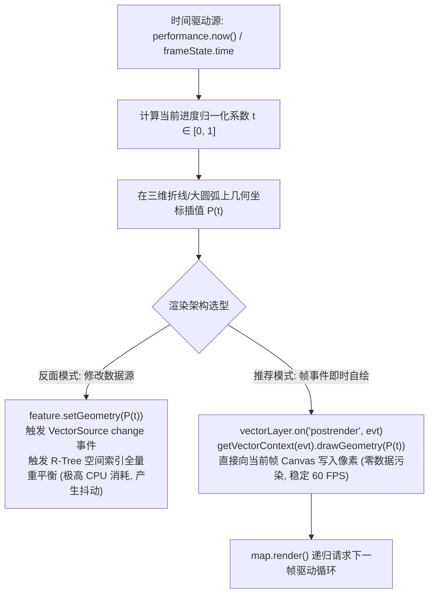

<nav aria-label="breadcrumb"><ol class="breadcrumb mb-4"><li class="breadcrumb-item"><a href="../">Home</a></li><li class="breadcrumb-item"><a href="./">Summary</a></li><li class="breadcrumb-item active" aria-current="page">空间轨迹与飞行航线动效指南</li></ol></nav>

# OpenLayers 空间轨迹插值与飞行航线动效实战指南
> 针对车辆 GPS 监控回放、民航大圆航线模拟与海量船舶时空轨迹动态流等前沿可视化需求，系统解构测地大圆弧生成（Geodesic Arc）、切向航向角（Bearing）实时解算、以及基于 `postrender` 帧循环的“零数据污染”即时渲染（Immediate Rendering）架构。

---

## 1. 核心架构与渲染循环驱动

在 WebGIS 中实现飞行航线或移动目标平滑动画，存在两条截然不同的技术路线：



### 1.1 大圆航线（Great Circle）与切向旋转角解算

在扁球体地球表面，两点之间的最短物理路径并非平面直线，而是大圆航线（Geodesic Arc）。
在插值得到当前时刻位置 $P_t(x_t, y_t)$ 与下一微小增量点 $P_{t+\Delta}(x_{t+\Delta}, y_{t+\Delta})$ 后，飞机图标的航向旋转角 $\theta$ 由反正切函数实时解算：

$$\theta = \operatorname{atan2}(y_{t+\Delta} - y_t, x_{t+\Delta} - x_t)$$

---

## 2. 官方示例矩阵解构

| 示例标识 | 核心实现与涉及模块 | 典型生产应用场景 |
| :--- | :--- | :--- |
| [`flight-animation`](../en/latest/examples/flight-animation.html) | `arc.js` 大圆弧插值 + `postrender` 即时渲染 + 动态弧形进度与粒子尾迹 | 全球国际航线动态飞线大屏、物流货运跨国干线流向呈现 |
| [`feature-move-animation`](../en/latest/examples/feature-move-animation.html) | 折线线段累计距离插值 + `getVectorContext` + 动画控制与播放速率调节 | 车队 GPS 轨迹平滑回放、巡检人员步行动线复现 |
| [`heatmap-trajectories`](../en/latest/examples/heatmap-trajectories.html) | 时空轨迹点集 + `ol/layer/Heatmap` 权重衰减与密度场计算 | 出租车历史轨迹热力分布、港口船舶航道密度场热点挖掘 |
| [`line-arrows`](../en/latest/examples/line-arrows.html) | 样式函数中利用 `geometry` 提取线段中点与切线偏角自动绘制箭头 | 单行道指示、电力水利管道流向标记、航道方向指引 |

---

## 3. 核心实现与典型范式

### 3.1 基于 `postrender` 的“零数据污染”即时渲染范式

在 `flight-animation.html` 与 `feature-move-animation.html` 中，展示了避免频繁修改 `VectorSource` 的高性能动效架构：

```javascript
import Map from 'ol/Map';
import View from 'ol/View';
import LineString from 'ol/geom/LineString';
import Point from 'ol/geom/Point';
import Feature from 'ol/Feature';
import VectorLayer from 'ol/layer/Vector';
import VectorSource from 'ol/source/Vector';
import {Style, Stroke, Icon} from 'ol/style';
import {getVectorContext} from 'ol/render';

// 1. 固定的背景航线（保存在数据源中）
const route = new LineString([
  [-11116037, 5036735],
  [-7455066, 6338219],
]);
const routeFeature = new Feature(route);
const vectorSource = new VectorSource({features: [routeFeature]});
const vectorLayer = new VectorLayer({
  source: vectorSource,
  style: new Style({stroke: new Stroke({width: 2, color: 'rgba(0,0,0,0.2)'})}),
});

// 2. 动态移动物体（飞机）的样式
const planeStyle = new Style({
  image: new Icon({
    src: 'data/airplane.png',
    rotateWithView: true,
    rotation: 0,
  }),
});

let animating = false;
let startTime = 0;
const speed = 2000; // 动画完成一次耗时 2000ms

// 关键步骤：在图层渲染后，向同一帧绘制动态目标
vectorLayer.on('postrender', function (event) {
  if (!animating) return;

  const frameState = event.frameState;
  const elapsedTime = frameState.time - startTime;
  const fraction = (elapsedTime % speed) / speed;

  // 在折线上按比例截取当前坐标
  const currentCoord = route.getCoordinateAt(fraction);
  // 提取下一微小增量点以计算飞机机头朝向角
  const nextCoord = route.getCoordinateAt(Math.min(fraction + 0.01, 1));
  const dx = nextCoord[0] - currentCoord[0];
  const dy = nextCoord[1] - currentCoord[1];
  const rotation = Math.atan2(dy, dx);

  // 动态更新飞机图标角度
  planeStyle.getImage().setRotation(-rotation);

  // 获取即时渲染上下文（Direct Immediate Render Context）
  const vectorContext = getVectorContext(event);
  vectorContext.setStyle(planeStyle);
  vectorContext.drawGeometry(new Point(currentCoord));

  // 递归通知地图继续渲染下一帧，保证动画循环流畅运行
  map.render();
});

function startAnimation() {
  animating = true;
  startTime = Date.now();
  vectorLayer.changed(); // 触发初始重绘
}
```

---

## 4. 生产避坑指南与性能治理

### 4.1 严禁在动画循环中频繁调用 `source.addFeature` / `removeFeature`
- **灾难后果**：很多初学者在每一帧执行 `movingSource.clear(); movingSource.addFeature(...)`。
- **底层根因**：OpenLayers 的 `VectorSource` 内部使用 R-Tree 空间索引树。频繁插入与移除要素会导致空间树不断执行节点分裂与平衡旋转计算，CPU 占用率飙升至 100%，并在移动设备上引发严重卡顿发热。
- **最佳实践**：采用上文所示的 `vectorLayer.on('postrender', ...)` 方案。数据源中只保留静态轨迹，动态移动要素只作为“临时绘制图形”直接写入当前 Canvas 缓冲，内存与 CPU 消耗几乎为零。

### 4.2 离开当前页面或组件销毁时的动画清理
- 如果直接使用 `requestAnimationFrame` 自主循环且未在组件卸载时取消，即使页面隐藏，后台依然会持续调度重绘。
- **防范规范**：OpenLayers 的 `map.render()` 会自动根据视口可见性进行智能节流；但在组件销毁时，仍应将 `animating = false` 并解绑 `postrender` 事件监听器，杜绝内存泄漏。
