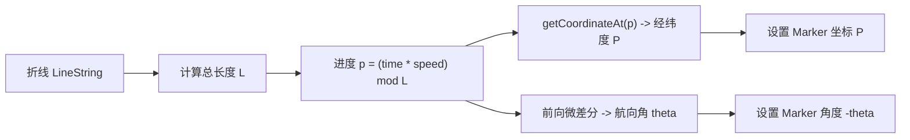

<nav aria-label="breadcrumb"><ol class="breadcrumb mb-4"><li class="breadcrumb-item"><a href="../">Home</a></li><li class="breadcrumb-item"><a href="./">Summary</a></li><li class="breadcrumb-item active" aria-current="page">轨迹漫游与动态流向指南</li></ol></nav>

# OpenLayers 轨迹漫游、要素脉冲与动态航线流向全景实战指南

> 在智慧交通、车联网监控、物流态势大屏与航空航运可视化中，**动态图元（Moving Assets）与视觉特效（Visual Effects）**是打动用户与辅助决策的核心利器。
>
> 许多初学者在实现车辆轨迹漫游或警报闪烁时，往往通过频繁调用 `feature.setGeometry()` 或 `vectorSource.clear()` + `addFeatures()`，这会在每一帧强行触发 R-Tree 空间索引重构与全量脏矩形重算，导致严重的垃圾回收（GC）卡顿与掉帧。
>
> OpenLayers 提供了基于 **`postrender` 帧生命周期钩子**与**即时渲染矢量上下文（Immediate Vector Context）**的高性能动效管线。本文基于 5 个核心官方示例，系统解构点位脉冲扩散波纹、沿线变速轨迹漫游、全球大圆航线（Great Circle）流光弧线与动态热力轨迹的实现原理。

---

## 1. 架构总览：5 个轨迹与动效核心官方示例矩阵

| 分类 | 示例标识 | 核心技术机制 | 解决的典型生产场景 |
| :--- | :--- | :--- | :--- |
| **点位脉冲波纹** | [`feature-animation`](../en/latest/examples/feature-animation.html) | `postrender` + 缓动函数驱动圆形半径与透明度衰减 | 地震烈度爆发、物联告警定位、重点目标光环波纹扩散 |
| **沿线轨迹漫游** | [`feature-move-animation`](../en/latest/examples/feature-move-animation.html) | 折线几何长度插值（LERP）+ 动态切线旋转角计算 | 巡逻车、无人机、外卖骑手沿历史路径平滑变速回放 |
| **大圆航线飞行** | [`flights`](../en/latest/examples/flights.html) | 测地线大圆弧（Arc）+ 二次贝塞尔曲线粒子流光 | 全球航线网络流向、跨境贸易海运链路、攻击链路动效 |
| **GIF 帧动效要素** | [`animated-gif`](../en/latest/examples/animated-gif.html) | GIF 单帧解析与 Canvas 图形上下文动态投射 | 天气雷达风车、动态旋转雷达扫描、卡通动态图元 |
| **动态热力演变** | [`heatmap-trajectories`](../en/latest/examples/heatmap-trajectories.html) | `HeatmapLayer` 结合时序时间窗口权重衰减 | 人群流动热力扩散、候鸟迁徙路径热度时空演进 |

---

## 2. 即时渲染管线与 60 FPS 零 GC 核心机理

### 2.1 传统模式 vs 即时渲染（Immediate Rendering）

```mermaid
flowchart TD
    subgraph 错误做法: 频繁更新要素树 (产生卡顿)
        Loop1["requestAnimationFrame 触发"] --> ModGeo["feature.setGeometry(newCoords)"]
        ModGeo --> RTree["重构 VectorSource R-Tree 空间索引"]
        RTree --> LayerRebuild["重新生成批处理 Draw Calls"]
        LayerRebuild --> GC["频繁分配几何对象触发浏览器垃圾回收 (GC)"]
    end

    subgraph 推荐架构: 即时渲染管线 (零 GC, 满帧)
        Loop2["tileLayer.on('postrender', callback)"] --> GetCtx["getVectorContext(event) 获取即时上下文"]
        GetCtx --> DrawGeom["vectorContext.drawGeometry(tempGeom)"]
        DrawGeom --> DirectBlit["直接写入主屏 Canvas, 绕过要素树与数据源"]
        DirectBlit --> MapRender["map.render() 持续驱动下一帧"]
    end
```

`getVectorContext(event)` 允许开发者在底图渲染完毕后、浏览器屏幕合成前，以纳秒级速度将临时几何体（点、圆、线）直接画在 Canvas 表面，完全不影响 `VectorSource` 的内部数据结构。

---

## 3. 点位脉冲波纹扩散动效（`feature-animation`）

### 3.1 缓动衰减数学模型

脉冲波纹通常从圆心向外扩散，半径随时间增大，而不透明度随时间单调递减：

$$R(t) = R_{\max} \cdot \text{easeOut}(t), \quad t \in [0, 1]$$
$$\alpha(t) = 1 - \text{easeOut}(t)$$

其中二次缓出函数 $\text{easeOut}(t) = 1 - (1 - t)^2$。

### 3.2 生产级脉冲代码范式

```javascript
import { getVectorContext } from 'ol/render.js';
import { easeOut } from 'ol/easing.js';
import Circle from 'ol/geom/Circle.js';
import Style from 'ol/style/Style.js';
import Stroke from 'ol/style/Stroke.js';

const duration = 3000; // 动画周期 3000ms

function flash(feature) {
  const start = Date.now();
  const flashGeom = feature.getGeometry().clone();
  const listenerKey = tileLayer.on('postrender', animate);

  function animate(event) {
    const frameState = event.frameState;
    const elapsed = frameState.time - start;
    if (elapsed >= duration) {
      unByKey(listenerKey); // 结束动画，移除监听
      return;
    }

    const vectorContext = getVectorContext(event);
    const elapsedRatio = elapsed / duration;
    // 半径从 5 像素扩展到 30 像素
    const radius = easeOut(elapsedRatio) * 25 + 5;
    const opacity = easeOut(1 - elapsedRatio);

    const style = new Style({
      stroke: new Stroke({
        color: `rgba(255, 0, 0, ${opacity})`,
        width: 0.25 + opacity,
      }),
    });

    vectorContext.setStyle(style);
    // 构造扩散同心圆并即时渲染
    vectorContext.drawGeometry(new Circle(flashGeom.getCoordinates(), radius));

    // 通知地图在下一帧继续重绘
    map.render();
  }
}
```

---

## 4. 沿折线轨迹平滑漫游与朝向角解算（`feature-move-animation`）

### 4.1 几何插值与航向角（Heading）解算数学

1. **路径长度采样**：获取整条折线总长度 $L$，根据漫游进度 $p \in [0, 1]$ 计算当前行进距离 $d = L \times p$。
2. **当前点位坐标插值**：利用 `LineString.getCoordinateAt(p)` 精确提取 $[x, y]$。
3. **切线航向角 $\theta$**：在漫游点前后取微小步长 $\Delta s$，计算切线方位角：
   $$\theta = \operatorname{atan2}(y_{t+\Delta} - y_t, x_{t+\Delta} - x_t)$$
   根据此角度动态旋转车辆或飞机的图标样式（`iconStyle.setRotation(-theta)`）。



---

## 5. 全球大圆航线飞行弧线（`flights`）

在平面投影（如 EPSG:3857）中，两个远距离城市之间的真实最短飞行路线是球面**大圆航线（Great Circle Arc）**，在地图上表现为一条向上弯曲的优美弧线。

### 5.1 贝塞尔流光飞行粒子

1. 利用经纬度插值算法生成大圆弧点集；
2. 利用二次贝塞尔曲线公式控制飞行高度弧度：
   $$B(t) = (1 - t)^2 P_0 + 2(1 - t)t P_{\text{control}} + t^2 P_1$$
3. 在航线上截取微小线段作为“飞行粒子”，并在 `postrender` 中随时间向前平移，营造航线流光效果。

---

## 6. 避坑指南与动效性能调优

### 6.1 隐藏标签页（Background Tab）能耗优化
- 当用户切换到其他浏览器标签页时，`requestAnimationFrame` 会自动降低频率或挂起。
- 严禁在动效代码中使用 `setInterval` 强行驱动地图渲染，必须始终使用 `event.frameState.time` 作为时钟基准，保证切回前台时平滑无缝衔接。

### 6.2 移动端省电与图元复用
- 严禁在 `animate` 回调内部 `new Style()` 或 `new Stroke()`。
- 将样式对象声明在外部作用域作为单例，在帧循环内部仅调用 `setColor()` 变色，避免每秒触发数千次内存垃圾回收。
