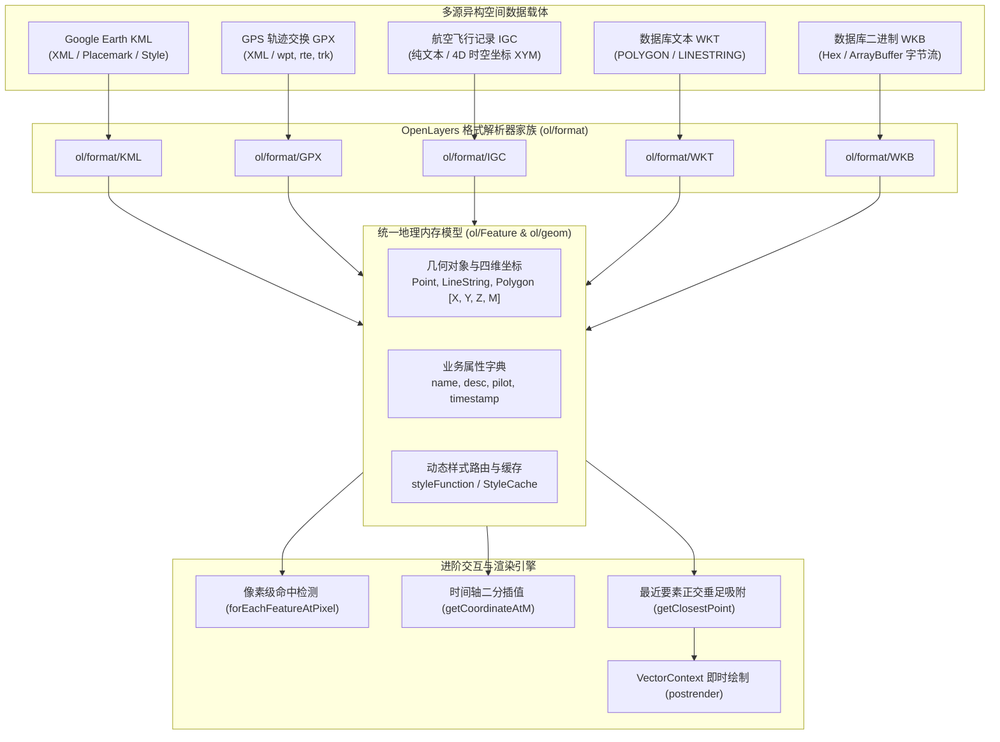
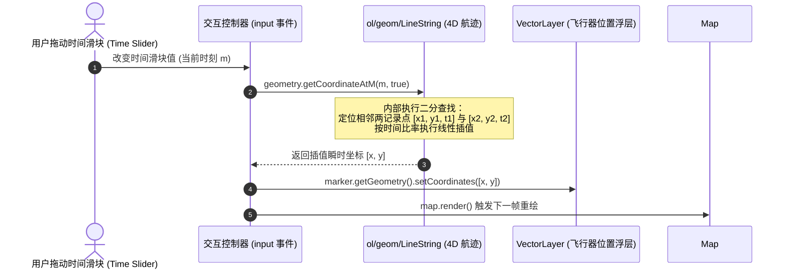

# OpenLayers 地理空间标准矢量格式解析、4D时空轨迹与 WKT/WKB 实战架构指南

> 在现代 GIS 与数字孪生平台中，后端存储的数据格式千差万别（关系型空间数据库、无人机航测、户外运动手持机、航空黑匣子、桌面 GIS 导出文件）。前端若无法高效解析并统一转化为拓扑要素，就无法进行任何空间渲染与交互：
> 1. **标绘与无人机生态（KML）**：如何通过 `ol/format/KML` 解析 Google Earth XML 树，提取内嵌样式并实现毫秒级像素命中拾取？
> 2. **运动轨迹与户外导航（GPX）**：面对同时包含航点（`wpt`）、路线（`rte`）和航迹（`trk`）的 GPX 文件，如何根据几何类型（Point / LineString / MultiLineString）进行 $O(1)$ 样式分流路由？
> 3. **4D 时空连续轨迹与吸附（IGC）**：面对记录飞行时间与高度的四维坐标（`[x, y, m]`），如何利用 `getCoordinateAtM` 在近 5 万个顶点中毫秒级二分插值实现时间轴动态回放？如何通过 `getClosestPoint` 和 `postrender` 瞬时渲染吸附引导线？
> 4. **空间数据库标准协议（WKT 与 WKB）**：PostGIS 与 MySQL Spatial 输出的 WKT 纯文本与 WKB 二进制流，如何通过 `ol/format/WKT` 与 `ol/format/WKB` 在单步反序列化中直接完成坐标投影变换？
>
> 本文基于 5 个核心官方示例（`kml.html`、`gpx.html`、`igc.html`、`wkt.html`、`wkb.html`），全面解构 OpenLayers 矢量格式解析体系、4D 轨迹回放及二进制流处理架构。

---

## 1. 架构总览：OpenLayers 矢量格式抽象矩阵

OpenLayers 设计了高度统一的 `ol/format/Feature` 抽象基类。所有标准格式解析器均遵循 `readFeatures(source, opt_options)` 与 `writeFeatures(features, opt_options)` 的双向序列化流水线：



### 1.1 五大标准矢量格式特性对比

| 格式标准 | 数据协议 | 空间维度支持 | 典型应用领域 | 核心解析器 | 核心优势与瓶颈 |
| :--- | :--- | :--- | :--- | :--- | :--- |
| **KML** | XML (OGC) | 2D / 3D (XYZ) | Google Earth、无人机飞控 | `ol/format/KML` | 可携带内嵌样式，但 XML 冗长体积庞大 |
| **GPX** | XML (通用) | 3D / 4D (XYZM) | 户外运动、Garmin 手持机、骑行 | `ol/format/GPX` | 结构语义分明，自动提取高程与时间 |
| **IGC** | 纯文本行 | 4D (XYM / 时间戳) | 滑翔机、滑翔伞越野、航空防作弊 | `ol/format/IGC` | 极度紧凑，适合数十万顶点时间序列回放 |
| **WKT** | 纯文本 (OGC) | 2D ~ 4D | PostGIS、SQL 数据库调试 | `ol/format/WKT` | 跨平台人类可读，但浮点数有转换开销 |
| **WKB** | 二进制流 (OGC)| 2D ~ 4D | PostGIS 生产推流、RPC 微服务 | `ol/format/WKB` | **体积精简 60% 以上，IEEE 754 零精度损失** |

---

## 2. KML 与 GPX：XML 结构化要素与多几何分流（`kml.html` & `gpx.html`）

### 2.1 KML 异步加载与像素拾取

在 `kml.html` 中，`VectorSource` 通过内部的 `XHR` 异步拉取 KML 文件，并调用 `KML` 解析器生成要素集合。
当用户在地图上滑动或点击时，利用 `map.forEachFeatureAtPixel()` 可以在离屏 Canvas 上执行无损命中检测：

```javascript
// 像素级要素探测与名称提取
const displayFeatureInfo = function (pixel) {
  const features = [];
  map.forEachFeatureAtPixel(pixel, (feature) => features.push(feature));

  if (features.length > 0) {
    const names = features.map((f) => f.get('name') || '(unknown)');
    document.getElementById('info').innerHTML = names.join(', ');
    map.getTargetElement().style.cursor = 'pointer';
  } else {
    document.getElementById('info').innerHTML = '&nbsp;';
    map.getTargetElement().style.cursor = '';
  }
};
```

### 2.2 GPX 多几何类型动态样式路由

GPX 文件在同一个图层中经常混合存放地标点（`<wpt>`）与连续运动轨迹（`<trkseg>`）。
直接配置固定样式无法满足点线的区分。`gpx.html` 演示了以 $O(1)$ 字典映射为核心的动态样式分流器：

```javascript
const style = {
  'Point': new Style({
    image: new CircleStyle({ fill: new Fill({ color: 'rgba(255,255,0,0.4)' }), radius: 5 }),
  }),
  'LineString': new Style({ stroke: new Stroke({ color: '#f00', width: 3 }) }),
  'MultiLineString': new Style({ stroke: new Stroke({ color: '#0f0', width: 3 }) }),
};

const vector = new VectorLayer({
  source: new VectorSource({ url: 'fells_loop.gpx', format: new GPX() }),
  // 依据几何类型分流样式
  style: (feature) => style[feature.getGeometry().getType()],
});
```

---

## 3. IGC 4D 时空轨迹、二分插值回放与垂足吸附（`igc.html`）

`igc.html` 是 OpenLayers 在处理海量时空轨迹数据领域的巅峰示例。5 条滑翔机轨迹包含了 **49,707 个带有秒级时间戳的坐标点**。

### 3.1 时间轴拖拽与 `getCoordinateAtM` 二分插值算法

在四维几何中，坐标结构为 `[x, y, m]`（$M$ 为时间戳）。
当用户拖动时间滑块时，OpenLayers 无需手动遍历成千上万个数组，而是调用 `LineString.prototype.getCoordinateAtM(m, extrapolate)`：



核心代码实现：
```javascript
control.addEventListener('input', function () {
  const value = parseInt(control.value, 10) / 100;
  const m = time.start + time.duration * value; // 计算当前时间戳
  vectorSource.forEachFeature(function (feature) {
    const geometry = feature.getGeometry();
    // 毫秒级二分插值提取瞬时经纬度坐标
    const coordinate = geometry.getCoordinateAtM(m, true);
    let highlight = feature.get('highlight');
    if (!highlight) {
      highlight = new Feature(new Point(coordinate));
      feature.set('highlight', highlight);
      featureOverlay.getSource().addFeature(highlight);
    } else {
      highlight.getGeometry().setCoordinates(coordinate);
    }
  });
  map.render();
});
```

### 3.2 空间垂足最近吸附与 VectorContext 即时渲染

鼠标在地图上移动时，系统需要实时找出离光标最近的飞行员航迹，并绘制一条吸附红线与垂足靶心：
1. **R 树快速初筛**：`vectorSource.getClosestFeatureToCoordinate(coord)`；
2. **多段线正交投影**：`geometry.getClosestPoint(coord)`，返回垂足坐标并取出该位置的通过时间；
3. **即时渲染（Immediate Rendering）**：在 `vectorLayer.on('postrender')` 中利用 `getVectorContext(evt).drawGeometry()` 直接绘制，避免频繁操作 Source 引发垃圾回收（GC）丢帧。

```javascript
vectorLayer.on('postrender', function (evt) {
  const vectorContext = getVectorContext(evt);
  vectorContext.setStyle(style);
  if (point !== null) vectorContext.drawGeometry(point);
  if (line !== null) vectorContext.drawGeometry(line);
});
```

---

## 4. WKT 与 WKB：数据库交互与二进制传输极限（`wkt.html` & `wkb.html`）

### 4.1 单步“解析 + 投影变换”流水线

无论 WKT 纯文本还是 WKB 二进制流，`ol/format` 均提供了双重投影参数配置：

```javascript
// WKT 单步解析
const formatWKT = new WKT();
const featureWKT = formatWKT.readFeature(wktString, {
  dataProjection: 'EPSG:4326',       // 数据库返回的经纬度
  featureProjection: 'EPSG:3857',    // 视口所需的 Web 墨卡托
});

// WKB 单步解析 (支持十六进制 Hex 或 Uint8Array)
const formatWKB = new WKB();
const featureWKB = formatWKB.readFeature(wkbHexOrBuffer, {
  dataProjection: 'EPSG:4326',
  featureProjection: 'EPSG:3857',
});
```

### 4.2 WKB 相比 WKT 的性能与网络优势

```mermaid
graph LR
    subgraph WKT_Flow["WKT 纯文本传输链路 (臃肿 & 精度折损)"]
        DB1["PostGIS 内存浮点数"] -->|ST_AsText 四舍五入| Str["ASCII 字符串 (体积大)"]
        Str -->|HTTP 传输 (宽带占用高)| Client1["前端字符串正则解析"]
        Client1 -->|parseFloat 精度损失| Geom1["生成 Feature"]
    end

    subgraph WKB_Flow["WKB 二进制传输链路 (极限紧凑 & 零损耗)"]
        DB2["PostGIS 内存浮点数"] -->|ST_AsBinary 内存直出| Bin["IEEE 754 字节流 (精简 60%+)"]
        Bin -->|HTTP 二进制直传| Client2["DataView 内存映射读取"]
        Client2 -->|零拷贝直接还原| Geom2["生成 Feature (绝对零精度损失)"]
    end
```

---

## 5. 生产实践踩坑与选型指南

### 5.1 矢量格式选型决策矩阵

| 业务场景 | 推荐格式 | 核心选型依据 | 避坑提醒 |
| :--- | :--- | :--- | :--- |
| **空间数据库接口 (高并发/实时)** | **WKB (二进制)** | 体积最小，反序列化性能最高，零浮点精度损失 | 前端需使用 `response.arrayBuffer()` 接收并处理大/小端字节序 |
| **调试接口 / 人机可读文本** | **WKT (文本)** | 纯文本易读，便于在 SQL 控制台排查 | 注意经纬度顺序严格为 `X(经度) Y(纬度)`，不可颠倒 |
| **无人机 / 航测 / 航线规划** | **KML** | 行业通用标准，支持自带色彩描边与标注树 | 复杂大文件关闭 `extractStyles`，防止 Style 实例暴涨 |
| **运动户外 / 车联网轨迹** | **GPX** | 携带原生海拔与时间戳，生态工具链完整 | 注意解析 `[x, y, z, m]` 多维坐标并合理过滤无效 GPS 漂移点 |
| **高频时序时空回放** | **IGC / 自定义 XYM** | 时间戳内嵌于几何点中，配合 `getCoordinateAtM` 秒级回放 | 批量要素必须使用 `styleCache` 共享样式对象单例 |
