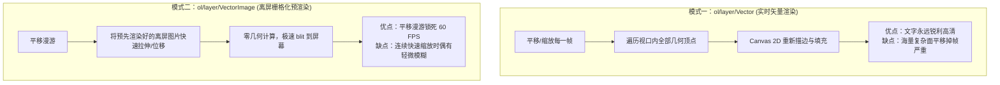

<nav aria-label="breadcrumb"><ol class="breadcrumb mb-4"><li class="breadcrumb-item"><a href="../">Home</a></li><li class="breadcrumb-item"><a href="./">Summary</a></li><li class="breadcrumb-item active" aria-current="page">矢量渲染调优与压测指南</li></ol></nav>

# OpenLayers 矢量渲染性能调优、动态数据流与海量压测实战指南

> 在物联网设备监控、大规模交通轨迹回放与高密测绘地理数据可视化中，浏览器前端往往需要承载数万至数十万个点、线、面图元的连续渲染与高频动态刷新。开发者经常面临两大性能痛点：**地图漫游平移时的卡顿掉帧**以及**高频数据流写入导致的频繁垃圾回收（GC Thrashing）**。
>
> OpenLayers 构建了分层的矢量渲染治理体系：从传统的实时几何绘制（`VectorLayer`），到预栅格化离屏缓存（`VectorImageLayer`），再到绕过 R-Tree 索引的即时渲染管线（`getVectorContext`）与切片过渡动效阻尼。本文基于 7 个核心官方示例，系统解构矢量渲染引擎的瓶颈定位、架构选型与极端压测实战。

---

## 1. 架构总览：7 个矢量性能与动态数据核心官方示例矩阵

| 分类                     | 示例标识                                                              | 核心机制 / 关键 API                        | 解决的典型生产场景                                     |
| :----------------------- | :-------------------------------------------------------------------- | :----------------------------------------- | :----------------------------------------------------- |
| **离屏缓存栅格化**       | [`image-vector-layer`](../en/latest/examples/image-vector-layer.html) | `ol/layer/VectorImage` 预渲染视口图片      | 复杂多边形海量图层在平移漫游时实现稳健 60 FPS          |
| **高频动态数据流**       | [`dynamic-data`](../en/latest/examples/dynamic-data.html)             | `postrender` 动画循环 + `getVectorContext` | 绕过 VectorSource 索引重构开销，毫秒级更新复杂数学动效 |
| **海量折线性能压测**     | [`synthetic-lines`](../en/latest/examples/synthetic-lines.html)       | 批量合成数万条折线 + 共享样式对象单例      | 评估客户端在复杂线网（如电网、航线）压力下的渲染极限   |
| **海量离散点压测**       | [`synthetic-points`](../en/latest/examples/synthetic-points.html)     | 50,000+ 离散点 + 即时渲染帧驱动            | 超大规模点要素群（如浮标、共享单车）高吞吐渲染         |
| **属性数据驱动插值**     | [`populated-places`](../en/latest/examples/populated-places.html)     | 属性线性插值 + 空间密度自适应着色          | 全球百万级城市聚落属性映射与视觉梯度展示               |
| **数据源无缝重用**       | [`reusable-source`](../en/latest/examples/reusable-source.html)       | `source.setUrl()` 平滑动态切换             | 动态图层切片源切换时避免白屏闪烁与内存泄露             |
| **切片过渡与透明度阻尼** | [`tile-transitions`](../en/latest/examples/tile-transitions.html)     | `transition` 参数控制切片加载渐显          | 改善网络抖动下瓦片骤现的突兀感，提升视觉舒适度         |

---

## 2. 渲染模式决战：`VectorLayer` vs `VectorImageLayer`



### 2.1 典型选型代码范式（`image-vector-layer`）

当要素数量极大（如全国 3000 个行政区划复杂多边形）时，替换为 `VectorImageLayer` 可获得立竿见影的流畅度提升：

```javascript
import VectorImageLayer from "ol/layer/VectorImage";
import VectorSource from "ol/source/Vector";
import GeoJSON from "ol/format/GeoJSON";

const vectorImageLayer = new VectorImageLayer({
  imageRatio: 2, // 预渲染超出当前视口 2 倍范围的图像，预留平移缓冲
  source: new VectorSource({
    url: "data/geojson/countries.geojson",
    format: new GeoJSON(),
  }),
  style: countryStyle,
});
```

---

## 3. 高频数据流渲染：绕过 R-Tree 的零 GC 策略（`dynamic-data`）

### 3.1 为什么高频更新不能调用 `source.addFeature()`？

在 OpenLayers 中，每个 `VectorSource` 内部维护了一棵用于空间加速查找的 **R-Tree（R 树索引）**。

- 如果每秒 60 次清空并重新 `addFeature()`，会导致 R 树不断经历“销毁 -> 内存重新分配 -> 平衡调整”的过程，产生海量临时对象，直接引发浏览器垃圾回收器（GC）暂停，产生肉眼可见的顿挫。

### 3.2 `getVectorContext` 即时渲染优化范式

在 `postrender` 监听器中使用 `getVectorContext(event)` 直接向当前帧 Canvas 写入几何体，零 R-Tree 开销：

```javascript
import { getVectorContext } from "ol/render";
import Point from "ol/geom/Point";

// 单例几何与样式对象，全生命周期绝不重新 new
const dynamicPoint = new Point([0, 0]);

baseLayer.on("postrender", (event) => {
  const vectorContext = getVectorContext(event);

  // 1. 数学函数实时计算当前时间戳下的坐标
  const time = event.frameState.time;
  const newCoord = calculateTrajectory(time);
  dynamicPoint.setCoordinates(newCoord);

  // 2. 直接光栅化绘制，完全不进 VectorSource
  vectorContext.setStyle(sharedDotStyle);
  vectorContext.drawGeometry(dynamicPoint);

  // 3. 请求下一帧连续重绘
  map.render();
});
```

---

## 4. 极端海量图元压测实战（`synthetic-lines` & `synthetic-points`）

在压测 50,000+ 个离散点或折线段时，官方示例展现了两大核心原则：

### 4.1 样式单例化与批处理合并

严禁在样式函数内针对每个要素执行 `new Style()`。整个图层必须共享预先创建好的单例样式数组，使底层的批处理机制（Batch Renderer）能够一次性提交所有顶点的 WebGL / Canvas 上下文调用。

### 4.2 数据驱动空间插值（`populated-places`）

```javascript
// 基于城市人口属性执行平滑线性插值推导渲染半径
function getRadiusByPopulation(population) {
  // 插值公式：R = 3 + Math.sqrt(population / 10000)
  return Math.max(3, Math.min(25, 3 + Math.sqrt(population / 10000)));
}
```

---

## 5. 切片平滑更新与渐显阻尼（`reusable-source` & `tile-transitions`）

在动态切换图层数据源 URL 时，直接销毁图层重建会引发白屏。

1. **`source.setUrl(newUrl)`**：OpenLayers 内部会自动保留旧切片显示，直至新 URL 的切片下载并完成解码，实现零闪烁无缝平滑替换；
2. **`transition: 250`**：在 `ol/layer/Tile` 中配置过渡时间（毫秒），通过 Alpha 透明度渐显机制消除网络抖动带来的生硬感。

---

## 附录：7 个官方矢量性能与动态数据核心示例直达索引

1. [`image-vector-layer`](../en/latest/examples/image-vector-layer.html) &mdash; VectorImageLayer 预栅格化图层：复杂矢量离屏缓存极速漫游
2. [`dynamic-data`](../en/latest/examples/dynamic-data.html) &mdash; 动态高频数据流与内旋轮线动效（postrender 驱动）
3. [`synthetic-lines`](../en/latest/examples/synthetic-lines.html) &mdash; 海量合成折线图元渲染性能压测与批处理优化
4. [`synthetic-points`](../en/latest/examples/synthetic-points.html) &mdash; 海量合成离散点图元压测与即时渲染动画
5. [`populated-places`](../en/latest/examples/populated-places.html) &mdash; 全球人口聚落分布：数据驱动样式与属性空间插值
6. [`reusable-source`](../en/latest/examples/reusable-source.html) &mdash; 瓦片数据源 URL 动态更新与平滑无缝切换
7. [`tile-transitions`](../en/latest/examples/tile-transitions.html) &mdash; 切片加载不透明度渐变过渡动效与视觉阻尼
