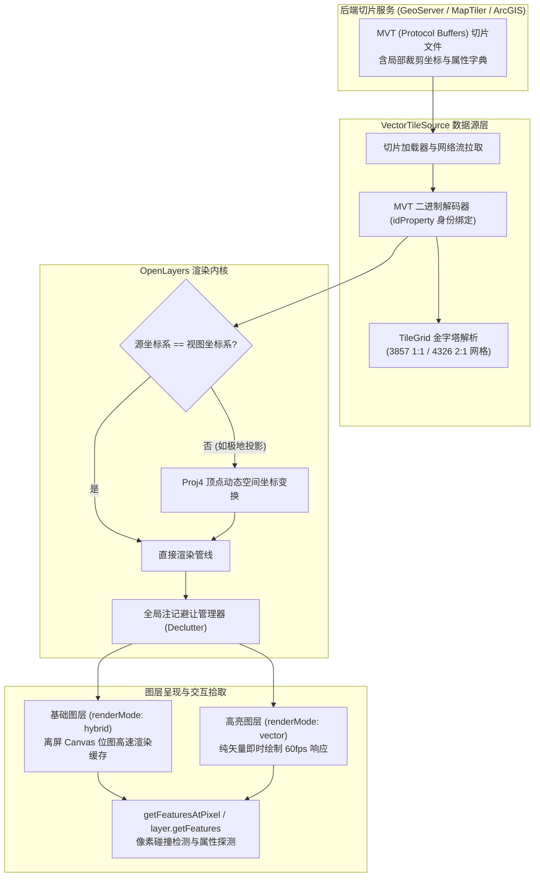
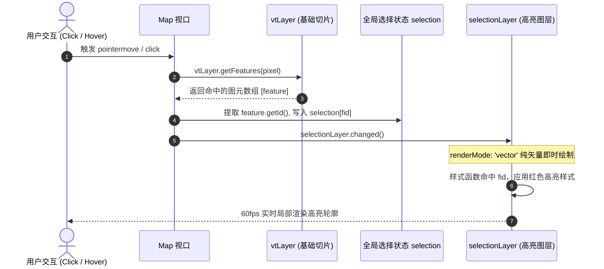

# OpenLayers 矢量切片高级架构、交互拾取与跨坐标系重投影实战指南

> **专题标识**：`vector-tiles-grid-reprojected`  
> **核心标签**：`vector tiles`、`grid`、`reprojection`、`epsg4326`、`selection`、`tms`  
> **涉及示例**：
> - [`vector-tile-info`](../examples/vector-tile-info.html) - 矢量切片要素属性交互探测
> - [`vector-tile-selection`](../examples/vector-tile-selection.html) - 矢量切片要素交互拾取与高亮 (Single/Multi/Hover)
> - [`vector-tiles-4326`](../examples/vector-tiles-4326.html) - EPSG:4326 地理坐标系矢量切片与 Mapbox Style
> - [`vector-tiles-reprojected`](../examples/vector-tiles-reprojected.html) - 矢量切片客户端动态重投影 (极地等面积方位投影)
> - [`canvas-tiles-tms`](../examples/canvas-tiles-tms.html) - 自定义 Canvas 切片与 TMS 坐标网格调试

---

## 1. 架构总览：新一代矢量切片运行机制

随着高分辨率显示设备与 Web 空间分析需求的普及，基于 Protocol Buffers 二进制流的 **Mapbox 矢量切片（MVT/PBF）** 已成为现代 WebGIS 的事实标准。传统栅格切片（PNG/JPEG）将图元栅格化为死板的像元矩阵，丢失了全部图元拓扑、属性字典与样式自适应能力；而矢量切片将点、线、面矢量坐标及键值对属性编码进网格化的金字塔中，交由前端浏览器执行动态着色、注记布局与交互探测。

OpenLayers 拥有业界最成熟、可扩展性最高的矢量切片（`VectorTileLayer` + `VectorTileSource`）架构。它不仅完美支持标准 Web 墨卡托（EPSG:3857），更支持**非墨卡托原生切片（EPSG:4326 等经纬度网格）**、**任意异构坐标系下的客户端矢量实时重投影（如北极极地投影 ESRI:102017）**、**TMS/XYZ 坐标翻转调试** 以及 **毫秒级跨切片要素统一高亮（Selection）**。



---

## 2. 核心技术对比与方案选型

| 评估维度 | 传统栅格切片 (TileLayer) | 默认矢量切片 (`renderMode: 'hybrid'`) | 纯矢量高亮切片 (`renderMode: 'vector'`) | 传统矢量图层 (`VectorLayer`) |
| :--- | :--- | :--- | :--- | :--- |
| **数据载荷** | 压缩位图 (PNG/JPEG/WebP) | 压缩二进制 (MVT/PBF) | 压缩二进制 (MVT/PBF) | 纯文本/JSON (GeoJSON/WFS) |
| **内存与渲染方式** | 显存/内存位图贴图 | 离屏 Canvas 位图栅格化缓存 | 视口逐帧纯矢量 Path 绘制 | 全量 DOM/Canvas 几何对象树 |
| **属性探测机制** | 需向后端请求 WMS `GetFeatureInfo` | 客户端本地直接读取 `getProperties()` | 客户端本地直接读取 `getProperties()` | 客户端直接读取 `getProperties()` |
| **高频重绘性能** | 极快（仅平移贴图） | 瓦片重栅格化开销大（约 15~30fps） | 局部图元即时重绘（稳居 60fps） | 要素量大时 CPU/GC 瓶颈明显 |
| **样式动态定制** | 不支持（需后端重绘发图） | 支持（通过 JS 样式函数或 Mapbox Style） | 支持（通过高亮过滤样式函数） | 完全支持自由重设样式 |
| **重投影表现** | 栅格变形，边缘与文字发虚 | 顶点精确重投影，边缘极致锐利 | 顶点精确重投影，边缘极致锐利 | 顶点重投影，数据量大时耗时长 |

---

## 3. 核心机制深入剖析

### 3.1 属性实时拾取：`getFeaturesAtPixel` vs `layer.getFeatures`

在矢量切片中探测鼠标悬停或点击的要素，OpenLayers 提供了两种主流途径：

#### 途径一：`map.getFeaturesAtPixel(pixel, [options])`（同步检索）
```javascript
// examples/vector-tile-info.js
map.on('pointermove', (evt) => {
  if (evt.dragging) return; // 平移过程中中断探测，提升性能
  
  const features = map.getFeaturesAtPixel(evt.pixel);
  if (features.length > 0) {
    const props = features[0].getProperties();
    console.log('要素属性字典:', props);
  }
});
```
- **工作机制**：同步遍历当前渲染在 Canvas 上的图元碰撞体。
- **优点**：代码直观简单，天然受图层层级（Z-Index）与可见性影响。
- **局限**：在切片正在加载重绘的交界期，可能受栅格缓存影响。

#### 途径二：`layer.getFeatures(pixel)`（异步 Promise 检索）
```javascript
// examples/vector-tile-selection.js
vtLayer.getFeatures(event.pixel).then((features) => {
  if (!features.length) {
    selection = {};
    selectionLayer.changed();
    return;
  }
  const feature = features[0];
  const fid = feature.getId(); // 基于唯一业务主键
  selection[fid] = feature;
  selectionLayer.changed();
});
```
- **工作机制**：直接穿透到底层 `VectorTileSource` 的瓦片图元树，以 Promise 异步返回精确要素。
- **优点**：能够精准锁定特定图层，并在内部多级 Tile 缓存中完成精细拓扑匹配。

---

### 3.2 跨瓦片接缝消除：`idProperty` 与双图层高亮架构

在矢量切片生产过程中，跨越瓦片分界线的多边形会被切成多个子多边形分别封入不同的 PBF 文件中。若直接高亮某个切片中的要素，会导致**只高亮了多边形的一半**。

#### 解决方案：全局唯一标识提取
```javascript
source: new VectorTileSource({
  format: new MVT({
    idProperty: 'iso_a3', // 将属性中的 ISO 3 字代码提取为 feature.getId()
  }),
  url: 'https://.../{z}/{x}/{-y}.pbf',
})
```
当配置了 `idProperty` 后，各切片中解出的子图元都拥有相同的 `feature.getId() === 'CHN'`。

#### 双图层覆盖模式（Base Layer + Selection Layer）
为实现极致的高亮交互性能，避免修改底图切片导致全图重栅格化：
1. **底图图层**：负责底图背景与全部多边形的常规绘制。
2. **高亮图层**：共享底图数据源 `source: vtLayer.getSource()`，自身不发任何网络请求；配置 `renderMode: 'vector'`，样式函数只匹配 `feature.getId() in selection` 的图元。



---

### 3.3 EPSG:4326 原生矢量切片与 Mapbox 样式集成

绝大多数在线地图切片基于 Web 墨卡托（EPSG:3857，范围为 1:1 正方形）。而在气象、水文、高精度测绘及非墨卡托项目中，数据源往往是原生的等经纬度网格（EPSG:4326，经度 360°、纬度 180°，长宽比 2:1）。

OpenLayers 通过 `createXYZ` 精准定制 4326 的切片分辨率金字塔：
```javascript
// examples/vector-tiles-4326.js
const tileGrid = createXYZ({
  extent: [-180, -90, 180, 90], // 全球经纬度范围
  tileSize: 512,                // 512 像素大瓦片
  maxResolution: 180 / 512,      // Zoom 0 分辨率：180度 / 512像素 = 0.3515625
  maxZoom: 13,
});

const layer = new VectorTileLayer({
  declutter: true,
  source: new VectorTileSource({
    projection: 'EPSG:4326',
    tileGrid: tileGrid,
  }),
});

// 使用 ol-mapbox-style 渲染样式，必须传入切片网格 resolutions
applyStyle(layer, styleJsonUrl, {resolutions: tileGrid.getResolutions()});
applyBackground(layer, styleJsonUrl);
```

> [!IMPORTANT]
> **Mapbox 样式的 Zoom 与 Resolution 映射**：  
> Mapbox Style 规范基于 3857 的 Zoom 级别定义线宽和字号。在 4326 切片中，由于每度代表的物理距离随纬度变化，必须通过 `{resolutions: tileGrid.getResolutions()}` 将切片网格的实际分辨率映射表注入 `applyStyle`，否则样式规则的断点（Stop）计算将严重漂移。

---

### 3.4 极地与异构坐标系下的客户端矢量实时重投影

Web 墨卡托投影在南北纬 85° 以上区域形变趋于无穷大，导致北极航道、格陵兰岛或南极洲在 3857 切片中直接被截断或严重扭曲。

利用 OpenLayers 的矢量重投影引擎，我们可以拉取 **EPSG:4326 矢量切片**，并在客户端直接将其重投影到 **北极朗伯等面积方位投影（ESRI:102017）** 呈现：

```javascript
// examples/vector-tiles-reprojected.js
// 1. 注册 Proj4 极地等面积方位投影定义
proj4.defs(
  'ESRI:102017',
  '+proj=laea +lat_0=90 +lon_0=0 +x_0=0 +y_0=0 +datum=WGS84 +units=m +no_defs +type=crs'
);
register(proj4);

// 2. 矢量切片源维持 EPSG:4326
const layer = new VectorTileLayer({
  source: new VectorTileSource({
    projection: 'EPSG:4326',
    tileGrid: tileGrid4326,
  }),
});

// 3. 地图 View 采用 ESRI:102017 极地投影
const map = new Map({
  target: 'map',
  layers: [layer],
  view: new View({
    projection: 'ESRI:102017',
    center: fromLonLat([0, 90], 'ESRI:102017'), // 以北极点为中心
    zoom: 4,
  }),
});
```

#### 为什么矢量切片重投影完胜栅格切片重投影？
- **无重采样模糊**：栅格重投影是将正方形像素拉伸成梯形并插值，文字和细线会严重模糊；矢量切片重投影直接对几何顶点调用数学坐标转换公式，重投影后文字依然是水平/沿线清晰排版，线条边缘保持原生 1 像素物理锐度。
- **无接缝撕裂**：切片生产时带有微小像素缓冲（Buffer），OpenLayers 在目标投影像素空间下直接拼接多边形，渲染无缝无裂纹。

---

### 3.5 TMS 与 XYZ 坐标系排错调试：`TileDebug`

在加载切片服务时，经常会遇到“整图全白”、“切片返回 404”或“南北半球颠倒”的现象，这通常是由于 **TMS（Tile Map Service）** 与 **XYZ** 坐标系的 Y 轴定义差异导致的：

```
XYZ / WMTS 规范 (Top-Left 原点):
Y=0 位于最北端 (+85.05°)，向南逐渐增大：Y -> 最大

TMS 规范 (Bottom-Left 原点):
Y=0 位于最南端 (-85.05°)，向北逐渐增大：Y -> 最大
```

OpenLayers 在 URL 模板中通过 `{-y}` 占位符自动执行 TMS 行号翻转：
$$\{-y\} = 2^z - 1 - y$$

#### 借助 `TileDebug` 实时显化切片行号与网格
```javascript
// examples/canvas-tiles-tms.js
const debugLayer = new TileLayer({
  source: new TileDebug({
    template: 'z:{z} x:{x} y:{-y}',               // 打印实际向后端请求的 TMS 行号
    projection: vtLayer.getSource().getProjection(), // 对齐投影
    tileGrid: vtLayer.getSource().getTileGrid(),     // 严格继承切片网格
    zDirection: 1,                                  // 优先选择高分辨率切片匹配
  }),
});
```
在界面上开启该图层后，视口内每个瓦片中心都会显示黑框与编号，如 `z:4 x:8 y:10`。开发者可在浏览器 Network 面板中对照实际请求的 URL，若瓦片编号一致且能命中数据，即可迅速定位是投影偏移、TileGrid 错位还是 Y 轴未翻转。

---

## 4. 生产实践踩坑与工程避坑指南

### 4.1 避让机制（Declutter）与多切片重复文本
- **现象**：一个大型国家（如加拿大、俄罗斯）横跨 10 多个瓦片，地图缩放时到处都出现重复的国家名称标签。
- **根因**：切片切片机为了保证每个瓦片独立可用，会在相交的每个瓦片内都写入该要素的中心注记点或多边形。
- **解决策**：在 `VectorTileLayer` 上务必开启 `declutter: true`。OpenLayers 的全局避让管理器会在屏幕像素空间汇总所有注记，根据要素 ID 或文本内容自动合并去重，只在最佳几何中心展示一个标签。

### 4.2 内存泄漏与 Canvas 缓存暴涨
- **现象**：用户在矢量切片地图上频繁缩放与大幅平移后，浏览器内存占用从 200MB 飙升到 1.5GB 以上，甚至触发 WebGL 上下文丢失或页面崩溃。
- **优化配置**：
  ```javascript
  const source = new VectorTileSource({
    cacheSize: 512, // 限制内部 LRU 缓存的切片最大数量（默认相对宽松）
    maxZoom: 16,
    // ...
  });
  ```
  在单页应用（SPA）组件卸载时，务必调用 `map.setTarget(null)` 并清空数据源引用，确保垃圾回收器（GC）及时回收离屏切片缓存。

---

## 5. 总结与延伸阅读

本专题完整演示了 OpenLayers 针对现代矢量切片的底层运行机制：
1. **高性能探测与高亮**：通过属性提取（`idProperty`）与双图层分离（`renderMode: 'vector'`），在毫秒级实现要素单选、多选与悬停响应；
2. **多投影兼容**：打破 3857 垄断，支持 EPSG:4326 原生切片与 Mapbox 样式转换；
3. **极地实时重投影**：利用 Proj4 实现异构投影无损矢量保真展示；
4. **切片调试与排错**：运用 `TileDebug` 快速排查 TMS 轴向与网格分块异常。

建议结合以下专题交叉进阶学习：
- [OpenLayers 矢量图层与样式渲染专题指南](./openlayers-vector-formats-guide.html)
- [OpenLayers 投影坐标系与格网实战指南](./openlayers-graticule-projections-tissot-guide.html)
- [OpenLayers 图层堆叠与渲染通道优化指南](./openlayers-layer-stack-zindex-resolution-guide.html)
